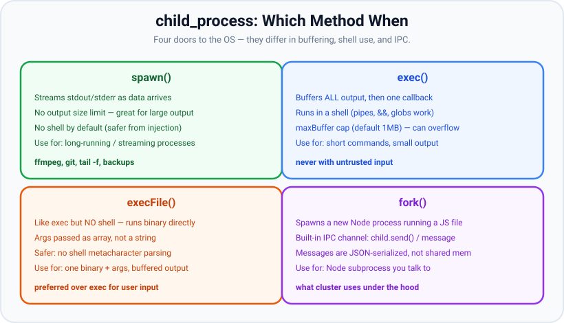

# Child processes

*10 min read · Updated 24 Jul 2026 Topic 63 of 70 Bookmark Mark done Why it matters Not everything your service needs to do is JavaScript · Topic 63 of 70*

**Source:** [https://www.geekyfrontend.in/learn/nodejs-backend-kit/child-processes](https://www.geekyfrontend.in/learn/nodejs-backend-kit/child-processes)

---

## Why it matters

Not everything your service needs to do is JavaScript. You want to transcode a video with `ffmpeg`, run a Git command, shell out to a Python script, invoke ImageMagick, run a database backup, or call any of the thousands of mature command-line tools that already solve a problem better than you could re-implement it. The **child\_process** module is Node's bridge to the operating system: it lets your app **launch and control external programs**, stream their output, feed them input, and get their exit status.

It is also how Node scales itself — `cluster` is built on `child_process.fork()` — and it is where one of the most dangerous security bugs in the ecosystem lives: **command injection**. Choosing `exec` vs `spawn` vs `execFile`, and whether a shell is involved, is not a stylistic preference; it decides whether an attacker who controls a filename can run arbitrary commands on your server. In interviews, being able to say *which* of the four methods to use and *why* — especially the shell/injection distinction — signals real production experience.

## The concept, simply

child\_process gives you four ways to start another program, and they differ along three axes: **does a shell get involved**, **is the output streamed or buffered**, and **is there a built-in messaging channel**.



spawn streams output with no shell; exec buffers all output through a shell; execFile runs a binary directly without a shell; fork starts a Node child with a built-in IPC channel.

- **spawn(cmd, args)** — launches a program and gives you its `stdout`/`stderr` as *streams*. Output arrives incrementally, so there's no size limit. No shell by default. Best for long-running or high-output processes (ffmpeg, `tail -f`, backups).
- **exec(cmdString)** — runs a command *through a shell* and *buffers* all output, handing it to a callback at the end. Convenient (pipes, `&&`, globs work), but capped by `maxBuffer` (1 MB default) and shell-based → injection risk. Best for short commands with small output.
- **execFile(file, args)** — like exec but *no shell*: it runs a binary directly with an args array. Safer against injection because shell metacharacters aren't interpreted. Buffered output like exec.
- **fork(modulePath)** — a specialization of spawn for running *another Node.js script*, with an automatic **IPC channel** so parent and child exchange messages via `child.send()` / `process.on('message')`. This is what cluster uses.

The mental shortcut: **spawn/execFile take an args array and skip the shell (safe); exec takes one command string and uses a shell (convenient but risky); fork is for Node-to-Node with messaging.** All of them create a genuine separate OS process with its own memory — so this is another way (besides cluster and worker\_threads) to move heavy or blocking work off your event loop.

## How it works

Every child process exposes three standard streams — `stdin`, `stdout`, `stderr` — plus lifecycle events: `'spawn'` (started), `'exit'` (process ended, with code/signal), `'error'` (failed to start, e.g. binary not found), and `'close'` (streams flushed). With `spawn` you subscribe to `child.stdout.on('data', ...)` to consume output as it flows; with `exec`/`execFile` Node accumulates it for you and calls back with `(err, stdout, stderr)`.

**The shell distinction is the crux.** `exec` effectively runs `/bin/sh -c "your string"`. The shell parses that string, so metacharacters like `;`, `|`, `&&`, `$()`, and backticks are *interpreted*. If any part of that string comes from user input, an attacker can inject commands: a "filename" of `a.txt; rm -rf /` becomes two commands. `spawn`/`execFile` with an args array pass arguments *directly* to the program via the OS, with no shell parsing, so a malicious "filename" is just a (harmless) literal argument. This is why the rule is: **never build a shell command string from untrusted input; use spawn/execFile with an args array.** (If you truly need shell features, `spawn(cmd, args, { shell: true })` exists — but then you own the injection risk again.)

**maxBuffer** is the other classic footgun. Because `exec`/`execFile` buffer all output in memory, they cap it (default 1 MB). A command that prints more than that is killed with an `ERR_CHILD_PROCESS_STDOUT_MAXBUFFER_EXCEEDED` error and truncated output — a silent, confusing failure in production. For anything that can produce large output, use `spawn` and stream.

**IPC via fork.** When you `fork` a Node module, Node opens an extra pipe as a message channel. `child.send(obj)` serializes `obj` (JSON/structured-clone) and delivers it to the child's `process.on('message')`, and vice versa. Like cluster, this is copy-based messaging, not shared memory. You can also pass a server handle or socket over this channel, which is precisely how cluster shares its listening socket with workers.

All variants also have **synchronous siblings** — `spawnSync`, `execSync`, `execFileSync`. These *block the event loop* until the child exits, so they're fine in build scripts and CLIs but should essentially never appear in a request handler.

## Code examples

Stream a long-running external tool with `spawn` — output arrives incrementally, no buffer cap, no shell.

javascript

```
import { spawn } from 'node:child_process';

// Note: command and args are SEPARATE — no shell parses this string.
const ffmpeg = spawn('ffmpeg', ['-i', 'input.mov', '-vcodec', 'h264', 'out.mp4']);

ffmpeg.stdout.on('data', (chunk) => process.stdout.write(chunk));
ffmpeg.stderr.on('data', (chunk) => process.stderr.write(chunk));   // ffmpeg logs here

ffmpeg.on('error', (err) => console.error('failed to start:', err.message));
ffmpeg.on('close', (code) => {
  console.log(code === 0 ? 'transcode done' : `ffmpeg exited ${code}`);
});
```

The safe way to pass user input: `execFile` (or spawn) with an args array — shell metacharacters can't break out.

javascript

```
import { execFile } from 'node:child_process';
import { promisify } from 'node:util';
const run = promisify(execFile);

async function countLines(userPath) {
  // Even if userPath is "a.txt; rm -rf /", it's passed as ONE literal arg.
  const { stdout } = await run('wc', ['-l', userPath], { timeout: 5000 });
  return Number(stdout.trim().split(/\s+/)[0]);
}

// DANGER — never do this with untrusted input:
//   exec(`wc -l ${userPath}`)   // shell parses ';' → command injection
```

Two-way messaging with `fork` — offload a job to a Node child and get the result over IPC.

javascript

```
// parent.js
import { fork } from 'node:child_process';

const child = fork('./report-worker.js');
child.send({ type: 'build-report', month: '2026-07' });
child.on('message', (msg) => {
  if (msg.type === 'done') { console.log('report ready:', msg.path); child.disconnect(); }
});

// report-worker.js
process.on('message', async (msg) => {
  if (msg.type === 'build-report') {
    const path = await buildHeavyReport(msg.month);   // CPU/IO heavy, off parent's loop
    process.send({ type: 'done', path });
  }
});
```

## Common mistakes & gotchas

- **Command injection via exec + user input.** The single most dangerous mistake. Interpolating untrusted data into an `exec` string lets attackers run arbitrary shell commands. Use `execFile`/`spawn` with an args array.
- **maxBuffer overflow with exec.** Output over 1 MB kills the child and truncates results. For large/streaming output use `spawn`.
- **Ignoring `stderr` and exit codes.** Many tools (ffmpeg, git) write progress/errors to stderr and signal failure via a non-zero exit code, not by throwing. Check `code` on `'exit'`/`'close'` and read stderr.
- **Confusing `'error'` with a non-zero exit.** `'error'` fires when the process couldn't *start* (binary missing, permission denied). A process that starts and then fails emits `'exit'` with a non-zero code — not `'error'`.
- **Using the `*Sync` variants in a server.** `execSync`/`spawnSync` block the entire event loop until the child finishes — fine in CLIs, catastrophic in request handlers.
- **Zombie/orphan processes.** If your Node process dies without cleaning up, long-running children can be orphaned. Track children and kill them on shutdown; consider `detached`/process groups deliberately.
- **Assuming fork shares memory.** fork's IPC copies messages; it is not shared memory. Large data over `send()` is serialized every time.
- **No timeout.** An external tool that hangs will hang your request forever. Always pass a `timeout` (and handle the kill).

## Best practices

- **Default to `spawn`/`execFile` with an args array.** Only use a shell (`exec` or `shell: true`) when you truly need shell features *and* the whole command is trusted/static.
- **Never interpolate untrusted input into a command string.** Validate/allowlist arguments; pass them as array elements, not concatenated text.
- **Stream large output with spawn** instead of buffering with exec; set `maxBuffer` deliberately if you must buffer.
- **Always set a `timeout`** and handle the resulting kill signal; check exit codes and stderr for failure.
- **Track and clean up children** on `SIGTERM`/shutdown so you don't leak processes.
- **Prefer a native/library solution when one exists** — shelling out adds a process, a dependency on an installed binary, and an attack surface. Use child\_process when a mature external tool genuinely beats reimplementing.
- **Use `fork` only for Node-to-Node** with messaging; for arbitrary binaries use spawn/execFile.

## ⭐ Interview lens

> **Q: spawn vs exec — what's the difference and when do you pick each?**  
> A: `spawn` streams output (no size limit) and by default doesn't use a shell — best for long-running or high-output processes. `exec` runs through a shell and buffers all output into a callback (capped by `maxBuffer`, 1 MB) — convenient for short commands but risky with user input. Rule: spawn for streaming/large output, exec only for small trusted commands.

> **Q: How do you prevent command injection when shelling out?**  
> A: Don't build a shell command string from user input. Use `execFile` or `spawn` with the command and an *args array*, so no shell interprets metacharacters — a malicious "filename" like `a; rm -rf /` is passed as a single literal argument. Avoid `exec` and `shell: true` with untrusted data. (This is the trap they're fishing for.)

> **Q: What does fork give you that spawn doesn't?**  
> A: fork is spawn specialized for launching another Node.js module, and it automatically sets up an IPC channel so parent and child exchange messages via `send()`/`'message'`. It's what cluster uses to fork and coordinate workers. spawn can run any binary but has no built-in messaging.

> **Q: You run `exec('git log')` on a huge repo and it fails. Why?**  
> A: `exec` buffers all stdout in memory with a default `maxBuffer` of 1 MB. Large output exceeds it, so the child is killed and output truncated with a maxBuffer error. Fix: use `spawn` and stream stdout, or raise `maxBuffer` intentionally.

> **Q: Difference between the `'error'` event and a non-zero exit code?**  
> A: `'error'` means the process failed to *start* (binary not found, no permission). A non-zero `exit`/`close` code means it started but the program itself failed. You must handle both — many candidates only check one.

> **Q: child\_process vs worker\_threads for offloading work?**  
> A: child\_process spawns a whole separate OS process (heavier, full isolation, good for running external programs or separate Node scripts). worker\_threads runs threads inside the current process (lighter, can share memory via SharedArrayBuffer, best for CPU-bound JavaScript). For invoking ffmpeg/git → child\_process; for a heavy JS calculation → worker\_threads.

## Cheat-card

- **spawn** = stream output, no shell, no size cap → long-running / large output.
- **exec** = shell + buffered output (`maxBuffer` 1 MB) → short, *trusted* commands only.
- **execFile** = like exec but no shell, args array → safe way to buffer.
- **fork** = spawn a Node module + auto IPC (`send`/`message`) → what cluster uses.
- **Injection rule:** untrusted input → spawn/execFile with an **args array**, never an exec string.
- Events: `error` = failed to start; non-zero `exit` = ran but failed. Handle both + read stderr.
- Always set a **timeout**; kill children on shutdown; avoid `*Sync` in servers.
- **Cancel:** `{ signal, killSignal }` on `spawn`/`exec`/`execFile`/`fork` (since v15.4–v15.6); abort → `AbortError` (`ABORT_ERR`, reason in `err.cause`), exit code `null` + signal. Default `SIGTERM` can be ignored → escalate to `SIGKILL`.
- **`stdio`:** `'pipe'` (default), `'inherit'`, `'ignore'` (`/dev/null`), `'overlapped'` (= `'pipe'` off Windows), `'ipc'` (max one), a Stream with an fd, an integer fd, `null` (default); index 3+ = extra fds, read via `child.stdio[3]`.

---

## Learn More

- [Node.js Child Process (spawn / exec / execFile / fork) nodejs.org](https://nodejs.org/api/child_process.html)
- [Node.js Cluster module (built on child_process.fork) nodejs.org](https://nodejs.org/api/cluster.html)
- [All you need to know about "child_process" in Node.js Software Developer Diaries](https://www.youtube.com/watch?v=C1v4MXGhpcM)

---

## Additional topics

*Added 12 Oct 2026 · examples verified on Node v24.19.0 on Linux x64 (Ubuntu 26.04, `/bin/sh` is dash); no npm packages*

### Cancelling a child with an `AbortSignal`

A child process keeps running until it exits or something kills it. If the request that started it is cancelled, times out or the server is shutting down, the parent needs a way to stop the child that fits the rest of its cancellation code. All four async functions accept a `signal` option: `exec` (added in v15.4.0), `execFile` (v15.4.0 / v14.17.0), `spawn` (v15.5.0 / v14.17.0) and `fork` (v15.6.0 / v14.17.0). When the signal aborts, Node kills the child with `killSignal`; `spawn` and `fork` honour `killSignal` for aborts since v15.11.0 / v14.18.0. The default `killSignal` is `'SIGTERM'`. The general `AbortController` pattern, and why core APIs report `AbortError` rather than `TimeoutError`, is covered in [AbortController and AbortSignal](73-abortcontroller-and-abortsignal.md).

How it works:

1. You pass `{ signal }` (and optionally `killSignal`) in the options.
2. When the signal aborts, Node calls `child.kill(killSignal)`.
3. For `spawn` and `fork`, the `ChildProcess` emits `'error'` with an `AbortError`: `name` `'AbortError'`, `code` `'ABORT_ERR'`, message `The operation was aborted`, and `err.cause` set to `signal.reason`. For `exec` and `execFile`, the callback receives that error.
4. Then `'exit'` and `'close'` fire with `code` `null` and the signal name, as for any killed child. `child.killed` is `true`, which only means the signal was delivered.
5. If the signal is already aborted when you call `spawn`, the child is started and killed straight away; you still get `'error'` and `'close'`.

**Example — abort each of the four, the error shape, and `killSignal: 'SIGKILL'`.**

javascript

```
// abort.mjs: cancel spawn / exec / execFile / fork with an AbortSignal and inspect what you get.
import { spawn, exec, execFile, fork } from 'node:child_process';
// Not events.once(child, 'close'): once() rejects when 'error' fires first, and abort emits 'error'.
const ended = (child, ev) => new Promise((r) => child.once(ev, (...a) => r(a)));

const sleeper = ['-e', 'setTimeout(() => {}, 10_000)'];   // a child that would run for 10 s

// spawn (and fork): the ChildProcess emits 'error' with an AbortError, then 'exit'/'close'.
{
  const ac = new AbortController();
  const child = spawn(process.execPath, sleeper, { signal: ac.signal });
  child.on('error', (err) => console.log('spawn error:', err.name, err.code, '|', err.message));
  setTimeout(() => ac.abort(), 100);
  const [code, sig] = await ended(child, 'close');
  console.log('spawn close: code', code, 'signal', sig, '| child.killed', child.killed);
}

// exec / execFile: the callback gets the AbortError.
for (const [name, run] of [
  ['exec', (o, cb) => exec(`"${process.execPath}" -e "setTimeout(() => {}, 10000)"`, o, cb)],
  ['execFile', (o, cb) => execFile(process.execPath, sleeper, o, cb)],
]) {
  const ac = new AbortController();
  const err = await new Promise((resolve) => {
    run({ signal: ac.signal }, (e) => resolve(e));
    setTimeout(() => ac.abort(), 100);
  });
  console.log(`${name} callback err:`, err.name, err.code, '| keys:', Object.keys(err).join(','));
}

// fork with an abort *reason* and killSignal: 'SIGKILL'.
{
  const child = fork(new URL('./sleeper.mjs', import.meta.url), {
    signal: AbortSignal.timeout(100),          // aborts itself after 100 ms
    killSignal: 'SIGKILL',
  });
  child.on('error', (err) => console.log('fork error:', err.name, err.code, '| cause:', err.cause?.name));
  const [code, sig] = await ended(child, 'exit');
  console.log('fork exit: code', code, 'signal', sig);
}

// Already-aborted signal: the child is started and killed straight away.
{
  const child = spawn(process.execPath, sleeper, { signal: AbortSignal.abort() });
  child.on('error', (err) => console.log('pre-aborted spawn error:', err.code));
  const [code, sig] = await ended(child, 'close');
  console.log('pre-aborted close: code', code, 'signal', sig);
}
```

javascript

```
// sleeper.mjs: a fork child that ignores SIGTERM, so only SIGKILL stops it.
process.on('SIGTERM', () => console.log('child: ignoring SIGTERM'));
setTimeout(() => {}, 10_000);
```

```
$ node abort.mjs
spawn error: AbortError ABORT_ERR | The operation was aborted
spawn close: code null signal SIGTERM | child.killed true
exec callback err: AbortError ABORT_ERR | keys: code,name,cmd
execFile callback err: AbortError ABORT_ERR | keys: code,name,cmd
fork error: AbortError ABORT_ERR | cause: TimeoutError
fork exit: code null signal SIGKILL
pre-aborted spawn error: ABORT_ERR
pre-aborted close: code null signal SIGTERM
```

Real output (Node v24.19.0). Note what the `exec`/`execFile` error does **not** have: no `killed`, `signal` or numeric `code` fields, unlike the error you get from a `timeout` kill. The `fork` child ignores `SIGTERM`, but `killSignal: 'SIGKILL'` stopped it anyway, so its `'child: ignoring SIGTERM'` line never printed.

### The `stdio` option: every value

`stdio` decides what each of the child's file descriptors is connected to. Without it, Node creates three pipes and exposes their parent ends as `child.stdin`, `child.stdout` and `child.stderr`. The option is either a shorthand string (`'pipe'`, `'overlapped'`, `'ignore'`, `'inherit'`) or an array in which index *n* configures the child's fd *n*. Indexes 0, 1 and 2 are stdin, stdout and stderr; any further index creates an extra fd. The v24 docs list these values for each array slot:

| Value | What the child's fd is connected to | Parent side |
|---|---|---|
| `'pipe'` | a pipe to the parent | `child.stdio[n]` (also `child.stdin`/`stdout`/`stderr` for 0–2) |
| `'overlapped'` | same as `'pipe'`, with `FILE_FLAG_OVERLAPPED` set on the handle (added in v15.6.0 / v14.18.0) | as `'pipe'` |
| `'ipc'` | an IPC channel (at most one per child) | `child.send()`, `'message'` |
| `'ignore'` | `/dev/null` | `null` |
| `'inherit'` | the parent's own stdin/stdout/stderr (for fd 3 and up it means `'ignore'`) | `null` |
| a Stream object | a duplicate of the stream's underlying fd (tty, file, socket or pipe) | `null` |
| a positive integer | a duplicate of that fd, open in the parent | `null` |
| `null` / `undefined` | default: a pipe for 0–2, `'ignore'` for 3 and up | as above |

How it works:

1. Node builds one entry per index and hands the list to libuv, which sets up the child's fds before the program starts.
2. For `'pipe'` and `'overlapped'`, Node (through libuv) creates the channel and keeps the parent's end as a stream (a `net.Socket`, as item 1 below prints). The docs note these are not real Unix pipes, so the child cannot open them through `/dev/fd/2` or `/dev/stdout`.
3. For a Stream or an integer, the parent's fd is duplicated into the child at that index. The parent gets no stream for it; the bytes go straight to the file, socket or terminal.
4. `'ipc'` adds a channel that only `process.send()` should use. If the child is Node, `process.send()`, `process.disconnect()` and the `'message'` event exist in it. `fork()` sets this up for you.
5. `'overlapped'` changes nothing on Linux and macOS: the docs say it is "exactly the same as `'pipe'` on non-Windows systems". Its purpose is overlapped (asynchronous) I/O on Windows handles.

> ⚠️ Unverified: the Windows behaviour of `'overlapped'` (the `FILE_FLAG_OVERLAPPED` handle flag and overlapped I/O in the child). There is no Windows machine here; on Linux it was run and behaved exactly like `'pipe'` (item 4 below), which is what the docs say.

**Example — one child per `stdio` value, including an extra fd 3.**

javascript

```
// stdio.mjs: every stdio value, one child each. The children are `node -e` one-liners.
import { spawn } from 'node:child_process';
import fs from 'node:fs';
import { once } from 'node:events';

const node = (code, stdio) => spawn(process.execPath, ['-e', code], { stdio });
const done = (child) => new Promise((r) => child.on('close', (code) => r(code)));
const SAY = 'console.log("out from child"); console.error("err from child")';

// 1. 'pipe' (the default): the parent gets readable streams for the child's stdout/stderr.
{
  const c = node(SAY, 'pipe');
  let out = ''; c.stdout.on('data', (d) => (out += d)); c.stderr.on('data', (d) => (out += d));
  await done(c);
  console.log("1 'pipe'      captured:", JSON.stringify(out), '| stdin is', c.stdin.constructor.name);
}
// 2. 'inherit': the child writes straight to the parent's own stdout/stderr; nothing to read.
{
  const c = node(SAY, 'inherit');
  await done(c);
  console.log("2 'inherit'   c.stdout:", c.stdout, '(the two lines above came from the child)');
}
// 3. 'ignore': fds 0-2 are opened on /dev/null.
{
  const c = node(SAY, 'ignore');
  console.log("3 'ignore'    c.stdout:", c.stdout, '| exit code', await done(c));
}
// 4. 'overlapped': on Linux/macOS exactly the same as 'pipe' (the flag only matters on Windows).
{
  const c = node(SAY, 'overlapped');
  let out = ''; c.stdout.on('data', (d) => (out += d));
  await done(c);
  console.log("4 'overlapped' captured stdout:", JSON.stringify(out));
}
// 5. 'ipc': a message channel on one fd. A Node child gets process.send().
{
  const c = spawn(process.execPath,
    ['-e', 'process.on("message", (m) => { process.send({ echo: m, connected: process.connected }); process.disconnect(); })'],
    { stdio: ['pipe', 'pipe', 'pipe', 'ipc'] });
  c.send({ hello: 'child' });
  const [msg] = await once(c, 'message');
  await done(c);
  console.log("5 'ipc'       reply:", JSON.stringify(msg));
}
// 6. A Stream object with a real fd: a file write stream, used once it has emitted 'open'.
{
  const file = fs.createWriteStream('child-out.log');
  await once(file, 'open');
  const c = node(SAY, ['ignore', file, 'pipe']);
  let err = ''; c.stderr.on('data', (d) => (err += d));
  await done(c); file.end(); await once(file, 'close');
  console.log('6 Stream      file has:', JSON.stringify(fs.readFileSync('child-out.log', 'utf8')),
    '| stderr piped:', JSON.stringify(err));
}
// 7. A positive integer: an fd that is open in the parent, here a file opened with openSync.
{
  const fd = fs.openSync('child-fd.log', 'w');
  const c = node(SAY, ['ignore', fd, fd]);      // stdout AND stderr both go to the same file
  await done(c); fs.closeSync(fd);
  console.log('7 integer fd  file has:', JSON.stringify(fs.readFileSync('child-fd.log', 'utf8')));
}
// 8. An array mixing values: stdin ignored, stdout piped, stderr shared with the parent's stderr.
{
  const c = node(SAY, ['ignore', 'pipe', process.stderr]);
  let out = ''; c.stdout.on('data', (d) => (out += d));
  await done(c);
  console.log('8 mixed       stdout captured:', JSON.stringify(out), '(stderr line printed above)');
}
// 9. Extra fds: index 3 is a fourth pipe. The child writes to fd 3; the parent reads c.stdio[3].
{
  const c = node('require("fs").writeSync(3, "side channel on fd 3\\n"); console.log("normal stdout")',
    ['pipe', 'pipe', 'pipe', 'pipe']);
  let out = '', fd3 = '';
  c.stdout.on('data', (d) => (out += d)); c.stdio[3].on('data', (d) => (fd3 += d));
  await done(c);
  console.log('9 extra fd 3  stdout:', JSON.stringify(out), '| fd 3:', JSON.stringify(fd3));
}
// 10. Extra fd left at the default (null): fd 3 and up default to 'ignore', so the child has no fd 3.
{
  const c = spawn('sh', ['-c', 'echo x >&3'], { stdio: ['pipe', 'pipe', 'pipe', null] });
  let err = ''; c.stderr.on('data', (d) => (err += d));
  const code = await done(c);
  console.log('10 null fd 3  sh stderr:', JSON.stringify(err), '| exit', code, '| c.stdio[3]:', c.stdio[3]);
}
```

```
$ node stdio.mjs
1 'pipe'      captured: "out from child\nerr from child\n" | stdin is Socket
out from child
err from child
2 'inherit'   c.stdout: null (the two lines above came from the child)
3 'ignore'    c.stdout: null | exit code 0
4 'overlapped' captured stdout: "out from child\n"
5 'ipc'       reply: {"echo":{"hello":"child"},"connected":true}
6 Stream      file has: "out from child\n" | stderr piped: "err from child\n"
7 integer fd  file has: "out from child\nerr from child\n"
err from child
8 mixed       stdout captured: "out from child\n" (stderr line printed above)
9 extra fd 3  stdout: "normal stdout\n" | fd 3: "side channel on fd 3\n"
10 null fd 3  sh stderr: "sh: 1: 3: Bad file descriptor\n" | exit 2 | c.stdio[3]: null
```

Real output (Node v24.19.0, Linux). Item 9 is how tools hand a side channel to a child (progress, a status protocol, a second data stream) without mixing it into stdout. Item 10 shows that an extra index left `null` gives the child no fd 3 at all; the error text is dash's.

### Common mistakes & gotchas (additional topics)

- **`await once(child, 'close')` after an abort.** `events.once()` rejects as soon as the emitter emits `'error'`, and an abort always emits `'error'` on a `spawn`/`fork` child. Listen for `'error'` and `'close'` yourself, or catch the rejection.
- **Reading `child.killed` as "the child is dead".** It only says the signal was sent. A child that handles `SIGTERM` is still running (see the edge case below).
- **Passing a stream that has no fd.** A `PassThrough`, or a file stream that has not yet emitted `'open'`, is rejected synchronously with `ERR_INVALID_ARG_VALUE` (example below). To feed a child from an in-memory stream, use `'pipe'` and `pipeline(source, child.stdin)`.
- **Expecting output from `'inherit'` or `'ignore'`.** `child.stdout` is `null` for both; calling `.on('data')` on it throws a `TypeError`.
- **More than one `'ipc'` entry.** The docs allow at most one IPC fd per child.
- **Leaving a `'pipe'` unread.** The parent stops pulling data from the pipe once its stream buffer is full, and the child cannot finish writing, so it never exits (example below). Read it, or use `'ignore'`, `'inherit'` or a file fd.

**Example — streams without an fd are rejected.**

javascript

```
// nofd.mjs: a Stream without an underlying fd (PassThrough) or a file stream before 'open'.
import { spawn } from 'node:child_process';
import { PassThrough } from 'node:stream';
import fs from 'node:fs';

for (const [label, stream] of [['PassThrough', new PassThrough()], ['WriteStream before open', fs.createWriteStream('early.log')]]) {
  try {
    spawn(process.execPath, ['-e', 'console.log(1)'], { stdio: ['ignore', stream, 'inherit'] });
    console.log(label, '-> spawned');
  } catch (e) {
    console.log(label, '->', e.code, '|', e.message.split('\n')[0]);
  }
}
```

```
$ node nofd.mjs
PassThrough -> ERR_INVALID_ARG_VALUE | The argument 'stdio' is invalid. Received PassThrough {
WriteStream before open -> ERR_INVALID_ARG_VALUE | The argument 'stdio' is invalid. Received WriteStream {
```

**Example — an unread `'pipe'` keeps the child alive.**

javascript

```
// unread.mjs: the child writes 10 MB to a 'pipe' stdout that the parent never reads.
import { spawn } from 'node:child_process';
const c = spawn(process.execPath, ['-e', 'process.stdout.write(Buffer.alloc(10 * 1024 * 1024, 97)); console.error("child: write returned")'],
  { stdio: ['ignore', 'pipe', 'inherit'] });
c.on('exit', (code) => console.log('child exited', code));
setTimeout(() => {
  console.log('after 2 s: exitCode', c.exitCode, '| readableLength', c.stdout.readableLength);
  c.stdout.resume();                       // start reading: the child can finish
}, 2000);
```

```
$ node unread.mjs
child: write returned
after 2 s: exitCode null | readableLength 65536
child exited 0
```

Real output (Node v24.19.0). The child's `write()` call returned (Node writes to pipes asynchronously), but the child could not exit with 10 MB still unwritten. The parent held 64 KiB in its stream buffer and stopped reading. The child exited as soon as `resume()` drained the pipe.

### Edge case worked through: aborting a child that ignores `SIGTERM`

`abort()` only sends `killSignal`. With the default `SIGTERM`, a child that installs a `SIGTERM` handler (many servers do, for graceful shutdown) keeps running, and the parent still sees the `AbortError`.

javascript

```
// ignore-term.mjs: abort() sends killSignal (default SIGTERM). A child that handles SIGTERM keeps running.
import { fork } from 'node:child_process';

const ac = new AbortController();
const child = fork(new URL('./sleeper.mjs', import.meta.url), { signal: ac.signal });
child.on('error', (err) => console.log('parent: error event', err.code));
child.on('exit', (code, sig) => console.log('parent: exit', code, sig));

child.on('spawn', () => setTimeout(() => ac.abort(), 200));   // give it time to install its handler
setTimeout(() => {
  console.log('parent: 500 ms after abort, exitCode', child.exitCode, 'signalCode', child.signalCode,
    '| killed', child.killed);
  child.kill('SIGKILL');                                    // the escalation you must add yourself
}, 700);
```

```
$ node ignore-term.mjs
child: ignoring SIGTERM
parent: error event ABORT_ERR
parent: 500 ms after abort, exitCode null signalCode null | killed true
parent: exit null SIGKILL
```

Real output (Node v24.19.0; `sleeper.mjs` is the file shown above). After the abort, the parent had already reported a cancelled operation, yet the child was alive 500 ms later with `killed` `true`. Either pass `killSignal: 'SIGKILL'` (no cleanup in the child), or keep `SIGTERM` and add your own timer that escalates to `SIGKILL` if `'exit'` has not fired, the same pattern as the forced-exit timer in [Graceful shutdown & monitoring](66-graceful-shutdown-monitoring.md).

### ⭐ Interview lens (additional topics)

> **Q: “How do you cancel a running child process, and what does the caller see?”**  
> A: Pass `signal` from an `AbortController` (or `AbortSignal.timeout(ms)`) to `spawn`, `exec`, `execFile` or `fork`. On abort Node sends `killSignal` (default `SIGTERM`). `spawn`/`fork` emit `'error'` with an `AbortError` (`code: 'ABORT_ERR'`, the reason in `err.cause`), then `'exit'`/`'close'` with code `null` and the signal; `exec`/`execFile` pass the `AbortError` to the callback. *Trap:* a child that handles `SIGTERM` survives the abort, so escalate to `SIGKILL` on a timer.

> **Q: “How would you give a child process a second output channel besides stdout?”**  
> A: Add an extra entry to `stdio`, for example `stdio: ['pipe', 'pipe', 'pipe', 'pipe']`. The child writes to fd 3 and the parent reads `child.stdio[3]`. For a Node child that needs structured messages, use `'ipc'` (or `fork`) instead.
