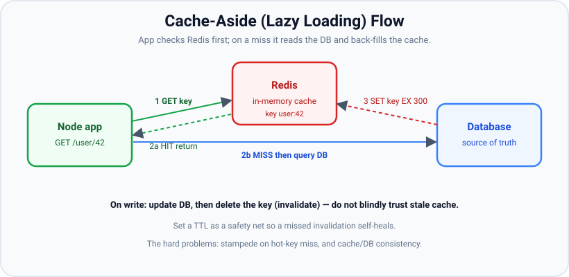
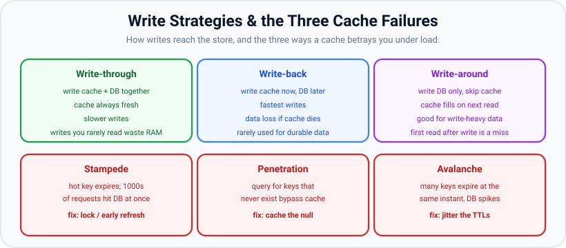

# Caching with Redis

*11 min read · Updated 24 Jul 2026 Topic 64 of 70 Bookmark Mark done Why it matters The fastest query is the one you never run · Topic 64 of 70*

**Source:** [https://www.geekyfrontend.in/learn/nodejs-backend-kit/caching-redis](https://www.geekyfrontend.in/learn/nodejs-backend-kit/caching-redis)

---

## Why it matters

The fastest query is the one you never run. Every time your API can answer from a fast in-memory store instead of hitting the primary database, you save tens of milliseconds, cut database load, and buy headroom to serve more traffic on the same hardware. Under real load, **caching is frequently the single highest-leverage performance change you can make** — a well-placed cache in front of a hot, read-heavy endpoint can turn a p99 of 400 ms into 5 ms and drop database CPU by half.

**Redis** is the default tool for this in the Node world. It's an in-memory data store that reads and writes in microseconds, speaks a simple protocol, and offers exactly the primitives caching needs: key/value with per-key expiry (TTL), atomic counters, pub/sub, and data structures (hashes, sorted sets, lists). It's also the standard place to keep the *shared* state that cluster workers and multiple containers can't hold in local memory — sessions, rate-limit counters, distributed locks. In interviews, caching is where the questions get sharp: anyone can call "cache it," but the real signal is understanding **invalidation** — famously "one of the two hard things in computer science" — and the failure modes (stampede, penetration, avalanche) that separate a cache that helps from one that takes down your database at 3 a.m.

## The concept, simply

A cache is a small, fast store that holds copies of data that's expensive to compute or fetch, keyed so you can look it up quickly. The core question is always **where does the data live and how does it stay correct**. The dominant read pattern is **cache-aside** (a.k.a. lazy loading): your app checks the cache first; on a *hit* it returns immediately; on a *miss* it reads the database, stores the result in the cache (with a TTL), and returns it. The cache fills itself on demand — only data that's actually requested gets cached.



Cache-aside: check Redis, return on hit; on a miss read the DB, write the value back with a TTL, and return it. On writes, update the DB then invalidate the key.

The other half is **writes and invalidation** — keeping the cache from serving stale data after the underlying record changes. The common strategies:

- **Write-through:** write to cache and DB together on every write. Cache is always fresh, but writes are slower and you cache data nobody may read.
- **Write-around:** write only to the DB; let the cache fill on the next read. Good for write-heavy data, but the first read after a write is a miss.
- **Write-back:** write to cache now, flush to DB later. Fastest writes, but you can lose data if the cache dies before flushing — rarely used for durable data.

Most APIs use **cache-aside for reads + explicit invalidation on writes**: after you update the database, you *delete* the cache key (rather than trying to update it), so the next read repopulates fresh. Layered on top, a **TTL** on every key acts as a safety net — even if an invalidation is missed, the stale entry self-heals when it expires.



Write strategies (top) and the three cache failure modes under load (bottom): stampede on a hot-key miss, penetration by keys that never exist, and avalanche when many keys expire together.

## How it works

In Node you talk to Redis through a client — **`ioredis`** (feature-rich, cluster-aware) or the official **`redis`** (node-redis v4+) package. Both are promise-based and maintain a persistent TCP connection (you create the client once at startup and reuse it — never per request). You mostly use a handful of commands: `GET`/`SET`, `SET key val EX seconds` (set with expiry), `DEL` (invalidate), `INCR` (atomic counter for rate limiting), `EXPIRE`, and for grouped data `HSET`/`HGETALL`. Values are strings/bytes, so objects are stored as `JSON.stringify` and parsed on read.

**TTL and eviction.** Every cache key should expire. TTL bounds staleness and stops the cache growing without limit. Redis also enforces a memory cap via `maxmemory` + an eviction policy — for a pure cache you typically set `allkeys-lru` (evict least-recently-used keys when full), so Redis behaves like a proper bounded cache rather than filling up and rejecting writes.

Now the three failure modes the diagram names — this is the depth interviewers probe:

- **Cache stampede (thundering herd):** a very popular key expires, and in the microsecond it's gone, thousands of concurrent requests all miss simultaneously and hit the database at once — potentially overwhelming it. Fixes: a short *lock* so only one request recomputes while others wait or serve stale; *early/probabilistic refresh* (recompute just before expiry); or serve-stale-while-revalidate.
- **Cache penetration:** requests for keys that *don't exist* (e.g. random product IDs from a scraper) always miss the cache and always hit the DB, because there's nothing to cache. Fix: cache the negative result (store a short-TTL "null" marker), and/or use a Bloom filter to reject unknown keys.
- **Cache avalanche:** many keys are given the *same* TTL (e.g. warmed at boot with 1-hour expiry) and all expire at the same instant, causing a coordinated flood of misses. Fix: add *jitter* — randomize each TTL by, say, ±10% so expirations spread out.

**Sessions and shared state.** Beyond caching query results, Redis is the standard session store. In a clustered or multi-container deployment, workers don't share memory, so an in-process session map breaks the moment a user's next request lands on a different worker (see the cluster topic). Storing sessions in Redis — via `connect-redis` for `express-session`, keyed by session ID with a TTL — makes any worker able to serve any user. The same logic makes Redis the home for rate-limit counters (`INCR` + `EXPIRE`) and distributed locks.

## Code examples

Cache-aside read with a TTL, using ioredis — the everyday pattern.

javascript

```
import Redis from 'ioredis';
const redis = new Redis(process.env.REDIS_URL);   // one client, reused

async function getUser(id) {
  const key = `user:${id}`;

  const cached = await redis.get(key);
  if (cached) return JSON.parse(cached);          // HIT

  const user = await db.users.findById(id);       // MISS → source of truth
  if (user) {
    // EX = expire seconds; add jitter to avoid avalanche
    const ttl = 300 + Math.floor(Math.random() * 60);
    await redis.set(key, JSON.stringify(user), 'EX', ttl);
  }
  return user;
}
```

Write path: update the database, then *invalidate* (delete) the key so the next read repopulates fresh — don't leave stale data behind.

javascript

```
async function updateUser(id, patch) {
  const user = await db.users.update(id, patch);
  await redis.del(`user:${id}`);                  // invalidate; next GET refills
  return user;
}

// Cache penetration guard: cache the "not found" result briefly so
// repeated lookups of a non-existent id don't keep hammering the DB.
async function getUserSafe(id) {
  const key = `user:${id}`;
  const cached = await redis.get(key);
  if (cached === '__missing__') return null;
  if (cached) return JSON.parse(cached);

  const user = await db.users.findById(id);
  await redis.set(key, user ? JSON.stringify(user) : '__missing__', 'EX', user ? 300 : 30);
  return user;
}
```

Stampede protection with a lock — only one request recomputes a hot key; others briefly back off. (`SET NX` = set only if absent, atomic.)

javascript

```
import { randomUUID } from 'node:crypto';

// Delete the lock only if it still holds OUR token — atomically, inside Redis.
const RELEASE_LOCK = `
if redis.call('GET', KEYS[1]) == ARGV[1] then
  return redis.call('DEL', KEYS[1])
end
return 0`;

async function getWithLock(key, loader, ttl = 300, lockMs = 10_000) {
  const cached = await redis.get(key);
  if (cached) return JSON.parse(cached);

  // Try to acquire a short lock so only ONE caller rebuilds the value.
  // The value is a unique token, so we can later prove the lock is still ours.
  const lockKey = `lock:${key}`;
  const token = randomUUID();
  const gotLock = await redis.set(lockKey, token, 'PX', lockMs, 'NX');
  if (!gotLock) {
    await new Promise((r) => setTimeout(r, 50));   // let the winner fill it
    return getWithLock(key, loader, ttl, lockMs);  // retry the cache
  }
  try {
    const value = await loader();                  // the single DB hit
    await redis.set(key, JSON.stringify(value), 'EX', ttl);
    return value;
  } finally {
    // NOT `redis.del(lockKey)`: if our lock expired while loader() ran, another
    // caller may own it now, and a plain DEL would delete THEIR lock.
    await redis.eval(RELEASE_LOCK, 1, lockKey, token);
  }
}
```

Why the token matters — the timeline the test below reproduces:

1. Caller A sets `lock:hot` to its token with a 100 ms expiry and starts a 300 ms rebuild.
2. At 100 ms the lock expires while A is still working.
3. Caller B finds no lock, sets `lock:hot` to *its* token, and starts rebuilding.
4. At about 300 ms A finishes. The old code ran `DEL lock:hot`, deleting B's lock, so a third caller could start yet another rebuild. The new Lua script sees that the stored token is B's, not A's, and deletes nothing.
5. B finishes, and its script deletes its own lock.

A's lock (100 ms) expires while A is still loading (300 ms), and B takes the lock. Then A finishes and releases:

```
Real output (Redis 8.0.5, ioredis 6.0.0, Node v24.19.0):
OLD: SET lock 1 NX + DEL
  t=170ms lock:hot = 1 (B owns it)
  after A releases, lock:hot = null (B is still rebuilding)      <- A deleted B's lock
NEW: SET lock <token> NX PX + Lua compare-and-delete
  t=170ms lock:hot = 975f8ead-6faa-4166-b412-565a25e78e58 (B owns it)
  after A releases, lock:hot = 975f8ead-6faa-4166-b412-565a25e78e58 (B is still rebuilding)
```

> **Why this was wrong:** the earlier version stored `'1'` and released with an unconditional `DEL`. Any caller whose lock had already expired would delete whoever held the lock next, letting a third caller in and defeating the stampede protection.

**This is still not a full distributed-lock guarantee.** The token stops you deleting someone else's lock, but (1) the lock can still expire while its holder is working (a slow query, a GC pause), so two callers can briefly run at once; (2) on a single Redis primary with asynchronous replication, a failover can lose a lock that was just granted. For a cache rebuild that is fine — the worst case is one extra DB query. If correctness depends on mutual exclusion (payments, inventory), use the database's own guarantees (transactions, row locks, unique constraints) or fencing tokens checked by the resource you protect, rather than a Redis lock alone.

Sessions in Redis so any cluster worker / container can authenticate a user.

javascript

```
import session from 'express-session';
import { RedisStore } from 'connect-redis';
import Redis from 'ioredis';

const store = new RedisStore({ client: new Redis(process.env.REDIS_URL) });
app.use(session({
  store,                                   // sessions live in Redis, not process memory
  secret: process.env.SESSION_SECRET,
  resave: false,
  saveUninitialized: false,
  cookie: { httpOnly: true, secure: true, maxAge: 86_400_000 },
}));
```

## Common mistakes & gotchas

- **Caching without a TTL.** Keys live forever, memory fills, and any missed invalidation serves stale data indefinitely. Always set an expiry.
- **Updating the cache instead of invalidating it.** Trying to keep the cached copy in sync with every write is error-prone (concurrent writes, partial updates). The robust default is delete-on-write and let the next read refill.
- **Identical TTLs → avalanche.** Warming many keys with the same expiry makes them all die at once. Add jitter.
- **No stampede protection on hot keys.** A single expiring hot key can unleash a thundering herd on the DB. Use a lock, early refresh, or stale-while-revalidate.
- **Ignoring cache penetration.** Lookups for non-existent keys bypass the cache entirely. Cache negatives (short TTL) or filter with a Bloom filter.
- **Creating a Redis client per request.** Connection setup is expensive; create one client at startup and reuse it. Per-request clients exhaust connections.
- **Treating the cache as a system of record.** Redis (as a cache) can evict or be flushed; never store the only copy of durable data in it. The DB is the source of truth.
- **Not handling Redis being down.** If Redis is unreachable, your app should degrade to hitting the DB, not throw 500s. Wrap cache reads so a cache error falls through to the source.
- **Large `KEYS` scans in production.** `KEYS *` blocks Redis (single-threaded). Use `SCAN`, or better, structure keys so you can delete by known key, not by scanning.

## Best practices

- **Default to cache-aside + delete-on-write + TTL.** It's simple, robust, and covers most read-heavy APIs.
- **Always expire keys, and jitter TTLs** to prevent synchronized expiry.
- **Set `maxmemory` + `allkeys-lru`** so Redis behaves as a bounded cache and evicts cold data instead of failing writes.
- **Protect hot keys** with a rebuild lock or early refresh; cache negatives to stop penetration.
- **Use one shared client** (ioredis/node-redis) created at startup; enable reconnection and command timeouts.
- **Fail open.** On a cache error, fall back to the database so a Redis blip doesn't become an outage.
- **Namespace and version keys** (`user:v2:42`) so you can invalidate a whole shape by bumping the version.
- **Store shared state (sessions, rate limits, locks) in Redis** so it survives across cluster workers and containers.
- **Only cache what's hot and read-heavy.** Caching rarely-read data wastes memory; measure hit rate and evict cold entries.

## ⭐ Interview lens

> **Q: Explain the cache-aside pattern.**  
> A: The app checks the cache first. On a hit it returns the cached value; on a miss it reads the database, writes the result into the cache with a TTL, and returns it. Writes update the DB and then delete (invalidate) the key so the next read refills. The cache lazily fills with only the data actually requested.

> **Q: What's a cache stampede and how do you prevent it?**  
> A: A hot key expires and thousands of concurrent requests all miss at once, flooding the database. Prevent it with a short lock so only one request rebuilds the value while others wait or serve stale, with probabilistic early refresh before expiry, or with stale-while-revalidate. (Interviewers love this because "just cache it" candidates miss it.)

> **Q: On a write, do you update the cache or delete it? Why?**  
> A: Usually delete (invalidate). Updating the cached copy on every write is fragile under concurrent/partial writes and can leave the cache inconsistent with the DB. Deleting the key means the next read repopulates from the source of truth — simpler and safer. A TTL backs it up in case an invalidation is missed.

> **Q: Why store sessions in Redis instead of in memory?**  
> A: With cluster or multiple containers, workers don't share memory, so an in-process session is invisible when the user's next request lands on a different worker — they appear logged out. Redis is a shared store any worker can read, keyed by session ID with a TTL. (Same reasoning applies to rate-limit counters and distributed locks.)

> **Q: Cache penetration vs avalanche vs stampede?**  
> A: Penetration = requests for keys that never exist always miss and hit the DB (fix: cache the null / Bloom filter). Avalanche = many keys expire at the same instant causing a flood (fix: jitter TTLs). Stampede = one hot key expires and many concurrent requests rebuild it at once (fix: lock / early refresh). Distinct problems, distinct fixes.

> **Q: What happens to your app if Redis goes down?**  
> A: It should degrade gracefully — cache reads fail open and fall through to the database, maybe slower but still correct. If your app 500s when Redis is unreachable, the cache became a single point of failure. Wrap cache access so errors don't propagate as request failures.

## Cheat-card

- **Cache-aside:** check cache → hit returns; miss → read DB, `SET … EX`, return.
- **On write:** update DB then `DEL` key (invalidate); TTL is the safety net.
- Write strategies: **through** (fresh, slow) / **around** (write-heavy) / **back** (fast, risky).
- Three failures: **stampede** (lock/early refresh), **penetration** (cache null/Bloom), **avalanche** (jitter TTLs).
- Redis clients: `ioredis`/`redis` — **one shared client**, never per request.
- `maxmemory` + `allkeys-lru`; DB is source of truth; **fail open** if Redis is down.
- Redis also holds **shared state**: sessions, rate limits (`INCR`+`EXPIRE`), locks (`SET key <token> NX PX`, release with a Lua compare-and-delete).
- **In-process LRU:** `Map` keeps insertion order → on `get`, `delete` + `set` to refresh; evict `map.keys().next().value`. Or `lru-cache` v11: `new LRUCache({ max, ttl, maxSize, sizeCalculation, fetchMethod })`. Per process, always bounded.
- **HTTP caching:** `max-age` (all caches) / `s-maxage` (shared only); `no-cache` = store but revalidate; `no-store` = never store; `stale-while-revalidate` / `stale-if-error` (RFC 5861); ETag + `If-None-Match` → 304. CDN behaviour is vendor-specific.
- **Redis Cluster:** slot = CRC16(key) mod 16384; `{tag}` hashes only the tag; `MOVED` = slot lives elsewhere (update map), `ASK` = mid-migration (one-off `ASKING`); multi-key ops across slots → `CROSSSLOT`.
- **Sentinel:** quorum decides "objectively down"; a majority of Sentinels must elect the leader that promotes a replica; clients ask Sentinel for the master address (ioredis `sentinels` + `name`).

---

## Learn More

- [node-redis guide (connect a Node.js app to Redis) redis.io](https://redis.io/docs/latest/develop/clients/nodejs/)
- [node-redis: Production usage (errors, reconnection, timeouts) redis.io](https://redis.io/docs/latest/develop/clients/nodejs/produsage/)
- [Redis Crash Course Web Dev Simplified](https://www.youtube.com/watch?v=jgpVdJB2sKQ)

---

## Additional topics

*Added 12 Oct 2026 · examples verified on Node v24.19.0, lru-cache 11.5.3, Express 5.3.0 (its `fresh` dependency is 2.0.0), ioredis 6.0.0, Redis 8.0.5 (Ubuntu package, run unprivileged: a 3-master Cluster and a Sentinel setup), curl 8.18.0 and the undici 7.29.0 bundled in Node*

### An in-memory LRU cache with a `Map`

A Redis round trip costs a network hop. For a small set of very hot values (configuration, feature flags, a parsed template), a cache inside the process answers in nanoseconds. It must be **bounded**, or it grows until the process runs out of memory. The usual eviction rule is LRU (least recently used): when the cache is full, drop the entry that was read or written longest ago.

A JavaScript `Map` already keeps its keys in insertion order, and `map.keys().next()` returns the oldest one. That is enough to build an LRU:

1. `get(key)`: if the key exists, `delete` it and `set` it again. Re-inserting moves it to the newest end of the iteration order.
2. `set(key, value)`: delete the key first if it exists (an update is also a use), then insert it at the newest end.
3. If `size` is now above `max`, delete the first key in iteration order: the least recently used one.
4. `has(key)` is a peek: it does not move the key, so checking existence does not keep an entry alive.

Every step is an O(1) `Map` operation. Remember that each cluster worker or container has its **own** copy (lesson [61](61-the-cluster-module.md)), so an in-process cache is a per-process layer in front of Redis, not a replacement for it.

**Example — a `Map`-based LRU and its tests.**

javascript

```
// lru.mjs: a bounded LRU cache on top of Map's insertion order.
export class LRU {
  #max;
  #map = new Map();                  // oldest entry first, newest last
  constructor(max) {
    if (!Number.isInteger(max) || max < 1) throw new RangeError('max must be a positive integer');
    this.#max = max;
  }
  get size() { return this.#map.size; }
  has(key) { return this.#map.has(key); }   // a peek: does NOT refresh recency
  get(key) {
    if (!this.#map.has(key)) return undefined;
    const value = this.#map.get(key);
    this.#map.delete(key);           // delete + re-set moves the key to the newest end
    this.#map.set(key, value);
    return value;
  }
  set(key, value) {
    if (this.#map.has(key)) this.#map.delete(key);   // an update also counts as "recently used"
    this.#map.set(key, value);
    if (this.#map.size > this.#max) {
      const oldest = this.#map.keys().next().value; // first key in iteration order = least recently used
      this.#map.delete(oldest);
    }
    return this;
  }
  delete(key) { return this.#map.delete(key); }
  keys() { return [...this.#map.keys()]; }          // oldest -> newest, for tests and debugging
}
```

javascript

```
// lru.test.mjs: run with `node --test`
import { test } from 'node:test';
import assert from 'node:assert/strict';
import { LRU } from './lru.mjs';

test('evicts the least recently used key when full', () => {
  const c = new LRU(2);
  c.set('a', 1).set('b', 2).set('c', 3);
  assert.deepEqual(c.keys(), ['b', 'c']);
  assert.equal(c.get('a'), undefined);
});

test('get() refreshes recency, so the other key is evicted', () => {
  const c = new LRU(2);
  c.set('a', 1).set('b', 2);
  assert.equal(c.get('a'), 1);          // a is now newest
  c.set('c', 3);                        // evicts b, not a
  assert.deepEqual(c.keys(), ['a', 'c']);
});

test('set() on an existing key updates it and refreshes recency without growing', () => {
  const c = new LRU(2);
  c.set('a', 1).set('b', 2).set('a', 10);
  assert.equal(c.size, 2);
  c.set('c', 3);
  assert.deepEqual(c.keys(), ['a', 'c']);
  assert.equal(c.get('a'), 10);
});

test('has() is a peek and does not refresh recency', () => {
  const c = new LRU(2);
  c.set('a', 1).set('b', 2);
  assert.equal(c.has('a'), true);
  c.set('c', 3);
  assert.deepEqual(c.keys(), ['b', 'c']);
});

test('a stored falsy value (0) is still a hit', () => {
  const c = new LRU(2);
  c.set('zero', 0);
  assert.equal(c.get('zero'), 0);
  assert.equal(c.has('zero'), true);
});

test('rejects a non-positive max', () => {
  assert.throws(() => new LRU(0), RangeError);
});
```

```
$ node --test lru.test.mjs
✔ evicts the least recently used key when full (3.549368ms)
✔ get() refreshes recency, so the other key is evicted (0.387275ms)
✔ set() on an existing key updates it and refreshes recency without growing (0.366424ms)
✔ has() is a peek and does not refresh recency (0.816042ms)
✔ a stored falsy value (0) is still a hit (1.92725ms)
✔ rejects a non-positive max (0.931128ms)
ℹ tests 6
ℹ suites 0
ℹ pass 6
ℹ fail 0
…
```

Real output (Node v24.19.0, `node:test`); the timings vary per run. The falsy-value test is there because `if (cache.get(k))` would treat a cached `0` or `''` as a miss; the class checks `has` instead.

### `lru-cache` v11: `max`, `ttl`, `maxSize`, `fetchMethod`

For production you usually want the `lru-cache` package (11.5.3 was npm `latest` on 12 Oct 2026; install with `npm install lru-cache@11`). It is the same idea with the features a hand-rolled class lacks. In v11 you import the named export `LRUCache`. The options used below are from its type definitions:

- **`max`**: the maximum number of entries. Its docs strongly recommend always setting it.
- **`ttl`**: milliseconds before an entry is stale. A stale entry is treated as missing on `get()`, but it is **not** removed in the background unless you set `ttlAutopurge`. `ttl: 0` (the default) means "no TTL", not "expire immediately".
- **`maxSize`** with **`sizeCalculation(value, key)`**: a bound on the total size you compute (bytes, say) instead of the entry count. An entry larger than `maxSize` is not stored.
- **`fetchMethod(key, staleValue, { signal, options, context })`**: an async loader. `cache.fetch(key)` calls it on a miss, and concurrent `fetch()` calls for one key share one load. With `allowStale: true`, a stale entry is returned at once while a refresh runs in the background.
- At least one of `max`, `maxSize` or `ttl` is required; otherwise the constructor throws.

How it works:

1. Keys and values live in arrays (`keyList`, `valList`), and two index arrays (`next`, `prev`) link the entries in recency order. A `Map` from key to array index (`keyMap`) makes lookups O(1). (These are private fields in `dist/esm/index.js`.)
2. `get`/`set` move an entry to the most recent end; when a bound (`max` or `maxSize`) is exceeded, entries are evicted from the least recent end.
3. With `ttl`, each entry records its start time. A read compares it with the current time and treats an expired entry as missing (or, with `allowStale`, returns it once).
4. `fetch()` stores a pending promise in the entry, so a second caller during the load gets the same promise instead of starting a second load. This is the in-process version of the stampede protection that the Redis lock above gives you across processes.

**Example — the four options in action.**

javascript

```
// lrucache-demo.mjs: lru-cache v11 — max, ttl, maxSize + sizeCalculation, fetchMethod.
import { LRUCache } from 'lru-cache';
import { setTimeout as sleep } from 'node:timers/promises';

// 1. max: a count limit, least recently used evicted first.
const byCount = new LRUCache({ max: 2 });
byCount.set('a', 1); byCount.set('b', 2); byCount.get('a'); byCount.set('c', 3);
console.log('1 max=2 keys (newest first):', [...byCount.keys()]);

// 2. ttl (ms): an expired entry is treated as missing on get().
const byTime = new LRUCache({ max: 100, ttl: 50 });
byTime.set('session', 'abc');
console.log('2 ttl get now:', byTime.get('session'), '| remaining ms ~', Math.round(byTime.getRemainingTTL('session')));
await sleep(80);
console.log('2 ttl get after 80 ms:', byTime.get('session'));

// 3. maxSize + sizeCalculation: limit by total "size" (here: string length in bytes).
const bySize = new LRUCache({
  maxSize: 10,
  sizeCalculation: (value) => Buffer.byteLength(value),
});
bySize.set('x', 'aaaa'); bySize.set('y', 'bbbb'); bySize.set('z', 'cccc');   // 12 > 10: evict x
console.log('3 maxSize=10 keys:', [...bySize.keys()], '| calculatedSize:', bySize.calculatedSize);
bySize.set('huge', 'h'.repeat(11));                                           // bigger than maxSize
console.log('3 entry larger than maxSize stored?', bySize.has('huge'));

// 4. fetchMethod: cache.fetch() loads on a miss; concurrent fetches of one key share one load.
let loads = 0;
const users = new LRUCache({
  max: 100,
  ttl: 100,
  allowStale: true,                                // serve the old value while refreshing
  fetchMethod: async (id, staleValue, { signal }) => {
    loads++;
    await sleep(20, undefined, { signal });
    return { id, name: `user-${id}`, version: loads };
  },
});
const [u1, u2, u3] = await Promise.all([users.fetch('42'), users.fetch('42'), users.fetch('42')]);
console.log('4 three concurrent fetches -> loads:', loads, '| same object:', u1 === u2 && u2 === u3);
await sleep(120);                                  // let the entry go stale
const stale = await users.fetch('42');             // returns stale at once, refreshes in background
console.log('4 after ttl: got version', stale.version, '| loads now', loads);
await sleep(40);
console.log('4 after refresh: version', (await users.fetch('42')).version);

// 5. At least one bound is required.
try { new LRUCache({}); } catch (e) { console.log('5', e.name + ':', e.message); }
```

```
$ node lrucache-demo.mjs
1 max=2 keys (newest first): [ 'c', 'a' ]
2 ttl get now: abc | remaining ms ~ 50
2 ttl get after 80 ms: undefined
3 maxSize=10 keys: [ 'z', 'y' ] | calculatedSize: 8
3 entry larger than maxSize stored? false
4 three concurrent fetches -> loads: 1 | same object: true
4 after ttl: got version 1 | loads now 2
4 after refresh: version 2
5 TypeError: At least one of max, maxSize, or ttl is required
```

Real output (Node v24.19.0, lru-cache 11.5.3). In part 4, three concurrent `fetch()` calls caused one load. After the TTL, `fetch()` returned version 1 at once (stale) and started load 2 in the background.

### HTTP caching headers

A Redis cache saves your database a query, but the request still reaches your server. HTTP caching lets the **browser** or a **shared cache** (a CDN edge, a reverse proxy) answer without contacting your server at all, or with a cheap "nothing changed" exchange. The rules are in [RFC 9111 (HTTP Caching)](https://www.rfc-editor.org/rfc/rfc9111.html); two extensions, `stale-while-revalidate` and `stale-if-error`, are in [RFC 5861](https://www.rfc-editor.org/rfc/rfc5861.html), an Informational RFC from 2010.

The response directives used here:

| Directive | Meaning (RFC section) |
|---|---|
| `max-age=N` | the response is fresh for N seconds after it was generated (RFC 9111 §5.2.2.1) |
| `s-maxage=N` | for a **shared** cache only, overrides `max-age`; it also means a shared cache must not serve it stale without revalidating (§5.2.2.10) |
| `public` / `private` | `private`: a shared cache must not store it, a browser may (§5.2.2.7, §5.2.2.9) |
| `no-cache` | may be stored, but must not be reused without a successful revalidation with the origin (§5.2.2.4) |
| `no-store` | must not be stored at all, by any cache (§5.2.2.5) |
| `stale-while-revalidate=N` | after it goes stale, a cache may keep serving it for up to N more seconds while it revalidates in the background, without blocking (RFC 5861 §3) |
| `stale-if-error=N` | if revalidation hits an error (500, 502, 503, 504, or the origin cannot be reached), a cache may serve the stale copy for up to N seconds of staleness (RFC 5861 §4) |

`no-cache` does **not** mean "do not cache"; `no-store` does. Use `no-cache` for content that must always be current but is expensive to send (the cache revalidates and usually gets a small 304). Use `no-store` for responses that must never sit in a cache (account balances, one-time tokens).

**ETag revalidation** (RFC 9111 §4.3) works like this:

1. The origin sends the body with an `ETag` validator. Express 5 adds a weak ETag (`W/"…"`, a hash of the body) to `res.send()` responses by default.
2. When the cached copy is stale (or marked `no-cache`), the cache sends the same request with `If-None-Match: <etag>`.
3. If the resource has not changed, the origin replies **304 Not Modified** with no body. Express does this for you: `res.send()` checks `req.fresh` and turns the response into a 304.
4. The cache resets the stored response's age and serves its stored body. If the resource changed, the origin sends a normal 200 with a new ETag and the cache replaces its copy.

The demo uses a real Express 5 origin and a small shared cache written for this lesson. It follows the RFC rules listed in its header comment and adds an `X-Cache` header that says what it did. It is a model of what a CDN edge does, not a CDN.

> ⚠️ Unverified: how any particular CDN (Cloudflare, Fastly, CloudFront, Akamai) treats these directives: whether it honours `s-maxage`, `stale-while-revalidate` and `stale-if-error`, what it does with `private` and `no-cache`, and its default TTL when no header is set. That is vendor-specific and configurable, and no CDN was available here. Check your CDN's documentation and test with its debug headers.

**Example — an Express 5 origin with four caching policies.**

javascript

```
// origin.mjs: Express 5 origin server that sets different caching headers per route.
import express from 'express';

const app = express();                    // Express sets a weak ETag on res.send() by default
const hits = {};
let failing = false;
app.use((req, res, next) => {
  hits[req.path] = (hits[req.path] ?? 0) + 1;
  console.log(`origin: ${req.method} ${req.path} #${hits[req.path]}` +
    (req.get('if-none-match') ? ` If-None-Match: ${req.get('if-none-match')}` : ''));
  next();
});

app.get('/fresh', (req, res) => {          // browsers 10 s, shared caches (CDN/proxy) 30 s
  res.set('Cache-Control', 'public, max-age=10, s-maxage=30').send('price list v1\n');
});
app.get('/no-cache', (req, res) => {       // may be stored, but must be revalidated every time
  res.set('Cache-Control', 'no-cache').send('profile page\n');
});
app.get('/no-store', (req, res) => {       // must not be stored at all
  res.set('Cache-Control', 'no-store').send(`bank balance at ${hits['/no-store']}\n`);
});
app.get('/swr', (req, res) => {            // RFC 5861 extensions
  if (failing) return res.status(503).send('origin down\n');
  res.set('Cache-Control', 'max-age=2, stale-while-revalidate=5, stale-if-error=60')
    .send(`feed rendered #${hits['/swr']}\n`);
});
app.post('/admin/fail', (req, res) => { failing = true; res.send('origin will now fail /swr\n'); });

app.listen(7601, () => console.log('origin on http://127.0.0.1:7601'));
```

**Example — a tiny shared cache in front of it.**

javascript

```
// cache-proxy.mjs: a tiny shared HTTP cache (like a CDN edge) in front of the origin.
// Implements only: s-maxage/max-age freshness, no-store, no-cache, private, ETag revalidation,
// stale-while-revalidate and stale-if-error. GET only; no Vary, Expires, must-revalidate or
// proxy-revalidate handling, and the Map is unbounded. A teaching model, not a real cache.
import http from 'node:http';

const ORIGIN = 'http://127.0.0.1:7601';
const cache = new Map();                  // url -> { status, headers, body, storedAt }

function parseCC(value = '') {
  const cc = {};
  for (const part of value.split(',')) {
    const [k, v] = part.trim().toLowerCase().split('=');
    if (k) cc[k] = v === undefined ? true : Number(v);
  }
  return cc;
}
const ageOf = (e) => (Date.now() - e.storedAt) / 1000;
const lifetime = (cc) => cc['s-maxage'] ?? cc['max-age'] ?? 0;   // a shared cache prefers s-maxage

async function fromOrigin(url, entry) {
  const headers = {};
  if (entry?.headers.etag) {
    headers['if-none-match'] = entry.headers.etag;   // conditional request
    // Without this, fetch() adds 'cache-control: no-cache' to a conditional request, and Express
    // (the fresh package) then always answers 200 instead of 304. See the edge case below.
    headers['cache-control'] = 'max-age=0';
  }
  const r = await fetch(ORIGIN + url, { headers });
  const body = Buffer.from(await r.arrayBuffer());
  return { status: r.status, headers: Object.fromEntries(r.headers), body };
}

function store(url, resp) {
  const cc = parseCC(resp.headers['cache-control']);
  if (resp.status !== 200 || cc['no-store'] || cc.private) { cache.delete(url); return 'not stored'; }
  cache.set(url, { ...resp, storedAt: Date.now() });
  return 'stored';
}

async function revalidate(url, entry) {
  const resp = await fromOrigin(url, entry);
  if (resp.status === 304) { entry.storedAt = Date.now(); return { entry, how: 'REVALIDATED (304)' }; }
  if (resp.status >= 500) return { error: resp };
  store(url, resp);
  return { entry: resp, how: 'MISS' };
}

function send(res, e, xcache) {
  const h = { ...e.headers, 'x-cache': xcache };
  delete h['content-length']; delete h['transfer-encoding']; delete h['connection']; delete h['keep-alive'];
  if (e.storedAt) h.age = String(Math.floor(ageOf(e)));
  res.writeHead(e.status, h).end(e.body);
}

http.createServer(async (req, res) => {
  const url = req.url;
  const entry = cache.get(url);
  try {
    if (!entry) {
      const resp = await fromOrigin(url);
      const s = store(url, resp);
      return send(res, s === 'stored' ? cache.get(url) : resp, s === 'stored' ? 'MISS' : 'MISS (not stored)');
    }
    const cc = parseCC(entry.headers['cache-control']);
    const age = ageOf(entry), ttl = lifetime(cc);
    if (!cc['no-cache'] && age < ttl) return send(res, entry, 'HIT');
    if (!cc['no-cache'] && age < ttl + (cc['stale-while-revalidate'] ?? 0)) {
      send(res, entry, 'STALE (revalidating in background)');
      revalidate(url, entry).catch(() => {});
      return;
    }
    let r;
    try { r = await revalidate(url, entry); } catch (err) { r = { error: err }; }
    if (r.error) {
      if (age < ttl + (cc['stale-if-error'] ?? 0)) return send(res, entry, 'STALE-IF-ERROR');
      if (r.error.status) return send(res, r.error, 'MISS (origin error)');
      throw r.error;
    }
    return send(res, cache.get(url) ?? r.entry, r.how);
  } catch (err) {
    res.writeHead(502).end(`proxy error: ${err.message}\n`);
  }
}).listen(7602, () => console.log('cache proxy on http://127.0.0.1:7602'));
```

**Example — what curl sees, directly and through the cache.**

bash

```
# http-demo.sh: run with origin.mjs (:7601) and cache-proxy.mjs (:7602) already started.
# h = curl that drops the headers that do not matter here, keeping status, caching headers and body.
h() { curl -s -i "$@" | tr -d '\r' | grep -viE '^(date|connection|keep-alive|content-type|content-length|x-powered-by):|^$'; }
P=http://127.0.0.1:7602
run() { echo "\$ $*"; "$@"; }
# --- ETag revalidation straight against the origin (what a browser does after max-age runs out)
run h http://127.0.0.1:7601/no-cache
E=$(curl -s -o /dev/null -w '%header{etag}' http://127.0.0.1:7601/no-cache)
run h -H "If-None-Match: $E" http://127.0.0.1:7601/no-cache
# --- max-age vs s-maxage through the shared cache
run h $P/fresh
run h $P/fresh
# --- no-cache: stored, but every request goes back to the origin with If-None-Match
run h $P/no-cache
run h $P/no-cache
# --- no-store: never stored
run h $P/no-store
run h $P/no-store
# --- stale-while-revalidate: after max-age=2, serve stale once and refresh in the background
run h $P/swr
run sleep 3
run h $P/swr
run sleep 0.3
run h $P/swr
# --- stale-if-error: origin fails; the cache serves the stale copy instead of the 503
run curl -s -X POST http://127.0.0.1:7601/admin/fail
run sleep 8
run h $P/swr
run h http://127.0.0.1:7601/swr
```

```
$ node origin.mjs &      # :7601
$ node cache-proxy.mjs & # :7602
$ bash http-demo.sh
$ h http://127.0.0.1:7601/no-cache
HTTP/1.1 200 OK
Cache-Control: no-cache
ETag: W/"d-KxmCEBsnUqGqxTaOFfy8occPLRc"
profile page
$ h -H If-None-Match: W/"d-KxmCEBsnUqGqxTaOFfy8occPLRc" http://127.0.0.1:7601/no-cache
HTTP/1.1 304 Not Modified
Cache-Control: no-cache
ETag: W/"d-KxmCEBsnUqGqxTaOFfy8occPLRc"
$ h http://127.0.0.1:7602/fresh
HTTP/1.1 200 OK
cache-control: public, max-age=10, s-maxage=30
etag: W/"e-D+Rzq40ua7ymCqhJowuyF4FhKcE"
x-cache: MISS
age: 0
Transfer-Encoding: chunked
price list v1
$ h http://127.0.0.1:7602/fresh
HTTP/1.1 200 OK
cache-control: public, max-age=10, s-maxage=30
etag: W/"e-D+Rzq40ua7ymCqhJowuyF4FhKcE"
x-cache: HIT
age: 0
Transfer-Encoding: chunked
price list v1
$ h http://127.0.0.1:7602/no-cache
HTTP/1.1 200 OK
cache-control: no-cache
etag: W/"d-KxmCEBsnUqGqxTaOFfy8occPLRc"
x-cache: MISS
age: 0
Transfer-Encoding: chunked
profile page
$ h http://127.0.0.1:7602/no-cache
HTTP/1.1 200 OK
cache-control: no-cache
etag: W/"d-KxmCEBsnUqGqxTaOFfy8occPLRc"
x-cache: REVALIDATED (304)
age: 0
Transfer-Encoding: chunked
profile page
$ h http://127.0.0.1:7602/no-store
HTTP/1.1 200 OK
cache-control: no-store
etag: W/"12-EkURvmIYfERI8B1q3KzZDv72DfM"
x-cache: MISS (not stored)
Transfer-Encoding: chunked
bank balance at 1
$ h http://127.0.0.1:7602/no-store
HTTP/1.1 200 OK
cache-control: no-store
etag: W/"12-PqnQr7nzNI8UyPnTG+mDjIHn0/8"
x-cache: MISS (not stored)
Transfer-Encoding: chunked
bank balance at 2
$ h http://127.0.0.1:7602/swr
HTTP/1.1 200 OK
cache-control: max-age=2, stale-while-revalidate=5, stale-if-error=60
etag: W/"11-vHy1uYkloBH9C0D2zf+wSxOQwKw"
x-cache: MISS
age: 0
Transfer-Encoding: chunked
feed rendered #1
$ sleep 3
$ h http://127.0.0.1:7602/swr
HTTP/1.1 200 OK
cache-control: max-age=2, stale-while-revalidate=5, stale-if-error=60
etag: W/"11-vHy1uYkloBH9C0D2zf+wSxOQwKw"
x-cache: STALE (revalidating in background)
age: 3
Transfer-Encoding: chunked
feed rendered #1
$ sleep 0.3
$ h http://127.0.0.1:7602/swr
HTTP/1.1 200 OK
cache-control: max-age=2, stale-while-revalidate=5, stale-if-error=60
etag: W/"11-BULlVF8l7cY6i0WCJ4O8zsNTaE4"
x-cache: HIT
age: 0
Transfer-Encoding: chunked
feed rendered #2
$ curl -s -X POST http://127.0.0.1:7601/admin/fail
origin will now fail /swr
$ sleep 8
$ h http://127.0.0.1:7602/swr
HTTP/1.1 200 OK
cache-control: max-age=2, stale-while-revalidate=5, stale-if-error=60
etag: W/"11-BULlVF8l7cY6i0WCJ4O8zsNTaE4"
x-cache: STALE-IF-ERROR
age: 8
Transfer-Encoding: chunked
feed rendered #2
$ h http://127.0.0.1:7601/swr
HTTP/1.1 503 Service Unavailable
ETag: W/"c-BRp5vKwycXGdEuL8qwRSV0Euj8U"
origin down
```

The origin's own log for the same run (one line per request that reached it):

```
origin on http://127.0.0.1:7601
origin: GET /no-cache #1
origin: GET /no-cache #2
origin: GET /no-cache #3 If-None-Match: W/"d-KxmCEBsnUqGqxTaOFfy8occPLRc"
origin: GET /fresh #1
origin: GET /no-cache #4
origin: GET /no-cache #5 If-None-Match: W/"d-KxmCEBsnUqGqxTaOFfy8occPLRc"
origin: GET /no-store #1
origin: GET /no-store #2
origin: GET /swr #1
origin: GET /swr #2 If-None-Match: W/"11-vHy1uYkloBH9C0D2zf+wSxOQwKw"
origin: POST /admin/fail #1
origin: GET /swr #3 If-None-Match: W/"11-BULlVF8l7cY6i0WCJ4O8zsNTaE4"
origin: GET /swr #4
```

Real output (Node v24.19.0, Express 5.3.0, curl 8.18.0). The `run` helper echoes each command without its quotes, so the `If-None-Match` line lost its double quotes in the echo; the header that curl sent was `If-None-Match: W/"d-…"`. `Transfer-Encoding: chunked` appears because the cache drops `Content-Length` when it re-sends a body. What the run shows:

- `/fresh`: the second request was a `HIT`; the origin saw only one `/fresh` request. The cache used `s-maxage=30`; a browser would use `max-age=10`.
- `/no-cache`: both requests reached the origin, but the second was a conditional request (`If-None-Match` in the origin log) and got a 304, so the body came from the cache.
- `/no-store`: never stored; each request rendered a new body (`at 1`, `at 2`).
- `/swr`: 3 s after a 2 s `max-age`, the cache served the old body (`Age: 3`, `#1`) and revalidated in the background; 0.3 s later it had the new body (`#2`). After the origin started failing, a request 8 s after the last refresh got the stale copy (`STALE-IF-ERROR`, `Age: 8`) instead of the 503 that the origin really returned.

### Redis Cluster: hash slots, redirects and `CROSSSLOT`

One Redis server holds its whole dataset in one machine's memory and runs commands on one main thread. **Redis Cluster** splits the keyspace across several primaries (masters), each optionally with replicas. It does this without a proxy: every key belongs to one of **16384 hash slots**, every master owns a set of slots, and clients send each command straight to the master that owns the key's slot. The rules are in the [Redis Cluster specification](https://redis.io/docs/latest/operate/oss_and_stack/reference/cluster-spec/).

How it works:

1. **Slot = CRC16(key) mod 16384.** The CRC16 variant is XMODEM (polynomial 0x1021); the spec's test vector is `123456789` → slot 12739.
2. **Hash tags.** If a key contains `{`, and a `}` follows it with at least one character in between, only the part between the first `{` and the next `}` is hashed. `{user:1000}:profile` and `{user:1000}:cart` therefore share a slot. `{}x` has nothing between the braces, so the whole key is hashed.
3. **Slot map.** Each master owns slot ranges (here 0–5460, 5461–10922, 10923–16383). Cluster-aware clients ask any node for the map once (`CLUSTER SLOTS`/`CLUSTER SHARDS`) and cache it.
4. **`MOVED <slot> <host:port>`.** A node that does not own the slot refuses the command with this error. The client sends it again to the right node and updates its map, because the slot has moved for good.
5. **`ASK <slot> <host:port>`.** While a slot is being migrated, keys that have already moved live on the target. The source answers `ASK` for them. The client sends `ASKING` and then the command to the target, **once**, without updating its map, because the migration is not finished. Without `ASKING`, the target answers `MOVED` back to the source.
6. **`CROSSSLOT`.** A multi-key command (`MGET`, `MSET`, `DEL k1 k2`, a Lua script with several `KEYS`, a `MULTI` transaction) must touch keys in **one** slot, because one node must run it atomically. Otherwise the server answers `CROSSSLOT Keys in request don't hash to the same slot`. Hash tags are how you put related keys in one slot on purpose.
7. **Failover.** Nodes talk to each other on a separate cluster bus port (by default the client port + 10000; `cluster-port` sets it). If a majority of masters agree that a master is unreachable, one of its replicas is promoted. This example has no replicas, so it shows the slot rules only.

```text
                     CRC16(key) mod 16384
   "user:1000"           ──────────────►  slot 1649   ─┐
   "{user:1000}:cart"    hash "user:1000" slot 1649   ─┤──►  127.0.0.1:7610  owns 0-5460
   "cart:1000"           ──────────────►  slot 7883   ────►  127.0.0.1:7611  owns 5461-10922
   "123456789"           ──────────────►  slot 12739  ────►  127.0.0.1:7612  owns 10923-16383

   client ──GET cart:1000──► 7610 ──"MOVED 7883 127.0.0.1:7611"──► client retries on 7611,
                                                                    updates its slot map
   during migration of 7883 (7611 → 7610):
   client ──GET k──► 7611 ──"ASK 7883 127.0.0.1:7610"──► client sends ASKING + GET k to 7610,
                                                         slot map unchanged
```

**Example — create a 3-master cluster from the Redis 8.0.5 binaries, without root.**

bash

```
# cluster-start.sh: 3 cluster-enabled Redis 8.0.5 nodes on 7610-7612, bus ports 7620-7622, no root.
R=$HOME/.cache/nodekit-repair-tools/root; export LD_LIBRARY_PATH=$R/usr/lib/x86_64-linux-gnu
D=$HOME/.cache/nodekit-repair-tools/pass7/b7/cluster
for i in 0 1 2; do
  p=$((7610 + i)); mkdir -p $D/n$p
  $R/usr/bin/redis-server --port $p --bind 127.0.0.1 --cluster-enabled yes --cluster-port $((7620 + i)) \
    --cluster-config-file nodes-$p.conf --dir $D/n$p --save '' --appendonly no \
    --daemonize yes --logfile $D/n$p/log
done
sleep 1
$R/usr/bin/redis-cli --cluster create 127.0.0.1:7610 127.0.0.1:7611 127.0.0.1:7612 --cluster-yes
```

```
$ redis-cli --cluster create 127.0.0.1:7610 127.0.0.1:7611 127.0.0.1:7612 --cluster-yes
>>> Performing hash slots allocation on 3 nodes...
Master[0] -> Slots 0 - 5460
Master[1] -> Slots 5461 - 10922
Master[2] -> Slots 10923 - 16383
M: 29d70858f94eca1bad2f38d52d6c8138fdf80c1e 127.0.0.1:7610
   slots:[0-5460] (5461 slots) master
M: 4b1507b7dd43c45d598ad551051d7ef51d97ef66 127.0.0.1:7611
   slots:[5461-10922] (5462 slots) master
M: 4ff47ec0d4c63cd068724d0da0bd28836f6217ff 127.0.0.1:7612
   slots:[10923-16383] (5461 slots) master
>>> Nodes configuration updated
>>> Assign a different config epoch to each node
>>> Sending CLUSTER MEET messages to join the cluster
Waiting for the cluster to join

>>> Performing Cluster Check (using node 127.0.0.1:7610)
M: 29d70858f94eca1bad2f38d52d6c8138fdf80c1e 127.0.0.1:7610
   slots:[0-5460] (5461 slots) master
M: 4b1507b7dd43c45d598ad551051d7ef51d97ef66 127.0.0.1:7611
   slots:[5461-10922] (5462 slots) master
M: 4ff47ec0d4c63cd068724d0da0bd28836f6217ff 127.0.0.1:7612
   slots:[10923-16383] (5461 slots) master
[OK] All nodes agree about slots configuration.
>>> Check for open slots...
>>> Check slots coverage...
[OK] All 16384 slots covered.
```

Real output (Redis 8.0.5). The node IDs are random per cluster, and the order of the nodes in the check section changed between runs. `cluster-port` keeps the bus ports at 7620–7622.

**Example — slots, hash tags, `MOVED`, `ASK` and `CROSSSLOT` with redis-cli.**

```
$ redis-cli -p 7610 CLUSTER KEYSLOT user:1000
1649
$ redis-cli -p 7610 CLUSTER KEYSLOT cart:1000
7883
$ redis-cli -p 7610 CLUSTER KEYSLOT {user:1000}:profile
1649
$ redis-cli -p 7610 CLUSTER KEYSLOT {user:1000}:cart
1649
$ redis-cli -p 7610 CLUSTER KEYSLOT {}x
10595
$ redis-cli -p 7610 CLUSTER KEYSLOT {}y
14658
$ redis-cli -p 7610 MSET user:1000 a cart:1000 b
CROSSSLOT Keys in request don't hash to the same slot

$ redis-cli -p 7610 MSET {user:1000}:profile a {user:1000}:cart b
OK
$ redis-cli -p 7610 MGET {user:1000}:profile {user:1000}:cart
a
b
$ redis-cli -p 7610 SET cart:1000 x
MOVED 7883 127.0.0.1:7611

$ redis-cli -c -p 7610 SET cart:1000 x
OK
```

`-c` makes redis-cli follow redirects, so the second `SET cart:1000` succeeded. Then a manual slot migration, to make the source answer `ASK`:

```
$ redis-cli -p 7610 CLUSTER SETSLOT 7883 IMPORTING 4b1507b7dd43c45d598ad551051d7ef51d97ef66
OK
$ redis-cli -p 7611 CLUSTER SETSLOT 7883 MIGRATING 29d70858f94eca1bad2f38d52d6c8138fdf80c1e
OK
$ redis-cli -p 7611 MIGRATE 127.0.0.1 7610 cart:1000 0 5000
OK
$ redis-cli -p 7611 GET cart:1000
ASK 7883 127.0.0.1:7610

$ redis-cli -p 7610 GET cart:1000
MOVED 7883 127.0.0.1:7611

$ printf "ASKING\nGET cart:1000\n" | redis-cli -p 7610
OK
x
$ redis-cli -p 7610 CLUSTER SETSLOT 7883 NODE 29d70858f94eca1bad2f38d52d6c8138fdf80c1e
OK
$ redis-cli -p 7611 CLUSTER SETSLOT 7883 NODE 29d70858f94eca1bad2f38d52d6c8138fdf80c1e
OK
$ redis-cli -p 7611 GET cart:1000
MOVED 7883 127.0.0.1:7610

$ redis-cli -p 7610 GET cart:1000
x
```

Real output (Redis 8.0.5); the node IDs belong to this run. During the migration the target answered `MOVED` back to the source until the client sent `ASKING` on the same connection. After `CLUSTER SETSLOT … NODE`, slot 7883 belongs to 7610 for good, so 7611 answers `MOVED`.

**Example — computing the slot yourself.**

javascript

```
// crc16.mjs: compute a Redis Cluster hash slot by hand (CRC16-CCITT/XMODEM of the key, mod 16384).
function crc16(buf) {
  let crc = 0;
  for (const byte of buf) {
    crc ^= byte << 8;
    for (let i = 0; i < 8; i++) crc = crc & 0x8000 ? ((crc << 1) ^ 0x1021) & 0xffff : (crc << 1) & 0xffff;
  }
  return crc;
}
export function keySlot(key) {
  // Hash tag rule: if the key has a '{' followed later by a '}' with at least one byte between them,
  // only the bytes between the FIRST '{' and the first '}' after it are hashed.
  const s = key.indexOf('{');
  if (s !== -1) {
    const e = key.indexOf('}', s + 1);
    if (e > s + 1) key = key.slice(s + 1, e);
  }
  return crc16(Buffer.from(key)) % 16384;     // same as & 16383
}
for (const k of ['123456789', 'user:1000', 'cart:1000', '{user:1000}:profile', '{user:1000}:cart', '{}x', 'a{}{b}'])
  console.log(k.padEnd(20), keySlot(k));
```

```
$ node crc16.mjs
123456789            12739
user:1000            1649
cart:1000            7883
{user:1000}:profile  1649
{user:1000}:cart     1649
{}x                  10595
a{}{b}               15033
```

Real output (Node v24.19.0). Every value matches `CLUSTER KEYSLOT` on the real cluster (`123456789` → 12739, `a{}{b}` → 15033). In `a{}{b}` the first `{` is followed directly by `}`, so the whole key is hashed, not `b`.

**Example — `CROSSSLOT` and the hash-tag fix with ioredis's `Cluster` client.**

javascript

```
// cluster-demo.mjs: ioredis Cluster client against a local 3-master Redis Cluster (ports 7610-7612).
import { Cluster } from 'ioredis';

const cluster = new Cluster([{ host: '127.0.0.1', port: 7610 }]);   // one seed node is enough
await new Promise((r) => cluster.once('ready', r));
console.log('masters:', cluster.nodes('master').map((n) => n.options.port).sort());

// Single-key commands are routed by slot; the client learned the slot map from the seed.
await cluster.set('user:1000', 'ada');
await cluster.set('order:77', 'paid');
console.log('GET user:1000 ->', await cluster.get('user:1000'), '| GET order:77 ->', await cluster.get('order:77'));

// Multi-key command across slots: the server refuses it.
try {
  await cluster.mset('user:1000:profile', '{"name":"Ada"}', 'user:1000:cart', '[]');
} catch (err) {
  console.log('MSET without hash tag ->', err.name + ':', err.message);
}

// Same data with a hash tag: only "user:1000" is hashed, so both keys share one slot.
await cluster.mset('{user:1000}:profile', '{"name":"Ada"}', '{user:1000}:cart', '[]');
console.log('MSET with hash tag   ->', await cluster.mget('{user:1000}:profile', '{user:1000}:cart'));

// MULTI/EXEC across slots fails too; with a hash tag it is one atomic transaction on one node.
await cluster.del('{stock}:sku1', '{stock}:sku2');          // so a re-run prints the same counts
try {
  await cluster.multi().incr('stock:sku1').incr('stock:sku2').exec();
} catch (err) {
  console.log('MULTI without hash tag ->', err.message);
}
console.log('MULTI with hash tag    ->', await cluster.multi().incr('{stock}:sku1').incr('{stock}:sku2').exec());

await cluster.quit();
```

```
$ node cluster-demo.mjs
masters: [ 7610, 7611, 7612 ]
GET user:1000 -> ada | GET order:77 -> paid
MSET without hash tag -> ReplyError: CROSSSLOT Keys in request don't hash to the same slot
MSET with hash tag   -> [ '{"name":"Ada"}', '[]' ]
MULTI without hash tag -> All keys in the pipeline should belong to the same slots allocation group
MULTI with hash tag    -> [ [ null, 1 ], [ null, 1 ] ]
```

Real output (Node v24.19.0, ioredis 6.0.0, Redis 8.0.5). The `MSET` error is the server's `CROSSSLOT` reply, raised as a `ReplyError`. The `MULTI` error comes from ioredis itself: it checks the keys of a pipeline before sending it.

**The stampede lock in a cluster.** The token lock earlier in this lesson (`SET lockKey token PX lockMs NX`, released by the Lua compare-and-delete) touches one key per command, so it works unchanged on a cluster. The same caveats apply, including that a failover can lose a lock that was just granted.

javascript

```
// cluster-lock.mjs: the lesson's token lock on a Redis Cluster. One key per script = one slot = it works.
import { Cluster } from 'ioredis';
import { randomUUID } from 'node:crypto';

const RELEASE_LOCK = `
if redis.call('GET', KEYS[1]) == ARGV[1] then
  return redis.call('DEL', KEYS[1])
end
return 0`;

const cluster = new Cluster([{ host: '127.0.0.1', port: 7610 }]);
const lockKey = 'lock:product:42', token = randomUUID();
console.log('SET NX PX ->', await cluster.set(lockKey, token, 'PX', 10_000, 'NX'));
console.log('release with wrong token ->', await cluster.eval(RELEASE_LOCK, 1, lockKey, 'not-mine'));
console.log('release with our token   ->', await cluster.eval(RELEASE_LOCK, 1, lockKey, token));

// A script that declares two keys in different slots is refused by the server.
try {
  await cluster.eval("return redis.call('GET', KEYS[1])", 2, 'lock:a', 'lock:b');
} catch (err) { console.log('2 keys, 2 slots ->', err.message); }
await cluster.quit();
```

```
$ node cluster-lock.mjs
SET NX PX -> OK
release with wrong token -> 0
release with our token   -> 1
2 keys, 2 slots -> CROSSSLOT Keys in request don't hash to the same slot
```

Real output (Node v24.19.0, ioredis 6.0.0). If you write a script that needs several keys, give them one hash tag (`{order:42}:lock`, `{order:42}:state`).

### Redis Sentinel: monitoring, quorum and failover

Sentinel solves a different problem from Cluster. It does not split data; it keeps **one** master with replicas available. A set of Sentinel processes watches the master, and if it fails they promote a replica and tell clients the new address ([Redis Sentinel docs](https://redis.io/docs/latest/operate/oss_and_stack/management/sentinel/)).

How it works:

1. **Monitoring.** Each Sentinel is configured with `sentinel monitor <name> <host> <port> <quorum>`. It pings the master, finds the replicas from the master's `INFO`, and finds the other Sentinels through a pub/sub channel on the master.
2. **SDOWN.** If the master does not reply correctly for `down-after-milliseconds`, that Sentinel marks it *subjectively down* (`+sdown`).
3. **ODOWN and quorum.** When at least *quorum* Sentinels agree it is down, it is *objectively down* (`+odown … #quorum 2/2`). The quorum only decides when a failure is detected.
4. **Leader election.** To start the failover, one Sentinel must be elected leader by a **majority** of all Sentinels (`+elected-leader`), not just the quorum. With 3 Sentinels, 2 must be reachable. This is why you run at least 3, on separate machines.
5. **Failover.** The leader picks a replica (`+selected-slave`), sends it `REPLICAOF NO ONE` (`+promoted-slave`), points the other replicas at it, and announces `+switch-master`.
6. **Clients** do not hard-code the master address. They ask a Sentinel (`SENTINEL get-master-addr-by-name <name>`) and ask again after a disconnect. ioredis does this when you pass `sentinels` and `name`.

**Example — 1 master, 1 replica, 3 Sentinels, then kill the master.**

bash

```
# sentinel-setup.sh: 1 master (7630), 1 replica (7631), 3 Sentinels (7640-7642), quorum 2. No root needed.
R=$HOME/.cache/nodekit-repair-tools/root; export LD_LIBRARY_PATH=$R/usr/lib/x86_64-linux-gnu
S=$HOME/.cache/nodekit-repair-tools/pass7/b7/sentinel; mkdir -p $S; cd $S
$R/usr/bin/redis-server --port 7630 --bind 127.0.0.1 --save '' --appendonly no --daemonize yes --dir $S --logfile $S/m.log
$R/usr/bin/redis-server --port 7631 --bind 127.0.0.1 --save '' --appendonly no --daemonize yes --dir $S --logfile $S/r.log \
  --replicaof 127.0.0.1 7630
for p in 7640 7641 7642; do
  cat > s$p.conf <<CONF
port $p
bind 127.0.0.1
daemonize yes
logfile $S/s$p.log
dir $S
sentinel monitor mymaster 127.0.0.1 7630 2
sentinel down-after-milliseconds mymaster 2000
sentinel failover-timeout mymaster 10000
sentinel parallel-syncs mymaster 1
CONF
  $R/usr/bin/redis-server s$p.conf --sentinel      # Sentinel rewrites this file with what it learns
done
```

javascript

```
// sentinel-demo.mjs: an ioredis client that finds the master through 3 Sentinels and follows a failover.
import Redis from 'ioredis';
import { execFileSync } from 'node:child_process';

const redis = new Redis({
  sentinels: [7640, 7641, 7642].map((port) => ({ host: '127.0.0.1', port })),
  name: 'mymaster',                    // the name in `sentinel monitor mymaster …`
});
const t0 = Date.now();
const log = (...a) => console.log(`${String(((Date.now() - t0) / 1000).toFixed(1)).padStart(5)} s`, ...a);
redis.on('error', (err) => log('client error event:', err.message));   // without it ioredis logs 'Unhandled error event'

let killed = false;
for (let i = 0; i < 8; i++) {
  try {
    const n = await redis.incr('counter');
    log(`INCR -> ${n} on port ${redis.stream.remotePort}`, '| master per Sentinel:',
      (await sentinelMaster()).join(':'));
  } catch (err) {
    log('INCR failed:', err.message);
  }
  if (i === 2 && !killed) {
    killed = true;
    log('killing the master (port 7630) with SHUTDOWN NOSAVE');
    try { cli(7630, 'SHUTDOWN', 'NOSAVE'); } catch {}
  }
  await new Promise((r) => setTimeout(r, 1000));
}
redis.disconnect();

function cli(port, ...args) {
  return execFileSync(process.env.REDIS_CLI, ['-p', String(port), ...args], { encoding: 'utf8' }).trim();
}
async function sentinelMaster() { return cli(7640, 'SENTINEL', 'get-master-addr-by-name', 'mymaster').split('\n'); }
```

```
$ bash sentinel-setup.sh && sleep 3
$ REDIS_CLI=…/redis-cli node sentinel-demo.mjs
  0.0 s INCR -> 1 on port 7630 | master per Sentinel: 127.0.0.1:7630
  1.0 s INCR -> 2 on port 7630 | master per Sentinel: 127.0.0.1:7630
  2.1 s INCR -> 3 on port 7630 | master per Sentinel: 127.0.0.1:7630
  2.1 s killing the master (port 7630) with SHUTDOWN NOSAVE
  3.1 s client error event: connect ECONNREFUSED 127.0.0.1:7630
  3.3 s client error event: connect ECONNREFUSED 127.0.0.1:7630
  3.6 s client error event: All sentinels are unreachable. Retrying from scratch after 10ms.
  3.7 s client error event: connect ECONNREFUSED 127.0.0.1:7630
  4.1 s client error event: connect ECONNREFUSED 127.0.0.1:7630
  5.0 s client error event: connect ECONNREFUSED 127.0.0.1:7630
  6.7 s client error event: All sentinels are unreachable. Retrying from scratch after 10ms.
  6.8 s INCR -> 4 on port 7631 | master per Sentinel: 127.0.0.1:7631
  7.8 s INCR -> 5 on port 7631 | master per Sentinel: 127.0.0.1:7631
  8.8 s INCR -> 6 on port 7631 | master per Sentinel: 127.0.0.1:7631
  9.8 s INCR -> 7 on port 7631 | master per Sentinel: 127.0.0.1:7631
 10.8 s INCR -> 8 on port 7631 | master per Sentinel: 127.0.0.1:7631
```

Lines from the log of the Sentinel that led the failover (`grep '+'` on its logfile):

```
1605306:X 12 Oct 2026 22:52:32.425 # +sdown master mymaster 127.0.0.1 7630
1605306:X 12 Oct 2026 22:52:32.485 # +odown master mymaster 127.0.0.1 7630 #quorum 2/2
1605306:X 12 Oct 2026 22:52:32.485 # +try-failover master mymaster 127.0.0.1 7630
1605306:X 12 Oct 2026 22:52:32.580 # +elected-leader master mymaster 127.0.0.1 7630
1605306:X 12 Oct 2026 22:52:32.671 # +selected-slave slave 127.0.0.1:7631 127.0.0.1 7631 @ mymaster 127.0.0.1 7630
1605306:X 12 Oct 2026 22:52:33.556 # +promoted-slave slave 127.0.0.1:7631 127.0.0.1 7631 @ mymaster 127.0.0.1 7630
1605306:X 12 Oct 2026 22:52:33.619 # +failover-end master mymaster 127.0.0.1 7630
1605306:X 12 Oct 2026 22:52:33.619 # +switch-master mymaster 127.0.0.1 7630 127.0.0.1 7631
```

Real output (Node v24.19.0, ioredis 6.0.0, Redis 8.0.5); a second run gave the same sequence with timings about 0.1 s apart. The master died at 2.1 s. After `down-after-milliseconds` (2000 ms) the Sentinels marked it down, reached the quorum (`#quorum 2/2`), elected a leader and promoted 7631, about 1.2 s from `+sdown` to `+switch-master`. ioredis reconnected to 7631 at 6.8 s. The `INCR` sent in the meantime waited in ioredis's offline queue and then ran, and the counter continued at 4 because the replica had a copy of the data. The "All sentinels are unreachable" message appeared although all three Sentinels were running. Reading ioredis's `SentinelConnector`: each reconnect asks the next Sentinel; until the failover finished they all returned the old address 7630, the connection was refused (the `ECONNREFUSED` lines), and after the third Sentinel ioredis prints that message and starts the list again. Replication is asynchronous, so writes the master accepted just before dying can be lost; that is the same failover caveat as for the lock.

### Common mistakes & gotchas (additional topics)

- **An unbounded in-process cache.** A plain object or `Map` with no limit is a memory leak with extra steps. Always set `max` or `maxSize`.
- **Reading "no-cache" as "do not cache".** It means "revalidate before every reuse"; only `no-store` forbids storing.
- **`max-age` on personalised responses without `private`.** A shared cache may then serve one user's page to another. Mark per-user responses `private` (or `no-store`) and check what your CDN does by default.
- **Expecting a 304 from a `fetch()`-based revalidator.** `fetch()` adds `Cache-Control: no-cache` to a request that carries `If-None-Match`, and Express answers 200 (see the edge case below).
- **Multi-key commands in a cluster without a plan.** `MGET`, `MSET`, multi-key `DEL`, `MULTI` and multi-key Lua scripts fail with `CROSSSLOT` across slots. Design keys with hash tags for data that must be read or updated together.
- **One giant hash tag.** Putting every key in `{app}` makes the whole dataset one slot on one master and removes the point of the cluster. Tag per entity (`{user:1000}`), not per application.
- **A non-cluster client against a cluster.** A plain client does not follow `MOVED`/`ASK`; it just gets errors for most keys. Use `new Cluster([...])` in ioredis or `createCluster` in node-redis.
- **Two Sentinels, or all Sentinels on one machine.** Leader election needs a majority of all Sentinels. With 2 Sentinels, losing one blocks failover; with all of them on the master's machine, losing that machine loses them too.

### Edge case worked through: a revalidation that never gets a 304

The first version of the demo cache used `fetch()` with an `If-None-Match` header and nothing else. The origin always answered 200 with the full body, so `no-cache` responses were never "revalidated", only re-downloaded. This script shows why:

javascript

```
// fetch-cc.mjs: what headers does fetch() send on a conditional request, and what does Express answer?
import express from 'express';
const app = express();
app.get('/page', (req, res) => {
  console.log('  origin saw cache-control:', req.get('cache-control'), '| pragma:', req.get('pragma'));
  res.set('Cache-Control', 'no-cache').send('profile page\n');
});
const server = app.listen(7603);
const url = 'http://127.0.0.1:7603/page';
const etag = (await fetch(url)).headers.get('etag');
console.log('first response ETag:', etag);

console.log('fetch with If-None-Match only:');
console.log('  status', (await fetch(url, { headers: { 'if-none-match': etag } })).status);

console.log("fetch with If-None-Match and our own 'cache-control: max-age=0':");
console.log('  status', (await fetch(url, { headers: { 'if-none-match': etag, 'cache-control': 'max-age=0' } })).status);
server.close();
```

```
$ node fetch-cc.mjs
  origin saw cache-control: undefined | pragma: undefined
first response ETag: W/"d-KxmCEBsnUqGqxTaOFfy8occPLRc"
fetch with If-None-Match only:
  origin saw cache-control: no-cache | pragma: no-cache
  status 200
fetch with If-None-Match and our own 'cache-control: max-age=0':
  origin saw cache-control: max-age=0 | pragma: no-cache
  status 304
```

Real output (Node v24.19.0, undici 7.29.0, Express 5.3.0, fresh 2.0.0). Two rules meet here:

1. The Fetch standard says that when a request in the default cache mode carries a conditional header such as `If-None-Match`, its cache mode becomes `no-store`, and a `no-store` request gets `Pragma: no-cache` and `Cache-Control: no-cache` unless they are already set. Node's `fetch()` (undici) follows this.
2. Express decides on a 304 with the `fresh` package, and `fresh` 2.0.0 always returns "not fresh" when the **request** has `Cache-Control: no-cache` (its source comment: "Always return stale when Cache-Control: no-cache").

Setting `cache-control: max-age=0` yourself stops `fetch()` from adding `no-cache`, and the 304 comes back. A request `max-age=0` means the client wants a response no older than 0 seconds (RFC 9111 §5.2.1.1), which is what a revalidation asks for anyway. That is the line the demo cache has in `fromOrigin()`. Clients written with `http.request` or curl do not add the header and never hit this.

### ⭐ Interview lens (additional topics)

> **Q: “What is the difference between `Cache-Control: no-cache` and `no-store`, and where does `s-maxage` fit?”**  
> A: `no-cache` lets caches store the response but requires a revalidation (usually `If-None-Match` → 304) before each reuse. `no-store` forbids storing it anywhere. `s-maxage` sets the freshness lifetime for shared caches (CDNs, proxies) only, overriding `max-age`, which browsers use. `stale-while-revalidate` and `stale-if-error` (RFC 5861) let a cache serve a stale copy while it refreshes in the background, or while the origin is failing. *Trap:* what a given CDN actually honours is vendor configuration; test it.

> **Q: “Your `MGET user:1:name user:1:email` works locally but fails in production on Redis Cluster. Why, and how do you fix it?”**  
> A: Cluster maps each key to one of 16384 slots with CRC16(key) mod 16384, and a multi-key command must stay within one slot, so the server answers `CROSSSLOT`. Put related keys in one slot with a hash tag: `{user:1}:name`, `{user:1}:email`, where only `user:1` is hashed. Don't tag everything with one tag, or all data lands on one master. `MOVED` and `ASK` are the redirects a cluster client follows when a slot lives elsewhere or is being migrated.
