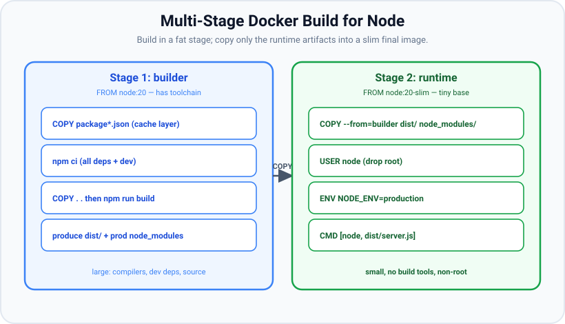

# PM2 & Docker

*11 min read · Updated 24 Jul 2026 Topic 65 of 70 Bookmark Mark done Why it matters node server · Topic 65 of 70*

**Source:** [https://www.geekyfrontend.in/learn/nodejs-backend-kit/pm2-docker](https://www.geekyfrontend.in/learn/nodejs-backend-kit/pm2-docker)

---

## Why it matters

`node server.js` is how you run an app on your laptop. It is *not* how you run one in production. In production the process must survive crashes (restart automatically), use every CPU core, never lose your one running copy to an SSH disconnect, capture logs somewhere, and roll out new versions without dropping traffic. And it must run *the same way* on a teammate's machine, in CI, and on the server — no "works on my machine." The two tools that dominate this space in the Node world are **PM2** (a process manager) and **Docker** (containerization), and the discipline that ties them together is the **12-factor** methodology.

These come up constantly in interviews because they're where "I can write an endpoint" becomes "I can operate a service." Being able to explain why config belongs in environment variables (not committed files), why you build a Docker image in multiple stages, why the container should run as a non-root user, and how PM2's cluster mode relates to the `cluster` module — that's the operational literacy senior backend roles screen for.

## The concept, simply

**PM2** is a production process manager for Node. You hand it your app and it keeps it alive: it restarts the process if it crashes or runs out of memory, can run **one instance per CPU core in cluster mode** (wrapping the `cluster` module for you), aggregates logs, and reloads new code with zero downtime. It's the classic way to run Node directly on a VM.

**Docker** packages your app *and* its entire runtime — the exact Node version, your dependencies, system libraries, everything — into an **image**: a portable, immutable artifact. A running instance of an image is a **container**. Because the image contains everything, it runs identically anywhere Docker runs. This solves "works on my machine" and makes your app deployable to any container platform (Kubernetes, ECS, Cloud Run).

The key Docker technique for Node is the **multi-stage build**: use a full "builder" image (with compilers and dev dependencies) to install and build, then copy *only* the runtime artifacts into a small, clean final image. The result is a smaller, faster, more secure image with no build tools left inside.



Multi-stage build: a fat builder stage compiles and installs everything; the slim runtime stage copies only the built artifacts and production dependencies, drops to a non-root user, and runs the app.

**12-factor** is the glue: a set of principles for building services that run well in these environments. The one you'll be asked about most is **config in the environment** — store deploy-specific settings (DB URLs, secrets, feature flags) in environment variables, never hard-coded or committed, so the *same* image runs in dev, staging, and prod with different env values. Other factors that matter here: treat processes as **stateless** (no local session/file state — put it in a backing service), **logs as event streams** to stdout/stderr (let the platform collect them), and **fast startup / graceful shutdown** so instances are disposable.

## How it works

**PM2** runs a background daemon that supervises your processes. `pm2 start app.js -i max` launches one worker per core in cluster mode; PM2 is the primary, forking workers exactly like the cluster module (it uses it internally), so you get multi-core scaling and automatic respawn without writing fork/exit logic yourself. An **ecosystem file** (`ecosystem.config.js`) declares apps, instance counts, env vars per environment, memory-restart thresholds, and log paths. `pm2 reload` does a rolling zero-downtime restart (new workers up before old ones retire); `pm2 startup` + `pm2 save` make it survive server reboots.

**Docker builds** from a `Dockerfile` — an ordered list of instructions, each producing a cached *layer*. Layer caching is why instruction order matters: copy `package.json` and run `npm ci` *before* copying your source, so that changing a source file doesn't invalidate the (slow) dependency-install layer. `npm ci` (not `npm install`) is the production install: it installs exactly what's in the lockfile, deterministically, and is faster in CI. A multi-stage `Dockerfile` has multiple `FROM` lines; the final stage `COPY --from=builder` pulls only what it needs, leaving compilers and dev dependencies behind. A `.dockerignore` keeps `node_modules`, `.git`, and secrets out of the build context.

**Security and correctness details** the diagram highlights: run as a **non-root user** (`USER node` — the official images ship a `node` user) so a container escape isn't automatically root; set `NODE_ENV=production` (many libraries, including Express, optimize on it, and it prunes dev dependencies); pick a slim base (`node:24-slim` or a distroless/Alpine variant) to shrink attack surface and size; and pin the Node major version rather than `latest`. Handle **PID 1 and signals**: a Node process running as PID 1 in a container doesn't get default signal handlers, so `SIGTERM` may be ignored — use `--init` (or `tini`) and implement graceful shutdown (next topic) so orchestrator stop/rolling-deploy signals are honored.

**PM2 vs Docker — do you need both?** They overlap on "keep it running and use all cores." A very common modern pattern is **one Node process per container** and let the orchestrator (Kubernetes) handle restarts and horizontal scaling with multiple container replicas — in that world you often *don't* run PM2 cluster mode inside the container, because the platform already supervises and scales. PM2 shines when you deploy straight onto VMs without an orchestrator. Knowing that trade-off is the senior answer.

## Code examples

A production multi-stage Dockerfile for a Node app — small, non-root, deterministic.

dockerfile

```
# ---- Stage 1: build ----
FROM node:24 AS builder
WORKDIR /app
# copy manifests first for layer caching
COPY package*.json ./
# deterministic install (dev + prod)
RUN npm ci
COPY . .
# produce dist/
RUN npm run build
# drop dev deps for the runtime copy
RUN npm prune --omit=dev

# ---- Stage 2: runtime ----
FROM node:24-slim AS runtime
ENV NODE_ENV=production
WORKDIR /app
COPY --from=builder /app/node_modules ./node_modules
COPY --from=builder /app/dist ./dist
# drop root privileges
USER node
EXPOSE 3000
CMD ["node", "dist/server.js"]
```

> **Why this was wrong:** Docker treats a line as a comment only when it *starts* with `#`; a `#` later in the line is passed to the instruction as more arguments. In the earlier version `COPY package*.json ./   # copy manifests…` asked Docker to copy files named `#`, `copy`, `manifests`, …, and `USER node   # drop root privileges` fails because `USER requires exactly one argument` (BuildKit's parser). The `RUN … # …` lines only worked by accident, because `/bin/sh` ignores the `#`. The base image was also `node:20`, which reached end of life on 2026-04-30; `node:24` is the Active LTS line as of October 2026 (Node 26 becomes LTS on 2026-10-28 — check nodejs.org/en/about/previous-releases and bump the tag when you upgrade).

Verification (no Docker daemon was available, so this was linted rather than built — hadolint 2.15.1):

```
$ hadolint Dockerfile        # earlier version
Dockerfile:4 DL3021 error: COPY with more than 2 arguments requires the last argument to end with /
Dockerfile:8 DL3059 info: Multiple consecutive `RUN` instructions. Consider consolidation.
Dockerfile:16 DL3066 info: Non-numeric user-id may not be resolvable by host system

$ hadolint --failure-threshold warning Dockerfile   # fixed version: no errors or warnings, exit code 0
Dockerfile:12 DL3059 info: Multiple consecutive `RUN` instructions. Consider consolidation.
Dockerfile:21 DL3066 info: Non-numeric user-id may not be resolvable by host system
```

A matching `.dockerignore` keeps the build context small and secrets out of the image.

bash

```
# .dockerignore
node_modules
npm-debug.log
.git
.env
Dockerfile
dist
coverage
```

Reading config from the environment (12-factor). The same image runs everywhere; only env values change.

javascript

```
// config.js — validate env once at startup, fail fast if misconfigured
const required = ['DATABASE_URL', 'REDIS_URL', 'SESSION_SECRET'];
const missing = required.filter((k) => !process.env[k]);
if (missing.length) {
  console.error('Missing env vars:', missing.join(', '));
  process.exit(1);                       // don't boot half-configured
}

export const config = {
  port: Number(process.env.PORT ?? 3000),
  databaseUrl: process.env.DATABASE_URL,
  redisUrl: process.env.REDIS_URL,
  nodeEnv: process.env.NODE_ENV ?? 'development',
};
```

A PM2 ecosystem file for VM deployments — cluster mode, per-env config, auto memory restart.

javascript

```
// ecosystem.config.js
module.exports = {
  apps: [{
    name: 'api',
    script: 'dist/server.js',
    instances: 'max',            // one worker per CPU core (cluster mode)
    exec_mode: 'cluster',
    max_memory_restart: '500M',  // restart a worker if it leaks past 500MB
    env: { NODE_ENV: 'development', PORT: 3000 },
    env_production: { NODE_ENV: 'production', PORT: 8080 },
  }],
};
// pm2 start ecosystem.config.js --env production
// pm2 reload api   # zero-downtime rolling restart
```

## Common mistakes & gotchas

- **Hard-coding config or committing `.env`.** Secrets in the repo/image leak and can't vary per environment. Read config from env vars; inject secrets at deploy time.
- **Single-stage images with dev tooling inside.** Shipping compilers, dev dependencies, and source bloats the image and widens the attack surface. Use multi-stage and copy only runtime artifacts.
- **Running as root.** The default container user is root; a compromise is then root inside the container. Add `USER node`.
- **Copying source before installing deps.** Breaks layer caching, so every code change reinstalls all dependencies. Copy `package*.json` and `npm ci` first.
- **`npm install` instead of `npm ci` in builds.** `install` can drift from the lockfile; `ci` is deterministic and faster for CI/images.
- **Ignoring PID 1 / signals.** Node as PID 1 doesn't get default signal handling, so `docker stop`'s SIGTERM may be ignored and the container is SIGKILLed after a timeout, cutting off in-flight requests. Use `--init`/tini + graceful shutdown.
- **Forgetting `NODE_ENV=production`.** Without it you keep dev-only overhead and dev dependencies, and some frameworks run slower.
- **Running PM2 cluster mode *inside* Kubernetes.** Double-scaling (PM2 forks × pod replicas) confuses resource accounting and health checks. Usually one process per container and let the orchestrator scale.
- **Storing state on the container's filesystem.** Containers are ephemeral; local files/sessions vanish on restart. Keep state in backing services (DB, Redis, object storage).
- **Writing logs to files inside the container.** 12-factor says stream logs to stdout/stderr and let the platform collect them.

## Best practices

- **Config in the environment**, validated at startup (fail fast on missing vars). One image, many environments.
- **Multi-stage builds**: fat builder, slim runtime; copy only `dist` + prod `node_modules`.
- **Slim, pinned base image** (`node:24-slim`/distroless; Node 20 is end-of-life), `NODE_ENV=production`, non-root `USER node`.
- **Order Dockerfile for cache**: manifests + `npm ci` before source; keep a `.dockerignore`.
- **Handle signals**: `--init`/tini + graceful shutdown so rolling deploys don't drop requests.
- **Stateless processes; logs to stdout**; state and sessions in backing services.
- **Pick one scaling owner**: PM2 cluster on VMs, *or* one process per container + orchestrator replicas — not both.
- **Add a health-check endpoint** and wire it to the platform's liveness/readiness probes.

## ⭐ Interview lens

> **Q: Why not just run `node server.js` in production?**  
> A: It doesn't restart on crash, uses only one core, has no zero-downtime reload, and dies with your shell. You need a supervisor — PM2 (restarts, cluster mode, log aggregation, reloads) on VMs, or a container platform (Kubernetes restarts + replicas) that provides the same guarantees.

> **Q: What is a multi-stage Docker build and why use it for Node?**  
> A: A Dockerfile with multiple stages: a builder stage with the full toolchain installs and compiles, then a slim runtime stage `COPY --from=builder` pulls only the built output and production dependencies. Result: a much smaller image with no compilers, dev deps, or source — faster to ship and a smaller attack surface.

> **Q: Why put config in environment variables (12-factor)?**  
> A: So the same immutable image runs unchanged in dev, staging, and prod, with only env values differing — and secrets stay out of the repo and image. Hard-coded or committed config leaks secrets and forces a rebuild per environment. Validate required vars at startup and fail fast.

> **Q: How does PM2 cluster mode relate to the cluster module?**  
> A: PM2 cluster mode uses Node's cluster module under the hood — PM2 acts as the primary and forks one worker per core, sharing the port, so you get multi-core scaling and respawn without writing fork/exit code. It's cluster with production ergonomics (logs, reloads, monitoring).

> **Q: Why run the container as a non-root user, and what's the PID 1 problem?**  
> A: Non-root (`USER node`) limits blast radius — a container escape isn't automatically host root. PID 1: a process running as PID 1 doesn't get default signal handlers, so `SIGTERM` from `docker stop`/rolling deploys can be ignored and the container gets SIGKILLed, dropping in-flight requests. Fix with `--init`/tini plus graceful shutdown handling.

> **Q: Do you need PM2 if you're deploying to Kubernetes?**  
> A: Usually not in cluster mode. Kubernetes already restarts crashed containers and scales horizontally with replicas, so running PM2's multi-process cluster inside a pod double-counts CPU/memory and confuses probes. The common pattern is one Node process per container and let the orchestrator own scaling and restarts. PM2 is for VM deployments without an orchestrator.

## Cheat-card

- **PM2**: production process manager — restart on crash, `-i max` cluster mode (wraps cluster module), zero-downtime `reload`, boot persistence.
- **Docker image** = app + runtime, portable/immutable; **container** = running instance.
- **Multi-stage build**: fat builder compiles → slim runtime copies only `dist` + prod deps.
- Dockerfile: `package*.json` + `npm ci` **before** source (layer cache); `.dockerignore`; slim pinned base.
- `NODE_ENV=production`, `USER node` (non-root), `--init`/tini for signals.
- **12-factor**: config in env, stateless procs, logs to stdout, fast start / graceful stop.
- Scale owner is **one**: PM2 cluster on VMs *or* one-process-per-container + orchestrator replicas.
- **Next steps:** [107](107-ci-cd-with-github-actions.md) builds and pushes this image in GitHub Actions; [108](108-docker-compose.md) runs it with Postgres and Redis in Compose; [109](109-kubernetes-for-node-developers.md) Kubernetes; [110](110-cloud-and-serverless-deployment.md) cloud and serverless.
- **Compose for this image:** `build: {context: ., target: runtime}` + `init: true` (= `docker run --init`); `docker compose config` validates the file without a daemon but does not read the Dockerfile.

---

## Learn More

- [PM2 Quick Start pm2.keymetrics.io](https://pm2.keymetrics.io/docs/usage/quick-start/)
- [Containerize a Node.js application (Docker guide) docs.docker.com](https://docs.docker.com/guides/nodejs/)
- [How to Use PM2 for Node.js Application Management Code With KASA](https://www.youtube.com/watch?v=_6nxB2RiSKI)
- [How to Build Node.js Apps with Docker | Dockerize Node.js and Express Apps Dipesh Malvia](https://www.youtube.com/watch?v=nH47lsxvY9c)

---

## Additional topics

*Added 12 Oct 2026 · examples verified on Node v24.19.0 and Docker Compose v5.6.0 (`docker-compose config` only; no Docker daemon was available)*

### Where this lesson continues: lessons 107–110

This lesson builds one image and runs one process. Four later lessons take that image further, from the pipeline that builds it to the platforms that run it:

- **[CI/CD with GitHub Actions](107-ci-cd-with-github-actions.md) (lesson 107)** — a workflow that runs `npm ci`, lint, tests and build on Node 22, 24 and 26, then builds *this lesson's Dockerfile* with `docker/build-push-action`, pushes it to `ghcr.io` with `GITHUB_TOKEN`, and deploys it by digest through a protected environment.
- **[Docker Compose: App, Postgres and Redis](108-docker-compose.md) (lesson 108)** — runs the same image next to PostgreSQL and Redis, with health checks, `depends_on` conditions, volumes, `.env` handling, dev and prod override files, and a one-shot `migrate` service that runs before the app.
- **[Kubernetes for Node Developers](109-kubernetes-for-node-developers.md) (lesson 109)** — the "orchestrator" this lesson mentions: the image in a Deployment with several replicas, restarted and scaled by the cluster instead of by PM2.
- **[Cloud and Serverless Deployment](110-cloud-and-serverless-deployment.md) (lesson 110)** — managed platforms that run a container or a function for you, and what changes for a Node process there.

A Compose file is the shortest step from this lesson's `docker run` to a described service. It records the build, the `--init` flag, the environment and the ports in one file, so nobody has to remember the flags.

How it works:

1. `build.context: .` sends the current directory, minus the entries in `.dockerignore`, to the builder, and `build.target: runtime` stops at the Dockerfile's second stage (`FROM node:24-slim AS runtime`).
2. `init: true` is the Compose form of `docker run --init`: a small init process runs as PID 1 and forwards `SIGTERM` to `node`, which addresses the PID 1 point in "How it works" above.
3. `environment:` sets the variables that `config.js` reads. Real secrets belong in the environment of the deploy, not in the file (lesson 108 shows `.env` and `env_file`).
4. `docker compose config` parses the file, applies defaults and validates it against the Compose schema without a Docker daemon. `docker compose up --build` would then build and start it.

**Example — the lesson's Dockerfile, described in Compose and validated.** The directory holds the corrected Dockerfile from "Code examples" above (unchanged: `node:24` builder, `node:24-slim` runtime, comments on their own lines), the `.dockerignore`, and this file:

yaml

```
# compose.yaml — lesson 65's Dockerfile, built and run by Compose
services:
  api:
    build:
      context: .
      target: runtime
    # same as `docker run --init`: a small init process is PID 1 and forwards SIGTERM to node
    init: true
    environment:
      PORT: "3000"
    ports:
      - "3000:3000"
```

bash

```
$ docker-compose version
Docker Compose version v5.6.0
$ docker-compose config
name: l65
services:
  api:
    environment:
      PORT: "3000"
    init: true
    networks:
      default: null
    build:
      context: /…/l65
      dockerfile: Dockerfile
      target: runtime
    ports:
      - mode: ingress
        target: 3000
        published: "3000"
        protocol: tcp
networks:
  default:
    name: l65_default
$ echo $?
0
```

The project name (`l65`) comes from the directory name, because the file sets no top-level `name:`. Compose added a `default` network and the `dockerfile: Dockerfile` default. The binary is the standalone `docker-compose` from github.com/docker/compose releases (v5.6.0, sha256 checked against the published `.sha256` file).

> ⚠️ Unverified: the image was not built and the container was not started (no Docker daemon). Only the Compose model was validated.

### Common mistakes & gotchas (additional topics)

- **Treating `config` as a build check.** `docker compose config` validates the YAML and the Compose schema. It does not read the Dockerfile, so a wrong stage name passes (edge case below). Only a real build checks the Dockerfile.
- **Forgetting `init: true`.** Without it, `node` is PID 1 in the container, which is the signal problem described in "How it works".
- **Putting secrets in `environment:` in a committed file.** Use interpolation from the deploy's environment (`${SESSION_SECRET:?…}`) instead; lesson 108, Example 5 shows the error when it is missing.

### Edge case worked through: a misspelled build target passes `config`

The same file with `target: runtme` (missing `i`), next to a file with an invalid `init` value:

bash

```
$ docker-compose -f typo.yaml config --quiet
$ echo $?
0
$ docker-compose -f typo2.yaml config --quiet
error while interpolating services.api.init: failed to cast to expected type: invalid boolean: yes please
$ echo $?
1
```

1. `init: yes please` is checked, because `init` is a Compose field with a type (boolean) that Compose knows.
2. `target: runtme` is only a string to Compose. Whether a stage with that name exists is decided by the builder when it reads the Dockerfile, so `config` exits 0.
3. So `config` in CI catches schema and type errors, and a build step (`docker build --target runtime .` or the `image` job in lesson 107) is still needed to catch Dockerfile errors.

> ⚠️ Unverified: the builder's error for an unknown target stage was not observed, because no build was possible.

### ⭐ Interview lens (additional topics)

> **Q: “You have a working Dockerfile. What do Compose, CI and an orchestrator each add?”**  
> A: Compose describes how to run the image with its neighbours (database, cache), its environment, ports and start order, so a whole stack starts with one command (lesson 108). CI builds the image from a clean checkout after tests pass, pushes it with an immutable tag and deploys it by digest (lesson 107). An orchestrator such as Kubernetes runs several replicas, restarts them and routes traffic to the healthy ones (lesson 109). The image itself stays the same in all three.
