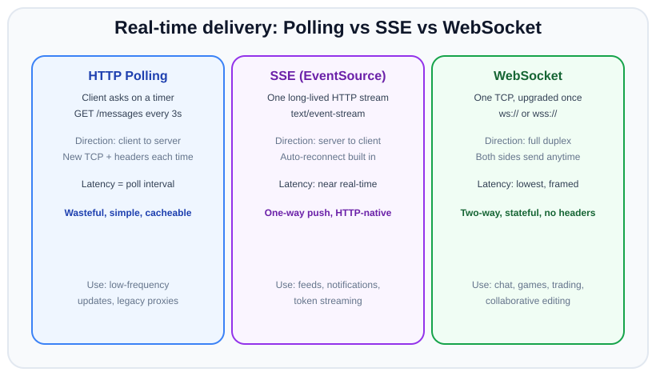
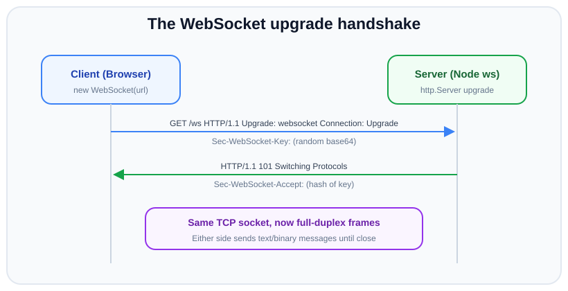

# Real-time with WebSockets

*11 min read · Updated 24 Jul 2026 Topic 67 of 70 Bookmark Mark done Why it matters Plain HTTP has one shape · Topic 67 of 70*

**Source:** [https://www.geekyfrontend.in/learn/nodejs-backend-kit/websockets](https://www.geekyfrontend.in/learn/nodejs-backend-kit/websockets)

---

## Why it matters

Plain HTTP has one shape: the **client asks, the server answers, the exchange ends**. That request/response model is perfect for loading a page or saving a form, but it cannot *push*. If a message arrives on the server — a new chat line, a price tick, another user's cursor move — HTTP has no way to hand it to the browser until the browser asks again. For a whole class of products (chat, multiplayer games, live dashboards, collaborative editors, trading screens, ride tracking) that "ask again" model is either too slow or too wasteful to ship.

WebSockets close that gap. They give you a single, long-lived, **full-duplex** connection over which either side can send a message at any moment, with almost no per-message overhead. Knowing when to reach for WebSockets — and, just as important, when a cheaper tool like Server-Sent Events or ordinary polling is the correct answer — is a signature backend skill and a very common interview theme. Getting it wrong means either a laggy product or a server melting under connections it never needed to hold open.

## The concept, simply

A WebSocket is a persistent two-way pipe between client and server. It *starts* its life as a normal HTTP request, then asks to be "upgraded" to the WebSocket protocol. Once upgraded, the HTTP framing is gone: both ends now speak in lightweight **frames** over the same underlying TCP connection, and both can speak whenever they like without waiting to be asked.

Compare the three common real-time strategies. **Polling** is the browser repeatedly asking "anything new?" on a timer — simple, but latency equals your interval and most requests come back empty. **Server-Sent Events (SSE)** is a single long HTTP response that the server keeps writing to — one-way (server to client only), HTTP-native, auto-reconnecting, and ideal for feeds and notification streams. **WebSockets** are the heavyweight: genuinely two-way, lowest latency, but a stateful connection you now have to manage and scale.



Polling asks on a timer, SSE streams one-way over HTTP, and WebSocket is a full-duplex pipe — pick the lightest tool that meets the latency and directionality you actually need.

## How it works (deep)

The connection begins with a normal HTTP/1.1 GET carrying three tell-tale headers: `Upgrade: websocket`, `Connection: Upgrade`, and a random `Sec-WebSocket-Key`. If the server agrees, it replies with status **101 Switching Protocols** and a `Sec-WebSocket-Accept` header derived from that key (the client verifies it to prove it really reached a WebSocket server, not a confused cache). After the 101, the socket is no longer HTTP — the same TCP connection now carries WebSocket frames.



The handshake is one HTTP request that upgrades in place — after the 101, both sides send framed messages over the same TCP connection until either closes it.

Each message is sent as one or more frames. A frame header encodes an **opcode** (text, binary, ping, pong, or close), a payload length, and — for messages sent *from the browser* — a masking key XORed over the payload (a security measure against cache-poisoning proxies; servers never mask). Because framing is so thin (as few as 2 bytes of overhead), a WebSocket can push thousands of tiny updates far more cheaply than the same number of HTTP requests, each of which would carry full headers and cookies.

In Node, the `http.Server` emits an `'upgrade'` event instead of the usual `'request'` event when those upgrade headers arrive. The `ws` library hooks that event, completes the handshake, and hands you a socket object with `send()` and `'message'`/`'close'` events. `socket.io` sits a layer above: it adds rooms, automatic reconnection, acknowledgements, and a *fallback to HTTP long-polling* when a raw WebSocket cannot be established (hostile proxies, some corporate networks) — at the cost of its own wire protocol, so a socket.io client cannot talk to a bare `ws` server and vice-versa.

Two operational realities shape every production deployment. First, WebSockets are **stateful**: connection C lives on exactly one server instance. If user A is on instance 1 and user B is on instance 2, instance 1 cannot deliver a message to B on its own — you need a **backplane** (commonly a Redis pub/sub adapter) so instances can relay events to each other. Second, load balancers and reverse proxies must be told to allow the upgrade and to hold idle connections open; a default 60-second idle timeout will silently kill quiet sockets, which is why heartbeats matter.

## Code examples

A minimal broadcast server with `ws`. Note the ping/pong heartbeat that detects dead peers — TCP will happily believe a yanked-cable connection is still "open" for minutes.

javascript

```
import { WebSocketServer } from 'ws';

const wss = new WebSocketServer({ port: 8080 });

function heartbeat() { this.isAlive = true; }

wss.on('connection', (ws, req) => {
  ws.isAlive = true;
  ws.on('pong', heartbeat); // client answered our ping

  ws.on('message', (data, isBinary) => {
    // Broadcast to everyone else who is still open
    for (const client of wss.clients) {
      if (client !== ws && client.readyState === client.OPEN) {
        client.send(data, { binary: isBinary });
      }
    }
  });

  ws.on('close', () => console.log('client left'));
});

// Every 30s, drop peers that never ponged back
const interval = setInterval(() => {
  for (const ws of wss.clients) {
    if (ws.isAlive === false) { ws.terminate(); continue; }
    ws.isAlive = false;
    ws.ping();
  }
}, 30_000);

wss.on('close', () => clearInterval(interval));
```

Sharing the same Node HTTP server between Express and WebSockets — you almost never want two ports. You authenticate *during* the upgrade so unauthenticated sockets never open.

javascript

```
import http from 'node:http';
import express from 'express';
import { WebSocketServer } from 'ws';

const app = express();
app.get('/health', (_req, res) => res.send('ok'));

const server = http.createServer(app);
const wss = new WebSocketServer({ noServer: true }); // we drive the handshake

server.on('upgrade', (req, socket, head) => {
  const token = new URL(req.url, 'http://x').searchParams.get('token');
  if (!isValid(token)) {
    socket.write('HTTP/1.1 401 Unauthorized\r
\r
');
    socket.destroy();
    return;
  }
  wss.handleUpgrade(req, socket, head, (ws) => {
    wss.emit('connection', ws, req);
  });
});

server.listen(3000);
function isValid(t) { return t === 'secret'; }
```

A socket.io server showing rooms — the feature you would otherwise hand-roll. Rooms let you address a subset of clients (one chat channel, one document) without tracking arrays yourself.

javascript

```
import { Server } from 'socket.io';

const io = new Server(3000, { cors: { origin: '*' } });

io.on('connection', (socket) => {
  socket.on('join', (roomId) => {
    socket.join(roomId);
    io.to(roomId).emit('system', socket.id + ' joined');
  });

  socket.on('chat', ({ roomId, text }) => {
    // Emit only to sockets in this room, excluding the sender
    socket.to(roomId).emit('chat', { from: socket.id, text });
  });
});
```

Scaling socket.io across instances with the Redis adapter — the backplane in one line, so an emit on instance 1 reaches a client held by instance 2.

javascript

```
import { Server } from 'socket.io';
import { createAdapter } from '@socket.io/redis-adapter';
import { createClient } from 'redis';

const pub = createClient({ url: process.env.REDIS_URL });
const sub = pub.duplicate();
await Promise.all([pub.connect(), sub.connect()]);

const io = new Server(3000);
io.adapter(createAdapter(pub, sub)); // cross-instance fan-out

io.on('connection', (s) => s.on('broadcast', (m) => io.emit('broadcast', m)));
```

## Common mistakes & gotchas

- **Assuming a connection is alive because TCP says so.** A crashed client or a dropped Wi-Fi connection can leave a "half-open" socket that never fires `'close'`. Without a ping/pong heartbeat you accumulate zombie connections and leak memory.
- **Forgetting the multi-instance problem.** Everything works on your laptop with one process. In production behind a load balancer, a naive `broadcast to all clients` only reaches the clients on *that* instance. You need a Redis (or similar) backplane.
- **Not enabling sticky sessions** when using socket.io's HTTP long-polling fallback. The initial handshake and subsequent polls must hit the same instance, or the session breaks. Raw WebSockets avoid this because there is a single upgraded connection.
- **Trusting the `Origin` header is set — but never checking it.** Browsers do not enforce the same-origin policy on WebSockets. Any website can open a socket to your server ("Cross-Site WebSocket Hijacking"). Validate `Origin` and authenticate on upgrade.
- **Sending giant JSON blobs as text.** Frames are cheap but your JSON parsing is not. High-frequency streams (game state, market data) usually belong in a compact binary format, not `JSON.stringify` on every tick.
- **No backpressure handling.** If you `send()` faster than a slow client can drain, Node buffers it in memory. Check `ws.bufferedAmount` and drop or throttle rather than OOM the server.
- **Reaching for WebSockets when SSE would do.** If data only flows server-to-client (a live feed, a notification bell, LLM token streaming), SSE is simpler, survives proxies better, and reconnects for free.

## Best practices

- **Authenticate during the upgrade,** not after the socket opens — reject bad tokens before the connection exists, and re-check authorization on sensitive actions since a long-lived socket outlives a short-lived token.
- **Always run a heartbeat** (ping/pong on a timer) and terminate peers that miss it. Pair it with client-side reconnect-with-backoff.
- **Use `wss://` (TLS) in production.** Besides encryption, TLS dramatically improves the odds that intermediary proxies leave the upgraded connection alone.
- **Design idempotent, versioned messages.** On reconnect a client may replay or miss messages; a sequence number or "since" cursor lets you resync cleanly.
- **Plan for horizontal scale from day one** with a pub/sub backplane, even if you launch on one box — retrofitting it under load is painful.
- **Cap and account for connection count.** Each open socket is memory and a file descriptor; know your ceiling, set OS limits, and shed load gracefully.
- **Keep the protocol boundary clear:** use `ws` when you want a thin, standards-pure layer; use `socket.io` when you want rooms, acks, and fallbacks and control both ends.

## ⭐ Interview lens

> **Q: Walk me through what happens when a browser opens a WebSocket.** The client sends an ordinary HTTP/1.1 GET with `Upgrade: websocket`, `Connection: Upgrade`, and a random `Sec-WebSocket-Key`. If the server accepts, it returns **101 Switching Protocols** with a `Sec-WebSocket-Accept` hash of that key. The same TCP connection then carries bidirectional WebSocket frames — no more HTTP request/response. In Node this surfaces as the `'upgrade'` event on the HTTP server.

> **Q: WebSockets vs SSE vs polling — when do you pick each?** Polling for infrequent updates or dead-simple integrations. SSE when data flows *only* server-to-client (feeds, notifications, token streaming) — it is HTTP-native and auto-reconnects. WebSockets when you need genuinely *two-way*, low-latency traffic (chat, games, collaboration). *Trap:* candidates default to WebSockets for a live feed that has no client-to-server messages — that is SSE's job and it is cheaper to operate.

> **Q: Your chat works locally but messages vanish after you scale to three instances. Why?** WebSocket connections are stateful and pinned to one instance. A broadcast on instance 1 never reaches clients held by instances 2 and 3. You need a backplane — e.g. the socket.io Redis adapter or your own Redis pub/sub — so instances relay events to each other.

> **Q: How do you detect a client that dropped without a proper close?** TCP may not notice for minutes. Send periodic pings; if a client misses N pongs, `terminate()` it. The classic implementation flags each socket `isAlive=false` before each ping and back to `true` on pong.

> **Q: Is a WebSocket subject to the same-origin policy / CORS?** No — browsers do *not* apply CORS to WebSocket handshakes. That is exactly why Cross-Site WebSocket Hijacking exists. You must validate the `Origin` header and authenticate the connection yourself. *Trap:* assuming CORS "protects" the endpoint.

> **Q: What is backpressure on a WebSocket and how do you handle it?** If you send faster than a client can receive, Node buffers unsent bytes in memory (`ws.bufferedAmount`). Under sustained pressure that is an OOM risk. Handle it by checking buffered amount and throttling, coalescing, or dropping stale updates for slow consumers.

## Cheat-card

- **WebSocket =** one long-lived, full-duplex TCP connection; starts as HTTP, upgrades via **101 Switching Protocols**.
- **Direction test:** two-way ➜ WebSocket; server-only push ➜ SSE; rare updates ➜ polling.
- **Node hook:** `http.Server` `'upgrade'` event; `ws` = thin, `socket.io` = rooms + acks + fallback (not wire-compatible with `ws`).
- **Scale:** connections are pinned to one instance ➜ need a Redis/pub-sub backplane; long-polling fallback needs sticky sessions.
- **Health:** ping/pong heartbeat + client reconnect-with-backoff; watch `bufferedAmount` for backpressure.
- **Security:** authenticate on upgrade, validate `Origin` (no CORS on WS), use `wss://`.
- **Frames:** tiny header, text/binary/ping/pong/close opcodes; browser-to-server frames are masked.
- **SSE resume:** send `id:` on every event (+ `retry:`); the client reconnects with `Last-Event-ID`; the server replays newer events from a bounded log. Node 24: no global `EventSource` without `--experimental-eventsource` → `eventsource` package.
- **Reconnecting WS client:** heartbeat (ping + pong timeout → `terminate()`), backoff `random(0, min(cap, base·2^n))`, outbox while disconnected, resend unacked after reconnect, server dedupes by id. Global `WebSocket` has no `ping()`.

---

## Learn More

- [Socket.IO v4 Documentation - Introduction socket.io](https://socket.io/docs/v4/)
- [The WebSocket API (MDN) developer.mozilla.org](https://developer.mozilla.org/en-US/docs/Web/API/WebSockets_API)
- [WebSockets in 100 Seconds & Beyond with Socket.io Fireship](https://www.youtube.com/watch?v=1BfCnjr_Vjg)

---

## Additional topics

*Added 12 Oct 2026 · examples verified on Node v24.19.0, Express 5.3.0, eventsource 5.1.2, ws 8.22.0 and curl 8.18.0*

### Server-Sent Events with `Last-Event-ID` resume

Server-Sent Events (SSE) is a one-way stream from server to client over an ordinary HTTP response with `Content-Type: text/event-stream`. The format and the browser's `EventSource` client are defined in the [WHATWG HTML standard](https://html.spec.whatwg.org/multipage/server-sent-events.html). What makes SSE more than "a long response" is the reconnect rule. If the server tags each event with an `id:`, the client remembers the last one it received, and when the connection drops it reconnects and sends that id in a `Last-Event-ID` request header. A server that keeps recent events can then send exactly the ones the client missed. Without ids, a dropped connection silently loses every event sent while the client was away.

The wire format is plain text, one field per line, and a blank line ends an event:

- `id: 7`: sets the event's id; the client stores it as its last event id.
- `event: price`: the event type; the client dispatches it to `addEventListener('price', …)`. Without it the type is `message`.
- `data: …`: the payload (several `data:` lines are joined with newlines).
- `retry: 1000`: tells the client how many milliseconds to wait before reconnecting.
- a line starting with `:` is a comment; servers send `: ping` periodically so that proxies do not close an idle connection.

**Node 24 has no global `EventSource` by default.** It exists only behind the `--experimental-eventsource` flag (added in v22.3.0 / v20.18.0; Stability 1, Experimental, in the v24 docs):

```
$ node -e "console.log(typeof EventSource)"
undefined
$ node --experimental-eventsource -e "console.log(typeof EventSource)"
function
```

This lesson uses the [`eventsource`](https://github.com/EventSource/eventsource) npm package instead (5.1.2, which requires Node `>=22.12.0`), which implements the same browser API on top of `fetch()`.

How it works:

1. The client sends `GET /events`. The server answers `200` with `Content-Type: text/event-stream` and keeps the response open.
2. The server writes `retry:` once, then one `id:`/`event:`/`data:` block per event.
3. The connection drops (network change, proxy timeout, server restart). The client fires `error` with `readyState` `0` (CONNECTING), waits `retry` milliseconds, and sends a new `GET` with `Last-Event-ID: <last id>`.
4. The server reads the header, writes every stored event with a larger id, then continues with new events.
5. The client gets a second `open` and the missed events, in order. A `204 No Content` reply tells the client to stop reconnecting; `es.close()` stops it from the client side.

```text
 time ─────────────────────────────────────────────────────────────────────►
 server log:   … 3   4   5 │ 6   7   8 │ 9   10  11 …     (one event per 300 ms)
                           │           │
 client:  GET /events      │  waits    │ GET /events
          ◄─ 3 ◄─ 4 ◄─ 5   │  retry:   │ Last-Event-ID: 5
          (stores id 5)    │  1000 ms  │ ◄─ 6 ◄─ 7 ◄─ 8   (replayed from the log)
                       connection      │ ◄─ 9 ◄─ 10 ◄─ 11 (live again)
                        dropped        └─ no gap: 3,4,5,6,7,8,9,10,11
```

**Example — an Express 5 SSE server that replays missed events.**

javascript

```
// sse-server.mjs: Server-Sent Events with ids, replay from Last-Event-ID, and a way to drop connections.
import express from 'express';

const app = express();
const log = [];                         // every event ever sent: { id, data } (bound this in real code)
const clients = new Set();              // open SSE responses
let nextId = 1;

setInterval(() => {                     // the "business events": one every 300 ms
  const event = { id: nextId++, data: JSON.stringify({ price: 100 + nextId, at: Date.now() % 100000 }) };
  log.push(event);
  for (const res of clients) write(res, event);
}, 300);

function write(res, { id, data }) {
  res.write(`id: ${id}\nevent: price\ndata: ${data}\n\n`);   // one event = lines + a blank line
}

app.get('/events', (req, res) => {
  const header = req.get('last-event-id');                 // sent by EventSource on reconnect
  console.log(`server: connect, Last-Event-ID = ${header ?? '(none)'}`);
  res.set({
    'Content-Type': 'text/event-stream',
    'Cache-Control': 'no-cache',
    Connection: 'keep-alive',
  });
  res.flushHeaders();
  res.write('retry: 1000\n\n');                              // client should reconnect after 1 s
  // A first connection gets only new events; a reconnect gets everything after the id it last saw.
  const missed = header === undefined ? [] : log.filter((e) => e.id > Number(header));
  if (header !== undefined) console.log(`server: replaying ${missed.length} missed event(s): ${missed.map((e) => e.id).join(', ')}`);
  for (const e of missed) write(res, e);
  clients.add(res);
  const ping = setInterval(() => res.write(': ping\n\n'), 15_000);  // comment line keeps proxies from timing out
  req.on('close', () => { clients.delete(res); clearInterval(ping); });
});

app.post('/drop', (req, res) => {       // simulate a network drop: destroy every SSE socket
  for (const c of clients) c.socket.destroy();
  console.log(`server: dropped ${clients.size} connection(s)`);
  res.end();
});

app.listen(7650, () => console.log('server: SSE on http://127.0.0.1:7650/events'));
```

The raw stream as curl sees it, asking to resume after id 1:

```
$ curl -s -N --max-time 1 -H "Last-Event-ID: 1" http://127.0.0.1:7650/events
retry: 1000

id: 2
event: price
data: {"price":103,"at":66924}

id: 3
event: price
data: {"price":104,"at":67224}

id: 4
event: price
data: {"price":105,"at":67525}

id: 5
event: price
data: {"price":106,"at":67826}
```

**Example — an `EventSource` client that survives a dropped connection.**

javascript

```
// sse-client.mjs: the `eventsource` package (Node 24 has no global EventSource without a flag).
import { EventSource } from 'eventsource';

const es = new EventSource('http://127.0.0.1:7650/events');
const seen = [];
// eventsource unref()s its reconnect timer, so with nothing else pending Node would exit
// during the retry wait. This interval keeps the demo process alive until we are done.
const keepAlive = setInterval(() => {}, 1000);
es.addEventListener('open', () => console.log('client: open'));
es.addEventListener('error', (e) => console.log(`client: error "${e.message}", readyState ${es.readyState} (0 = CONNECTING, will retry)`));
es.addEventListener('price', (e) => {
  seen.push(Number(e.lastEventId));
  console.log(`client: event id=${e.lastEventId} data=${e.data}`);
  if (seen.length === 3) {
    console.log('client: asking the server to drop our connection');
    fetch('http://127.0.0.1:7650/drop', { method: 'POST' });
  }
  if (seen.length === 9) {
    es.close();
    clearInterval(keepAlive);
    const gaps = seen.filter((id, i) => i > 0 && id !== seen[i - 1] + 1);
    console.log('client: ids seen', seen.join(','), '| gaps:', gaps.length ? gaps : 'none');
  }
});
```

```
$ node sse-server.mjs & sleep 1; node sse-client.mjs
server: SSE on http://127.0.0.1:7650/events
server: connect, Last-Event-ID = (none)
client: open
client: event id=3 data={"price":104,"at":96708}
client: event id=4 data={"price":105,"at":97010}
client: event id=5 data={"price":106,"at":97311}
client: asking the server to drop our connection
server: dropped 1 connection(s)
client: error "TypeError: terminated: other side closed", readyState 0 (0 = CONNECTING, will retry)
server: connect, Last-Event-ID = 5
server: replaying 3 missed event(s): 6, 7, 8
client: open
client: event id=6 data={"price":107,"at":97611}
client: event id=7 data={"price":108,"at":97912}
client: event id=8 data={"price":109,"at":98212}
client: event id=9 data={"price":110,"at":98512}
client: event id=10 data={"price":111,"at":98812}
client: event id=11 data={"price":112,"at":99112}
client: ids seen 3,4,5,6,7,8,9,10,11 | gaps: none
```

Real output (Node v24.19.0, Express 5.3.0, eventsource 5.1.2); the server and client wrote to the same terminal. The server destroyed the socket after event 5. Events 6, 7 and 8 were produced during the one-second `retry` wait, and the server replayed them when the client came back with `Last-Event-ID: 5`. The id list has no gaps. The client's first event was id 3 because, by design, a first connection gets only new events; on a second run start-up timing shifted every id by one (first id 4, resume from `Last-Event-ID: 6`, replay 7, 8, 9), with no gaps again.

### A WebSocket client with heartbeat, backoff and an outbox

A browser-style WebSocket client is easy to open and easy to lose. Three things go wrong in production, and each needs code on the **client**:

- **Half-open connections.** If the server process freezes, or a NAT box forgets the connection, no `close` event arrives. The socket stays `OPEN`, `send()` succeeds, and the bytes go nowhere. A **heartbeat** detects this: send a ping on a timer and treat a missing pong as a dead connection.
- **Reconnect storms.** When a server restarts, every client reconnects. If they all retry at fixed intervals, they hit the new server at the same moment, again and again. **Exponential backoff with jitter** spreads them out: the delay cap doubles on each failed attempt (up to a maximum), and the actual delay is a random value below the cap. This is "full jitter" as described in [AWS's article on backoff and jitter](https://aws.amazon.com/blogs/architecture/exponential-backoff-and-jitter/).
- **Lost messages.** Messages sent while disconnected must wait somewhere, and messages written to a socket that turned out to be dead were never processed. An **outbox** queues the first kind. Keeping every message until the server **acknowledges** it covers the second kind: unacknowledged messages are sent again after a reconnect, and the server ignores duplicates by id.

How it works (in `ws-client.mjs` below):

1. `connect()` opens a `ws` client with `handshakeTimeout: 1000`, so a connect to a frozen server fails instead of hanging.
2. On `open`: reset the attempt counter, resend everything in `unacked`, flush `outbox` in order, and start the heartbeat.
3. Heartbeat: every second, `ws.ping()` and start a 1-second timer; a `pong` cancels the timer. If the timer fires, `ws.terminate()` destroys the socket at once (no closing handshake, which a dead peer would never answer).
4. On `close` (from a terminate, a refused connection or a normal close): stop the heartbeat, compute `cap = min(5000, 200 × 2^attempt)`, wait `random(0, cap)` ms, and call `connect()` again.
5. `send()` writes at once if the socket is `OPEN`, otherwise it pushes to `outbox`. Every written message stays in `unacked` until the server's `{ ack: seq }` arrives.

**Example — the server (started twice: A, then B on the same port).**

javascript

```
// ws-server.mjs: echo server that acknowledges each message by seq. Started twice in the demo (A, then B).
import { WebSocketServer } from 'ws';

const name = process.argv[2] ?? 'A';
const wss = new WebSocketServer({ port: 7660 });
const seen = new Set();                     // per server process; a real app would dedupe in a store
wss.on('listening', () => console.log(`server ${name}: listening on :7660`));
wss.on('connection', (ws) => {
  console.log(`server ${name}: client connected`);
  ws.on('message', (raw) => {
    const msg = JSON.parse(raw);
    const dup = seen.has(msg.seq);
    seen.add(msg.seq);
    console.log(`server ${name}: got #${msg.seq}${dup ? ' (duplicate, ignored)' : ''}`);
    ws.send(JSON.stringify({ ack: msg.seq }));
  });
  // ws answers pings with pongs automatically; nothing to do for the client's heartbeat.
});
```

**Example — the client.**

javascript

```
// ws-client.mjs: reconnecting WebSocket client (ws 8.22.0) with
//   - heartbeat: ping every 1 s, terminate if no pong within 1 s (catches half-open connections)
//   - exponential backoff with full jitter: delay = random(0, min(5000, 200 * 2^attempt)) ms
//   - an outbox: messages sent while disconnected are queued and flushed on reconnect;
//     messages sent but not yet acknowledged are resent too (the server ignores duplicates).
import WebSocket from 'ws';

const URL = 'ws://127.0.0.1:7660';
const t0 = Date.now();
const log = (...a) => console.log(`${((Date.now() - t0) / 1000).toFixed(1).padStart(4)} s client:`, ...a);

let ws, attempt = 0, heartbeat, pongTimer;
const outbox = [];                          // not yet written to an open socket
const unacked = new Map();                  // seq -> message, written but not acknowledged

function connect() {
  ws = new WebSocket(URL, { handshakeTimeout: 1000 });
  ws.on('open', () => {
    log(`connected (attempt ${attempt + 1}); resending ${unacked.size} unacked, flushing ${outbox.length} queued`);
    attempt = 0;
    for (const m of unacked.values()) ws.send(JSON.stringify(m));
    while (outbox.length) write(outbox.shift());
    heartbeat = setInterval(() => {
      pongTimer = setTimeout(() => { log('no pong within 1 s: terminating'); ws.terminate(); }, 1000);
      ws.ping();
    }, 1000);
  });
  ws.on('pong', () => clearTimeout(pongTimer));
  ws.on('message', (raw) => { const { ack } = JSON.parse(raw); unacked.delete(ack); });
  ws.on('error', (err) => log('error:', err.code ?? err.message));
  ws.on('close', () => {
    clearInterval(heartbeat); clearTimeout(pongTimer);
    const cap = Math.min(5000, 200 * 2 ** attempt);
    const delay = Math.round(Math.random() * cap);          // full jitter
    attempt++;
    log(`closed; reconnect attempt ${attempt + 1} in ${delay} ms (cap ${cap} ms)`);
    setTimeout(connect, delay);
  });
}

function write(m) { unacked.set(m.seq, m); ws.send(JSON.stringify(m)); }
function send(m) {
  if (ws.readyState === WebSocket.OPEN) { write(m); log(`sent #${m.seq}`); }
  else { outbox.push(m); log(`queued #${m.seq} (socket not open)`); }
}

connect();
let seq = 0;
const timer = setInterval(() => send({ seq: ++seq, text: `hello ${seq}` }), 500);
setTimeout(() => {                           // end of the demo
  clearInterval(timer);
  log(`done: unacked ${unacked.size}, queued ${outbox.length}`);
  process.exit(0);
}, 11_000);
```

**Example — a server freeze, a crash and a restart in the middle of a session.**

bash

```
# ws-demo.sh: server A runs, freezes (SIGSTOP: TCP stays open, nothing answers), is killed,
# then server B starts on the same port. The client must notice, back off, queue and resend.
node ws-server.mjs A & A=$!
sleep 0.5
node ws-client.mjs & C=$!
sleep 2.2;  echo "---- demo: SIGSTOP server A (frozen, sockets still open)"; kill -STOP $A
sleep 3;    echo "---- demo: SIGKILL server A";                              kill -KILL $A
sleep 2;    echo "---- demo: start server B";  node ws-server.mjs B & B=$!
wait $C; kill $B
```

```
$ bash ws-demo.sh
server A: listening on :7660
server A: client connected
 0.0 s client: connected (attempt 1); resending 0 unacked, flushing 0 queued
 0.5 s client: sent #1
server A: got #1
 1.0 s client: sent #2
server A: got #2
 1.5 s client: sent #3
server A: got #3
 2.0 s client: sent #4
server A: got #4
---- demo: SIGSTOP server A (frozen, sockets still open)
 2.5 s client: sent #5
 3.0 s client: sent #6
 3.5 s client: sent #7
 4.0 s client: sent #8
 4.0 s client: no pong within 1 s: terminating
 4.0 s client: closed; reconnect attempt 2 in 51 ms (cap 200 ms)
 4.5 s client: queued #9 (socket not open)
 5.0 s client: queued #10 (socket not open)
 5.1 s client: error: Opening handshake has timed out
 5.1 s client: closed; reconnect attempt 3 in 50 ms (cap 400 ms)
---- demo: SIGKILL server A
 5.1 s client: error: ECONNREFUSED
 5.1 s client: closed; reconnect attempt 4 in 285 ms (cap 800 ms)
 5.4 s client: error: ECONNREFUSED
 5.4 s client: closed; reconnect attempt 5 in 1317 ms (cap 1600 ms)
 5.5 s client: queued #11 (socket not open)
 6.0 s client: queued #12 (socket not open)
 6.5 s client: queued #13 (socket not open)
 6.7 s client: error: ECONNREFUSED
 6.7 s client: closed; reconnect attempt 6 in 1030 ms (cap 3200 ms)
 7.0 s client: queued #14 (socket not open)
---- demo: start server B
ws-demo.sh: line 9: 1640817 Killed                     node ws-server.mjs A
server B: listening on :7660
 7.5 s client: queued #15 (socket not open)
 7.8 s client: connected (attempt 6); resending 4 unacked, flushing 7 queued
server B: client connected
server B: got #5
server B: got #6
server B: got #7
server B: got #8
server B: got #9
server B: got #10
server B: got #11
server B: got #12
server B: got #13
server B: got #14
server B: got #15
 8.0 s client: sent #16
server B: got #16
 8.5 s client: sent #17
server B: got #17
 9.0 s client: sent #18
server B: got #18
 9.5 s client: sent #19
server B: got #19
10.0 s client: sent #20
server B: got #20
10.5 s client: sent #21
server B: got #21
11.0 s client: done: unacked 0, queued 0
```

Real output (Node v24.19.0, ws 8.22.0). The backoff delays are random by design, so they differ on every run: a second run waited 19, 318, 515, 1003 and 2554 ms, reconnected at 9.5 s, resent the same #5–#8 and lost nothing. What happened:

- **0–2 s:** normal traffic; server A acknowledged #1–#4.
- **SIGSTOP at about 2.2 s:** server A still held the TCP connection but ran no code. `send()` "succeeded" for #5–#8; nothing processed them. No `close` event came. The heartbeat's pong timer fired at 4.0 s and the client terminated the socket.
- **4.0–7.8 s:** reconnects failed, first with `Opening handshake has timed out` (the frozen server's kernel accepted the TCP connection but nobody answered the upgrade), then with `ECONNREFUSED` after SIGKILL. The cap doubled each time: 200, 400, 800, 1600, 3200 ms. Messages #9–#15 went to the outbox. (`Killed` is bash reporting the SIGKILL of server A.)
- **7.8 s:** server B was up. The client resent the 4 unacknowledged messages (#5–#8, written to the frozen server) and flushed the 7 queued ones. Server B received #5–#15 in order, and the run ended with nothing unacknowledged.

Without the `unacked` map, #5–#8 would have been lost: they left the client while the connection looked healthy. Duplicate handling is still needed: if the server had processed #8 and died before its ack arrived, #8 would be sent again, so the server must recognise ids it has already seen. This demo keeps them in memory per process; a real server would keep them in shared storage such as Redis.

### Common mistakes & gotchas (additional topics)

- **SSE without `id:`.** The client still reconnects, but it sends no `Last-Event-ID`, so everything sent while it was away is gone.
- **Replaying from an unbounded log.** Keep a bounded window (the last N events or minutes). If a client asks for an id older than the window, send a "resync" event telling it to reload, rather than pretending nothing was missed.
- **Buffering proxies and compression.** SSE needs each event flushed as it is written. Reverse proxies that buffer responses, and compression middleware, can hold events back. Set `Cache-Control: no-cache`, send comment pings, and turn off buffering for that route in the proxy.
- **The `eventsource` package and process exit.** It `unref()`s its reconnect timer (its source comment says so), so a script whose only work is the `EventSource` exits during the retry wait instead of reconnecting. A server process has other handles and is not affected; the demo client keeps an interval for this reason.
- **Reconnecting at a fixed interval, or immediately.** Thousands of clients then reconnect in step after every server restart. Use exponential backoff with jitter and a cap, and reset the attempt counter after a successful connection.
- **Relying on `close` to detect a dead server.** A frozen process or a dropped NAT mapping produces no `close` event. Only a heartbeat with a timeout notices.
- **Calling `close()` on a dead connection.** `close()` starts a closing handshake that a dead peer never answers. Use `ws.terminate()` (in `ws`) to destroy the socket at once.
- **Node 24's global `WebSocket` is the browser API.** It has no `ping()` or `terminate()` method, so a client heartbeat must be an application-level message (as in a browser). It did answer the server's ping frames with pongs automatically, and it accepted undici's non-standard `headers` option, which browsers do not have:

javascript

```
// global-ws.mjs: what Node 24's built-in (undici) WebSocket can and cannot do, against a ws server.
import { WebSocketServer } from 'ws';

const wss = new WebSocketServer({ port: 7661 });
wss.on('connection', (sock, req) => {
  console.log('server: authorization header =', req.headers.authorization ?? '(none)');
  sock.on('pong', () => console.log('server: got pong from the built-in client (answered automatically)'));
  sock.ping();
  sock.on('message', (m) => { console.log('server: got', String(m)); sock.close(1000, 'bye'); });
});

const ws = new WebSocket('ws://127.0.0.1:7661', { headers: { authorization: 'Bearer demo' } });
console.log('client: typeof ws.ping =', typeof ws.ping, '| typeof ws.terminate =', typeof ws.terminate,
  '| bufferedAmount =', ws.bufferedAmount);
ws.addEventListener('open', () => setTimeout(() => ws.send('app-level ping'), 100));
ws.addEventListener('close', (e) => { console.log('client: close', e.code, e.reason); wss.close(); });
```

```
$ node global-ws.mjs
client: typeof ws.ping = undefined | typeof ws.terminate = undefined | bufferedAmount = 0
server: authorization header = Bearer demo
server: got pong from the built-in client (answered automatically)
server: got app-level ping
client: close 1000 bye
```

### Edge case worked through: the message that was "sent" to a frozen server

In the transcript above, the client logged `sent #5` to `sent #8` while server A was stopped. The `ws` library had written those frames into the client's TCP send buffer, and the kernel had accepted them, so from the client's point of view they were sent. Server A never ran another line of code, and the SIGKILL that followed threw them away with its socket. Two separate mechanisms were needed:

1. The **heartbeat** turned "the socket looks open" into "the socket is dead" within about 2 seconds (the next ping plus the 1-second pong timeout). Without it, the client would have kept writing into a connection that would never deliver.
2. The **ack map** decided what to resend. "Written to the socket" is not "received by the application", so only an application-level ack can remove a message from `unacked`.

This is at-least-once delivery: nothing is lost, and the receiver removes duplicates by `seq`. The same reasoning appears in the idempotent consumer of [Message queues & async jobs](70-message-queues-async-jobs.md).

### ⭐ Interview lens (additional topics)

> **Q: “How does an SSE client resume after a dropped connection without missing events?”**  
> A: The server tags each event with `id:`. The client (`EventSource`) stores the last id and reconnects after the `retry:` interval with a `Last-Event-ID` header. The server replays stored events with larger ids, then continues live. Without ids there is nothing to resume from. *Trap:* Node 24 has no global `EventSource` unless you pass `--experimental-eventsource`; use the `eventsource` package or a fetch-based reader.

> **Q: “Your WebSocket clients all reconnect at once after a deploy and knock the new servers over. What do you change?”**  
> A: Exponential backoff with jitter: double a delay cap on each failed attempt up to a maximum, and wait a random time below the cap, so reconnects spread out. Add a heartbeat (ping/pong with a timeout, then `terminate()`) to detect half-open connections, queue outgoing messages while disconnected, and resend anything the server has not acknowledged, with server-side dedupe by message id.
