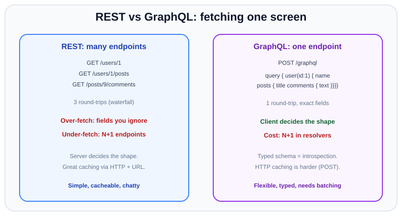
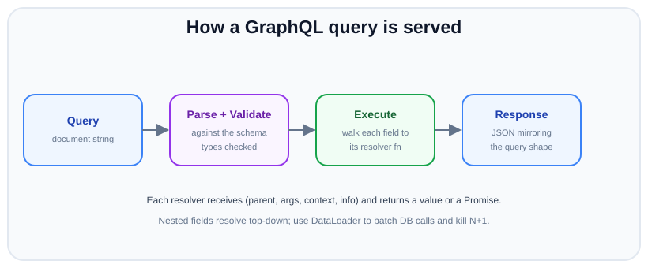

# GraphQL basics

*11 min read · Updated 24 Jul 2026 Topic 68 of 70 Bookmark Mark done Why it matters REST organises an API around resources at URLs · Topic 68 of 70*

**Source:** [https://www.geekyfrontend.in/learn/nodejs-backend-kit/graphql-basics](https://www.geekyfrontend.in/learn/nodejs-backend-kit/graphql-basics)

---

## Why it matters

REST organises an API around **resources at URLs**: the server decides what each endpoint returns, and the client takes it or leaves it. That works beautifully until a screen needs a little of this resource and a little of that one. Then you either build a bespoke endpoint for every screen, or you make the client fire several requests and stitch the results together. Mobile teams felt this pain first — every extra round-trip on a flaky network hurts — and GraphQL grew out of it at Facebook.

GraphQL flips the control: the **client sends a query describing exactly the shape it wants**, and the server returns precisely that — no more, no less — from a single endpoint. Understanding GraphQL is now table stakes for backend interviews, not because it replaces REST (it does not), but because knowing *when* its flexibility pays for its added complexity is exactly the kind of trade-off judgement senior engineers are hired for.

## The concept, simply

A GraphQL API is defined by a **schema**: a strongly-typed contract listing every type, every field, and the entry points (`Query` for reads, `Mutation` for writes, `Subscription` for real-time streams). The client sends a query that mirrors the shape of the data it wants; the response JSON comes back in that same shape.

The two problems it targets have names. **Over-fetching** is when an endpoint hands you 40 fields and you needed 3. **Under-fetching** is when one endpoint is not enough, so you call a second and a third — the "waterfall". GraphQL lets one request ask for a user, their last five posts, and each post's comment count, all at once, with every field named explicitly.



REST spreads one screen across several endpoints and fixed payloads; GraphQL lets the client request the exact nested shape from a single endpoint — at the cost of harder caching and resolver-level work.

## How it works (deep)

The heart of a GraphQL server is the pairing of a **schema** with **resolvers**. The schema is the "what" — a menu of types and fields. Resolvers are the "how" — a function per field that knows where to get that field's value. When a query arrives, the server does four things: **parses** the query string into an AST, **validates** it against the schema (unknown field? wrong argument type? rejected before any code runs), **executes** by walking the query tree and calling each field's resolver, then assembles the result into JSON matching the requested shape.



Every query is parsed, validated against the typed schema, then executed by walking field-by-field to resolvers — nested fields resolve top-down, which is where the N+1 problem is born and where DataLoader solves it.

Resolution is **hierarchical and top-down**. The `user` resolver runs first and returns a user object (the "parent"). Then, for each field the query asked for on that user, the corresponding resolver runs, receiving that parent. A field resolver's signature is `(parent, args, context, info)`: `parent` is the resolved object above it, `args` are the field's arguments, `context` is a per-request bag (auth, loaders, db handles) shared across every resolver in that request, and `info` is the query AST for advanced cases. If a field maps directly to a property on `parent`, you can omit the resolver — the "default resolver" reads it for you.

This top-down walk creates the single most important GraphQL performance trap: the **N+1 problem**. Ask for 10 posts and each post's author, and the naive author-resolver fires 10 separate database queries — one per post — on top of the 1 query for the posts. The fix is **DataLoader**: a per-request utility that collects all the keys requested within a tick, issues *one* batched query (`WHERE id IN (...)`), and also caches within the request so the same author is never fetched twice. DataLoader is not optional in production GraphQL; it is the thing that makes the flexible query model survivable.

Two more structural facts. First, GraphQL is **transport-agnostic but conventionally a single `POST /graphql`**. That is why HTTP caching (which keys on URL + method) does not help you — every query is a POST to the same URL. Caching moves into the application: persisted queries, response caches keyed on the query, or field-level caching. Second, the schema is **introspectable**: the server can describe its own types, which powers auto-generated docs, IDE autocomplete, and code generation — a genuine developer-experience win REST only gets via extra tooling like OpenAPI.

## Code examples

A minimal server with Apollo Server 5 (the current major line — Apollo Server 4 has been end-of-life since 26 January 2026) and standalone startup. Schema-first: types in SDL, resolvers as plain functions. Install with `npm install @apollo/server graphql@16` — Apollo Server 5 requires Node.js 20+ and `graphql` `^16.11.0` as a peer dependency, so a bare `npm install graphql` (which now installs v17) does not satisfy it.

javascript

```
import { ApolloServer } from '@apollo/server';
import { startStandaloneServer } from '@apollo/server/standalone';

const typeDefs = `
  type User { id: ID!, name: String!, posts: [Post!]! }
  type Post { id: ID!, title: String!, author: User! }
  type Query { user(id: ID!): User, users: [User!]! }
`;

const db = {
  users: [{ id: '1', name: 'Ada' }, { id: '2', name: 'Linus' }],
  posts: [{ id: '9', title: 'Hello', authorId: '1' }],
};

const resolvers = {
  Query: {
    user: (_parent, { id }) => db.users.find(u => u.id === id),
    users: () => db.users,
  },
  User: {
    // resolves the nested "posts" field for a given user parent
    posts: (user) => db.posts.filter(p => p.authorId === user.id),
  },
  Post: {
    author: (post) => db.users.find(u => u.id === post.authorId),
  },
};

const server = new ApolloServer({ typeDefs, resolvers });
const { url } = await startStandaloneServer(server, { listen: { port: 4000 } });
console.log('ready at ' + url);

// Real output (@apollo/server 5.5.1, graphql 16.14.2, Node v24.19.0):
//   ready at http://localhost:4000/
```

Mounting the same server inside an Express app (changed in v5): the built-in `@apollo/server/express4` entry point was removed, so install the integration package for your Express major — `npm install @as-integrations/express5` (or `@as-integrations/express4` on Express 4; same API).

javascript

```
import express from 'express';
import { ApolloServer } from '@apollo/server';
import { expressMiddleware } from '@as-integrations/express5'; // was '@apollo/server/express4' in v4

const server = new ApolloServer({ typeDefs, resolvers });
await server.start();                                  // required before expressMiddleware

const app = express();
app.use('/graphql', express.json(), expressMiddleware(server, {
  context: async ({ req }) => ({ user: req.user }),    // per-request context, as before
}));
app.listen(4000);

// Real output for the GetUser query below, POSTed to /graphql
// (@as-integrations/express5 1.1.2, Express 5.2.1):
//   {"data":{"user":{"name":"Ada","posts":[{"title":"Hello"}]}}}
```

A query the client would send, and the response shape it produces — identical trees.

javascript

```
// Request body sent to POST /graphql
const query = `
  query GetUser($id: ID!) {
    user(id: $id) {
      name
      posts { title }
    }
  }
`;
const variables = { id: '1' };

// Response:
// { "data": { "user": { "name": "Ada", "posts": [{ "title": "Hello" }] } } }
```

Killing N+1 with DataLoader. One batched lookup per request, plus a per-request cache. The loader lives on `context` so every resolver in the request shares it.

javascript

```
import DataLoader from 'dataloader';

function createContext() {
  const userLoader = new DataLoader(async (ids) => {
    // ONE query for all requested ids
    const rows = await db.usersWhereIdIn(ids); // returns array
    const byId = new Map(rows.map(u => [u.id, u]));
    return ids.map(id => byId.get(id)); // must match input order
  });
  return { userLoader };
}

const resolvers = {
  Post: {
    // 100 posts -> 1 batched user query, not 100
    author: (post, _args, ctx) => ctx.userLoader.load(post.authorId),
  },
};

const server = new ApolloServer({ typeDefs, resolvers });
await startStandaloneServer(server, { context: async () => createContext() });
```

A mutation with input validation and an auth check pulled from context — writes look just like reads but live under `Mutation`.

javascript

```
const typeDefs = `
  type Post { id: ID!, title: String! }
  input CreatePostInput { title: String! }
  type Mutation { createPost(input: CreatePostInput!): Post! }
`;

const resolvers = {
  Mutation: {
    createPost: async (_p, { input }, ctx) => {
      if (!ctx.userId) throw new Error('UNAUTHENTICATED');
      if (input.title.trim().length === 0) throw new Error('title required');
      return db.insertPost({ title: input.title, authorId: ctx.userId });
    },
  },
};
```

## Common mistakes & gotchas

- **Ignoring N+1 until it takes production down.** The demo with 3 rows is instant; the real table with nested fields fires hundreds of queries per request. DataLoader (or equivalent batching) is mandatory, not a nicety.
- **Expecting HTTP caching to "just work".** Because everything is one `POST /graphql`, CDNs and browser caches cannot key on it. You must add persisted queries or application-level caching deliberately.
- **Leaving introspection and unbounded queries open in production.** A public schema is a map of your whole domain, and deeply nested queries can be a denial-of-service vector. Add query depth/complexity limits and consider disabling introspection or requiring persisted queries.
- **Returning raw database errors to the client.** GraphQL surfaces errors in an `errors` array; unmapped exceptions leak stack traces and internal shape. Map to safe, coded errors.
- **Putting side effects in query resolvers.** Queries must be read-only and are executed in parallel; anything that mutates belongs under `Mutation`, whose top-level fields run in series.
- **Treating status codes like REST.** A GraphQL response is typically HTTP 200 even when a field errored — the failure is *inside* the body. Clients must inspect the `errors` array, not just the status line.
- **One giant resolver file with DB logic inline.** It becomes untestable. Keep resolvers thin — they should call a service/data layer, not embed SQL.

## Best practices

- **Batch every to-many and to-one lookup with DataLoader,** and create the loaders per-request in `context` so caching never leaks across users.
- **Bound query cost:** enforce maximum depth and a complexity budget, and prefer **persisted queries** for public APIs so only vetted queries run.
- **Keep resolvers thin;** push business logic into a service layer so it is testable and reusable outside GraphQL.
- **Design the schema for clients, not tables.** Model the domain (nullable fields chosen deliberately, meaningful enums, input types) rather than mirroring your database rows.
- **Put auth in context and check it in resolvers/directives,** not in a single gateway middleware — field-level access is the whole point.
- **Version by evolution, not URLs:** add fields freely, deprecate with `@deprecated`, and avoid breaking changes — GraphQL is meant to grow without `/v2`.
- **Use it where its shape wins** — many clients with divergent data needs, or a graph of related entities — and stick with REST for simple, cache-heavy, file-ish endpoints.

## ⭐ Interview lens

> **Q: What problems does GraphQL solve that REST struggles with?** Over-fetching (endpoints returning more than a screen needs) and under-fetching (needing several round-trips to assemble one view). The client specifies the exact fields, nested, in a single request against one endpoint, and the strongly-typed schema gives introspection and codegen for free.

> **Q: Explain the N+1 problem in GraphQL and how you fix it.** Resolvers execute top-down per field, so a list of N parents whose child field each hits the DB produces 1 + N queries. Fix with DataLoader: it collects keys within a tick, issues one batched `IN (...)` query, and caches per request. *Trap:* saying "add a database index" — indexing speeds each query but you are still making N of them.

> **Q: Why is HTTP caching harder with GraphQL than REST?** REST caches on URL + method; GET `/users/1` is trivially cacheable. GraphQL is conventionally a single `POST /graphql`, so URL-based caches cannot distinguish queries. You move caching into the app: persisted queries, response caching keyed on the query, or field-level caches.

> **Q: A resolver throws. What HTTP status does the client see?** Usually still **200** — GraphQL reports errors in an `errors` array inside the JSON body while returning partial `data`. Clients must check that array, not rely on the status code. This surprises people coming from REST.

> **Q: What are the arguments to a resolver?** `(parent, args, context, info)`. `parent` is the resolved object one level up, `args` the field arguments, `context` the shared per-request object (auth, loaders, db), `info` the query AST. Loaders and the current user live on `context`.

> **Q: When would you NOT choose GraphQL?** Simple CRUD with few clients, endpoints that benefit from HTTP/CDN caching, file uploads/downloads, or teams without the appetite for schema governance and N+1 discipline. GraphQL's flexibility is overhead you should only pay when many clients need divergent, graph-shaped data.

## Cheat-card

- **Schema =** typed contract (`Query`/`Mutation`/`Subscription`); **resolvers =** one function per field, signature `(parent, args, context, info)`.
- **Solves:** over-fetching + under-fetching; client picks exact fields from one endpoint.
- **Pipeline:** parse ➜ validate against schema ➜ execute resolvers top-down ➜ JSON in query shape.
- **N+1 ➜ DataLoader:** batch keys per tick into one `IN (...)` query + per-request cache.
- **Caching:** single `POST /graphql` ➜ no free HTTP caching; use persisted queries / app cache.
- **Errors:** usually HTTP 200 with an `errors` array; queries parallel, mutations serial.
- **Guardrails:** depth/complexity limits, persisted queries, thin resolvers over a service layer; evolve schema instead of versioning URLs.
- **Subscriptions:** graphql-ws 6.3.0 on a `ws` server via `useServer` from `graphql-ws/use/ws`, sharing the `http.Server` with `@as-integrations/express5`; `startStandaloneServer` has no WebSocket support.
- **`subscribe`:** return an AsyncIterator such as `events.on(bus, name)` directly; an `async function*` wrapper keeps the listener until the next event after unsubscribe. In-memory buses reach one process only.
- **Federation 2:** entities marked `@key`, loaded by `__resolveReference` through `_entities`; the router builds a query plan across subgraphs. Apollo recommends the GraphOS Router (Rust) over `@apollo/gateway` (2.14.4) in most cases; `APOLLO_TELEMETRY_DISABLED=1` opts out of the gateway's telemetry.
- **Codegen:** `@graphql-codegen/cli` 7.4.6 + `typescript` + `typescript-resolvers` generates a typed `Resolvers` map; set `contextType` and `mappers` (row types as `parent`) and let `tsc` check it.

---

## Learn More

- [Learn GraphQL - Introduction, Queries & Schema graphql.org](https://graphql.org/learn/)
- [Getting Started With GraphQL.js (Node.js) graphql.org](https://graphql.org/graphql-js/)
- [Learn GraphQL In 22 Minutes (crash course) SWE with Vivek Bharatha](https://www.youtube.com/watch?v=QwpIvFwTTPI)

---

## Additional topics

*Added 12 Oct 2026 · examples verified on Node v24.19.0 and @apollo/server 5.5.1, @as-integrations/express5 1.1.2, Express 5.3.0, graphql 16.14.2, graphql-ws 6.3.0, ws 8.22.0, @graphql-tools/schema 10.1.4, @apollo/subgraph 2.15.1, @apollo/gateway 2.14.4, @apollo/query-planner 2.14.4, @graphql-codegen/cli 7.4.6, @graphql-codegen/typescript 6.1.2, @graphql-codegen/typescript-resolvers 6.1.1, TypeScript 7.0.2*

### Subscriptions with graphql-ws

A **subscription** is a GraphQL operation that stays open. The client sends it once, and the server then pushes a result each time a matching event happens. HTTP request/response cannot do this, so subscriptions need a long-lived connection. The usual one is a WebSocket that speaks the `graphql-transport-ws` subprotocol, which the **graphql-ws** library implements on both the server and the client. Apollo's subscriptions page says: "Apollo Server does not provide built-in support for subscriptions in non-federated graphs." You add graphql-ws next to Apollo Server yourself. That page also says `startStandaloneServer` does not support subscriptions, so the server below uses Express 5 with `@as-integrations/express5`, as in the main lesson. The older `subscriptions-transport-ws` library speaks a different protocol and is no longer maintained. A client and a server must use the same protocol.

Without a push channel, a client that wants to know about new posts has to poll a query over and over. That costs a request each time and still notices changes late.

How it works:

1. One `node:http` server carries both transports. Express (with Apollo's `expressMiddleware`) answers `POST /graphql`. A `ws` `WebSocketServer` attached to the same server takes the WebSocket upgrade on the same path.
2. The client opens the socket and sends `connection_init`. The server replies `connection_ack`.
3. The client sends `subscribe` with an operation id and the subscription query. graphql-ws calls graphql-js `subscribe()`. That calls the field's `subscribe` function, which must return an **AsyncIterator**.
4. Each value the iterator yields goes through the field's `resolve` function. Then the selection set (`{ id title }`) is executed, and the result goes to the client as a `next` message carrying the same id.
5. When the client unsubscribes, it sends `complete`. The server calls `return()` on the iterator so the event source can let go of its listener. When the HTTP server shuts down, Apollo's `drainServer` hook calls `dispose()` on the graphql-ws server.

```
client                                        server (one http.Server, port 7701)
  | -- WebSocket upgrade, /graphql,              |
  |    subprotocol graphql-transport-ws -------> | ws WebSocketServer + useServer()
  | -- connection_init ------------------------> |
  | <------------------------- connection_ack -- |
  | -- subscribe {id, postCreated} ------------> | subscribe() -> on(bus, 'POST_CREATED')
  |                                              |
  | -- POST /graphql createPost (HTTP) --------> | Express + Apollo: resolver emits on bus
  | <------------- next {id, data.postCreated} - | iterator yields -> resolve -> execute
  | -- complete {id} --------------------------> | iterator.return(): listener removed
```

**Example — Apollo Server 5 on Express 5 for HTTP, graphql-ws for subscriptions, on one port.** Install with `npm install @apollo/server @as-integrations/express5 express graphql@16 graphql-ws ws @graphql-tools/schema`. The import path `graphql-ws/use/ws` is the one Apollo's subscriptions page uses and the one graphql-ws 6.3.0 exports (`./use/ws` in its `package.json` `exports`). Version 5 used `graphql-ws/lib/use/ws`.

javascript

```
// subs-server.js — Apollo Server 5 on Express 5 for queries/mutations,
// graphql-ws on the same HTTP server for subscriptions.
import { createServer } from 'node:http';
import { EventEmitter, on } from 'node:events';
import express from 'express';
import { WebSocketServer } from 'ws';
import { useServer } from 'graphql-ws/use/ws';          // graphql-ws 6 path (was 'graphql-ws/lib/use/ws' in v5)
import { makeExecutableSchema } from '@graphql-tools/schema';
import { ApolloServer } from '@apollo/server';
import { ApolloServerPluginDrainHttpServer } from '@apollo/server/plugin/drainHttpServer';
import { expressMiddleware } from '@as-integrations/express5';

const typeDefs = `
  type Post { id: ID!, title: String! }
  type Query { posts: [Post!]! }
  type Mutation { createPost(title: String!): Post! }
  type Subscription { postCreated: Post! }
`;

const posts = [];
const bus = new EventEmitter();          // in-memory: only reaches clients on THIS process

const resolvers = {
  Query: { posts: () => posts },
  Mutation: {
    createPost: (_p, { title }) => {
      const post = { id: String(posts.length + 1), title };
      posts.push(post);
      bus.emit('POST_CREATED', post);
      return post;
    },
  },
  Subscription: {
    postCreated: {
      // subscribe must return an AsyncIterator. events.on() returns one whose
      // return() removes the listener at once (see the edge case below).
      subscribe: () => on(bus, 'POST_CREATED'),
      // each event arrives as the array of emit() arguments; resolve picks the Post
      resolve: ([post]) => post,
    },
  },
};

const schema = makeExecutableSchema({ typeDefs, resolvers });
const app = express();
const httpServer = createServer(app);

const wsServer = new WebSocketServer({ server: httpServer, path: '/graphql' });
const wsCleanup = useServer({
  schema,
  onConnect: () => console.log('[ws] client connected'),
  onSubscribe: (_ctx, id) => console.log('[ws] subscribe', id),
  onComplete: (_ctx, id) => console.log('[ws] complete', id, '| listeners left:', bus.listenerCount('POST_CREATED')),
  onClose: (_ctx, code) => console.log('[ws] closed', code),
}, wsServer);

const apollo = new ApolloServer({
  schema,
  plugins: [
    ApolloServerPluginDrainHttpServer({ httpServer }),
    { async serverWillStart() { return { async drainServer() { await wsCleanup.dispose(); } }; } },
  ],
});
await apollo.start();
app.use('/graphql', express.json(), expressMiddleware(apollo));

const PORT = Number(process.env.PORT ?? 7701);
httpServer.listen(PORT, () => console.log(`http+ws on http://localhost:${PORT}/graphql`));
// Apollo Server installs SIGINT/SIGTERM handlers itself (stopOnTerminationSignals),
// so SIGTERM runs drainServer() above and closes the WebSocket server too.
```

The client below uses graphql-ws's `createClient` with Node's global `WebSocket`. The global has had no flag since v22.0.0 and has not been experimental since v22.4.0. The client's option is named `webSocketImpl`. The script subscribes, sends two mutations over plain HTTP, and prints what the socket pushes.

javascript

```
// subs-client.js — subscribe over WebSocket, then trigger two mutations over HTTP.
import { createClient } from 'graphql-ws';

const PORT = Number(process.env.PORT ?? 7701);
const client = createClient({
  url: `ws://localhost:${PORT}/graphql`,
  webSocketImpl: WebSocket,   // Node 24 global WebSocket (no longer experimental since v22.4.0)
});

const received = [];
const unsubscribe = client.subscribe(
  { query: 'subscription { postCreated { id title } }' },
  {
    next: (msg) => { console.log('pushed:', JSON.stringify(msg)); received.push(msg); },
    error: (err) => console.error('error:', err),
    complete: () => console.log('subscription complete'),
  },
);

const gql = (query) => fetch(`http://localhost:${PORT}/graphql`, {
  method: 'POST',
  headers: { 'content-type': 'application/json' },
  body: JSON.stringify({ query }),
}).then((r) => r.json());

await new Promise((r) => setTimeout(r, 300));    // let the subscription register
for (const t of ['Hello', 'World']) {
  console.log('mutation ->', JSON.stringify(await gql(`mutation { createPost(title: "${t}") { id } }`)));
}
await new Promise((r) => setTimeout(r, 200));
unsubscribe();                                   // sends a "complete" message to the server
await new Promise((r) => setTimeout(r, 100));
await client.dispose();
console.log('received', received.length, 'events');

// Real output (Node v24.19.0, graphql-ws 6.3.0, @apollo/server 5.5.1), server started first:
//   pushed: {"data":{"postCreated":{"id":"1","title":"Hello"}}}
//   mutation -> {"data":{"createPost":{"id":"1"}}}
//   pushed: {"data":{"postCreated":{"id":"2","title":"World"}}}
//   mutation -> {"data":{"createPost":{"id":"2"}}}
//   subscription complete
//   received 2 events
```

Server log from the same run. The operation id is a random UUID, so it changes on each run.

text

```
http+ws on http://localhost:7701/graphql
[ws] client connected
[ws] subscribe 176c625a-1ed7-4707-a85a-b3432e0bac00
[ws] complete 176c625a-1ed7-4707-a85a-b3432e0bac00 | listeners left: 0
[ws] closed 1000
```

In this run, each pushed event arrived before the HTTP response of the mutation that caused it. The resolver emits before it returns, so the push can overtake the reply. Do not rely on either order. The `EventEmitter` reaches only subscribers connected to the same process. Behind a load balancer with several instances, a mutation on instance A never reaches a subscriber on instance B. The event has to go through a shared broker, such as Redis pub/sub (lesson 64 covers Redis). Apollo's page says its in-memory `PubSub` class (from `graphql-subscriptions`) "is **not** recommended for production environments" for the same reason.

### Federation overview (Apollo Federation 2)

**Federation** splits one GraphQL API across several services called **subgraphs**. Each team owns one subgraph. A **router** (Apollo also calls it a gateway) puts them together into one **supergraph** that clients query as if it were a single schema. A type that more than one subgraph contributes fields to is an **entity**. It is marked with `@key(fields: "id")`, and Apollo's entities page says "Every instance of an entity must be uniquely identifiable by its `@key` field(s)." Each subgraph that can return an entity by its key has a **reference resolver** (`__resolveReference` in Apollo Server). Without federation, one team owns one large schema that everyone else has to change. The other option is a hand-written gateway that stitches several APIs together and has to be updated every time a service's schema changes.

How it works:

1. Each subgraph's schema `@link`s the federation spec (here v2.3) and marks entities with `@key`. `buildSubgraphSchema` from `@apollo/subgraph` adds two root fields: `_service`, which returns the subgraph's SDL, and `_entities(representations: …)`, which returns entities by key.
2. **Composition** merges the subgraph schemas into a supergraph schema. Composition fails when the subgraphs conflict. In production you compose ahead of time (with the Rover CLI or GraphOS) and give the router the result. `IntrospectAndCompose`, used below, composes at startup by asking each subgraph for `_service`. Apollo's gateway page says: "We strongly recommend *against* using `IntrospectAndCompose` in production."
3. For each operation, the router builds a **query plan**: which subgraph to fetch from first, and which entity fetches follow.
4. In the example, the posts subgraph returns `author` as a bare reference (`{ __typename: 'User', id }`). The router then sends those representations to the users subgraph's `_entities`, where `__resolveReference` fills in `name`. The router merges both results into one response.

**Router or `@apollo/gateway`?** The router Apollo recommends is the **GraphOS Router**, built on Apollo Router Core. Its README calls it a graph router "written in Rust", and it ships as a standalone binary configured with YAML. Apollo's Node gateway page says: "In the majority of cases, **we recommend using the GraphOS Router** as your graph router". It keeps `@apollo/gateway` (Apollo Server plus the `ApolloGateway` class) for cases such as custom subgraph authentication that is hard to set up in the router. The npm package is still published (2.14.4, released 2026-08-18), and it ran on Apollo Server 5.5.1 here. Installing it prints a deprecation warning for its own dependency `@apollo/server-gateway-interface@1.1.1` ("part of Apollo Server v4"). Its changelog for 2.14.0 says it added "opt-out anonymous deployment environment telemetry". To opt out, set `APOLLO_TELEMETRY_DISABLED=1`. With the variable unset, a run here tried the cloud metadata address `169.254.169.254` and logged a `MetadataLookupWarning`, so the example sets the variable.

> ⚠️ Unverified: the GraphOS Router / Apollo Router Core binary and Rover composition were not run (no binaries downloaded). No end-of-support date for `@apollo/gateway` was found in Apollo's docs. The only statements found are the recommendation quoted above and the migration guide's claim of "significant performance improvements" from moving to the router, which was not measured here.

**Example — two subgraphs and `@apollo/gateway`, with one query that crosses both.** Install with `npm install @apollo/server @apollo/subgraph @apollo/gateway @apollo/query-planner@2.14.4 graphql@16`. `@apollo/query-planner` is already a dependency of the gateway; it is installed directly here only so the script can print the plan.

javascript

```
// federation.js — two Federation 2 subgraphs and an @apollo/gateway in one script.
import { ApolloServer } from '@apollo/server';
import { startStandaloneServer } from '@apollo/server/standalone';
import { buildSubgraphSchema } from '@apollo/subgraph';
import { ApolloGateway, IntrospectAndCompose } from '@apollo/gateway';
import { prettyFormatQueryPlan } from '@apollo/query-planner';   // same version as the gateway
import { parse } from 'graphql';

const FED = `extend schema @link(url: "https://specs.apollo.dev/federation/v2.3", import: ["@key"])`;

// --- users subgraph: owns User -------------------------------------------
const users = [{ id: '1', name: 'Ada' }, { id: '2', name: 'Linus' }];
// Pass an ARRAY of { typeDefs, resolvers } modules: 2.15.x throws on a bare object.
const usersSchema = buildSubgraphSchema([{
  typeDefs: parse(`${FED}
    type User @key(fields: "id") { id: ID!, name: String! }
    type Query { user(id: ID!): User }`),
  resolvers: {
    Query: { user: (_p, { id }) => users.find((u) => u.id === id) },
    User: {
      // called by the gateway with { __typename: 'User', id } to fetch a User by key
      __resolveReference: (ref) => {
        console.log('  [users] __resolveReference', JSON.stringify(ref));
        return users.find((u) => u.id === ref.id);
      },
    },
  },
}]);

// --- posts subgraph: owns Post, adds User.posts --------------------------
const posts = [{ id: '9', title: 'Hello', authorId: '1' }, { id: '10', title: 'Again', authorId: '1' }];
const postsSchema = buildSubgraphSchema([{
  typeDefs: parse(`${FED}
    type Post @key(fields: "id") { id: ID!, title: String!, author: User! }
    type User @key(fields: "id") { id: ID!, posts: [Post!]! }
    type Query { posts: [Post!]! }`),
  resolvers: {
    Query: { posts: () => posts },
    Post: { author: (p) => ({ __typename: 'User', id: p.authorId }) },   // a reference, not a full User
    User: { posts: (u) => {
      console.log('  [posts] User.posts for', JSON.stringify(u));
      return posts.filter((p) => p.authorId === u.id);
    } },
  },
}]);

async function serve(schema, port) {
  const s = new ApolloServer({ schema });
  const { url } = await startStandaloneServer(s, { listen: { port } });
  return { s, url };
}
const u = await serve(usersSchema, 7711);
const p = await serve(postsSchema, 7712);

// --- gateway: composes the supergraph and plans queries across subgraphs --
const gateway = new ApolloGateway({
  // IntrospectAndCompose is for local development only (Apollo recommends against it in production)
  supergraphSdl: new IntrospectAndCompose({
    subgraphs: [{ name: 'users', url: u.url }, { name: 'posts', url: p.url }],
  }),
  // print the plan the gateway builds for each operation
  experimental_didResolveQueryPlan: ({ queryPlan }) => console.log(prettyFormatQueryPlan(queryPlan)),
});
const gw = new ApolloServer({ gateway });
const { url: gwUrl } = await startStandaloneServer(gw, { listen: { port: 7710 } });
console.log('gateway at', gwUrl);

// One client query that needs both subgraphs.
const query = `{ posts { title author { name posts { title } } } }`;
console.log('query:', query);
const res = await fetch(gwUrl, {
  method: 'POST',
  headers: { 'content-type': 'application/json' },
  body: JSON.stringify({ query }),
});
console.log('response:', JSON.stringify(await res.json()));

await gw.stop(); await u.s.stop(); await p.s.stop();
```

bash

```
$ APOLLO_TELEMETRY_DISABLED=1 node federation.js
Enabling inline tracing for this subgraph. To disable, use ApolloServerPluginInlineTraceDisabled.
Enabling inline tracing for this subgraph. To disable, use ApolloServerPluginInlineTraceDisabled.
gateway at http://localhost:7710/
query: { posts { title author { name posts { title } } } }
QueryPlan {
  Sequence {
    Fetch(service: "posts") {
      {
        posts {
          title
          author {
            __typename
            id
            posts {
              title
            }
          }
        }
      }
    },
    Flatten(path: "posts.@.author") {
      Fetch(service: "users") {
        {
          ... on User {
            __typename
            id
          }
        } =>
        {
          ... on User {
            name
          }
        }
      },
    },
  },
}
  [posts] User.posts for {"__typename":"User","id":"1"}
  [posts] User.posts for {"__typename":"User","id":"1"}
  [users] __resolveReference {"__typename":"User","id":"1"}
  [users] __resolveReference {"__typename":"User","id":"1"}
response: {"data":{"posts":[{"title":"Hello","author":{"name":"Ada","posts":[{"title":"Hello"},{"title":"Again"}]}},{"title":"Again","author":{"name":"Ada","posts":[{"title":"Hello"},{"title":"Again"}]}}]}}
```

The plan has two steps. First, one fetch to `posts` gets the titles, the author keys, and `author.posts`. The planner put `author.posts` in that first fetch because the posts subgraph defines `User.posts` itself. Second, one `Flatten` fetch to `users` sends the author representations to `_entities` to get `name`. In the log, `__resolveReference` received exactly the representation `{"__typename":"User","id":"1"}`. It ran once per post, because each post's author is resolved separately even though both are user 1. Batch this lookup (DataLoader, as in the main lesson) when the list is long. The two "Enabling inline tracing" lines are Apollo Server's default for a server with a subgraph schema.

### Code generation with GraphQL Code Generator

**GraphQL Code Generator** (`@graphql-codegen/cli`) reads a schema and writes TypeScript from it. The `typescript` plugin writes one type per schema type. The `typescript-resolvers` plugin writes a `Resolvers` type whose functions have typed `parent`, `args`, `context` and return values. Without it, resolver arguments are `any`, so a renamed field or argument in the schema still compiles and only fails when a query runs.

How it works:

1. `codegen.yml` names the schema file, the output file and the plugins. `npx graphql-codegen --config codegen.yml` parses the schema and runs each plugin on it.
2. The output includes `QueryUserArgs` (from `user(id: ID!)`), the `Post` and `User` object types, and `QueryResolvers`, `UserResolvers` and `PostResolvers`. Each resolver is typed `(parent, args, context, info) => Result | Promise<Result>`.
3. `contextType` sets the type of the third argument. `mappers` tell the generator what a resolver really receives as `parent` (and must return) for a type. In the main lesson, a post row has `authorId` and no `author` object, so the schema type `Post` is the wrong shape for `parent`.
4. `tsc` then checks your resolver map against the generated types.

**Example — types generated from the main lesson's schema, then checked by `tsc`.** Install with `npm install -D @graphql-codegen/cli @graphql-codegen/typescript @graphql-codegen/typescript-resolvers graphql@16 typescript`. The schema is the one from the first example of this lesson:

text

```
type User { id: ID!, name: String!, posts: [Post!]! }
type Post { id: ID!, title: String!, author: User! }
type Query { user(id: ID!): User, users: [User!]! }
```

yaml

```
schema: ./schema.graphql
generates:
  ./src/generated/graphql.ts:
    plugins:
      - typescript
      - typescript-resolvers
    config:
      useTypeImports: true
      contextType: ../context.js#Context     # relative to the generated file; .js for Node ESM
      mappers:                               # what resolvers really receive as `parent`
        User: ../models.js#UserRow
        Post: ../models.js#PostRow
```

typescript

```
// src/models.ts
// database row shapes: no nested posts on a user, authorId instead of an author object
export interface UserRow { id: string; name: string }
export interface PostRow { id: string; title: string; authorId: string }

// src/context.ts
import type { UserRow, PostRow } from './models.js';
export interface Context { db: { users: UserRow[]; posts: PostRow[] } }
```

bash

```
$ npx graphql-codegen --config codegen.yml
❯ Parse Configuration
✔ Parse Configuration
❯ Generate outputs
❯ Generate to ./src/generated/graphql.ts
❯ Load GraphQL schemas
✔ Load GraphQL schemas
❯ Load GraphQL documents
✔ Load GraphQL documents
❯ Generate
✔ Generate
✔ Generate to ./src/generated/graphql.ts
✔ Generate outputs
```

Part of the generated file (154 lines in total):

typescript

```
import type { GraphQLResolveInfo } from 'graphql';
import type { UserRow, PostRow } from '../models.js';
import type { Context } from '../context.js';
…
export type QueryUserArgs = {
  id: Scalars['ID']['input'];
};
…
export type ResolversParentTypes = {
  Boolean: Scalars['Boolean']['output'];
  ID: Scalars['ID']['output'];
  Post: PostRow;
  Query: Record<PropertyKey, never>;
  String: Scalars['String']['output'];
  User: UserRow;
};

export type PostResolvers<ContextType = Context, ParentType extends ResolversParentTypes['Post'] = ResolversParentTypes['Post']> = {
  author?: Resolver<ResolversTypes['User'], ParentType, ContextType>;
  id?: Resolver<ResolversTypes['ID'], ParentType, ContextType>;
  title?: Resolver<ResolversTypes['String'], ParentType, ContextType>;
};

export type QueryResolvers<ContextType = Context, ParentType extends ResolversParentTypes['Query'] = ResolversParentTypes['Query']> = {
  user?: Resolver<Maybe<ResolversTypes['User']>, ParentType, ContextType, RequireFields<QueryUserArgs, 'id'>>;
  users?: Resolver<Array<ResolversTypes['User']>, ParentType, ContextType>;
};
…
export type Resolvers<ContextType = Context> = {
  Post?: PostResolvers<ContextType>;
  Query?: QueryResolvers<ContextType>;
  User?: UserResolvers<ContextType>;
};
```

The main lesson's resolvers, typed with it, plus a broken copy:

typescript

```
// src/resolvers.ts
import type { Resolvers } from './generated/graphql.js';

export const resolvers: Resolvers = {
  Query: {
    user: (_parent, { id }, { db }) => db.users.find((u) => u.id === id) ?? null,
    users: (_parent, _args, { db }) => db.users,
  },
  User: {
    posts: (user, _args, { db }) => db.posts.filter((p) => p.authorId === user.id),
  },
  Post: {
    // `post` is typed PostRow because of the mapper, so authorId is known
    author: (post, _args, { db }) => db.users.find((u) => u.id === post.authorId)!,
  },
};

// src/broken.ts
import type { Resolvers } from './generated/graphql.js';

export const broken: Resolvers = {
  Query: {
    user: (_parent, { userId }) => null,              // wrong argument name
  },
  Post: {
    author: (post) => ({ id: post.author_id, name: 1 }),  // wrong field, wrong type
  },
};
```

bash

```
$ cat tsconfig.json
{ "compilerOptions": { "strict": true, "noEmit": true, "module": "nodenext", "target": "es2022", "skipLibCheck": true },
  "include": ["src/resolvers.ts", "src/generated/graphql.ts"] }
$ npx tsc -p . ; echo "tsc exit $?"
tsc exit 0
$ cat tsconfig.broken.json
{ "extends": "./tsconfig.json", "include": ["src/broken.ts", "src/generated/graphql.ts"] }
$ npx tsc -p tsconfig.broken.json ; echo "tsc exit $?"
src/broken.ts(5,23): error TS2339: Property 'userId' does not exist on type 'RequireFields<QueryUserArgs, "id">'.
src/broken.ts(8,5): error TS2322: Type '(post: PostRow) => { id: any; name: number; }' is not assignable to type 'Resolver<ResolverTypeWrapper<UserRow>, PostRow, Context, Record<PropertyKey, never>> | undefined'.
  Type '(post: PostRow) => { id: any; name: number; }' is not assignable to type 'ResolverFn<ResolverTypeWrapper<UserRow>, PostRow, Context, Record<PropertyKey, never>>'.
    Type '{ id: any; name: number; }' is not assignable to type 'Promise<ResolverTypeWrapper<UserRow>> | ResolverTypeWrapper<UserRow>'.
      Type '{ id: any; name: number; }' is not assignable to type 'UserRow'.
        Types of property 'name' are incompatible.
          Type 'number' is not assignable to type 'string'.
src/broken.ts(8,35): error TS2551: Property 'author_id' does not exist on type 'PostRow'. Did you mean 'authorId'?
tsc exit 1
```

Without the `mappers` block, the correct `resolvers.ts` fails too. The generated `User` then requires `posts` and the generated `Post` requires `author`, while the database rows have neither. `tsc` reported, among others: `Property 'posts' is missing in type 'UserRow' but required in type 'User'.` and `Property 'authorId' does not exist on type 'Post'. Did you mean 'author'?`

### Common mistakes & gotchas (additional topics)

- **Using `startStandaloneServer` and expecting subscriptions to work.** It has no WebSocket support. Use an integration such as `@as-integrations/express5` on your own `http.Server`, and attach `ws` plus `useServer` to that server.
- **Old import path.** `graphql-ws/lib/use/ws` is the v5 path. graphql-ws 6.3.0 exports `graphql-ws/use/ws`.
- **Mismatched protocols.** A `subscriptions-transport-ws` client cannot talk to a graphql-ws server. Apollo's page warns that the protocol must match "across your backend, frontend, and **every other tool**".
- **In-process event bus with several instances.** An `EventEmitter` (or Apollo's in-memory `PubSub`) only reaches subscribers on the same process. Publish through a shared broker.
- **Wrapping the event source in an `async function*`.** Unsubscribing then waits for the next event (edge case below).
- **`buildSubgraphSchema({ typeDefs, resolvers })` on @apollo/subgraph 2.15.x.** The bare-object form threw `TypeError: doc.definitions is not iterable` on 2.15.0 and 2.15.1 but worked on 2.14.4 (changed in 2.15.0). Pass an array: `buildSubgraphSchema([{ typeDefs, resolvers }])`.
- **`IntrospectAndCompose` in production.** Composition then happens at startup and can fail at runtime. Compose ahead of time and give the router the supergraph file.
- **Forgetting the gateway's telemetry.** Since 2.14.0, `@apollo/gateway` sends anonymous telemetry unless `APOLLO_TELEMETRY_DISABLED=1` is set.
- **Codegen without `mappers`.** The schema type is used as the parent type, so resolvers that return database rows do not type-check. Fixing that with `as any` defeats the point of generating types.
- **ESM imports in generated code.** Under `"module": "nodenext"`, relative imports need `.js`. Put the extension in the `contextType` and `mappers` paths (`../models.js#UserRow`).

### Edge case worked through: an async generator that never lets go of its listener

A natural way to write `subscribe` is `async function* () { for await (const [p] of on(bus, 'X')) yield p; }`. It delivers events correctly, but it does not unsubscribe on time. graphql-ws's server loop has already asked for the next value when the client's `complete` arrives. An async generator queues `return()` behind that pending `next()`, and that `next()` is waiting inside `for await` for an event. So `return()` cannot finish, and the listener stays attached until another event arrives. In the networked run of the server with this generator style, the `onComplete` hook never logged anything. The script below reproduces it with graphql-js `subscribe()` directly.

javascript

```
// leak.js — what happens when a client unsubscribes, for two subscribe() styles.
import { EventEmitter, on } from 'node:events';
import { subscribe, parse } from 'graphql';
import { makeExecutableSchema } from '@graphql-tools/schema';

async function trial(label, subscribeFn) {
  const bus = new EventEmitter();
  const schema = makeExecutableSchema({
    typeDefs: 'type Query { ok: Boolean } type Subscription { tick: Int! }',
    resolvers: { Subscription: { tick: {
      subscribe: subscribeFn(bus),
      resolve: (v) => (Array.isArray(v) ? v[0] : v), // generator yields n, on() yields [n]
    } } },
  });
  const iter = await subscribe({ schema, document: parse('subscription { tick }') });
  const first = iter.next();
  bus.emit('tick', 1);
  console.log(label, 'first event:', JSON.stringify((await first).value));

  // graphql-ws's for-await loop has already asked for the next event when the
  // client's "complete" arrives; then it calls return() on the iterator.
  const pendingNext = iter.next();
  const done = iter.return().then(() => 'returned');
  const timeout = new Promise((r) => setTimeout(r, 500, 'still pending after 500 ms'));
  console.log(label, 'return():', await Promise.race([done, timeout]),
    '| listeners:', bus.listenerCount('tick'));
  bus.emit('tick', 2);                     // one more event unblocks the generator
  console.log(label, 'pending next() got:', JSON.stringify(await pendingNext),
    '| return():', await done, '| listeners:', bus.listenerCount('tick'));
}

await trial('async generator ', (bus) => async function* () {
  for await (const [n] of on(bus, 'tick')) yield n;
});
await trial('events.on direct', (bus) => () => on(bus, 'tick'));

// Real output (Node v24.19.0, graphql 16.14.2, @graphql-tools/schema 10.1.4):
//   async generator  first event: {"data":{"tick":1}}
//   async generator  return(): still pending after 500 ms | listeners: 1
//   async generator  pending next() got: {"value":{"data":{"tick":2}},"done":false} | return(): returned | listeners: 0
//   events.on direct first event: {"data":{"tick":1}}
//   events.on direct return(): returned | listeners: 0
//   events.on direct pending next() got: {"done":true} | return(): returned | listeners: 0
```

With the generator, `return()` was still pending after 500 ms and the listener was still attached. Only the next `emit` released it, and that event was then handed to a client that had already left. On a quiet topic the listener stays attached until the next event on that topic, one per departed subscriber. Returning the iterator from `events.on()` directly works because its `return()` removes the listener straight away and ends the pending `next()` with `{ done: true }`.

### ⭐ Interview lens (additional topics)

> **Q: “How do you add subscriptions to an Apollo Server 5 API, and what changes when you run three instances?”**  
> A: Apollo Server has no built-in subscription transport for a non-federated graph. Serve HTTP through an integration (`@as-integrations/express5`) on your own `http.Server`. Attach a `ws` `WebSocketServer` to it with graphql-ws's `useServer({ schema })`, and dispose it in a `drainServer` plugin hook. Each `Subscription` field's `subscribe` returns an AsyncIterator. With three instances, an in-memory emitter only reaches subscribers on the instance that handled the mutation, so events must go through a shared broker such as Redis pub/sub. *Trap:* expecting `startStandaloneServer` to handle WebSockets.

> **Q: “In Federation 2, how does a query that needs fields from two subgraphs get answered?”**  
> A: Entities are marked `@key(fields: "id")` in each subgraph that contributes fields. The router builds a query plan. It fetches from the subgraph that owns the root field, which returns entity references (`__typename` plus key). It then sends those representations to the other subgraph's `_entities` field, where `__resolveReference` loads each entity, and merges the results. Apollo recommends the Rust-based GraphOS Router over the Node `@apollo/gateway` in most cases.
