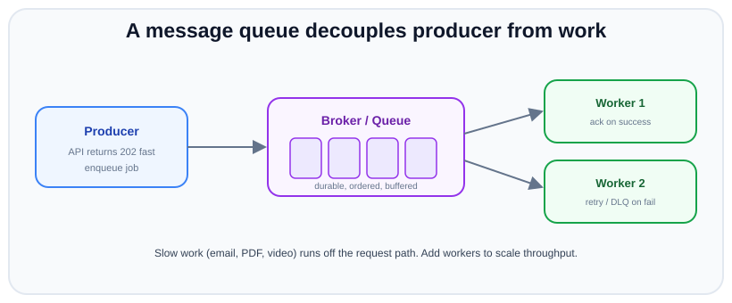
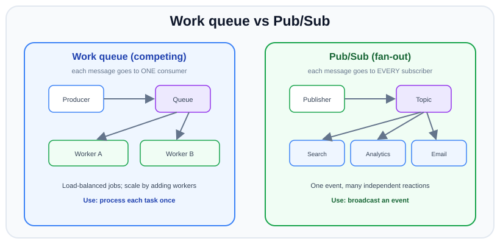

# Message queues & async jobs

*11 min read · Updated 24 Jul 2026 Topic 70 of 70 Bookmark Mark done Why it matters Some work does not belong on the request path · Topic 70 of 70*

**Source:** [https://www.geekyfrontend.in/learn/nodejs-backend-kit/message-queues](https://www.geekyfrontend.in/learn/nodejs-backend-kit/message-queues)

---

## Why it matters

Some work does not belong on the request path. When a user signs up, they should not wait for a welcome email to send, a thumbnail to render, or an analytics event to reach a warehouse. If you do that work inline, the request is as slow as your slowest dependency, and a hiccup in the email provider becomes a failed signup. Worse, a traffic spike hits your database and every third-party API at once, with nothing to smooth the load.

A **message queue** is the tool that fixes all of this. It lets a service hand off a unit of work and respond immediately, while separate workers pick the work up and do it reliably in the background — retrying on failure, absorbing spikes, and scaling independently. Queues are the backbone of resilient backends and a favourite interview topic because they force you to reason about delivery guarantees, ordering, idempotency, and failure — the parts of distributed systems that separate people who have run things in production from those who have only read about them.

## The concept, simply

A queue sits between a **producer** (who creates work) and one or more **consumers**/workers (who do it). The producer *enqueues* a message and moves on; the broker stores it durably; a worker *dequeues* it, does the job, and **acknowledges** success. If the worker crashes before acking, the broker redelivers the message to someone else — that is the reliability guarantee at the heart of the pattern.



The producer responds instantly after enqueuing; durable, buffered messages let workers do slow work in the background and scale out horizontally by simply adding more consumers.

There are two fundamental delivery shapes, and mixing them up is a classic mistake. A **work queue** load-balances: each message is handled by exactly *one* of the competing workers — perfect for "do this job once". **Pub/Sub** fans out: each message is delivered to *every* subscriber — perfect for "this event happened, let anyone interested react". Sending payment jobs via pub/sub would charge the card three times; broadcasting an event through a single work queue would let only one of your three interested services hear it.



Work queue = one message to one consumer (load-balanced jobs); Pub/Sub = one message to every subscriber (broadcast an event) — choosing the wrong one either drops work or duplicates it.

## How it works (deep)

The behaviour you must reason about is the **delivery guarantee**. *At-most-once* may drop messages (fire and forget). *Exactly-once* is the fantasy everyone wants and almost nothing truly delivers end-to-end. In practice, real brokers give you **at-least-once**: a message is delivered until it is acknowledged, so if a worker dies mid-job or its ack is lost, the message comes back — which means **duplicates are guaranteed to happen eventually**. The engineering consequence is non-negotiable: **consumers must be idempotent**. Processing the same "charge order 42" message twice must charge once. You achieve this by deduping on a stable id, using upserts, or recording processed message ids.

The **acknowledgement** is the other load-bearing idea. You ack *after* the work succeeds, never before. Ack too early and a crash loses the job silently; the whole reliability story depends on the broker holding the message until you confirm it is done. Messages that keep failing must not loop forever — after N attempts they go to a **dead-letter queue (DLQ)**, a side channel where poison messages wait for a human instead of blocking the pipeline or burning CPU on infinite retries.

The major tools embody different philosophies. **RabbitMQ** is a classic *smart broker*: producers publish to an *exchange* which routes to queues by binding rules (direct, topic, fanout); the broker tracks per-message acks and delivery, and a consumed message is gone. It excels at flexible routing and per-message work distribution. **Kafka** is a different animal — a *distributed, append-only log*. Messages are appended to partitioned *topics* and **retained** (for days, or forever) regardless of consumption; each consumer group tracks its own *offset* (its read position). That makes Kafka superb for high-throughput event streaming, replaying history, and multiple independent consumers reading the same stream — but it is not a task queue with per-message acks and selective routing. Ordering in Kafka is guaranteed only *within a partition*, which is why the partition *key* (e.g. userId) matters. **BullMQ** (Redis-backed) is the pragmatic Node default for *application job queues*: retries, delays, scheduled/repeatable jobs, rate limiting, and priorities, with almost no ops overhead if you already run Redis.

The rule of thumb: reach for a **job queue** (BullMQ) when you have discrete background *tasks* to run reliably; reach for a **log** (Kafka) when you have a high-volume *stream of events* many systems consume and you value replay; reach for a **broker** (RabbitMQ) when you need rich routing and per-message work distribution between services. And do not add any of them until inline processing actually hurts — a queue is real infrastructure with its own failure modes and monitoring burden.

## Code examples

A BullMQ producer and worker — the everyday Node pattern. The API enqueues and returns; the worker processes with automatic retries and backoff.

javascript

```
import { Queue, Worker } from 'bullmq';

const connection = { host: '127.0.0.1', port: 6379 };
const emailQueue = new Queue('emails', { connection });

// Producer: inside your signup handler, respond immediately after this
await emailQueue.add(
  'welcome',
  { userId: '42', to: 'ada@example.com' },
  {
    jobId: 'welcome-42',           // stable id -> natural de-dupe
    attempts: 5,                   // retry on failure
    backoff: { type: 'exponential', delay: 1000 },
    removeOnComplete: 1000,
  },
);

// Worker: a separate process/file
new Worker('emails', async (job) => {
  if (job.name === 'welcome') {
    await sendEmail(job.data.to); // if this throws, BullMQ retries
  }
}, { connection, concurrency: 10 });

async function sendEmail(to) { /* ... */ }
```

An idempotent consumer — because at-least-once means this *will* run twice for some message. Claim the message id first (`processing`), do the work, and mark it `done` only after the work succeeded; a claim left behind by a crashed worker expires after a lease so a redelivery can take it over.

sql

```
CREATE TABLE processed_messages (
  message_id TEXT PRIMARY KEY,
  status     TEXT NOT NULL CHECK (status IN ('processing', 'done')),
  claimed_by TEXT NOT NULL,                       -- which attempt owns the claim
  claimed_at TIMESTAMPTZ NOT NULL DEFAULT now()
);
```

javascript

```
import { randomUUID } from 'node:crypto';

const LEASE = '5 minutes'; // longer than any charge may take; older 'processing' rows count as stuck

async function handleCharge(job) {
  const { orderId } = job.data;
  const claimId = randomUUID();

  // 1. Atomically claim the message: insert it, or take over a claim stuck past the lease.
  const claim = await db.query(
    `INSERT INTO processed_messages (message_id, status, claimed_by)
     VALUES ($1, 'processing', $2)
     ON CONFLICT (message_id) DO UPDATE SET claimed_by = $2, claimed_at = now()
       WHERE processed_messages.status = 'processing'
         AND processed_messages.claimed_at < now() - $3::interval
     RETURNING message_id`,
    [job.id, claimId, LEASE],
  );
  if (claim.rowCount === 0) {
    const { rows } = await db.query('SELECT status FROM processed_messages WHERE message_id = $1', [job.id]);
    if (rows[0]?.status === 'done') return;          // duplicate delivery -> already done, ack it
    throw new Error(`message ${job.id} is claimed by another worker; retry later`);
  }

  // 2. Do the work. If it fails, release our claim so the retry can run straight away.
  try {
    await paymentProvider.charge(orderId);
  } catch (err) {
    await db.query(
      `DELETE FROM processed_messages WHERE message_id = $1 AND claimed_by = $2 AND status = 'processing'`,
      [job.id, claimId],
    );
    throw err;                                       // let the queue retry
  }

  // 3. Only now is the message done.
  await db.query(
    `UPDATE processed_messages SET status = 'done' WHERE message_id = $1 AND claimed_by = $2`,
    [job.id, claimId],
  );
}
```

The life of one message id in `processed_messages`:

1. No row yet: the claim inserts it as `processing` — this attempt owns it.
2. The work succeeds: the row becomes `done`, and every later delivery of the same id sees `done` and acks without doing the work again.
3. The work throws: the claim is deleted and the error goes back to the broker, so the retry starts again at step 1.
4. The worker crashes: the row stays `processing`. Deliveries within the lease are told to retry later; after the lease, a delivery takes over the claim and continues with the work.

The crash scenario, before and after — the worker process dies in the middle of `charge()`, then the broker redelivers:

```
Real output (PostgreSQL 18.4, pg 8.23.1, Node v24.19.0; the test moves claimed_at back 6 minutes to let the 5-minute lease pass):
OLD: mark processed, then charge
  [worker] charging... and the process dies
  redelivery: returned (acked)
  => charges: 0 | row: [ { message_id: 'msg-1' } ]                  <- job lost, customer never charged
NEW: claim -> charge -> done
  [worker] charging... and the process dies
  row after crash: [ { message_id: 'msg-1', status: 'processing' } ]
  redelivery right away: threw -> broker retries later: message msg-1 is claimed by another worker; retry later
  redelivery after lease: returned (acked)
  duplicate delivery: returned (acked)
  => charges: 1 | row: [ { message_id: 'msg-1', status: 'done' } ]
NEW: charge throws (provider down), then succeeds
  attempt 1: threw -> broker retries later: provider timeout
  row after failure: []
  attempt 2: returned (acked)
  => charges: 1
```

> **Why this was wrong:** the earlier version recorded the message as processed *before* charging. If the worker crashed (or `charge()` threw) after that insert, every redelivery saw "already processed" and acked — the job was silently lost. Mark done only after the work succeeds.

Two limits remain. A worker that dies *after* `charge()` succeeded but before step 3 will be charged again once the lease expires, so also pass a stable key to the provider (for example `job.id` as Stripe's `Idempotency-Key`) — this table cannot make an external side effect exactly-once on its own. And the lease must be longer than the slowest job, or a second worker can take over a claim that is still running.

RabbitMQ work queue with manual ack and a dead-letter queue — the two features that make delivery reliable.

javascript

```
import amqplib from 'amqplib';

const conn = await amqplib.connect(process.env.AMQP_URL);
const ch = await conn.createChannel();

// Main queue routes failures to a DLQ after they are rejected
await ch.assertQueue('jobs', {
  durable: true,
  deadLetterExchange: '',
  deadLetterRoutingKey: 'jobs.dead',
});
await ch.assertQueue('jobs.dead', { durable: true });

ch.prefetch(20); // do not fetch a message until we free capacity

ch.consume('jobs', async (msg) => {
  try {
    await doWork(JSON.parse(msg.content.toString()));
    ch.ack(msg);                      // success -> remove from queue
  } catch (err) {
    ch.nack(msg, false, false);       // fail, do not requeue -> goes to DLQ
  }
});

async function doWork(_data) {}
```

A Kafka consumer group with manual offset commit — note offsets and retention instead of per-message acks.

javascript

```
import { Kafka } from 'kafkajs';

const kafka = new Kafka({ clientId: 'orders', brokers: ['localhost:9092'] });
const consumer = kafka.consumer({ groupId: 'analytics' }); // group tracks offset

await consumer.connect();
await consumer.subscribe({ topic: 'order-events', fromBeginning: false });

await consumer.run({
  autoCommit: false, // commit only after successful processing
  eachMessage: async ({ topic, partition, message }) => {
    const event = JSON.parse(message.value.toString());
    await project(event);            // update a read model
    await consumer.commitOffsets([{  // advance our read position
      topic, partition, offset: (Number(message.offset) + 1).toString(),
    }]);
  },
});

async function project(_e) {}
```

## Common mistakes & gotchas

- **Non-idempotent consumers.** At-least-once delivery means duplicates are inevitable. If reprocessing a message double-charges, double-emails, or double-counts, the design is broken — dedupe on a stable id.
- **Acking before the work is done.** Ack after success only. Early acks turn "worker crashed mid-job" into silent data loss, defeating the entire point of a queue.
- **No dead-letter queue.** A single poison message with no DLQ retries forever, burns CPU, and can wedge the whole queue. Cap attempts and route failures aside for inspection.
- **Confusing work queues with pub/sub.** Using pub/sub for "run this job once" duplicates the work across subscribers; using one work queue for "notify everyone interested" means only one consumer hears it.
- **Assuming global ordering.** Concurrent workers process out of order by design, and Kafka only orders *within a partition*. If order matters, key related messages to the same partition/consumer and keep concurrency at 1 for that key.
- **Unbounded prefetch.** Letting a worker grab thousands of messages at once starves other workers and blows up memory; set a sane prefetch/concurrency so work is distributed.
- **Putting huge payloads on the queue.** Messages should be small pointers ("process file X at s3://..."), not multi-megabyte blobs. Store the payload elsewhere and pass a reference.
- **Treating Kafka like a task queue (or RabbitMQ like a log).** Kafka retains and replays a stream but is not built for selective per-message acking; RabbitMQ distributes tasks but is not a durable replayable log. Wrong tool, endless friction.

## Best practices

- **Make every consumer idempotent** using a stable message/operation id (dedupe table, upsert, or conditional insert) — assume every message can arrive more than once.
- **Ack only after success,** and configure bounded retries with exponential backoff plus a dead-letter queue for the messages that still fail.
- **Keep messages small and self-describing:** include a type, a version, and an id; put large data behind a reference and pass the pointer.
- **Right-size concurrency and prefetch** so load spreads across workers and a slow job cannot hoard the queue; scale throughput by adding consumers.
- **Pick the delivery shape deliberately:** work queue for "process once", pub/sub for "broadcast an event" — and where order matters, partition by a key.
- **Match the tool to the job:** BullMQ for app job queues, Kafka for high-throughput replayable streams, RabbitMQ for rich routing — do not force one to be the others.
- **Monitor depth, age, and DLQ size.** A growing backlog or an oldest-message age that keeps climbing is the earliest signal that consumers cannot keep up.
- **Only add a queue when inline work actually hurts;** it is real infrastructure with its own failure modes, not a free abstraction.

## ⭐ Interview lens

> **Q: Why put a message queue in front of background work?** To decouple producers from consumers: the request responds immediately, slow/failable work runs out-of-band with retries, traffic spikes are buffered instead of hammering downstreams, and you scale workers independently of the API. It converts "as slow and fragile as my slowest dependency" into "enqueue and move on".

> **Q: What delivery guarantee do real queues give, and what does that force on you?** At-least-once in practice — a message is redelivered until acknowledged, so duplicates will happen. That forces *idempotent consumers*: dedupe on a stable id so reprocessing is a no-op. *Trap:* claiming "exactly-once" — true end-to-end exactly-once is effectively unattainable; you approximate it with at-least-once delivery plus idempotency.

> **Q: Work queue vs pub/sub — what is the difference?** A work queue delivers each message to exactly one of the competing consumers (load-balanced, "do once"); pub/sub delivers each message to every subscriber (fan-out, "broadcast"). Choosing wrong either drops work or duplicates it across services.

> **Q: RabbitMQ vs Kafka — when each?** RabbitMQ is a smart broker with flexible routing and per-message acks; messages are consumed and gone — great for task distribution between services. Kafka is a partitioned, retained, append-only log with consumer offsets — great for high-throughput event streams, replay, and many independent consumers. Task distribution and routing ➜ RabbitMQ; event streaming and replayable history ➜ Kafka.

> **Q: A message keeps failing. What happens to it?** With bounded retries it is attempted N times (ideally with backoff); after that it is routed to a dead-letter queue for inspection rather than requeued forever. Without a DLQ a poison message loops endlessly and can stall the pipeline.

> **Q: How do you preserve ordering when it matters?** Accept that concurrent workers reorder by default. Route all messages that must stay ordered to the same partition/queue via a consistent key (e.g. userId) and process that key with a single consumer/concurrency of 1. Kafka guarantees order only within a partition, so the partition key is the lever.

## Cheat-card

- **Queue =** producer ➜ durable broker ➜ worker; respond fast, process slow work off the request path.
- **Delivery:** real brokers = **at-least-once** ➜ duplicates happen ➜ consumers MUST be idempotent (dedupe on id).
- **Ack after success only;** failed messages ➜ bounded retries + backoff ➜ dead-letter queue.
- **Shape:** work queue = one message to one consumer; pub/sub = one message to all subscribers.
- **Tools:** BullMQ (Redis) = app job queues; Kafka = retained/replayable log, order per partition; RabbitMQ = routing + per-message acks.
- **Ordering:** not global; key related messages to one partition/consumer if order matters.
- **Hygiene:** small referenced payloads, tuned prefetch/concurrency, monitor depth/age/DLQ; add a queue only when inline hurts.
- **SQS/SNS:** SNS topic → one SQS queue per consumer (fan-out; queue policy for `sqs:SendMessage`, `RawMessageDelivery`); delete = ack; visibility timeout default 30 s, max 12 h; redrive policy `maxReceiveCount` → DLQ in same account and Region.
- **SQS FIFO:** `.fifo` name, `MessageGroupId` required (order per group), `MessageDeduplicationId` or content-based dedupe for 5 minutes; examples ran on fauxqs 2.12.2, not AWS.
- **Cron-triggered jobs:** derive the job id from the schedule slot, or use BullMQ `upsertJobScheduler`; see [113](113-scheduled-jobs.md).
- **`jobId` dedupe** lasts only while the job is stored (`removeOnComplete` frees the id).
- **Outbox:** event row in the same transaction as the business row; relay `FOR UPDATE SKIP LOCKED` → publish → `sent_at`; at-least-once, see [69](69-microservices-in-node.md).

---

## Learn More

- [RabbitMQ Tutorial - "Hello World!" (JavaScript/amqplib) rabbitmq.com](https://www.rabbitmq.com/tutorials/tutorial-one-javascript)
- [RabbitMQ Tutorial - Work Queues (JavaScript/amqplib) rabbitmq.com](https://www.rabbitmq.com/tutorials/tutorial-two-javascript)
- [Kafka vs RabbitMQ: The Best Message Queue Explained The Coding Gopher](https://www.youtube.com/watch?v=PQHf_IzmUXE)

---

## Additional topics

*Added 12 Oct 2026 · examples verified on Node v24.19.0 and fauxqs 2.12.2 (a local SNS/SQS emulator run from npm, no Docker), @aws-sdk/client-sqs 3.1149.0, @aws-sdk/client-sns 3.1149.0, bullmq 6.3.13, node-cron 4.6.0, ioredis 6.0.0, Redis 8.0.5, pg 8.23.1, PostgreSQL 18.4*

### AWS SQS and SNS

**Amazon SQS** is a managed work queue: producers call `SendMessage`, consumers poll with `ReceiveMessage`, and a message stays in the queue until a consumer calls `DeleteMessage` with the receipt handle it was given. There is no ack: deleting *is* the ack. **Amazon SNS** is managed pub/sub: one `Publish` to a topic is pushed to every subscription. Putting an SQS queue behind each subscription gives **fan-out**: every interested service gets its own durable copy and reads it at its own pace, and a slow or broken consumer only backs up its own queue. Without the queues, SNS would push straight to the consumers, and one that is down would miss events.

How it works:

1. The producer publishes once to a topic. SNS delivers a copy to each subscribed queue. On AWS each queue needs a queue policy that lets the topic call `sqs:SendMessage`, limited with `aws:SourceArn` (SNS developer guide). With `RawMessageDelivery: 'true'` the queue gets your message body as is; without it, the body is a JSON envelope (`Type`, `MessageId`, `TopicArn`, `Message`, …).
2. A consumer calls `ReceiveMessage` (`WaitTimeSeconds` turns on long polling). The message is not removed; it becomes **invisible** for the queue's **visibility timeout** ("The default visibility timeout for a queue is 30 seconds", with "a maximum limit of 12 hours"; a consumer can extend it with `ChangeMessageVisibility`).
3. If the consumer deletes it before the timeout, it is gone. If it crashes or is too slow, the message becomes visible again and its `ApproximateReceiveCount` goes up. So SQS standard queues are at-least-once, like every broker in this lesson.
4. A **redrive policy** names a dead-letter queue and a `maxReceiveCount`: "the number of times a consumer can receive a message from a source queue before it is moved to a dead-letter queue". The DLQ must be in the same account and Region.
5. A **FIFO queue** (name ends in `.fifo`, `FifoQueue: 'true'`) needs a `MessageGroupId` on every message. Order is kept *within* a group, and while messages of a group are in flight, no further messages of that group are handed out. Different groups run in parallel. A send with the same `MessageDeduplicationId` (or the same body, with `ContentBasedDeduplication`) within "the 5-minute deduplication interval" is accepted but not added again.

text

```
                        ┌──────────────► SQS order-analytics ──► analytics worker (deletes)
producer ── Publish ──► SNS order-events
                        └──────────────► SQS order-email ──► email worker (crashes, never deletes)
                                              │  visible again after VisibilityTimeout,
                                              │  ApproximateReceiveCount 1, 2, ...
                                              └─ count > maxReceiveCount ──► SQS order-email-dlq
```

**Where this ran.** No AWS account or credentials were used. LocalStack was not an option: its installation page says "You must have a working Docker installation" (and LocalStack for AWS now needs an auth token), and Docker is not installed on this machine. The examples instead use **fauxqs** 2.12.2 (MIT, last release 8 Oct 2026, `npm install fauxqs`), which serves the SQS and SNS APIs on one port and states support for visibility timeouts, DLQs with `maxReceiveCount`, FIFO groups and deduplication, and SNS-to-SQS fan-out. It does no authentication, so the queue policy in the example is stored but not enforced.

bash

```
$ npm install fauxqs@2.12.2 @aws-sdk/client-sqs@3.1149.0 @aws-sdk/client-sns@3.1149.0
$ FAUXQS_PORT=7310 FAUXQS_LOGGER=false npx fauxqs &
$ curl -s localhost:7310/health
{"status":"ok"}
$ export SQS_ENDPOINT=http://127.0.0.1:7310
```

**Example — SNS fan-out to two queues, the visibility timeout, and a DLQ after `maxReceiveCount`.**

javascript

```
// SNS -> two SQS queues, visibility timeout, DLQ after maxReceiveCount.
// Talks to a local emulator (fauxqs) on port 7310; never to AWS.
import {
  SQSClient, CreateQueueCommand, GetQueueAttributesCommand, SetQueueAttributesCommand,
  SendMessageCommand, ReceiveMessageCommand, DeleteMessageCommand,
} from '@aws-sdk/client-sqs';
import { SNSClient, CreateTopicCommand, SubscribeCommand, PublishCommand } from '@aws-sdk/client-sns';

const local = {
  region: 'us-east-1',
  endpoint: process.env.SQS_ENDPOINT ?? 'http://127.0.0.1:4566',   // fauxqs default port
  credentials: { accessKeyId: 'local', secretAccessKey: 'local' },   // dummy: the emulator ignores them
};
const sqs = new SQSClient(local);
const sns = new SNSClient(local);
const sleep = (ms) => new Promise((r) => setTimeout(r, ms));

async function queue(name, attrs = {}) {
  const { QueueUrl } = await sqs.send(new CreateQueueCommand({ QueueName: name, Attributes: attrs }));
  const { Attributes } = await sqs.send(new GetQueueAttributesCommand({ QueueUrl, AttributeNames: ['QueueArn'] }));
  return { url: QueueUrl, arn: Attributes.QueueArn };
}

// 1. Queues: email has a 2 s visibility timeout and a DLQ after 2 receives
const dlq = await queue('order-email-dlq');
const email = await queue('order-email', {
  VisibilityTimeout: '2',
  RedrivePolicy: JSON.stringify({ deadLetterTargetArn: dlq.arn, maxReceiveCount: 2 }),
});
const analytics = await queue('order-analytics');

// 2. Topic + one subscription per queue (fan-out). On AWS each queue also needs a
//    queue policy that lets this topic call sqs:SendMessage.
const { TopicArn } = await sns.send(new CreateTopicCommand({ Name: 'order-events' }));
for (const q of [email, analytics]) {
  await sqs.send(new SetQueueAttributesCommand({ QueueUrl: q.url, Attributes: { Policy: JSON.stringify({
    Version: '2012-10-17',
    Statement: [{ Effect: 'Allow', Principal: { Service: 'sns.amazonaws.com' }, Action: 'sqs:SendMessage',
      Resource: q.arn, Condition: { ArnEquals: { 'aws:SourceArn': TopicArn } } }],
  }) } }));
  await sns.send(new SubscribeCommand({
    TopicArn, Protocol: 'sqs', Endpoint: q.arn, Attributes: { RawMessageDelivery: 'true' },
  }));
}

// 3. Publish once; both queues get a copy
await sns.send(new PublishCommand({ TopicArn, Message: JSON.stringify({ type: 'order.placed', orderId: 42 }) }));

const receive = (q) => sqs.send(new ReceiveMessageCommand({
  QueueUrl: q.url, MaxNumberOfMessages: 10, WaitTimeSeconds: 1, MessageSystemAttributeNames: ['ApproximateReceiveCount'],
})).then((r) => r.Messages ?? []);

const [a] = await receive(analytics);
console.log('analytics got:', a.Body);
await sqs.send(new DeleteMessageCommand({ QueueUrl: analytics.url, ReceiptHandle: a.ReceiptHandle }));  // done -> delete

// 4. The email worker "crashes": it receives but never deletes
let [m] = await receive(email);
console.log('email got:', m.Body, '| receive count', m.Attributes.ApproximateReceiveCount);
console.log('received again at once:', (await receive(email)).length, 'messages (invisible for 2 s)');
await sleep(2500);
[m] = await receive(email);
console.log('after the timeout:', m.Body, '| receive count', m.Attributes.ApproximateReceiveCount);
await sleep(2500);
console.log('3rd receive on email:', (await receive(email)).length, 'messages');
const dead = await receive(dlq);
console.log('DLQ has:', dead.map((d) => d.Body));

// Real output (Node v24.19.0, @aws-sdk/client-sqs and client-sns 3.1149.0, fauxqs 2.12.2):
//   analytics got: {"type":"order.placed","orderId":42}
//   email got: {"type":"order.placed","orderId":42} | receive count 1
//   received again at once: 0 messages (invisible for 2 s)
//   after the timeout: {"type":"order.placed","orderId":42} | receive count 2
//   3rd receive on email: 0 messages
//   DLQ has: [ '{"type":"order.placed","orderId":42}' ]
```

One publish reached both queues. The analytics worker deleted its copy. The email copy came back after 2 s with a receive count of 2, and the third receive found it already moved to the DLQ, which matches `maxReceiveCount: 2`.

**Example — a FIFO queue: groups and deduplication.**

javascript

```
// FIFO queue: ordering per MessageGroupId, deduplication by MessageDeduplicationId.
import {
  SQSClient, CreateQueueCommand, SendMessageCommand, ReceiveMessageCommand, DeleteMessageCommand,
} from '@aws-sdk/client-sqs';

const sqs = new SQSClient({
  region: 'us-east-1',
  endpoint: process.env.SQS_ENDPOINT ?? 'http://127.0.0.1:4566',   // fauxqs default port
  credentials: { accessKeyId: 'local', secretAccessKey: 'local' },
});

const { QueueUrl } = await sqs.send(new CreateQueueCommand({
  QueueName: 'payments.fifo',                       // FIFO names must end in .fifo
  Attributes: { FifoQueue: 'true', ContentBasedDeduplication: 'false' },
}));

const ids = new Map();
async function send(group, dedupId, body) {
  const r = await sqs.send(new SendMessageCommand({
    QueueUrl, MessageBody: body, MessageGroupId: group, MessageDeduplicationId: dedupId,
  }));
  const seen = ids.has(dedupId) ? `same MessageId as before: ${ids.get(dedupId) === r.MessageId}` : 'new message';
  ids.set(dedupId, r.MessageId);
  console.log(`send ${body.padEnd(14)} group=${group} dedup=${dedupId.padEnd(18)} -> ${seen}`);
}
await send('order-42', 'order-42:authorize', 'authorize #42');
await send('order-42', 'order-42:authorize', 'authorize #42');   // a producer retry: same dedup id
await send('order-42', 'order-42:capture', 'capture #42');
await send('order-77', 'order-77:authorize', 'authorize #77');

try {
  await sqs.send(new SendMessageCommand({ QueueUrl, MessageBody: 'no group' }));
} catch (err) {
  console.log('send without MessageGroupId:', err.name, '-', err.message);
}

// Drain: receive, print, delete
for (let round = 1; round <= 3; round++) {
  const { Messages = [] } = await sqs.send(new ReceiveMessageCommand({
    QueueUrl, MaxNumberOfMessages: 10, WaitTimeSeconds: 1, MessageSystemAttributeNames: ['MessageGroupId'],
  }));
  console.log(`receive ${round}:`, Messages.map((m) => `${m.Body} [${m.Attributes.MessageGroupId}]`));
  for (const m of Messages) await sqs.send(new DeleteMessageCommand({ QueueUrl, ReceiptHandle: m.ReceiptHandle }));
  if (Messages.length === 0) break;
}

// Real output (Node v24.19.0, @aws-sdk/client-sqs 3.1149.0, fauxqs 2.12.2):
//   send authorize #42  group=order-42 dedup=order-42:authorize -> new message
//   send authorize #42  group=order-42 dedup=order-42:authorize -> same MessageId as before: true
//   send capture #42    group=order-42 dedup=order-42:capture   -> new message
//   send authorize #77  group=order-77 dedup=order-77:authorize -> new message
//   send without MessageGroupId: AWS.SimpleQueueService.MissingParameter - The request must contain the parameter MessageGroupId.
//   receive 1: [ 'authorize #42 [order-42]', 'authorize #77 [order-77]' ]
//   receive 2: [ 'capture #42 [order-42]' ]
//   receive 3: []
```

The retried `authorize #42` got the first send's `MessageId` back and was delivered once. `capture #42` was held back until `authorize #42` was deleted, while order 77 was not blocked by order 42. Use one group per entity that needs ordering (an order id, an account id), not one group for the whole queue, or every message waits for the one before it.

> ⚠️ Unverified: behaviour on real AWS, because only the emulator was run. Two known differences: AWS "attempts to return as many messages as possible with the same message group ID in a single call" (SQS developer guide), so receive 1 on AWS may return both order-42 messages, in order, where fauxqs returned one per group; and the error name and text for the missing `MessageGroupId` above are fauxqs's. Queue policies were not enforced.

### Cron-triggered jobs

A cron-triggered job is a queue job whose producer is a clock instead of a request. The schedule decides *when* a job is enqueued; the queue then gives it the usual retries, backoff, concurrency limits and DLQ. The risk is the producer side: if every app instance runs the cron, every instance enqueues. [Lesson 113 (Scheduled Jobs)](113-scheduled-jobs.md) covers node-cron, BullMQ job schedulers (`upsertJobScheduler`, which replaced the `repeat` option in BullMQ 6), OS cron, Kubernetes CronJobs, locks, run keys and DST.

How it works:

1. The scheduler fires for a slot (for example `2026-10-13T03:00:00.000Z`) in one or more instances.
2. Each instance enqueues a job whose id is derived from the slot. The queue stores the first one; the others are duplicates of a stored id and are not added.
3. A worker runs the job with retries. Inside the job, the claim → work → done table from the example above still protects against redeliveries.

**Example — three cron triggers, one job per slot because the job id is the slot.**

javascript

```
// Every instance runs the cron; the queue keeps one job per slot because the jobId is the slot.
import cron from 'node-cron';
import { Queue, Worker } from 'bullmq';

const connection = { host: '127.0.0.1', port: Number(process.env.REDIS_PORT ?? 6379) };
const queue = new Queue('nightly', { connection });

const tasks = ['A', 'B', 'C'].map((instance) =>          // three "instances" in one process for the demo
  cron.schedule('*/3 * * * * *', async (ctx) => {
    const slot = ctx.date.toISOString();
    await queue.add('cleanup', { slot, enqueuedBy: instance }, {
      jobId: `cleanup-${slot}`,                          // same slot -> same id -> stored once
      attempts: 3, backoff: { type: 'exponential', delay: 1000 },
    });
    console.log(`[${instance}] add cleanup-${slot}`);
  }, { name: `cleanup-${instance}`, timezone: 'Etc/UTC' }));

const runs = [];
let firstRun;
const ran = new Promise((r) => { firstRun = r; });
const worker = new Worker('nightly', async (job) => {
  runs.push(job.id);
  console.log(`worker ran ${job.id}, stored data enqueuedBy=${job.data.enqueuedBy}`);
  firstRun();
}, { connection });

await ran;
for (const t of tasks) await t.destroy();                // stop the crons after the first slot
await new Promise((r) => setTimeout(r, 500));            // let any duplicate show up
console.log('worker runs:', runs.length);
await worker.close();
await queue.obliterate({ force: true });
await queue.close();

// Real output (Node v24.19.0, node-cron 4.6.0, bullmq 6.3.13, ioredis 6.0.0, Redis 8.0.5; REDIS_PORT=7301):
//   [A] add cleanup-2026-10-12T17:28:12.000Z
//   [B] add cleanup-2026-10-12T17:28:12.000Z
//   [C] add cleanup-2026-10-12T17:28:12.000Z
//   worker ran cleanup-2026-10-12T17:28:12.000Z, stored data enqueuedBy=A
//   worker runs: 1
```

All three instances called `add`, and only A's job was stored and run. The edge case below shows when this stops working.

### The outbox pattern

The **transactional outbox** solves the "dual write" problem: a service that writes an order to its database and then publishes `order.placed` can crash between the two, leaving an order with no event (or, if it publishes first, an event for an order that was rolled back). With an outbox, the event is written as a row in an `outbox` table **in the same transaction** as the order, so both commit or neither does. A separate relay reads unsent rows, publishes them and marks them sent. Delivery is then at-least-once (a relay that crashes after publishing but before marking will publish again), so consumers still need the idempotent claim → work → done handling from this lesson. [Lesson 69 (Microservices in Node)](69-microservices-in-node.md) has the full worked implementation; this is only the short version.

How it works:

1. `BEGIN`, insert the business row, insert the outbox row, `COMMIT`.
2. The relay selects unsent rows `FOR UPDATE SKIP LOCKED` (so several relays do not take the same rows; see the SKIP LOCKED appendix in [lesson 47](47-transactions-amp-acid.md)), publishes each one, and sets `sent_at`.
3. Consumers dedupe on the outbox row id.

**Example — a rolled-back order publishes nothing; a committed one publishes once.**

javascript

```
// Outbox: the event row commits (or rolls back) with the business row; a relay publishes it later.
import pg from 'pg';
import { SQSClient, CreateQueueCommand, SendMessageCommand, ReceiveMessageCommand } from '@aws-sdk/client-sqs';

const db = new pg.Pool({ connectionString: process.env.DATABASE_URL });
const sqs = new SQSClient({
  region: 'us-east-1', endpoint: process.env.SQS_ENDPOINT ?? 'http://127.0.0.1:4566',
  credentials: { accessKeyId: 'local', secretAccessKey: 'local' },   // dummy, local emulator only
});
const { QueueUrl } = await sqs.send(new CreateQueueCommand({ QueueName: 'order-events' }));

await db.query(`DROP TABLE IF EXISTS outbox, orders;
  CREATE TABLE orders (id serial PRIMARY KEY, total int NOT NULL CHECK (total > 0));
  CREATE TABLE outbox (id bigserial PRIMARY KEY, type text NOT NULL, payload jsonb NOT NULL,
                       sent_at timestamptz)`);

// 1. Business write and event write in ONE transaction: both commit or neither does
async function placeOrder(total) {
  const c = await db.connect();
  try {
    await c.query('BEGIN');
    const { rows: [o] } = await c.query('INSERT INTO orders (total) VALUES ($1) RETURNING id', [total]);
    await c.query(`INSERT INTO outbox (type, payload) VALUES ('order.placed', $1)`, [{ orderId: o.id, total }]);
    await c.query('COMMIT');
    return `order ${o.id} committed`;
  } catch (err) {
    await c.query('ROLLBACK');
    return `rolled back (${err.message})`;
  } finally { c.release(); }
}

// 2. Relay: claim unsent rows (SKIP LOCKED lets several relays run), publish, mark sent
async function relayOnce() {
  const c = await db.connect();
  try {
    await c.query('BEGIN');
    const { rows } = await c.query(
      'SELECT id, type, payload FROM outbox WHERE sent_at IS NULL ORDER BY id LIMIT 10 FOR UPDATE SKIP LOCKED');
    for (const r of rows) {
      await sqs.send(new SendMessageCommand({ QueueUrl, MessageBody: JSON.stringify({ id: String(r.id), type: r.type, ...r.payload }) }));
      await c.query('UPDATE outbox SET sent_at = now() WHERE id = $1', [r.id]);
    }
    await c.query('COMMIT');
    return rows.length;
  } finally { c.release(); }
}

console.log(await placeOrder(1500));
console.log(await placeOrder(-5));                        // violates the CHECK -> no event either
console.log('outbox rows:', (await db.query('SELECT id, type, sent_at FROM outbox')).rows.map((r) => `${r.id} ${r.type} sent=${r.sent_at !== null}`));
console.log('relay published:', await relayOnce(), '| second pass:', await relayOnce());
const { Messages = [] } = await sqs.send(new ReceiveMessageCommand({ QueueUrl, MaxNumberOfMessages: 10, WaitTimeSeconds: 1 }));
console.log('queue has:', Messages.map((m) => m.Body));
await db.end();

// Real output (Node v24.19.0, pg 8.23.1, PostgreSQL 18.4, @aws-sdk/client-sqs 3.1149.0, fauxqs 2.12.2):
//   order 1 committed
//   rolled back (new row for relation "orders" violates check constraint "orders_total_check")
//   outbox rows: [ '1 order.placed sent=false' ]
//   relay published: 1 | second pass: 0
//   queue has: [ '{"id":"1","type":"order.placed","total":1500,"orderId":1}' ]
```

The failed order left no outbox row, so nothing was published for it. The relay published the committed event once, and its second pass found nothing unsent.

### Common mistakes & gotchas (additional topics)

- **A visibility timeout shorter than the job.** The message reappears while the first consumer is still working, and a second consumer starts the same job. Set the timeout above the slowest run, or extend it with `ChangeMessageVisibility` while working.
- **Forgetting `DeleteMessage`.** Receiving is not consuming. A worker that finishes without deleting sends every message round again until it lands in the DLQ.
- **`maxReceiveCount: 1`.** One failed receive moves the message to the DLQ; the SQS guide warns to set it "high enough to allow for sufficient retries".
- **One `MessageGroupId` for a whole FIFO queue.** Everything is then processed one message at a time. Group by the entity that needs ordering.
- **Expecting FIFO deduplication to last.** It covers 5 minutes. A retry after that is a new message, so the consumer still needs its own idempotency.
- **Forgetting the queue policy for SNS.** On AWS the queue needs a policy that allows `sqs:SendMessage` from the topic (SNS developer guide). The emulator does not check it, so a missing policy only shows up on AWS (see the Unverified note).
- **Parsing the SNS envelope by accident.** Without `RawMessageDelivery`, the SQS body is SNS's JSON wrapper and your payload is the string in its `Message` field.
- **A cron per instance with no dedupe.** Each instance enqueues its own copy. Derive the job id from the slot, or use a BullMQ job scheduler (lesson 113).
- **Publishing inside the business transaction instead of using an outbox.** A publish that succeeds followed by a rollback sends an event for something that never happened.

### Edge case worked through: a `jobId` only deduplicates while the job is still stored

The BullMQ example at the top of this lesson uses `jobId: 'welcome-42'` as a "natural de-dupe" together with `removeOnComplete: 1000`. The dedupe works by refusing to add a job whose id already exists in Redis. Once the completed job has been removed, the id is free again, and a late duplicate is a brand-new job:

javascript

```
import { Queue, Worker } from 'bullmq';
const connection = { host: '127.0.0.1', port: Number(process.env.REDIS_PORT ?? 6379) };
const queue = new Queue('dedupe-test', { connection });
let runs = 0;
const worker = new Worker('dedupe-test', async () => { runs += 1; }, { connection });
for (const removeOnComplete of [false, true]) {
  runs = 0;
  await queue.add('x', {}, { jobId: `slot-${removeOnComplete}`, removeOnComplete });
  await new Promise((r) => setTimeout(r, 300));       // first copy completes
  await queue.add('x', {}, { jobId: `slot-${removeOnComplete}`, removeOnComplete }); // late duplicate
  await new Promise((r) => setTimeout(r, 300));
  console.log(`removeOnComplete=${removeOnComplete}: same jobId added twice -> worker runs: ${runs}`);
}
await worker.close(); await queue.obliterate({ force: true }); await queue.close();

// Real output (Node v24.19.0, bullmq 6.3.13, ioredis 6.0.0, Redis 8.0.5; REDIS_PORT=7301):
//   removeOnComplete=false: same jobId added twice -> worker runs: 1
//   removeOnComplete=true: same jobId added twice -> worker runs: 2
```

With `removeOnComplete: 1000`, the id is protected only while the job is among the last 1,000 completed jobs. That is fine for "two producers enqueue within a second" (the cron example above) but not for "a duplicate can arrive tomorrow". For that, keep the database dedupe (claim → work → done), which remembers the id for as long as the row exists.

### ⭐ Interview lens (additional topics)

> **Q: “How do you send one event to three services on AWS so that one slow service cannot hold up the others?”**  
> A: Publish once to an SNS topic and give each service its own SQS queue subscribed to the topic (with a queue policy allowing the topic, and usually raw message delivery). Each service polls and deletes from its own queue, has its own visibility timeout and its own DLQ through a redrive policy with `maxReceiveCount`. A slow service only grows its own queue. Delivery is at-least-once, so each consumer dedupes on an event id. *Trap:* one shared queue for all three; that is a work queue, so each event reaches only one of them.

> **Q: “Why use an outbox instead of publishing right after the database commit?”**  
> A: Because the process can die between the commit and the publish, and then the event is lost for good. Writing the event as a row in the same transaction makes the event exactly as durable as the business change. A relay publishes it afterwards, possibly more than once, so consumers must be idempotent.
