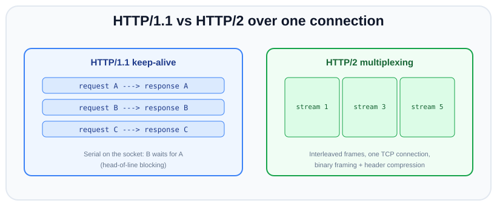

# Outbound HTTP: fetch, undici and http.request

*30 min read · Updated 10 Oct 2026 · Topic 75 of 85 · added to this kit, not part of the original course*

**Source:** written for this kit — examples verified on Node v24.19.0

---

## Why it matters

Most backends spend as much time calling other servers as answering their own clients: a payment provider, an auth server, another microservice, an object store. Lessons 12, 25 and 69 already call `fetch()` without explaining it. This lesson explains what happens underneath.

An outbound request with default settings has no useful deadline: undici's documented header and body timeouts are 300 seconds each, and `http.request` has none at all. It reuses connections in ways you cannot see, and it reports failures as a generic `TypeError: fetch failed` with the real reason one level down in `err.cause`. When it goes wrong in production, it looks like this:

- **One slow upstream piles up sockets.** Without a deadline, every request waits for minutes and holds a socket and a closure the whole time.
- **Unread response bodies stall the pool.** A response you never read keeps its connection busy, so the next request to that host waits behind it (Example 16).
- **Retries make things worse.** Retrying a `POST` can charge a card twice. Retrying with no delay hammers a server that is already overloaded.
- **Errors you cannot tell apart.** "Connection refused", "the server reset the connection" and "no headers within 300 s" all reach your `catch` as the same `TypeError`.

Node gives you three client APIs. You need to know which one to reach for and how each behaves when the network misbehaves.

## The concept, simply

An outbound HTTP request in Node goes through one of three APIs:

- **`fetch()`** (global; added in v17.5.0 behind a flag, unflagged in v18.0.0, stable since v21.0.0). It is the WHATWG Fetch API, the same one browsers have: `fetch(url, init)` returns a promise of a `Response` with `status`, `ok`, `headers` and a body you read once (`text()`, `json()`, `arrayBuffer()`, or the `body` web stream). Node implements it with a copy of **undici** bundled inside the Node binary. `process.versions.undici` tells you which copy: `7.29.0` on Node v24.19.0.
- **The `undici` npm package** (`npm install undici`; 8.11.2 used here). It is the same HTTP client as a library, with a newer version and more APIs: `request()` (returns `{ statusCode, headers, body }`; the undici README ranks it fastest of the three APIs), the connection objects `Client`, `Pool` and `Agent`, test doubles (`MockAgent`), `RetryAgent`, and proxy agents (`ProxyAgent`, `EnvHttpProxyAgent`).
- **`http.request()` / `https.request()`** (core since v0.x). The original Node API. The request is a Writable stream, the response is a Readable stream (`IncomingMessage`), and an `http.Agent` decides which TCP socket each request uses. It is built on Node's own `net` module and C++ parser, not on undici.

Every one of them is built from the same parts: a **connection manager** that owns TCP (or TLS) sockets per origin (an origin is scheme + host + port) and a **queue** of requests waiting for a free socket. In undici the parts are called *dispatchers*:

text

```
fetch(url)  /  undici.request(url)
        │
        ▼
  dispatcher (default: the global Agent; or { dispatcher } per request)
        │  Agent: one Pool per origin, created on first use
        ▼
  Pool  "http://127.0.0.1:3000"      connections: null = no limit (the default)
   ├── Client #1 ── TCP socket ──► server     one request at a time (pipelining: 1)
   ├── Client #2 ── TCP socket ──► server
   └── queue: requests waiting for a free Client  (pool.stats.pending)

http.request(options)
        │
        ▼
  http.Agent (default: http.globalAgent)
   ├── sockets['host:port:']       busy sockets, at most maxSockets
   ├── freeSockets['host:port:']   idle keep-alive sockets
   └── requests['host:port:']      requests waiting for a socket
```

## How it works

What happens during `await fetch('http://api.internal/users/7')`:

1. **Pick a dispatcher.** `fetch` uses `init.dispatcher` if you passed one, otherwise the process-wide global dispatcher (an undici `Agent`).
2. **Find the pool for the origin.** The Agent keeps a map from origin to `Pool`. The first request to an origin creates the Pool.
3. **Get a connection.** If a Client in the Pool has an idle keep-alive socket, the request goes on it. If not, and the Pool is below `connections`, it opens a new socket: DNS lookup, TCP connect (limited by `connectTimeout`, default 10 s), and a TLS handshake for `https:`. Otherwise the request waits in the queue.
4. **Write the request.** Request line, headers, then the body (a string or buffer at once, a stream chunk by chunk).
5. **Wait for headers.** `headersTimeout` (default 300 s) runs until the status line and all headers have arrived. Then the `fetch` promise resolves with a `Response`. **The body has not been read yet.**
6. **Read the body.** `res.json()`, `res.text()` or iterating `res.body` pulls the bytes. `bodyTimeout` (default 300 s) limits the gap *between* chunks, not the total time.
7. **Release the connection.** When the body has been read to the end, the socket goes back to the pool for the next request to that origin. If the body is never read, the socket stays busy.

**Connection reuse (keep-alive).** Opening a TCP connection costs a round trip, and a TLS handshake costs more. HTTP/1.1 keep-alive lets a client send the next request on a socket that already exists. Both stacks do this by default: the undici `Agent` behind `fetch`, and `http.globalAgent` (keep-alive on by default since v19.0.0; a custom `http.Agent` needs `keepAlive: true`). The catch is that HTTP/1.1 has no request IDs, so one socket carries **one request at a time**. Requests take turns on the socket: request B is sent only after response A has been fully read. To run requests in parallel you need several sockets, which is what `maxSockets` (`http.Agent`, default `Infinity`) and `connections` (undici `Pool`, default no limit) control. Requests beyond that limit wait in the agent's queue (Examples 2 and 3).


*Figure: HTTP/1.1 keep-alive vs HTTP/2 multiplexing on one connection. Look at: the top lane, where "B waits for A" is exactly the queueing you see with `maxSockets: 1`.*

HTTP/2 removes that limit by interleaving many streams on one connection. In these runs, Node's built-in `fetch` (undici 7.29.0) talked HTTP/1.1 to an HTTP/2-capable TLS server, undici 7.30.0 did too unless given `allowH2: true`, and undici 8.11.2 negotiated HTTP/2 by default. The undici v7→v8 migration guide documents that change.

**Timeouts come in phases.** One number cannot describe "the request took too long", because a request can stall in three places:

| Phase | undici (`Agent` / `Pool` / `Client` option, default) | `http.request` | Whole request |
| --- | --- | --- | --- |
| TCP/TLS connect | `connectTimeout`, 10 000 ms → `UND_ERR_CONNECT_TIMEOUT` | none of its own; the kernel gives up after its SYN retries (`ETIMEDOUT` after ~130 s on this machine, `tcp_syn_retries = 6`) | `AbortSignal.timeout(ms)` (added in v17.3.0) aborts any phase |
| Waiting for headers | `headersTimeout`, 300 000 ms → `UND_ERR_HEADERS_TIMEOUT` | `timeout` option: emits `'timeout'` after that many ms with **no socket activity**, in any phase including connect; you must call `req.destroy()` yourself | same signal |
| Reading the body | `bodyTimeout`, 300 000 ms between chunks → `UND_ERR_BODY_TIMEOUT` | same idle `timeout` | same signal |

The undici timers are coarse. In undici 8.11.2 the header and body timers are "fast timers" that a shared ticker checks about every 500 ms (`lib/util/timers.js`, `RESOLUTION_MS = 1e3`). A 300 ms `headersTimeout` fired after about 1000 ms in Example 5, and a 100 ms one after 1008 ms in a separate run. The Client docs say delays up to 1000 ms use native timers, but the parser code always picks the fast timer for the header and body phases. For a tight deadline, use `AbortSignal.timeout`, which fired on time (400 ms) in the same run.

**Retries need two rules.** First, only retry what is safe to repeat. RFC 9110 §9.2.2 defines a method as idempotent when "the intended effect on the server of multiple identical requests with that method is the same as the effect for a single such request". `PUT`, `DELETE` and the safe methods (`GET`, `HEAD`, `OPTIONS`, `TRACE`) are idempotent. `POST` and `PATCH` are not, unless the server deduplicates them with a key you send. The `Idempotency-Key` header for that comes from an IETF Internet-Draft (draft-ietf-httpapi-idempotency-key-header, listed as expired on 10 Oct 2026), not from an RFC. Second, wait longer after each failure, and add randomness (*jitter*) so a thousand clients that failed at the same moment do not all retry at the same moment. undici's `RetryAgent` (added in undici v6.7.0) does the first rule and exponential backoff (`minTimeout * timeoutFactor ** (n - 1)`, default 500 ms × 2ⁿ⁻¹, capped at 30 s, honouring `Retry-After`). Its default strategy adds no jitter. `interceptors.retry` is the same logic as an interceptor. Both exist in 8.11.2.

**Redirects.** `fetch` follows up to 20 redirects by default (`redirect: 'follow'`), changes `POST` to `GET` on a 301, 302 or 303 (307 and 308 keep the method; checked in a separate run), and sets `res.redirected` and `res.url`. `redirect: 'manual'` hands you the 3xx response with its `location` header. `redirect: 'error'` rejects. `http.request` never follows redirects.

**Proxies.** A forward proxy receives either an absolute-form request line (`GET http://host:port/path HTTP/1.1`) for plain HTTP, or a `CONNECT host:port` request, after which it copies raw bytes in both directions (a tunnel; HTTPS always uses one). undici's `ProxyAgent` (added in undici v4.8.2) sends to a proxy you name. `EnvHttpProxyAgent` (added in undici v6.14.0) reads `http_proxy`, `https_proxy` and `no_proxy`. Node itself reads the same variables when you start it with `NODE_USE_ENV_PROXY=1` (added in v24.0.0) or `--use-env-proxy` (added in v24.5.0). That covers both the built-in `fetch` and `http.request`/`https.request` (the `proxyEnv` option of `http.Agent` was added in v24.5.0; `http.setGlobalProxyFromEnv()` in v24.14.0). Both are marked "Stability: 1.1 - Active Development".

**Errors have two layers in `fetch`.** Network failures reject with `TypeError: fetch failed` (or `TypeError: terminated` if the body was cut off), and the real reason is `err.cause`: a Node system error (`ECONNREFUSED`, `ECONNRESET`, `ENOTFOUND`) or an undici error with a `UND_ERR_*` code. HTTP error statuses (404, 500) are **not** errors: the promise resolves and `res.ok` is `false`. `http.request` emits the system error directly on `'error'`.

## Code examples

The examples run against local servers on `127.0.0.1` so the output is reproducible. Install the library once with `npm install undici@8.11.2` for the examples that import it. Client port numbers differ on every run.

**Example 1 — `fetch` basics: status, headers, JSON, and a 404 that does not throw.**

javascript

```
import http from 'node:http';
import { once } from 'node:events';
import { createRequire } from 'node:module';

const require = createRequire(import.meta.url);
console.log('bundled undici (behind global fetch):', process.versions.undici);
console.log('installed undici npm package:       ', require('undici/package.json').version);

// A local server with three routes: JSON, a 404 with JSON, and HTML.
const server = http.createServer((req, res) => {
  if (req.url === '/user') {
    res.writeHead(200, { 'content-type': 'application/json' });
    return res.end(JSON.stringify({ id: 7, name: 'Ada' }));
  }
  if (req.url === '/missing') {
    res.writeHead(404, { 'content-type': 'application/json' });
    return res.end('{"error":"not found"}');
  }
  res.writeHead(200, { 'content-type': 'text/html' });
  res.end('<h1>hi</h1>');
});
server.listen(0, '127.0.0.1');
await once(server, 'listening');
const base = `http://127.0.0.1:${server.address().port}`;

const res = await fetch(`${base}/user`);
console.log(res.status, res.statusText, res.ok, res.headers.get('content-type'));
console.log(await res.json());

// fetch does NOT reject on 404: the promise resolves with ok === false
const miss = await fetch(`${base}/missing`);
console.log('404 resolved, ok =', miss.ok, '| body:', await miss.text());

server.close();

// Real output (Node v24.19.0):
//   bundled undici (behind global fetch): 7.29.0
//   installed undici npm package:        8.11.2
//   200 OK true application/json
//   { id: 7, name: 'Ada' }
//   404 resolved, ok = false | body: {"error":"not found"}
```

`fetch` resolves as soon as the headers arrive. A 404 is a normal response with `ok === false` (`ok` means status 200–299). The npm package (8.11.2) is a different, newer copy than the one inside Node (7.29.0).

**Example 2 — `http.Agent`: proving socket reuse and queueing with `req.socket.remotePort`.**

javascript

```
import http from 'node:http';
import { once } from 'node:events';

// The server logs which client port (= which TCP connection) each request used.
// Port numbers change on every run, so it also numbers each new port it sees.
const seen = new Map();
let t0 = Date.now();
const server = http.createServer((req, res) => {
  const p = req.socket.remotePort;
  if (!seen.has(p)) seen.set(p, seen.size + 1);
  const ms = Math.round((Date.now() - t0) / 100) * 100;
  console.log(`  server: ${req.url} on client port ${p} (connection #${seen.get(p)})  t=${ms} ms`);
  setTimeout(() => res.end('ok'), 200);           // each answer takes 200 ms
});
server.listen(0, '127.0.0.1');
await once(server, 'listening');
const port = server.address().port;

function get(path, agent) {
  return new Promise((resolve, reject) => {
    http.get({ host: '127.0.0.1', port, path, agent }, (res) => {
      res.resume();                                // read the body, or the socket is never freed
      res.on('end', resolve);
    }).on('error', reject);
  });
}

console.log('A: keepAlive agent, maxSockets 1, three requests at once');
const one = new http.Agent({ keepAlive: true, maxSockets: 1 });
const p = [get('/a1', one), get('/a2', one), get('/a3', one)];
console.log('  waiting in agent.requests:', one.requests[`127.0.0.1:${port}:`].length);
await Promise.all(p);
one.destroy();

console.log('B: keepAlive agent, maxSockets 2, four requests at once');
t0 = Date.now();
const two = new http.Agent({ keepAlive: true, maxSockets: 2 });
await Promise.all(['/b1', '/b2', '/b3', '/b4'].map((x) => get(x, two)));
two.destroy();

console.log('C: agent: false (a new connection per request), two in a row');
t0 = Date.now();
await get('/c1', false);
await get('/c2', false);

server.close();

// Real output (Node v24.19.0):
//   A: keepAlive agent, maxSockets 1, three requests at once
//     waiting in agent.requests: 2
//     server: /a1 on client port 36264 (connection #1)  t=0 ms
//     server: /a2 on client port 36264 (connection #1)  t=200 ms
//     server: /a3 on client port 36264 (connection #1)  t=400 ms
//   B: keepAlive agent, maxSockets 2, four requests at once
//     server: /b1 on client port 36270 (connection #2)  t=0 ms
//     server: /b2 on client port 36280 (connection #3)  t=0 ms
//     server: /b3 on client port 36270 (connection #2)  t=200 ms
//     server: /b4 on client port 36280 (connection #3)  t=200 ms
//   C: agent: false (a new connection per request), two in a row
//     server: /c1 on client port 50440 (connection #4)  t=0 ms
//     server: /c2 on client port 50448 (connection #5)  t=200 ms
```

The server's `req.socket.remotePort` identifies the client's TCP connection. In A, three requests share one socket and are answered 200 ms apart. Two of them waited in `agent.requests` while the first was in flight. In B, two sockets serve four requests in two rounds. In C, `agent: false` opens a fresh connection for every request. `res.resume()` matters: an unread response never frees its socket.

**Example 3 — undici `Pool` and `undici.request()`.**

javascript

```
import http from 'node:http';
import { once } from 'node:events';
import { Pool, request } from 'undici';            // undici@8.11.2

const seen = new Map();
const server = http.createServer((req, res) => {
  const p = req.socket.remotePort;
  if (!seen.has(p)) seen.set(p, seen.size + 1);
  console.log(`  server: ${req.method} ${req.url} on connection #${seen.get(p)}`);
  setTimeout(() => {
    res.writeHead(200, { 'content-type': 'application/json' });
    res.end(JSON.stringify({ path: req.url }));
  }, 100);
});
server.listen(0, '127.0.0.1');
await once(server, 'listening');
const origin = `http://127.0.0.1:${server.address().port}`;

// 1. A Pool: up to 2 connections to ONE origin; extra requests wait in its queue.
const pool = new Pool(origin, { connections: 2 });
const jobs = ['/p1', '/p2', '/p3', '/p4'].map((path) => pool.request({ path, method: 'GET' }));
await new Promise((r) => setImmediate(r));
const { connected, running, pending } = pool.stats;
console.log('pool.stats right after dispatch:', JSON.stringify({ connected, running, pending }));
for (const { statusCode, headers, body } of await Promise.all(jobs)) {
  console.log(' ', statusCode, headers['content-type'], await body.json());   // always read the body
}
await pool.close();

// 2. undici.request(): the same call on undici's global Agent, which keeps one Pool per origin.
const { statusCode, body } = await request(`${origin}/top-level`);
console.log('undici.request ->', statusCode, await body.text());

server.close();

// Real output (Node v24.19.0):
//   pool.stats right after dispatch: {"connected":2,"running":2,"pending":2}
//     server: GET /p1 on connection #1
//     server: GET /p2 on connection #2
//     server: GET /p3 on connection #1
//     server: GET /p4 on connection #2
//     200 application/json { path: '/p1' }
//     200 application/json { path: '/p2' }
//     200 application/json { path: '/p3' }
//     200 application/json { path: '/p4' }
//     server: GET /top-level on connection #3
//   undici.request -> 200 {"path":"/top-level"}
```

`connections: 2` caps the Pool at two sockets. Two requests ran while two waited (`pending: 2`), and the waiting ones then reused connections #1 and #2. `undici.request()` returns `statusCode`, a plain `headers` object and a `body` with `json()`/`text()`/`arrayBuffer()`. It never follows redirects or decompresses unless you add interceptors.

**Example 4 — `https.request`, an `https.Agent`, and streaming a request body.**

javascript

```
// Self-signed certificate made once with:
//   openssl req -x509 -newkey rsa:2048 -nodes -keyout key.pem -out cert.pem -days 30 \
//     -subj "/CN=localhost" -addext "subjectAltName=DNS:localhost,IP:127.0.0.1"
import https from 'node:https';
import { readFileSync } from 'node:fs';
import { once } from 'node:events';
import { Readable } from 'node:stream';
import { pipeline } from 'node:stream/promises';

const tls = { key: readFileSync('key.pem'), cert: readFileSync('cert.pem') };
const server = https.createServer(tls, async (req, res) => {
  let bytes = 0;
  for await (const c of req) bytes += c.length;
  res.end(`${req.method} ${req.url}: ${bytes} bytes over TLS port ${req.socket.remotePort}`);
});
server.listen(0, '127.0.0.1');
await once(server, 'listening');

// https.Agent has the same pooling options as http.Agent, plus TLS options such as `ca`.
const agent = new https.Agent({ keepAlive: true, maxSockets: 1, ca: tls.cert });

function upload(path) {
  return new Promise((resolve, reject) => {
    const req = https.request({ host: '127.0.0.1', port: server.address().port, path, method: 'PUT', agent }, (res) => {
      let text = '';
      res.setEncoding('utf8').on('data', (c) => (text += c)).on('end', () => resolve(`${res.statusCode} ${text}`));
    });
    req.on('error', reject);
    // The request is a Writable: stream the body into it, chunked, with backpressure.
    pipeline(Readable.from(['part1,', 'part2,', 'part3']), req).catch(reject);
  });
}

console.log(await upload('/one'));
console.log(await upload('/two'));      // same TLS connection (keepAlive), no second handshake

// Without the CA, the self-signed certificate is rejected
await new Promise((resolve) => {
  https.get(`https://127.0.0.1:${server.address().port}/`, { agent: false }, () => {})
    .on('error', (e) => { console.log('no ca:', e.code); resolve(); });
});
agent.destroy(); server.close();

// Real output (Node v24.19.0):
//   200 PUT /one: 17 bytes over TLS port 50200
//   200 PUT /two: 17 bytes over TLS port 50200
//   no ca: DEPTH_ZERO_SELF_SIGNED_CERT
```

The `ClientRequest` returned by `https.request` is a Writable, so `pipeline()` streams the body in chunks with backpressure and ends it. `keepAlive: true` kept one TLS socket for both uploads (same client port). Without the certificate in `ca`, Node rejects the self-signed certificate.

**Example 5 — the three timeout phases, `AbortSignal.timeout`, and `http.request`'s `timeout`.**

javascript

```
import http from 'node:http';
import { once } from 'node:events';
import { Agent, request, fetch as undiciFetch } from 'undici';   // undici@8.11.2

// /no-headers: accepts the request and never answers.
// /stall-body: sends headers and one chunk, then goes quiet.
const server = http.createServer((req, res) => {
  if (req.url === '/stall-body') { res.writeHead(200); res.write('first chunk…'); }
});
server.listen(0, '127.0.0.1');
await once(server, 'listening');
const base = `http://127.0.0.1:${server.address().port}`;

const timer = () => { const t0 = Date.now(); return () => `~${Math.round((Date.now() - t0) / 100) * 100} ms`; };
const agent = new Agent({ connectTimeout: 1000, headersTimeout: 300, bodyTimeout: 300 });

// 1. headersTimeout: no status line + headers within 300 ms
let el = timer();
await request(`${base}/no-headers`, { dispatcher: agent })
  .catch((e) => console.log('1 request      :', e.code, '|', e.message, el()));

// 2. bodyTimeout: headers arrived, then no body bytes for 300 ms
el = timer();
const { statusCode, body } = await request(`${base}/stall-body`, { dispatcher: agent });
await body.text().catch((e) => console.log(`2 body (${statusCode})  :`, e.code, '|', e.message, el()));

// 3. undici's own fetch with the same agent: the undici error is on err.cause
el = timer();
await undiciFetch(`${base}/no-headers`, { dispatcher: agent })
  .catch((e) => console.log('3 undici fetch :', e.name, e.message, '| cause:', e.cause.code, el()));

// 4. AbortSignal.timeout: one deadline for the whole built-in fetch, body included
el = timer();
const res = await fetch(`${base}/stall-body`, { signal: AbortSignal.timeout(400) });
await res.text().catch((e) => console.log('4 AbortSignal  :', e.name, '|', e.message, el()));

// 5. http.request `timeout`: emits 'timeout' after 300 ms with no socket activity.
//    It does not end the request; you must destroy it yourself.
el = timer();
const req = http.get(`${base}/no-headers`, { timeout: 300 });
req.on('timeout', () => { console.log('5 http.request : timeout event', el()); req.destroy(new Error('idle 300 ms')); });
req.on('error', (e) => console.log('5 http.request : error ->', e.message));
await new Promise((r) => req.on('close', r));

await agent.close();
server.closeAllConnections(); server.close();

// Real output (Node v24.19.0):
//   1 request      : UND_ERR_HEADERS_TIMEOUT | Headers Timeout Error ~1000 ms
//   2 body (200)  : UND_ERR_BODY_TIMEOUT | Body Timeout Error ~1000 ms
//   3 undici fetch : TypeError fetch failed | cause: UND_ERR_HEADERS_TIMEOUT ~1000 ms
//   4 AbortSignal  : TimeoutError | The operation was aborted due to timeout ~400 ms
//   5 http.request : timeout event ~300 ms
//   5 http.request : error -> idle 300 ms
```

`headersTimeout` and `bodyTimeout` work, but fired at ~1000 ms for a 300 ms setting (see "How it works"). `AbortSignal.timeout(400)` covered the whole request, body included, and fired on time. It rejects with a `DOMException` named `TimeoutError` (lesson 73). The `http.request` `timeout` only *reports* idleness. Without the `req.destroy()` in the handler, the request would wait forever.

The connect phase needs a server that never completes the TCP handshake. This helper makes one with Python: a listening socket that never calls `accept()`, whose accept queue is already full, so the kernel drops new SYN packets.

bash

```
$ cat > blackhole.py <<'EOF'
import socket, sys, time
# usage: python3 -I blackhole.py PORT SECONDS
# A listening socket that never calls accept(). listen(0) leaves room for one
# queued connection; we take it ourselves, so the kernel drops every new SYN
# and a client's connect() never completes.
port = int(sys.argv[1])
s = socket.socket(); s.setsockopt(socket.SOL_SOCKET, socket.SO_REUSEADDR, 1)
s.bind(('127.0.0.1', port)); s.listen(0)
filler = socket.create_connection(('127.0.0.1', port))
print('blackhole ready on', port, flush=True)
time.sleep(float(sys.argv[2]))
EOF
```

Example 15 uses it for `UND_ERR_CONNECT_TIMEOUT`. Here is what `http.get` does with no timeout set:

bash

```
$ python3 -I blackhole.py 4802 200 &
$ /usr/bin/time -f '%e s elapsed' node -e "
const http = require('node:http');
http.get('http://127.0.0.1:4802/', () => {}).on('error', (e) => console.log('http.get:', e.code, e.syscall, '|', e.message));
fetch('http://127.0.0.1:4802/').catch((e) => console.log('fetch   :', e.message, '|', e.cause.code, '|', e.cause.message));
"
blackhole ready on 4802
fetch   : fetch failed | UND_ERR_CONNECT_TIMEOUT | Connect Timeout Error (attempted address: 127.0.0.1:4802, timeout: 10000ms)
http.get: ETIMEDOUT connect | connect ETIMEDOUT 127.0.0.1:4802
133.29 s elapsed
```

`fetch` gave up after its default 10 s `connectTimeout`. `http.get` waited for the kernel: about 130 s with `tcp_syn_retries = 6`, then `ETIMEDOUT` from the `connect` syscall. (`timeout: 300` on `http.get` emitted `'timeout'` after 317 ms in a separate run, while `req.socket.connecting` was still `true`.)

**Example 6 — retries with exponential backoff, full jitter, and idempotency.**

javascript

```
import http from 'node:http';
import { once } from 'node:events';
import { setTimeout as sleep } from 'node:timers/promises';

// A flaky upstream: the first two calls to each path fail with 503, the third succeeds.
const hits = new Map();
const server = http.createServer((req, res) => {
  const n = (hits.get(req.url) ?? 0) + 1;
  hits.set(req.url, n);
  console.log(`  server: ${req.method} ${req.url} attempt ${n}`);
  if (n <= 2) { res.writeHead(503); return res.end('busy'); }
  res.end('ok');
});
server.listen(0, '127.0.0.1');
await once(server, 'listening');
const base = `http://127.0.0.1:${server.address().port}`;

// RFC 9110 §9.2.2: GET, HEAD, OPTIONS, TRACE, PUT and DELETE are idempotent.
const IDEMPOTENT = new Set(['GET', 'HEAD', 'OPTIONS', 'TRACE', 'PUT', 'DELETE']);
const RETRY_STATUS = new Set([408, 429, 500, 502, 503, 504]);

async function fetchWithRetry(url, init = {}, { retries = 3, baseMs = 100, capMs = 2000 } = {}) {
  const method = (init.method ?? 'GET').toUpperCase();
  // POST/PATCH are only retried when the caller sends an Idempotency-Key the server honours.
  const canRetry = IDEMPOTENT.has(method) || new Headers(init.headers).has('idempotency-key');
  for (let attempt = 0; ; attempt++) {
    let res, err;
    try { res = await fetch(url, init); } catch (e) { err = e; }
    const retryable = err ? err.name !== 'AbortError' && err.name !== 'TimeoutError' : RETRY_STATUS.has(res.status);
    if (!retryable || !canRetry || attempt === retries) {
      if (err) throw err;
      return res;
    }
    await res?.body?.cancel();                         // free the connection before waiting
    // Exponential backoff with "full jitter": a random delay in [0, min(cap, base * 2^attempt)]
    const ceiling = Math.min(capMs, baseMs * 2 ** attempt);
    const delay = Math.round(Math.random() * ceiling);
    console.log(`  client: ${method} got ${err ? err.cause?.code ?? err.message : res.status}, retry ${attempt + 1} after ${delay} ms (ceiling ${ceiling})`);
    await sleep(delay);
  }
}

const r1 = await fetchWithRetry(`${base}/report`);
console.log('GET  result:', r1.status, await r1.text());

const r2 = await fetchWithRetry(`${base}/charge`, { method: 'POST', body: '{}' });
console.log('POST result:', r2.status, await r2.text(), '(not retried: POST is not idempotent)');

const r3 = await fetchWithRetry(`${base}/charge-keyed`, {
  method: 'POST', body: '{}', headers: { 'idempotency-key': 'order-42' },
});
console.log('POST + Idempotency-Key result:', r3.status, await r3.text());

server.close();

// Real output (Node v24.19.0):
//     server: GET /report attempt 1
//     client: GET got 503, retry 1 after 82 ms (ceiling 100)
//     server: GET /report attempt 2
//     client: GET got 503, retry 2 after 174 ms (ceiling 200)
//     server: GET /report attempt 3
//   GET  result: 200 ok
//     server: POST /charge attempt 1
//   POST result: 503 busy (not retried: POST is not idempotent)
//     server: POST /charge-keyed attempt 1
//     client: POST got 503, retry 1 after 11 ms (ceiling 100)
//     server: POST /charge-keyed attempt 2
//     client: POST got 503, retry 2 after 52 ms (ceiling 200)
//     server: POST /charge-keyed attempt 3
//   POST + Idempotency-Key result: 200 ok
```

The delays are random and differ on every run. Each one is drawn from `[0, min(cap, base × 2^attempt)]`, the "full jitter" formula from the AWS Architecture Blog article in Learn More. The plain `POST` was not retried. The keyed one was, because the caller promised (by sending a key the server honours) that a repeat has no extra effect. The function does not retry its own aborts (`AbortError`/`TimeoutError`), and it cancels a failed response's body so the connection is free during the wait.

**Example 7 — undici's `RetryAgent`.**

javascript

```
import http from 'node:http';
import { once } from 'node:events';
import { Agent, RetryAgent, request } from 'undici';   // undici@8.11.2

const t0 = Date.now();
const hits = new Map();
const server = http.createServer((req, res) => {
  const n = (hits.get(req.url) ?? 0) + 1;
  hits.set(req.url, n);
  console.log(`  server: ${req.method} ${req.url} attempt ${n} at ~${Math.round((Date.now() - t0) / 100) * 100} ms`);
  if (n <= 2) { res.writeHead(503); return res.end('busy'); }
  res.end('ok');
});
server.listen(0, '127.0.0.1');
await once(server, 'listening');
const base = `http://127.0.0.1:${server.address().port}`;

// Delay before retry n = minTimeout * timeoutFactor^(n-1), capped at maxTimeout
const retrying = new RetryAgent(new Agent(), { maxRetries: 3, minTimeout: 200, timeoutFactor: 2 });

const ok = await request(`${base}/get`, { dispatcher: retrying });
console.log('GET  ->', ok.statusCode, await ok.body.text());

// POST is not in the default `methods` list: no retry. With throwOnError (default true)
// the 503 becomes a RequestRetryError instead of a response.
await request(`${base}/post`, { method: 'POST', body: 'x', dispatcher: retrying })
  .catch((e) => console.log('POST ->', e.name, e.code, 'statusCode', e.statusCode, 'count', e.data.count));

await retrying.close();
server.close();

// Real output (Node v24.19.0):
//     server: GET /get attempt 1 at ~0 ms
//     server: GET /get attempt 2 at ~200 ms
//     server: GET /get attempt 3 at ~600 ms
//   GET  -> 200 ok
//     server: POST /post attempt 1 at ~600 ms
//   POST -> RequestRetryError UND_ERR_REQ_RETRY statusCode 503 count 1
```

Attempts 2 and 3 came about 200 ms and 400 ms after the previous one: `minTimeout × 2^(n−1)` with no jitter. The default `methods` list is `GET, HEAD, OPTIONS, PUT, DELETE, TRACE`, and the default `statusCodes` are `500, 502, 503, 504, 429`. A `POST` with a 503 is not retried. Because `throwOnError` defaults to `true`, it rejects with `RequestRetryError` (`UND_ERR_REQ_RETRY`) instead of returning the 503. undici also refuses to retry a request whose body is a stream, because a consumed stream cannot be sent again.

**Example 8 — streaming request and response bodies with `fetch`.**

javascript

```
import http from 'node:http';
import { once } from 'node:events';
import { Readable } from 'node:stream';
import { pipeline } from 'node:stream/promises';
import { createWriteStream } from 'node:fs';
import { stat, rm } from 'node:fs/promises';

const server = http.createServer(async (req, res) => {
  if (req.url === '/upload') {
    let bytes = 0, chunks = 0;
    for await (const c of req) { bytes += c.length; chunks++; }
    console.log(`  server: upload done, ${bytes} bytes in ${chunks} chunk(s), transfer-encoding=${req.headers['transfer-encoding']}`);
    return res.end(`got ${bytes}`);
  }
  // /download: 5 lines, 100 ms apart
  for (let i = 1; i <= 5; i++) { res.write(`line ${i}\n`); await new Promise((r) => setTimeout(r, 100)); }
  res.end();
});
server.listen(0, '127.0.0.1');
await once(server, 'listening');
const base = `http://127.0.0.1:${server.address().port}`;

// 1. Streaming request body: a ReadableStream needs duplex: 'half'
const makeBody = () => new ReadableStream({
  start(c) { for (let i = 0; i < 3; i++) c.enqueue(new TextEncoder().encode('x'.repeat(1000))); c.close(); },
});
const e = await fetch(`${base}/upload`, { method: 'POST', body: makeBody() }).catch((err) => err);
console.log('without duplex:', e.name, '-', e.message);
const up = await fetch(`${base}/upload`, { method: 'POST', body: makeBody(), duplex: 'half' });
console.log('with duplex   :', await up.text());

// 2. Streaming response body: chunks arrive while the server is still writing
const t0 = Date.now();
const res = await fetch(`${base}/download`);
const decoder = new TextDecoder();
for await (const chunk of res.body) {
  console.log(`  chunk at ~${Math.round((Date.now() - t0) / 100) * 100} ms: ${JSON.stringify(decoder.decode(chunk, { stream: true }))}`);
}

// 3. Web stream -> Node stream -> file, with backpressure handled by pipeline
const res2 = await fetch(`${base}/download`);
await pipeline(Readable.fromWeb(res2.body), createWriteStream('download.txt'));
console.log('saved download.txt:', (await stat('download.txt')).size, 'bytes');
await rm('download.txt');

server.close();

// Real output (Node v24.19.0):
//   without duplex: TypeError - RequestInit: duplex option is required when sending a body.
//     server: upload done, 3000 bytes in 3 chunk(s), transfer-encoding=chunked
//   with duplex   : got 3000
//     chunk at ~0 ms: "line 1\n"
//     chunk at ~100 ms: "line 2\n"
//     chunk at ~200 ms: "line 3\n"
//     chunk at ~300 ms: "line 4\n"
//     chunk at ~400 ms: "line 5\n"
//   saved download.txt: 35 bytes
```

A `ReadableStream` (or async iterable) body needs `duplex: 'half'`, or `fetch` throws the `TypeError` above. With the option, the body was sent with `transfer-encoding: chunked`. `res.body` is a web `ReadableStream`, and `for await` gets each chunk as the server writes it (100 ms apart). `Readable.fromWeb()` turns it into a Node stream for `pipeline()`.

**Example 9 — `FormData`, `Blob` and `File` uploads, as the server receives them.**

javascript

```
import http from 'node:http';
import { once } from 'node:events';
import { openAsBlob } from 'node:fs';
import { writeFile, rm } from 'node:fs/promises';

// The server prints exactly what arrived on the wire (the boundary is random per request).
const server = http.createServer(async (req, res) => {
  const chunks = [];
  for await (const c of req) chunks.push(c);
  const boundary = req.headers['content-type'].split('boundary=')[1];
  console.log('content-type:', req.headers['content-type'].replace(boundary, '<boundary>'));
  console.log(Buffer.concat(chunks).toString().replaceAll(boundary, '<boundary>').replaceAll('\r\n', '⏎\n'));
  res.end('stored');
});
server.listen(0, '127.0.0.1');
await once(server, 'listening');

await writeFile('report.csv', 'id,total\n1,99\n');

const form = new FormData();
form.append('title', 'Q3 report');                                          // a text field
form.append('note', new Blob(['{"draft":true}'], { type: 'application/json' }), 'meta.json');
form.append('avatar', new File(['PNG…'], 'me.png', { type: 'image/png' }));   // File carries its name
form.append('report', await openAsBlob('report.csv', { type: 'text/csv' }), 'report.csv'); // file on disk, read lazily

// Do NOT set content-type yourself: fetch adds multipart/form-data with the boundary.
const res = await fetch(`http://127.0.0.1:${server.address().port}/upload`, { method: 'POST', body: form });
console.log('response:', await res.text());

await rm('report.csv');
server.close();

// Real output (Node v24.19.0):
//   content-type: multipart/form-data; boundary=<boundary>
//   --<boundary>⏎
//   Content-Disposition: form-data; name="title"⏎
//   ⏎
//   Q3 report⏎
//   --<boundary>⏎
//   Content-Disposition: form-data; name="note"; filename="meta.json"⏎
//   Content-Type: application/json⏎
//   ⏎
//   {"draft":true}⏎
//   --<boundary>⏎
//   Content-Disposition: form-data; name="avatar"; filename="me.png"⏎
//   Content-Type: image/png⏎
//   ⏎
//   PNG…⏎
//   --<boundary>⏎
//   Content-Disposition: form-data; name="report"; filename="report.csv"⏎
//   Content-Type: text/csv⏎
//   ⏎
//   id,total
//   1,99
//   ⏎
//   --<boundary>--⏎
//
//   response: stored
```

`⏎` marks each CRLF. Every field becomes one part between `--<boundary>` lines. A `Blob` or `File` part gets `filename` and `Content-Type`. `fs.openAsBlob()` (added in v19.8.0, stable in v24.0.0) gives a `Blob` backed by the file on disk. The global `File` class was added in v20.0.0. `fetch` wrote `multipart/form-data; boundary=…` itself. If you set `content-type` by hand you lose the boundary parameter, and the server cannot split the parts. Keep `FormData` and `fetch` from the same implementation: the undici README warns against mixing the global `FormData` with `undici.fetch()`.

**Example 10 — reading status, headers and JSON safely.**

javascript

```
import http from 'node:http';
import { once } from 'node:events';

const server = http.createServer((req, res) => {
  const routes = {
    '/good': [200, 'application/json; charset=utf-8', '{"id":1}'],
    '/bad-json': [200, 'application/json', '{"id":1,'],                         // truncated
    '/html-error': [502, 'text/html', '<html><body>Bad Gateway</body></html>'], // a proxy's error page
    '/empty': [204, undefined, ''],
  };
  const [status, type, body] = routes[req.url];
  res.writeHead(status, type ? { 'content-type': type } : {});
  res.end(body);
});
server.listen(0, '127.0.0.1');
await once(server, 'listening');
const base = `http://127.0.0.1:${server.address().port}`;

// 1. res.json() on invalid JSON rejects with a SyntaxError
const bad = await fetch(`${base}/bad-json`);
await bad.json().catch((e) => console.log('bad json   :', e.name, '-', e.message));

// 2. A body can be read once. A second read throws; clone() first if you need two.
const once1 = await fetch(`${base}/good`);
const copy = once1.clone();
console.log('first read :', await once1.text(), '| bodyUsed =', once1.bodyUsed);
await once1.json().catch((e) => console.log('second read:', e.name, '-', e.message));
console.log('clone read :', await copy.json());

// 3. A helper that checks status and content-type before parsing
async function getJson(url, init) {
  const res = await fetch(url, init);
  const type = res.headers.get('content-type') ?? '';
  if (res.status === 204) return null;
  if (!type.includes('application/json')) {
    const text = await res.text();                       // read it anyway: frees the connection
    throw new Error(`${res.status} ${res.statusText}: expected JSON, got ${type || 'no content-type'} (${text.slice(0, 30)}…)`);
  }
  const text = await res.text();
  let data;
  try { data = JSON.parse(text); } catch { throw new Error(`${res.status}: invalid JSON (${text.slice(0, 30)})`); }
  if (!res.ok) throw Object.assign(new Error(`HTTP ${res.status}`), { status: res.status, data });
  return data;
}

for (const p of ['/good', '/bad-json', '/html-error', '/empty']) {
  try { console.log(`getJson ${p.padEnd(11)} ->`, await getJson(base + p)); }
  catch (e) { console.log(`getJson ${p.padEnd(11)} -> Error:`, e.message); }
}
server.close();

// Real output (Node v24.19.0):
//   bad json   : SyntaxError - Expected double-quoted property name in JSON at position 8 (line 1 column 9)
//   first read : {"id":1} | bodyUsed = true
//   second read: TypeError - Body is unusable: Body has already been read
//   clone read : { id: 1 }
//   getJson /good       -> { id: 1 }
//   getJson /bad-json   -> Error: 200: invalid JSON ({"id":1,)
//   getJson /html-error -> Error: 502 Bad Gateway: expected JSON, got text/html (<html><body>Bad Gateway</body>…)
//   getJson /empty      -> null
```

`res.json()` rejects with a `SyntaxError` on a truncated body. A body is a one-shot stream: after `text()`, `bodyUsed` is `true` and a second read throws `TypeError: Body is unusable`. `clone()` before the first read gives you two readable copies. The helper reads text first and parses it itself, so the error can include what actually came back, such as the HTML error page a proxy returned with a 502.

**Example 11 — redirects: `follow`, `manual`, `error`, method change and loops.**

javascript

```
import http from 'node:http';
import { once } from 'node:events';

// /a -> 302 /b -> 302 /c (200).  /loop -> 302 /loop forever.  /post -> 302 /c
let loopHits = 0;
const server = http.createServer((req, res) => {
  if (req.url === '/loop') loopHits++; else console.log(`  server: ${req.method} ${req.url}`);
  const next = { '/a': '/b', '/b': '/c', '/loop': '/loop', '/post': '/c' }[req.url];
  if (next) { res.writeHead(302, { location: next }); return res.end(); }
  res.end(`final page, reached with ${req.method}`);
});
server.listen(0, '127.0.0.1');
await once(server, 'listening');
const base = `http://127.0.0.1:${server.address().port}`;

console.log("redirect: 'follow' (the default)");
const f = await fetch(`${base}/a`);
console.log(' ', f.status, f.redirected, f.url.replace(base, ''), '|', await f.text());

console.log("redirect: 'manual'");
const m = await fetch(`${base}/a`, { redirect: 'manual' });
console.log(' ', m.status, 'location =', m.headers.get('location'));
await m.body?.cancel();

console.log("redirect: 'error'");
await fetch(`${base}/a`, { redirect: 'error' })
  .catch((e) => console.log(' ', e.name, e.message, '| cause:', e.cause.message));

console.log('a 302 after POST is followed as GET (the body is dropped)');
const p = await fetch(`${base}/post`, { method: 'POST', body: 'x' });
console.log(' ', await p.text());

console.log('a redirect loop');
await fetch(`${base}/loop`).catch((e) => console.log(' ', e.message, '| cause:', e.cause.message));
console.log('  server saw', loopHits, 'requests for /loop');

console.log('http.request never follows redirects');
http.get(`${base}/a`, (res) => { console.log(' ', res.statusCode, res.headers.location); res.resume(); server.close(); });

// Real output (Node v24.19.0):
//   redirect: 'follow' (the default)
//     server: GET /a
//     server: GET /b
//     server: GET /c
//     200 true /c | final page, reached with GET
//   redirect: 'manual'
//     server: GET /a
//     302 location = /b
//   redirect: 'error'
//     server: GET /a
//     TypeError fetch failed | cause: unexpected redirect
//   a 302 after POST is followed as GET (the body is dropped)
//     server: POST /post
//     server: GET /c
//     final page, reached with GET
//   a redirect loop
//     fetch failed | cause: redirect count exceeded
//     server saw 21 requests for /loop
//   http.request never follows redirects
//     server: GET /a
//     302 /b
```

The loop was cut off after 21 requests: the original plus 20 redirects. The `POST` turned into a `GET` on the 302, and its body was dropped. Use `redirect: 'manual'` when you must check the target before following it, for example to refuse redirects to another host when you send credentials.

**Example 12 — a tiny forward/CONNECT proxy, `ProxyAgent` and `EnvHttpProxyAgent`.**

javascript

```
import http from 'node:http';
import net from 'node:net';
import { once } from 'node:events';
import { ProxyAgent, EnvHttpProxyAgent, request } from 'undici';   // undici@8.11.2

// Target server: says who connected to it.
const target = http.createServer((req, res) => res.end(`target saw ${req.method} ${req.url}`));
target.listen(4810);                                         // all interfaces, IPv4 and IPv6
await once(target, 'listening');
const tport = target.address().port;

// A tiny proxy. Two jobs:
//  1. forward proxy: a request line in absolute form "GET http://host:port/path"
//  2. CONNECT tunnel: "CONNECT host:port", then copy raw bytes both ways
const proxy = http.createServer((req, res) => {
  console.log(`  proxy: forward  ${req.method} ${req.url}`);
  const up = http.request(req.url, { method: req.method, headers: req.headers }, (upRes) => {
    res.writeHead(upRes.statusCode, upRes.headers);
    upRes.pipe(res);
  });
  up.on('error', () => res.writeHead(502).end());
  req.pipe(up);
});
proxy.on('connect', (req, clientSocket, head) => {
  console.log(`  proxy: CONNECT  ${req.url}`);
  const [host, port] = req.url.split(':');
  const upstream = net.connect(Number(port), host, () => {
    clientSocket.write('HTTP/1.1 200 Connection Established\r\n\r\n');
    upstream.write(head);
    upstream.pipe(clientSocket).pipe(upstream);
  });
  upstream.on('error', () => clientSocket.destroy());
});
proxy.listen(4811, '127.0.0.1');
await once(proxy, 'listening');
const proxyUrl = `http://127.0.0.1:${proxy.address().port}`;

const show = async (label, p) => { const { body } = await p; console.log(label, '->', await body.text()); };

// ProxyAgent, plain-http target: forwarded in absolute form (no tunnel)
const pa = new ProxyAgent(proxyUrl);
await show('ProxyAgent             ', request(`http://127.0.0.1:${tport}/a`, { dispatcher: pa }));

// proxyTunnel: true forces a CONNECT tunnel even for http targets (https targets always tunnel)
const tunnel = new ProxyAgent({ uri: proxyUrl, proxyTunnel: true });
await show('ProxyAgent proxyTunnel ', request(`http://127.0.0.1:${tport}/b`, { dispatcher: tunnel }));

// EnvHttpProxyAgent reads http_proxy / https_proxy / no_proxy (here passed as options)
const env = new EnvHttpProxyAgent({ httpProxy: proxyUrl, noProxy: 'localhost' });
await show('EnvHttpProxyAgent      ', request(`http://127.0.0.1:${tport}/c`, { dispatcher: env }));
await show('EnvHttpProxyAgent (no_proxy match)', request(`http://localhost:${tport}/d`, { dispatcher: env }));

await Promise.all([pa.close(), tunnel.close(), env.close()]);
proxy.close(); target.close();

// Real output (Node v24.19.0):
//     proxy: forward  GET http://127.0.0.1:4810/a
//   ProxyAgent              -> target saw GET /a
//     proxy: CONNECT  127.0.0.1:4810
//   ProxyAgent proxyTunnel  -> target saw GET /b
//     proxy: forward  GET http://127.0.0.1:4810/c
//   EnvHttpProxyAgent       -> target saw GET /c
//   EnvHttpProxyAgent (no_proxy match) -> target saw GET /d
```

For a plain-HTTP target, `ProxyAgent` sends the absolute-form request line. `proxyTunnel: true` forces a `CONNECT` tunnel, which is what HTTPS targets always use. The proxy then sees only `host:port` and encrypted bytes. `EnvHttpProxyAgent` skipped the proxy for `localhost` because it matched `no_proxy`.

**Example 13 — `NODE_USE_ENV_PROXY=1`: built-in proxy support for `fetch` and `http.get`.**

javascript

```
import http from 'node:http';
import net from 'node:net';
import { once } from 'node:events';
import { execFile } from 'node:child_process';
import { promisify } from 'node:util';

const target = http.createServer((req, res) => res.end(`target saw ${req.url}`));
// The same two-job proxy as before: absolute-form forwarding and CONNECT tunnels
const proxy = http.createServer((req, res) => {
  console.log(`  proxy: forward ${req.method} ${req.url}`);
  http.get(req.url, (up) => { res.writeHead(up.statusCode, up.headers); up.pipe(res); });
});
proxy.on('connect', (req, sock, head) => {
  console.log(`  proxy: CONNECT ${req.url}`);
  const [host, port] = req.url.split(':');
  const up = net.connect(Number(port), host, () => {
    sock.write('HTTP/1.1 200 Connection Established\r\n\r\n'); up.write(head); up.pipe(sock).pipe(up);
  });
});
target.listen(4812, '127.0.0.1'); proxy.listen(4813, '127.0.0.1');
await Promise.all([once(target, 'listening'), once(proxy, 'listening')]);

// The client runs in a child process because the variable is read at startup.
const client = `
  const http = require('node:http');
  fetch('http://127.0.0.1:4812/via-fetch').then((r) => r.text()).then((t) => console.log('fetch   :', t));
  http.get('http://127.0.0.1:4812/via-http', (r) => { r.setEncoding('utf8'); r.on('data', (t) => console.log('http.get:', t)); });
`;
const run = promisify(execFile);
for (const extra of [{}, { NODE_USE_ENV_PROXY: '1' }]) {
  console.log('env:', JSON.stringify({ HTTP_PROXY: 'http://127.0.0.1:4813', ...extra }));
  const { stdout, stderr } = await run(process.execPath, ['-e', client], {
    env: { ...process.env, HTTP_PROXY: 'http://127.0.0.1:4813', ...extra },
  });
  await new Promise((r) => setImmediate(r));
  process.stdout.write(stdout.split('\n').filter(Boolean).sort().map((l) => '  ' + l + '\n').join(''));
  if (stderr) console.log('  stderr:', stderr.trim());
}
target.close(); proxy.close();

// Real output (Node v24.19.0):
//   env: {"HTTP_PROXY":"http://127.0.0.1:4813"}
//     fetch   : target saw /via-fetch
//     http.get: target saw /via-http
//   env: {"HTTP_PROXY":"http://127.0.0.1:4813","NODE_USE_ENV_PROXY":"1"}
//     proxy: CONNECT 127.0.0.1:4812
//     proxy: forward GET http://127.0.0.1:4812/via-http
//     fetch   : target saw /via-fetch
//     http.get: target saw /via-http
```

`HTTP_PROXY` alone does nothing: Node ignores it unless `NODE_USE_ENV_PROXY=1` or `--use-env-proxy` is set. With the switch on, both clients used the proxy, in different ways: the built-in `fetch` (undici 7.29.0) opened a `CONNECT` tunnel even for this plain-HTTP target, while `http.get` sent an absolute-form request. A proxy that only supports one of the two will break one of your clients.

**Example 14 — `MockAgent`: testing code that calls `fetch`, with no network.**

javascript

```
import { test } from 'node:test';
import assert from 'node:assert/strict';
import { MockAgent, setGlobalDispatcher, getGlobalDispatcher } from 'undici';   // undici@8.11.2

// Code under test: it calls the built-in global fetch.
async function getUserName(id) {
  const res = await fetch(`https://api.example.test/users/${id}`);
  if (!res.ok) throw new Error(`upstream ${res.status}`);
  return (await res.json()).name;
}

test('getUserName with a mocked upstream', async (t) => {
  const original = getGlobalDispatcher();
  const mock = new MockAgent();
  mock.disableNetConnect();                 // any request without a matching mock fails
  setGlobalDispatcher(mock);
  t.after(() => setGlobalDispatcher(original));

  const api = mock.get('https://api.example.test');
  api.intercept({ path: '/users/7', method: 'GET' })
     .reply(200, { name: 'Ada' }, { headers: { 'content-type': 'application/json' } });
  api.intercept({ path: '/users/8', method: 'GET' }).reply(503, 'busy');

  assert.equal(await getUserName(7), 'Ada');
  await assert.rejects(getUserName(8), /upstream 503/);

  // An unmocked path never reaches the network
  const err = await fetch('https://api.example.test/other').catch((e) => e);
  console.log('unmocked:', err.name, err.message, '| cause:', err.cause.code, '-', err.cause.message);

  mock.assertNoPendingInterceptors();       // every intercept was used exactly once
});
```

bash

```
$ node --test 04-mock.mjs
unmocked: TypeError fetch failed | cause: UND_MOCK_ERR_MOCK_NOT_MATCHED - Mock dispatch not matched for path '/other': subsequent request to origin https://api.example.test was not allowed (net.connect disabled), 0 interceptor(s) remaining out of 2 defined
✔ getUserName with a mocked upstream (28.665622ms)
ℹ tests 1
ℹ suites 0
ℹ pass 1
ℹ fail 0
ℹ cancelled 0
ℹ skipped 0
ℹ todo 0
ℹ duration_ms 192.245603
```

`setGlobalDispatcher(mock)` from the npm package also changed what the built-in global `fetch` uses. The Node docs say so: "Calling this method will affect both `undici` and Node.js". `disableNetConnect()` turns any unmatched request into an error (`UND_MOCK_ERR_MOCK_NOT_MATCHED`) instead of a real network call. Each `intercept()` matches once unless you chain `.persist()` or `.times(n)` after `.reply()`. Restore the original dispatcher after the test.

**Example 15 — common failures, provoked for real, and where the code lives.**

javascript

```
import net from 'node:net';
import http from 'node:http';
import { once } from 'node:events';
import { spawn } from 'node:child_process';
import { Agent, fetch as undiciFetch } from 'undici';   // undici@8.11.2

// A raw TCP server that misbehaves in a different way per request path.
const bad = net.createServer((sock) => {
  sock.once('data', (buf) => {
    const path = buf.toString().split(' ')[1];
    if (path === '/close') sock.end();                                  // FIN, no response
    if (path === '/reset') sock.resetAndDestroy();                     // RST, no response
    if (path === '/garbage') sock.end('hello there\r\n\r\n');          // not HTTP
    if (path === '/short') sock.end('HTTP/1.1 200 OK\r\ncontent-length: 100\r\n\r\nonly 18 bytes here');
    if (path === '/silent') {}                                          // never answers
  });
});
bad.listen(0, '127.0.0.1');
await once(bad, 'listening');
const base = `http://127.0.0.1:${bad.address().port}`;

const deadPort = 4809;                       // nothing listens here

// A "black hole" (helper in Python): a listener that never accept()s, its queue already full.
const hole = spawn('python3', ['-I', 'blackhole.py', '4801', '30']);
await once(hole.stdout, 'data');

const fast = new Agent({ connectTimeout: 500, headersTimeout: 500 });
const cases = [
  ['nothing listening', `http://127.0.0.1:${deadPort}/`],
  ['server sends FIN  ', `${base}/close`],
  ['server sends RST  ', `${base}/reset`],
  ['not HTTP          ', `${base}/garbage`],
  ['short body        ', `${base}/short`],
  ['no headers        ', `${base}/silent`],
  ['SYN never answered', 'http://127.0.0.1:4801/'],
  ['DNS name not found', 'http://no-such-host.invalid/'],
];
console.log('fetch: always TypeError, the reason is in err.cause');
for (const [label, url] of cases) {
  // the two timeout cases use undici's fetch with short timeouts (defaults: 10 s / 300 s)
  const slow = label.startsWith('no headers') || label.startsWith('SYN');
  try {
    const res = slow ? await undiciFetch(url, { dispatcher: fast }) : await fetch(url);
    await res.text();
    console.log(`  ${label}: no error?`);
  } catch (e) {
    const c = e.cause;
    console.log(`  ${label}: ${e.name}('${e.message}') cause: ${c.name} code=${c.code} '${c.message}'`);
  }
}

console.log('http.request (no undici involved):');
for (const [label, url] of cases.slice(0, 5)) {
  await new Promise((resolve) => {
    http.get(url, (res) => {
      res.on('data', () => {}).on('end', () => { console.log(`  ${label}: no error?`); resolve(); })
        .on('error', (e) => { console.log(`  ${label}: response error ${e.code}: ${e.message}`); resolve(); });
    }).on('error', (e) => { console.log(`  ${label}: ${e.code}: ${e.message}`); resolve(); });
  });
}

hole.kill(); await fast.close(); bad.close();

// Real output (Node v24.19.0):
//   fetch: always TypeError, the reason is in err.cause
//     nothing listening: TypeError('fetch failed') cause: Error code=ECONNREFUSED 'connect ECONNREFUSED 127.0.0.1:4809'
//     server sends FIN  : TypeError('fetch failed') cause: SocketError code=UND_ERR_SOCKET 'other side closed'
//     server sends RST  : TypeError('fetch failed') cause: Error code=ECONNRESET 'read ECONNRESET'
//     not HTTP          : TypeError('fetch failed') cause: HTTPParserError code=undefined 'Response does not match the HTTP/1.1 protocol (Expected HTTP/, RTSP/ or ICE/)'
//     short body        : TypeError('terminated') cause: SocketError code=UND_ERR_SOCKET 'other side closed'
//     no headers        : TypeError('fetch failed') cause: HeadersTimeoutError code=UND_ERR_HEADERS_TIMEOUT 'Headers Timeout Error'
//     SYN never answered: TypeError('fetch failed') cause: ConnectTimeoutError code=UND_ERR_CONNECT_TIMEOUT 'Connect Timeout Error (attempted address: 127.0.0.1:4801, timeout: 500ms)'
//     DNS name not found: TypeError('fetch failed') cause: Error code=ENOTFOUND 'getaddrinfo ENOTFOUND no-such-host.invalid'
//   http.request (no undici involved):
//     nothing listening: ECONNREFUSED: connect ECONNREFUSED 127.0.0.1:4809
//     server sends FIN  : ECONNRESET: socket hang up
//     server sends RST  : ECONNRESET: read ECONNRESET
//     not HTTP          : HPE_INVALID_CONSTANT: Parse Error: Expected HTTP/, RTSP/ or ICE/
//     short body        : response error ECONNRESET: aborted
```

Run it from the folder that holds `blackhole.py`. The same failure has different names in the two stacks. A server that closes without answering is `UND_ERR_SOCKET` ("other side closed") in `fetch` and `ECONNRESET` "socket hang up" in `http.request`. A body cut short is `TypeError: terminated` in `fetch` (so it is thrown by `res.text()`, not by `await fetch()`) and an `'error'` with "aborted" on the `http` response stream. A non-HTTP reply has no `cause.code` in `fetch` (an `HTTPParserError`; its `code` can be `undefined`, as the undici docs allow) but `HPE_INVALID_CONSTANT` in `http.request`. The DNS case uses your system resolver; `.invalid` is a reserved name that never resolves. Other codes defined in undici 8.11.2's `lib/core/errors.js` that you may meet: `UND_ERR_BODY_TIMEOUT` (Example 5), `UND_ERR_REQ_RETRY` (Example 7), `UND_ERR_ABORTED`, `UND_ERR_HEADERS_OVERFLOW`, `UND_ERR_RES_CONTENT_LENGTH_MISMATCH`, `UND_ERR_REQ_CONTENT_LENGTH_MISMATCH`, `UND_ERR_INVALID_ARG` (Example 17), `UND_ERR_CLOSED` and `UND_ERR_DESTROYED`.

**Example 16 — edge case: an unread body blocks the next request on that connection.**

javascript

```
import http from 'node:http';
import { once } from 'node:events';
import { Pool } from 'undici';                      // undici@8.11.2

// Each response is 1 MiB, more than the socket buffers hold, so an unread body stalls the connection.
const server = http.createServer((req, res) => res.end(Buffer.alloc(1024 * 1024, 'a')));
server.listen(0, '127.0.0.1');
await once(server, 'listening');
const pool = new Pool(`http://127.0.0.1:${server.address().port}`, { connections: 1 });

const first = await pool.request({ path: '/first', method: 'GET' });
console.log('first:', first.statusCode, '(body not read)');

const second = pool.request({ path: '/second', method: 'GET' });
const winner = await Promise.race([second.then(() => 'second answered'), new Promise((r) => setTimeout(r, 1000, 'second still waiting after 1 s'))]);
console.log(winner, '| pool.stats:', JSON.stringify({ running: pool.stats.running, pending: pool.stats.pending }));

await first.body.text();                         // read the rest (body.dump() discards it instead)
const s = await second;
console.log('after reading the first body:', s.statusCode, (await s.body.arrayBuffer()).byteLength, 'bytes');

await pool.close(); server.close();

// Real output (Node v24.19.0):
//   first: 200 (body not read)
//   second still waiting after 1 s | pool.stats: {"running":1,"pending":1}
//   after reading the first body: 200 1048576 bytes
```

The first response's headers arrived, so `request()` resolved, but its 1 MiB body was still in the socket. With one connection the second request waited (`running: 1, pending: 1`) for as long as nobody read that body. Reading it freed the connection at once. The undici docs say: "All response bodies must always be fully consumed or destroyed." `body.dump()` reads and discards up to 128 KiB without destroying the socket. With `fetch` the same rule holds: read the body, or call `res.body.cancel()`. The undici README warns that leaving it to the garbage collector "can lead to excessive connection usage, reduced performance … and even stalls or deadlocks".

**Example 17 — edge case: an Agent from the npm package passed to the built-in `fetch`.**

javascript

```
import http from 'node:http';
import { once } from 'node:events';
import { Agent, fetch as undiciFetch, Dispatcher1Wrapper, setGlobalDispatcher } from 'undici';  // undici@8.11.2

const server = http.createServer((req, res) => res.end(`ok ${req.url}`));
server.listen(0, '127.0.0.1');
await once(server, 'listening');
const url = `http://127.0.0.1:${server.address().port}`;

console.log('Node bundles undici', process.versions.undici, '| npm package is 8.11.2');
const agent = new Agent({ connections: 4 });

// 1. A v8 Agent handed straight to the built-in (v7) fetch
const e = await fetch(`${url}/1`, { dispatcher: agent }).catch((err) => err);
console.log('1 global fetch + v8 Agent  :', e.message, '| cause:', e.cause.code, '-', e.cause.message);

// 2. Fix A: use the fetch from the same package as the Agent
console.log('2 undici.fetch + v8 Agent  :', await (await undiciFetch(`${url}/2`, { dispatcher: agent })).text());

// 3. Fix B: wrap it for older handler-API consumers
console.log('3 global fetch + wrapper   :', await (await fetch(`${url}/3`, { dispatcher: new Dispatcher1Wrapper(agent) })).text());

// 4. setGlobalDispatcher() stores a wrapped copy for the built-in fetch itself
setGlobalDispatcher(agent);
console.log('4 global fetch after setGlobalDispatcher:', await (await fetch(`${url}/4`)).text());

await agent.close(); server.close();

// Real output (Node v24.19.0):
//   Node bundles undici 7.29.0 | npm package is 8.11.2
//   1 global fetch + v8 Agent  : fetch failed | cause: UND_ERR_INVALID_ARG - invalid onRequestStart method
//   2 undici.fetch + v8 Agent  : ok /2
//   3 global fetch + wrapper   : ok /3
//   4 global fetch after setGlobalDispatcher: ok /4
```

undici 8 changed the internal handler API between dispatcher and request (`onConnect`/`onHeaders` became `onRequestStart`/`onResponseStart`). Node 24's built-in `fetch` is undici 7, so it rejects a v8 `Agent` with `UND_ERR_INVALID_ARG`, "invalid onRequestStart method". There are three ways out. Use `fetch` from the same package as the `Agent`. Wrap the Agent in `Dispatcher1Wrapper` (from the migration guide). Or call `setGlobalDispatcher()`, which stores a wrapped copy for older consumers. A fourth works too: install the 7.x line, which matches Node 24. In a separate run, an `Agent` from `undici@7.30.0` worked with the built-in `fetch` without a wrapper.

## Common mistakes & gotchas

- **Treating `await fetch()` as "the request succeeded".** It resolves on any HTTP status. Check `res.ok` or `res.status` before reading the body as data.
- **Logging only `err.message`.** For `fetch` it is almost always "fetch failed". The useful part is `err.cause.code` and `err.cause.message`.
- **No deadline.** undici's documented header and body timeouts are 300 s each, and `http.request` has none. Put `AbortSignal.timeout(ms)` (or `AbortSignal.any([...])` with a caller's signal) on every outbound call.
- **Expecting sub-second precision from `headersTimeout`/`bodyTimeout`.** They are checked by a ~500 ms ticker. A 300 ms setting fired at ~1000 ms.
- **Thinking `http.request`'s `timeout` cancels the request.** It only emits `'timeout'`. Call `req.destroy()` in the handler.
- **Leaving bodies unread.** The connection stays busy (Example 16). Read it, `res.body.cancel()` it (fetch), `body.dump()` it (undici) or `res.resume()` it (http).
- **Reading a body twice.** The second `json()`/`text()` throws `TypeError: Body is unusable`. Read `text()` once and parse it, or `clone()` before reading.
- **Retrying `POST` on any error.** It can repeat a side effect. Retry only idempotent methods, or send an idempotency key the server honours.
- **Retrying without jitter.** Synchronised retries arrive as a wave. undici's `RetryAgent` default strategy has no jitter, so add your own `retry` callback if many clients share an upstream.
- **Setting `content-type` for `FormData`.** It removes the boundary. Let `fetch` set it.
- **Forgetting `duplex: 'half'`** for a stream body: `TypeError: RequestInit: duplex option is required when sending a body.`
- **Mixing undici versions.** A v8 `Agent` as `dispatcher` for Node 24's built-in `fetch` fails with `UND_ERR_INVALID_ARG` (Example 17). Match on `err.code`, not `instanceof`, because errors can come from either copy (the undici Errors docs recommend this).
- **Assuming `HTTP_PROXY` is honoured.** Node ignores it unless `NODE_USE_ENV_PROXY=1` / `--use-env-proxy` is set or you configure an agent.

## Best practices

- **Wrap outbound calls in one small client module** per upstream: base URL, deadline, retry policy, JSON parsing and error mapping in one place, so every caller gets the same behaviour.
- **Always set a deadline** with `AbortSignal.timeout`, and tighten `connectTimeout`/`headersTimeout` on an undici `Agent` for internal services where a few seconds is already too slow.
- **Retry only idempotent requests**, with capped exponential backoff and full jitter, and a small retry count (2–3). Honour `Retry-After` on 429/503.
- **Bound concurrency per upstream** with `connections` (undici `Pool`/`Agent`) or `maxSockets` (`http.Agent`), so one slow dependency cannot take every socket.
- **Always consume or cancel bodies**, including on error paths.
- **Check `content-type` before `json()`** and include a snippet of the unexpected body in the error.
- **Log `err.cause?.code`** and the upstream host on failure. This is the field you will search by.
- **In tests, use `MockAgent` with `disableNetConnect()`** so a missing mock fails loudly instead of calling the real service.
- **Pin the undici package to the major Node bundles** (7.x for Node 24) if you pass its dispatchers to the global `fetch`, or use the package's own `fetch` everywhere.

## ⭐ Interview lens

> **Q: “What is the relationship between Node's `fetch` and undici?”**  
> A: The global `fetch` is implemented by a copy of undici bundled in the Node binary (`process.versions.undici`, 7.29.0 on Node v24.19.0). The `undici` npm package is the same client as a library, often newer (8.11.2 here), and adds `request`, `Pool`, `Agent`, `MockAgent`, `RetryAgent` and proxy agents. `setGlobalDispatcher()` from the package changes what the built-in `fetch` uses too. *Trap:* a dispatcher from a different major, passed per request, can fail (`UND_ERR_INVALID_ARG`).

> **Q: “Your service calls an upstream with `fetch`. The upstream starts accepting connections but never answers. What happens and how do you fix it?”**  
> A: Each request waits for headers until undici's `headersTimeout`, documented at 300 s by default. Sockets and memory pile up. Add `signal: AbortSignal.timeout(ms)` to every call, optionally a shorter `headersTimeout` on a custom `Agent`, cap `connections` per upstream, and fail fast to the caller. *Trap:* undici's header and body timers have about one-second precision, so do not rely on them for a 200 ms budget.

> **Q: “Which requests can a client retry automatically?”**  
> A: Idempotent ones (RFC 9110 §9.2.2): `GET`, `HEAD`, `OPTIONS`, `TRACE`, `PUT`, `DELETE`. A `POST` only if the server deduplicates it by an idempotency key. Retry on connection errors and on 429/502/503/504, not on 4xx. Back off exponentially with jitter and honour `Retry-After`. *Trap:* a retried stream body cannot be replayed; undici fails with `UND_ERR_REQ_RETRY`.

> **Q: “How do you prove two requests used the same TCP connection?”**  
> A: On the server, log `req.socket.remotePort`. The same client port means the same connection. With `new http.Agent({ keepAlive: true, maxSockets: 1 })`, three concurrent requests show one port and are answered one after another, because HTTP/1.1 carries one request at a time per socket. *Trap:* back-to-back `fetch` calls can still open a second socket, because the first is returned to the pool just after the body promise resolves (see lesson 30's additional topics).

> **Q: “`fetch` rejected with `TypeError: fetch failed`. What do you look at?”**  
> A: `err.cause`. `ECONNREFUSED` means nothing is listening. `ECONNRESET` or `UND_ERR_SOCKET` means the peer reset or closed the connection. `UND_ERR_CONNECT_TIMEOUT` or `UND_ERR_HEADERS_TIMEOUT` means a timeout phase expired. `ENOTFOUND` means DNS failed. A 4xx or 5xx never lands here; it is a resolved `Response` with `ok === false`.

## Cheat-card

- **Three clients:** global `fetch` (bundled undici, `process.versions.undici`), the `undici` package (`request`, `Pool`, `Agent`, mocks, retry, proxies), `http.request`/`https.request` + `http.Agent`.
- **fetch:** added v17.5.0, unflagged v18.0.0, stable v21.0.0. Resolves on any status; check `res.ok`.
- **Body:** read once (`json`/`text`/`arrayBuffer`/`body`), `clone()` for two reads, always consume or `res.body.cancel()`.
- **Reuse:** one request per HTTP/1.1 socket at a time. Parallelism = `connections` (undici, default unlimited) / `maxSockets` (http, default `Infinity`). Prove it with `req.socket.remotePort`.
- **undici timeouts:** `connectTimeout` 10 s, `headersTimeout` 300 s, `bodyTimeout` 300 s (between chunks), about 1 s precision.
- **Deadline:** `AbortSignal.timeout(ms)` → `TimeoutError`. `http.request` `timeout` only emits `'timeout'`; destroy it yourself.
- **Retry:** idempotent methods only (RFC 9110 §9.2.2), exponential backoff + full jitter, honour `Retry-After`. `RetryAgent` defaults: 5 retries, 500 ms × 2ⁿ⁻¹, max 30 s, no jitter.
- **Streams:** stream request body needs `duplex: 'half'`. `Readable.fromWeb(res.body)` for Node streams.
- **FormData:** don't set `content-type`. `fs.openAsBlob()` for files on disk.
- **Redirects:** `follow` (default, max 20, POST→GET on 301/302/303) / `manual` / `error`. `http.request` never follows.
- **Proxy:** `ProxyAgent`, `EnvHttpProxyAgent`, or `NODE_USE_ENV_PROXY=1` (v24.0.0) / `--use-env-proxy` (v24.5.0).
- **Errors:** `fetch` → `TypeError`, reason in `err.cause.code`: `ECONNREFUSED`, `ECONNRESET`, `ENOTFOUND`, `UND_ERR_SOCKET`, `UND_ERR_CONNECT_TIMEOUT`, `UND_ERR_HEADERS_TIMEOUT`, `UND_ERR_BODY_TIMEOUT`. `http.request` → `ETIMEDOUT`, `ECONNRESET` "socket hang up", `HPE_*`.

---

## Learn More

- [fetch (Globals) nodejs.org](https://nodejs.org/docs/latest-v24.x/api/globals.html)
- [HTTP: http.request, http.Agent, built-in proxy support nodejs.org](https://nodejs.org/docs/latest-v24.x/api/http.html)
- [Command-line options: NODE_USE_ENV_PROXY nodejs.org](https://nodejs.org/docs/latest-v24.x/api/cli.html)
- [undici documentation undici.nodejs.org](https://undici.nodejs.org/)
- [undici repository and README github.com](https://github.com/nodejs/undici)
- [undici Errors reference github.com](https://github.com/nodejs/undici/blob/main/docs/docs/api/Errors.md)
- [Using the Fetch API developer.mozilla.org](https://developer.mozilla.org/en-US/docs/Web/API/Fetch_API/Using_Fetch)
- [FormData developer.mozilla.org](https://developer.mozilla.org/en-US/docs/Web/API/FormData)
- [RFC 9110 HTTP Semantics (§9.2.2 Idempotent Methods) rfc-editor.org](https://www.rfc-editor.org/rfc/rfc9110.html)
- [Exponential Backoff And Jitter aws.amazon.com](https://aws.amazon.com/blogs/architecture/exponential-backoff-and-jitter/)
