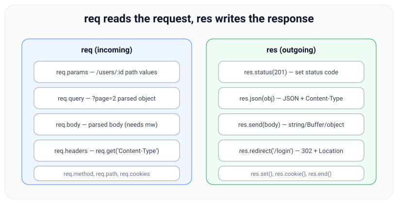

# Express req and res: Complete API Reference

*22 min read · Updated 10 Oct 2026 · Topic 92 of 96 · added to this kit, not part of the original course*

**Source:** written for this kit — examples verified on Node v24.19.0 and Express 5.3.0 (Express 4 comparisons on 4.22.3, requests sent with supertest 7.3.1 and curl)

---

## Why it matters

Lesson 38 ([The req and res objects](38-the-req-and-res-objects-reading-and-responding.md)) covers the helpers every handler uses: `params`, `query`, `body`, `get`, `status`, `json`, `send` and `redirect`. Production code needs more of the API than that:

- **Content types.** A route that accepts JSON should reject `text/plain` with `415`. `req.is` does the media-type comparison for you.
- **Negotiation.** An endpoint that serves JSON to an API client and HTML to a browser needs `req.accepts` or `res.format`, plus a `Vary: Accept` header so caches keep the two versions apart.
- **Clients behind proxies.** `req.ip`, `req.protocol` and `req.hostname` only report the real client once `trust proxy` is set (lesson 86).
- **Caching and partial content.** `req.fresh`, `req.range` and `res.vary` are what HTTP caching and range requests are built from.
- **Raw bodies.** Webhook senders sign the exact bytes they send. If `express.json()` parses the body first, you can no longer check the signature, so you need `express.raw`.

Each row of the table in Example 1 was sent to a running server, and the Result column is that server's real response.

## The concept, simply

Every Express handler receives two objects. **`req` reads the request**: the method, URL, headers and body that the client sent, with helpers that parse and compare them. **`res` writes the response**: helpers that set the status, headers and body, and send them back. The read side never sends anything, and the write side never looks at what the client sent, except where the response depends on it (`res.format` reads `Accept`).


*Figure: req reads the request, res writes the response. Look at: the left panel is everything you can read, the right panel everything you can write; this lesson adds the less common methods to both sides.*

The less common methods group into five families:

1. **Request content inspection:** `req.is(type)` checks the request's `Content-Type`.
2. **Negotiation:** `req.accepts`, `req.acceptsLanguages`, `req.acceptsCharsets` and `req.acceptsEncodings` pick the best match from the client's `Accept*` headers. `res.format` dispatches on `Accept`, and `res.vary` records which request headers the response depends on.
3. **Connection facts:** `req.hostname`, `req.protocol`, `req.secure`, `req.ip`, `req.ips`, `req.subdomains` and `req.xhr`. Some of them depend on the `trust proxy` and `subdomain offset` settings.
4. **Caching and ranges:** `req.fresh`, `req.stale` and `req.range`.
5. **Response shaping:** `res.sendStatus`, `res.type`, `res.links`, `res.append`, `res.locals` and `res.headersSent`.

Then there are the **body parsers**. `express.json`, `express.raw`, `express.text` and `express.urlencoded` are middleware that read the request stream and set `req.body`.

## How it works

1. **`req` and `res` are Node objects with an extra prototype.** On each request the app runs `Object.setPrototypeOf(req, app.request)` and `Object.setPrototypeOf(res, app.response)`. `app.request` inherits from `http.IncomingMessage.prototype` and `app.response` from `http.ServerResponse.prototype`. So `res.headersSent`, `res.setHeader` and `req.headers` are plain Node, and `res.json` or `req.ip` are Express.
2. **Most `req` properties are getters.** `req.ip`, `req.protocol`, `req.hostname`, `req.fresh`, `req.xhr` and (in Express 5) `req.query` are computed from headers and settings each time you read them. Nothing is parsed until your code asks for it.
3. **Negotiation goes through two packages.** `req.accepts*` call the `accepts` package, which uses `negotiator` to sort the header's entries by `q` weight and then by specificity. They return the best item from **your** list, or `false` if none is acceptable. `res.format(obj)` calls `req.accepts(Object.keys(obj))`, sets `Vary: Accept`, and runs the matching function. If nothing matches and there is no `default` key, it calls `next(err)` with `err.status = 406`.
4. **Content-type checks go through `type-is`.** `req.is('json')` expands the shorthand to `application/json`, compares it with the request's `Content-Type` (ignoring parameters such as `charset`), and returns the matching type, `false`, or `null` when the request has no body.
5. **`req.fresh` is the conditional-request test.** It uses the `fresh` package to compare the request's `If-None-Match` / `If-Modified-Since` with the response's `ETag` / `Last-Modified` headers **already set on `res`**. `res.send` runs the same test and turns the response into `304` with no body when it is fresh.
6. **Body parsers only act on their type.** Each parser checks `Content-Type` (by default `application/json`, `application/octet-stream`, `text/plain` or `application/x-www-form-urlencoded`; override with `type`). If it matches, the parser reads the stream up to `limit` (default `100kb`), decodes it and sets `req.body`; otherwise it calls `next()` and leaves `req.body` alone. In Express 5 that means `req.body` stays `undefined` (changed in v5; Express 4 set `{}`).

**Version notes.** `req.acceptsLanguages`, `req.acceptsCharsets` and `req.acceptsEncodings` are the only spellings in Express 5. The singular forms (`acceptsLanguage`, and so on) were deprecated in 4 and removed in 5 (changed in v5). `req.host` keeps the port in Express 5; Express 4 stripped it (changed in v5); `req.hostname` never includes it. `express.urlencoded()` defaults to `extended: false` in Express 5. Express 4 defaulted to `true` and printed `body-parser deprecated undefined extended: provide extended option` (changed in v5, Example 6). Added in Express 4: `res.sendStatus` (4.9.0), `res.append` (4.11.0), `req.range` options (4.14.0), `express.json` and `express.urlencoded` (4.16.0), `express.raw` and `express.text` (4.17.0).

## Code examples

**Example 1 — the reference table.** Each one-line example was run by the script in Example 2; the Result column is copied from its output.

| API | One-line example | Result (Express 5.3.0) |
|---|---|---|
| `req.is(type)` | `req.is('json')`, `req.is('application/*')`, `req.is('html')` with `Content-Type: application/json; charset=utf-8` | `"json"`, `"application/json"`, `false` |
| `req.accepts(types)` | `req.accepts(['html', 'json'])`, `req.accepts('png')` with `Accept: application/json;q=0.9, text/html;q=0.5` | `"json"`, `false` |
| `req.acceptsLanguages` / `acceptsCharsets` / `acceptsEncodings` | `req.acceptsLanguages('fr', 'en')`, `req.acceptsCharsets('utf-8')`, `req.acceptsEncodings('br', 'gzip')` | `"en"`, `"utf-8"`, `"gzip"` |
| `req.hostname`, `req.protocol`, `req.secure` | with `trust proxy` `'loopback'` and `X-Forwarded-Host: api.example.com`, `X-Forwarded-Proto: https` | `"api.example.com"`, `"https"`, `true` |
| `req.ip`, `req.ips` | same app, `X-Forwarded-For: 203.0.113.9, 10.0.0.2` from 127.0.0.1 | `"10.0.0.2"`, `["10.0.0.2"]` (only the socket hop is trusted) |
| `req.subdomains` | `Host: eu.api.example.com` | `["api","eu"]` (nearest first) |
| `subdomain offset` setting | `app.set('subdomain offset', 3)`, `Host: eu.api.example.co.uk` | `["api","eu"]` |
| `req.fresh` / `req.stale` | `res.set('ETag', '"v1"')` then read them; request `If-None-Match: "v1"` | `true,false`, and `res.json` sent `304` with no body |
| | same, `If-None-Match: "v0"` | `false,true`, `200` with the body |
| `req.xhr` | `X-Requested-With: XMLHttpRequest` | `true` |
| `req.range(size[, options])` | `req.range(1000)` and `req.range(1000, { combine: true })` with `Range: bytes=0-99,100-199,900-` | `[{0,99},{100,199},{900,999}]` and `[{0,199},{900,999}]` |
| | `req.range(100)` with `bytes=500-` / `bytes=abc` / no header | `-1` (unsatisfiable) / `-2` (malformed; Express 4.22.3 returns `-1`) / `undefined` |
| `res.sendStatus(code)` | `res.sendStatus(404)` | `404`, body `Not Found` |
| `res.format(obj)` | `{ 'text/plain': …, 'application/json': … }` with `Accept: text/plain` | `200 hi`, `Content-Type: text/plain; charset=utf-8` |
| `res.type(type)` | `res.type('csv').send('a,b')` | `Content-Type: text/csv; charset=utf-8` |
| `res.links(obj)` | `res.links({ next: '/items?page=3', prev: '/items?page=1' })` | `Link: </items?page=3>; rel="next", </items?page=1>; rel="prev"` |
| `res.vary(field)` | `res.vary('Accept').vary('Accept-Language').vary('accept')` | `Vary: Accept, Accept-Language` (no duplicate) |
| `res.append(field, value)` | `res.append('Set-Cookie', 'a=1').append('Set-Cookie', ['b=2'])` | two `Set-Cookie` headers: `a=1`, `b=2` |
| `res.locals` | `res.locals.user = 'ada'` in middleware, read in the handler | `{"user":"ada"}` |
| `res.headersSent` | read, then `res.write('x')`, read again | `false`, then `true` |
| `express.raw()` | `POST` 4 bytes as `application/octet-stream` | `req.body` is a `Buffer`, length `4` |
| `express.text()` | `POST hello` as `text/plain` | `typeof req.body` is `"string"`, `"hello"` |
| `express.urlencoded()` | `user[name]=ada&tag=a&tag=b` | `{"user[name]":"ada","tag":["a","b"]}` (Express 4 default: nested) |
| `express.urlencoded({ extended: true })` | same body | `{"user":{"name":"ada"},"tag":["a","b"]}` |

**Example 2 — the script that ran every row.** One app, one route per row, and supertest to send each request to a real listening server.

javascript

```
// table.cjs: one request per table row, against a real Express server (supertest).
const express = require('express');
const request = require('supertest');

const app = express();
app.set('trust proxy', 'loopback');           // so req.ip / ips / protocol read X-Forwarded-* from 127.0.0.1

const show = (fn) => (req, res) => { const v = fn(req, res); res.json(v === undefined ? 'undefined' : v); };
// ---- req ----
app.post('/is', express.raw({ type: '*/*' }), show((req) => [req.is('json'), req.is('application/*'), req.is('html')]));
app.get('/accepts', show((req) => [req.accepts(['html', 'json']), req.accepts('png')]));
app.get('/langs', show((req) => [req.acceptsLanguages('fr', 'en'), req.acceptsCharsets('utf-8'), req.acceptsEncodings('br', 'gzip')]));
app.get('/host', show((req) => [req.hostname, req.protocol, req.secure, req.ip, req.ips]));
app.get('/sub', show((req) => req.subdomains));
const app3 = express().set('subdomain offset', 3);   // treat example.co.uk as the base domain
app3.get('/sub', show((req) => req.subdomains));
app.get('/fresh', (req, res) => {
  res.set('ETag', '"v1"');                       // req.fresh compares the request's If-None-Match with this
  res.set('X-Fresh-Stale', `${req.fresh},${req.stale}`);
  res.json({ big: 'payload' });                  // Express itself turns this into 304 when req.fresh is true
});
app.get('/xhr', show((req) => req.xhr));
app.get('/range', show((req) => [req.range(1000), req.range(1000, { combine: true })]));
app.get('/range-bad', show((req) => req.range(100)));   // -1 unsatisfiable, -2 malformed, undefined no header
// ---- res ----
app.get('/sendStatus', (req, res) => res.sendStatus(404));
app.get('/format', (req, res) => res.format({ 'text/plain': () => res.send('hi'), 'application/json': () => res.json({ msg: 'hi' }) }));
app.get('/type', (req, res) => res.type('csv').send('a,b'));
app.get('/links', (req, res) => res.links({ next: '/items?page=3', prev: '/items?page=1' }).json([]));
app.get('/vary', (req, res) => res.vary('Accept').vary('Accept-Language').vary('accept').json([]));
app.get('/append', (req, res) => res.append('Set-Cookie', 'a=1').append('Set-Cookie', ['b=2']).append('Warning', '199 x').end());
app.get('/locals', (req, res, next) => { res.locals.user = 'ada'; next(); }, show((req, res) => res.locals));
app.get('/headersSent', (req, res) => {
  const before = res.headersSent;
  res.write('x');                                 // flushes the status line + headers
  res.end(` before=${before} after=${res.headersSent}`);
});
// ---- body parsers ----
app.post('/raw', express.raw({ type: 'application/octet-stream' }), show((req) => [Buffer.isBuffer(req.body), req.body.length]));
app.post('/text', express.text(), show((req) => [typeof req.body, req.body]));
app.post('/form', express.urlencoded(), show((req) => req.body));                      // Express 5 default: extended false
app.post('/form-ext', express.urlencoded({ extended: true }), show((req) => req.body));

const rows = [
  ['req.is',                r => r.post('/is').set('Content-Type', 'application/json; charset=utf-8').send('{}')],
  ['req.accepts',           r => r.get('/accepts').set('Accept', 'application/json;q=0.9, text/html;q=0.5')],
  ['acceptsLanguages/Charsets/Encodings', r => r.get('/langs').set({ 'Accept-Language': 'en-GB, en;q=0.8', 'Accept-Charset': 'utf-8', 'Accept-Encoding': 'gzip' })],
  ['hostname/protocol/secure/ip/ips', r => r.get('/host').set({ 'X-Forwarded-For': '203.0.113.9, 10.0.0.2', 'X-Forwarded-Proto': 'https', 'X-Forwarded-Host': 'api.example.com' })],
  ['req.subdomains',        r => r.get('/sub').set('Host', 'eu.api.example.com')],
  ['subdomain offset 3',    () => request(app3).get('/sub').set('Host', 'eu.api.example.co.uk')],
  ['req.fresh/stale',       r => r.get('/fresh').set('If-None-Match', '"v1"')],
  ['req.fresh/stale (no match)', r => r.get('/fresh').set('If-None-Match', '"v0"')],
  ['req.xhr',               r => r.get('/xhr').set('X-Requested-With', 'XMLHttpRequest')],
  ['req.range',             r => r.get('/range').set('Range', 'bytes=0-99,100-199,900-')],
  ['req.range unsatisfiable', r => r.get('/range-bad').set('Range', 'bytes=500-')],
  ['req.range malformed',   r => r.get('/range-bad').set('Range', 'bytes=abc')],
  ['req.range no header',   r => r.get('/range-bad')],
  ['res.sendStatus',        r => r.get('/sendStatus')],
  ['res.format',            r => r.get('/format').set('Accept', 'text/plain')],
  ['res.type',              r => r.get('/type')],
  ['res.links',             r => r.get('/links')],
  ['res.vary',              r => r.get('/vary')],
  ['res.append',            r => r.get('/append')],
  ['res.locals',            r => r.get('/locals')],
  ['res.headersSent',       r => r.get('/headersSent')],
  ['express.raw',           r => r.post('/raw').set('Content-Type', 'application/octet-stream').send(Buffer.from([1, 2, 3, 4]))],
  ['express.text',          r => r.post('/text').set('Content-Type', 'text/plain').send('hello')],
  ['express.urlencoded()',  r => r.post('/form').type('form').send('user[name]=ada&tag=a&tag=b')],
  ['urlencoded extended:true', r => r.post('/form-ext').type('form').send('user[name]=ada&tag=a&tag=b')],
];

const pick = { 'req.fresh/stale': 'x-fresh-stale', 'req.fresh/stale (no match)': 'x-fresh-stale', 'res.type': 'content-type', 'res.links': 'link', 'res.vary': 'vary', 'res.append': ['set-cookie', 'warning'], 'res.format': 'content-type' };

(async () => {
  for (const [name, make] of rows) {
    const r = await make(request(app));
    let hdr = '';
    if (pick[name]) hdr = ' ' + [].concat(pick[name]).map((h) => `${h}: ${JSON.stringify(r.headers[h])}`).join(' ');
    console.log(`${name.padEnd(36)} ${r.status} ${r.text}${hdr}`);
  }
})();

// Real output (Node v24.19.0, Express 5.3.0, supertest 7.3.1):
//   req.is                               200 ["json","application/json",false]
//   req.accepts                          200 ["json",false]
//   acceptsLanguages/Charsets/Encodings  200 ["en","utf-8","gzip"]
//   hostname/protocol/secure/ip/ips      200 ["api.example.com","https",true,"10.0.0.2",["10.0.0.2"]]
//   req.subdomains                       200 ["api","eu"]
//   subdomain offset 3                   200 ["api","eu"]
//   req.fresh/stale                      304  x-fresh-stale: "true,false"
//   req.fresh/stale (no match)           200 {"big":"payload"} x-fresh-stale: "false,true"
//   req.xhr                              200 true
//   req.range                            200 [[{"start":0,"end":99},{"start":100,"end":199},{"start":900,"end":999}],[{"start":0,"end":199},{"start":900,"end":999}]]
//   req.range unsatisfiable              200 -1
//   req.range malformed                  200 -2
//   req.range no header                  200 "undefined"
//   res.sendStatus                       404 Not Found
//   res.format                           200 hi content-type: "text/plain; charset=utf-8"
//   res.type                             200 a,b content-type: "text/csv; charset=utf-8"
//   res.links                            200 [] link: "</items?page=3>; rel=\"next\", </items?page=1>; rel=\"prev\""
//   res.vary                             200 [] vary: "Accept, Accept-Language"
//   res.append                           200  set-cookie: ["a=1","b=2"] warning: "199 x"
//   res.locals                           200 {"user":"ada"}
//   res.headersSent                      200 x before=false after=true
//   express.raw                          200 [true,4]
//   express.text                         200 ["string","hello"]
//   express.urlencoded()                 200 {"user[name]":"ada","tag":["a","b"]}
//   urlencoded extended:true             200 {"user":{"name":"ada"},"tag":["a","b"]}
```

Running the same file against Express 4.22.3 changed three lines: the `body-parser deprecated undefined extended` warning, `req.range malformed` gave `-1` (range-parser 1.2.1 instead of 1.3.0), and `express.urlencoded()` gave the nested object. Every other row was identical.

**Example 3 — content negotiation with `res.format`, and the 406 path.**

javascript

```
// format.cjs: content negotiation with res.format, including the 406 path.
const express = require('express');
const request = require('supertest');

const app = express();
const user = { id: 7, name: 'Ada' };

app.get('/users/7', (req, res) => {
  res.format({
    'application/json': () => res.json(user),
    'text/html': () => res.send(`<h1>${user.name}</h1>`),
    'text/plain': () => res.send(`user ${user.id}: ${user.name}`),
    // no "default" key: an unmatched Accept becomes next(err) with err.status 406
  });
});

app.get('/v2/users/7', (req, res) => {
  res.format({
    'application/json': () => res.json(user),
    default: () => res.status(406).json({ error: 'Not Acceptable', supported: ['application/json'] }),
  });
});

// Error handler: shows what res.format passed to next()
app.use((err, req, res, next) => {
  res.status(err.status ?? 500).json({ error: err.message, types: err.types });
});

(async () => {
  for (const accept of [undefined, 'application/json', 'text/html', 'text/*;q=0.5, application/json;q=0.4', 'image/png']) {
    let r = request(app).get('/users/7');
    if (accept) r = r.set('Accept', accept);
    r = await r;
    console.log(`Accept: ${(accept ?? '(none)').padEnd(38)} -> ${r.status} ${r.headers['content-type']} | Vary: ${r.headers.vary} | ${r.text}`);
  }
  const r = await request(app).get('/v2/users/7').set('Accept', 'image/png');
  console.log(`/v2 Accept: image/png -> ${r.status} | Vary: ${r.headers.vary} | ${r.text}`);
})();

// Real output (Node v24.19.0, Express 5.3.0, supertest 7.3.1):
//   Accept: (none)                                 -> 200 application/json; charset=utf-8 | Vary: Accept | {"id":7,"name":"Ada"}
//   Accept: application/json                       -> 200 application/json; charset=utf-8 | Vary: Accept | {"id":7,"name":"Ada"}
//   Accept: text/html                              -> 200 text/html; charset=utf-8 | Vary: Accept | <h1>Ada</h1>
//   Accept: text/*;q=0.5, application/json;q=0.4   -> 200 text/html; charset=utf-8 | Vary: Accept | <h1>Ada</h1>
//   Accept: image/png                              -> 406 application/json; charset=utf-8 | Vary: Accept | {"error":"Not Acceptable","types":["application/json","text/html","text/plain"]}
//   /v2 Accept: image/png -> 406 | Vary: Accept | {"error":"Not Acceptable","supported":["application/json"]}
```

Here is how each request was resolved:

1. With no `Accept` header, every type is acceptable, so the first key (`application/json`) wins. Put your preferred type first.
2. `text/*;q=0.5, application/json;q=0.4` picks `text/html`: the higher `q` wins, and among the `text/*` keys the first one listed in the object wins.
3. `image/png` matches nothing. Without a `default` key, `res.format` calls `next(err)` with `err.status` `406` and `err.types` listing what was offered; the error handler turned that into JSON. With a `default` key, that function runs instead and must set the status itself.
4. Every response, the 406 too, has `Vary: Accept`, so a shared cache stores one copy per `Accept` value.

Express 4.22.3 printed the same six lines.

**Example 4 — edge case: a webhook with `express.raw` and an HMAC-SHA256 signature.** The sender computes `HMAC-SHA256(secret, body)` over the bytes it sends and puts it in a header; the receiver recomputes it over the bytes it received. See lesson 24 ([crypto: hashing, HMAC](24-crypto-hashing-hmac-random-encryption.md)) for HMAC itself.

javascript

```
// webhook.cjs: verify an HMAC-SHA256 signature over the RAW request body.
const crypto = require('node:crypto');
const express = require('express');

const SECRET = 'whsec_test_only';   // in real code: process.env.WEBHOOK_SECRET

const app = express();

// express.raw leaves req.body as the exact bytes received. Re-serialising parsed
// JSON would change whitespace/key order and break the signature.
app.post('/webhooks/payments', express.raw({ type: 'application/json', limit: '100kb' }), (req, res) => {
  const header = req.get('X-Signature') ?? '';            // "sha256=<hex>"
  const match = /^sha256=([0-9a-f]+)$/.exec(header);
  if (!match || !Buffer.isBuffer(req.body)) return res.status(400).json({ error: 'missing signature or body' });

  const expected = crypto.createHmac('sha256', SECRET).update(req.body).digest(); // 32 bytes
  const given = Buffer.from(match[1], 'hex');
  // timingSafeEqual throws RangeError on different lengths, so check length first.
  if (given.length !== expected.length) return res.status(401).json({ error: 'bad signature length' });
  if (!crypto.timingSafeEqual(given, expected)) return res.status(401).json({ error: 'bad signature' });

  const event = JSON.parse(req.body.toString('utf8'));    // parse only after it is authentic
  res.json({ ok: true, type: event.type });
});

const server = app.listen(0, '127.0.0.1', async () => {
  const url = `http://127.0.0.1:${server.address().port}/webhooks/payments`;
  const body = '{"type":"payment.succeeded","amount":4200}';
  const sign = (b) => 'sha256=' + crypto.createHmac('sha256', SECRET).update(b).digest('hex');
  const send = async (label, payload, signature) => {
    const r = await fetch(url, { method: 'POST', headers: { 'Content-Type': 'application/json', 'X-Signature': signature }, body: payload });
    console.log(label.padEnd(22), r.status, await r.text());
  };
  await send('valid', body, sign(body));
  await send('tampered body', body.replace('4200', '9900'), sign(body));
  await send('wrong-length sig', body, sign(body).slice(0, 20));
  await send('no signature', body, '');
  try {
    crypto.timingSafeEqual(Buffer.alloc(3), Buffer.alloc(32));
  } catch (err) {
    console.log('timingSafeEqual(3 B, 32 B) ->', err.code, err.message);
  }
  server.close();
});

// Real output (Node v24.19.0, Express 5.3.0):
//   valid                  200 {"ok":true,"type":"payment.succeeded"}
//   tampered body          401 {"error":"bad signature"}
//   wrong-length sig       401 {"error":"bad signature length"}
//   no signature           400 {"error":"missing signature or body"}
//   timingSafeEqual(3 B, 32 B) -> ERR_CRYPTO_TIMING_SAFE_EQUAL_LENGTH Input buffers must have the same byte length
```

Why each step is there:

1. **`express.raw({ type: 'application/json' })`** keeps `req.body` as the received `Buffer`. With `express.json()`, the body would already be parsed, and `JSON.stringify(req.body)` does not give back the sender's bytes once whitespace, key order or number formatting differ. Register the raw parser on this route only. An app-wide `express.json()` placed before it would consume the stream first.
2. **Length check before `timingSafeEqual`.** `crypto.timingSafeEqual` compares two buffers in time that depends only on their length. That stops an attacker from guessing a valid signature byte by byte by timing a `===` comparison that returns at the first mismatch. It throws `ERR_CRYPTO_TIMING_SAFE_EQUAL_LENGTH` when the lengths differ (last line of the output), and an uncaught throw in the handler would become a 500. The length of an HMAC-SHA256 digest (32 bytes) is public, so checking it first leaks nothing.
3. **Parse after verifying.** `JSON.parse` runs only on a body that is known to be authentic.

Real providers usually also sign a timestamp and reject old ones to stop replays. Check your provider's header format.

**Example 5 — a health endpoint: liveness vs readiness, `Cache-Control: no-store`, HEAD.**

javascript

```
// health.cjs: liveness vs readiness, no caching, HEAD support.
const express = require('express');

const app = express();
app.disable('x-powered-by');
app.set('etag', false);   // no ETag, so a client can never get a 304 instead of a fresh check
let dbUp = true;            // stand-in for a real dependency check (e.g. SELECT 1 with a timeout)
let shuttingDown = false;   // set on SIGTERM so the load balancer stops sending traffic

// Every health response must be fresh: no browser, CDN or proxy cache may answer for us.
const noStore = (req, res, next) => { res.set('Cache-Control', 'no-store'); next(); };

// Liveness: "is this process able to answer at all?" No dependency checks here;
// a DB outage must not make the orchestrator restart every replica.
app.get('/livez', noStore, (req, res) => res.json({ status: 'ok' }));

// Readiness: "should traffic be routed to this instance right now?"
app.get('/readyz', noStore, async (req, res) => {
  const checks = { db: dbUp ? 'ok' : 'down', shuttingDown };
  const ready = dbUp && !shuttingDown;
  res.status(ready ? 200 : 503).json({ status: ready ? 'ready' : 'not ready', checks });
});

// Test hooks for this demo only
app.post('/_demo/db/:state', (req, res) => { dbUp = req.params.state === 'up'; res.sendStatus(204); });

const server = app.listen(Number(process.env.PORT) || 0, '127.0.0.1', () => {
  console.log('listening on', server.address().port);
});
process.on('SIGTERM', () => { shuttingDown = true; setTimeout(() => server.close(), 200); });
```

The script that drives it with curl:

bash

```
PORT=5501 node health.cjs & PID=$!; sleep 0.5
curl -si http://127.0.0.1:5501/livez; echo
curl -sI http://127.0.0.1:5501/readyz
curl -s -o /dev/null -w 'POST /_demo/db/down -> %{http_code}\n' -X POST http://127.0.0.1:5501/_demo/db/down
curl -si http://127.0.0.1:5501/readyz; echo
curl -s -o /dev/null -X POST http://127.0.0.1:5501/_demo/db/up
kill -TERM $PID; sleep 0.05
curl -s -w ' <- %{http_code}\n' http://127.0.0.1:5501/readyz
curl -s -w ' <- %{http_code}\n' http://127.0.0.1:5501/livez
wait $PID; echo "server exited: $?"
```

text

```
$ bash health.sh
listening on 5501
HTTP/1.1 200 OK
Cache-Control: no-store
Content-Type: application/json; charset=utf-8
Content-Length: 15
Date: Sat, 10 Oct 2026 16:11:55 GMT
Connection: keep-alive
Keep-Alive: timeout=5

{"status":"ok"}
HTTP/1.1 200 OK
Cache-Control: no-store
Content-Type: application/json; charset=utf-8
Content-Length: 60
Date: Sat, 10 Oct 2026 16:11:55 GMT
Connection: keep-alive
Keep-Alive: timeout=5

POST /_demo/db/down -> 204
HTTP/1.1 503 Service Unavailable
Cache-Control: no-store
Content-Type: application/json; charset=utf-8
Content-Length: 66
Date: Sat, 10 Oct 2026 16:11:55 GMT
Connection: keep-alive
Keep-Alive: timeout=5

{"status":"not ready","checks":{"db":"down","shuttingDown":false}}
{"status":"not ready","checks":{"db":"ok","shuttingDown":true}} <- 503
{"status":"ok"} <- 200
server exited: 0
```

What the run shows:

1. **Liveness (`/livez`)** answers "is the process able to respond?" and checks nothing else. An orchestrator restarts the container when it fails. If it checked the database, a database outage would restart every replica, which does not fix the database.
2. **Readiness (`/readyz`)** answers "should the load balancer send traffic here now?". It went `503` when the dependency was down, and again during shutdown after `SIGTERM`, while `/livez` stayed `200`. That lets in-flight requests finish while new traffic goes elsewhere (lesson 66).
3. **`Cache-Control: no-store`** stops any cache from answering a probe with an old result. The ETag is turned off for the same reason: an `If-None-Match` request could otherwise get a `304`.
4. **HEAD** needs no extra code. Express runs the `GET` route for a `HEAD` request and Node discards the body. The response kept `Content-Length: 60` with no body.

**Example 6 — `express.urlencoded()` with no options: Express 5 vs Express 4.**

javascript

```
// urlenc.cjs: express.urlencoded() with no options, Express 5 vs Express 4.
const request = require('supertest');

(async () => {
  for (const pkg of ['express', 'express4']) {
    const express = require(pkg);
    const app = express();
    app.post('/form', express.urlencoded(), (req, res) => res.json(req.body));
    const r = await request(app).post('/form').type('form').send('user[name]=ada&tag=a&tag=b');
    console.log(`${pkg} ${require(pkg + '/package.json').version}: ${r.text}`);
  }
})();

// Real output (Node v24.19.0, Express 5.3.0 and 4.22.3, supertest 7.3.1):
//   express 5.3.0: {"user[name]":"ada","tag":["a","b"]}
//   express4 4.22.3: {"user":{"name":"ada"},"tag":["a","b"]}
//   <date> body-parser deprecated undefined extended: provide extended option at urlenc.cjs:8:31
```

The migration guide says Express 5 "makes the `extended` option false by default". The run confirms it: Express 5 returns the flat `'user[name]'` key, and Express 4 returns the nested object with a deprecation warning. Pass `extended` explicitly so both versions behave the same.

## Common mistakes & gotchas

- **Using the singular `req.acceptsLanguage`** on Express 5. It was removed, so the call throws `TypeError: req.acceptsLanguage is not a function`; use the plural.
- **Reading `req.ip` without `trust proxy` behind a proxy.** It returns the proxy's address. Configure the setting for your topology (lesson 86).
- **Forgetting `Vary`.** If you branch on `Accept` or `Accept-Language` by hand, call `res.vary('Accept')`. `res.format` does it for you.
- **Testing `req.fresh` before setting `ETag`.** `req.fresh` compares against headers already on `res`. With none set, it is `false`.
- **`express.json()` app-wide in front of a webhook.** The JSON parser reads the stream first, so `express.raw` on the route finds nothing to read and `req.body` is the parsed object. Mount the webhook route before the app-wide parser, or scope the JSON parser with a `type` that excludes it.
- **`crypto.timingSafeEqual` on buffers of different length** throws `RangeError` (`ERR_CRYPTO_TIMING_SAFE_EQUAL_LENGTH`). Check the length first.
- **Treating `req.range` errors as arrays.** It returns `-1` (unsatisfiable) or `-2` (malformed) as numbers, and `undefined` without a `Range` header. Check `Array.isArray` first.
- **Calling `res.set` after `res.headersSent` is `true`.** The headers have already gone out, and Node throws `ERR_HTTP_HEADERS_SENT`.

## Best practices

- **Reject wrong content types early:** `if (!req.is('application/json')) return res.sendStatus(415)`.
- **Prefer `res.format` over hand-written `Accept` checks.** It handles `q` weights, sets `Vary`, and gives a 406 path.
- **Keep raw-body routes separate:** mount `express.raw` on the webhook path only, verify the signature, then parse.
- **Use `res.sendStatus` for bodiless status replies** (`204`, `404`) instead of `res.status(n).send('')`.
- **Use `res.append` for headers that can repeat** (`Set-Cookie`, `Link`, `Warning`). `res.set` replaces the existing value.
- **Pass `extended` explicitly to `express.urlencoded`** and `limit` to every parser.
- **Split health checks into liveness and readiness**, send `Cache-Control: no-store`, and let HEAD work through the GET route.

## ⭐ Interview lens

> **Q: “How do you serve JSON to API clients and HTML to browsers from one route?”**  
> A: `res.format({ 'application/json': …, 'text/html': … })`. It calls `req.accepts` with the keys, runs the best match, sets `Vary: Accept`, and if nothing matches it calls `next` with a 406 error (or runs `default`). *Trap:* without `Vary`, a CDN can serve the cached HTML to an API client.

> **Q: “Why does a webhook route use `express.raw` instead of `express.json`?”**  
> A: The signature is an HMAC over the exact bytes sent. After `express.json` parses the body, re-serialising it can change whitespace, key order or number formatting, so the HMAC would not match. Keep the `Buffer`, verify it with `crypto.timingSafeEqual` after a length check, then `JSON.parse`.

> **Q: “What is the difference between `req.fresh` and a 304?”**  
> A: `req.fresh` is a boolean that compares the request's conditional headers with the `ETag`/`Last-Modified` already set on `res`. `res.send` performs the same check and, when it is fresh, changes the response to `304` with no body. You only read `req.fresh` yourself to skip expensive work before building the body.

> **Q: “What changed for `express.urlencoded` in Express 5?”**  
> A: `extended` now defaults to `false`, so the body is parsed with Node's `querystring`, and `a[b]=c` stays a flat key. Express 4 defaulted to `true` (`qs`, nested objects) with a deprecation warning when you left it out.

> **Q: “Liveness vs readiness probe?”**  
> A: Liveness says the process can answer and should not be restarted, so it checks nothing external. Readiness says whether to route traffic here now, so it checks dependencies and returns 503 during shutdown. Both send `Cache-Control: no-store`.

## Cheat-card

- **`req.is(t)`** → matching type, `false`, or `null` (no body). Shorthands: `'json'`, `'html'`, `'application/*'`.
- **`req.accepts([…])`** → best of *your* list or `false`. Plurals only in v5: `acceptsLanguages`, `acceptsCharsets`, `acceptsEncodings`.
- **Behind proxies:** `req.ip`, `ips`, `protocol`, `secure`, `hostname` follow `trust proxy`; `req.subdomains` follows `subdomain offset` (default 2).
- **`req.fresh` / `req.stale`** compare against `res`'s `ETag`/`Last-Modified`; `res.send` auto-304s.
- **`req.range(size, { combine })`** → array of `{ start, end }` with `.type`, `-1`, `-2` or `undefined`.
- **`res.sendStatus(n)`**: status + reason-phrase body. **`res.type('csv')`**: sets `Content-Type` from an extension or a MIME type.
- **`res.format`** sets `Vary: Accept` and gives a 406 (`err.status`) without `default`.
- **`res.links`** builds `Link`; **`res.vary`** adds to `Vary` once; **`res.append`** adds a header value instead of replacing.
- **`res.headersSent`** (Node) turns `true` once the status line and headers are written.
- **Parsers:** `express.json` / `raw` (Buffer) / `text` (string) / `urlencoded` (`extended` default `false` in v5, `true` in v4); default `limit` `100kb`; v5 leaves `req.body` `undefined` when not matched.
- **Webhooks:** `express.raw` → HMAC → length check → `timingSafeEqual` → `JSON.parse`.

---

## Learn More

- [Request (req) API, Express 5 expressjs.com](https://expressjs.com/en/5x/api/request)
- [Response (res) API, Express 5 expressjs.com](https://expressjs.com/en/5x/api/response)
- [express.json, raw, text, urlencoded expressjs.com](https://expressjs.com/en/5x/api/express)
- [Migrating to Express 5 expressjs.com](https://expressjs.com/en/guide/migrating-5.html)
- [body-parser github.com](https://github.com/expressjs/body-parser)
- [negotiator github.com](https://github.com/jshttp/negotiator)
- [crypto.timingSafeEqual and HMAC nodejs.org](https://nodejs.org/docs/latest-v24.x/api/crypto.html)
- [Content negotiation developer.mozilla.org](https://developer.mozilla.org/en-US/docs/Web/HTTP/Guides/Content_negotiation)
- [Cache-Control developer.mozilla.org](https://developer.mozilla.org/en-US/docs/Web/HTTP/Reference/Headers/Cache-Control)
- [Configure liveness, readiness and startup probes kubernetes.io](https://kubernetes.io/docs/tasks/configure-pod-container/configure-liveness-readiness-startup-probes/)
