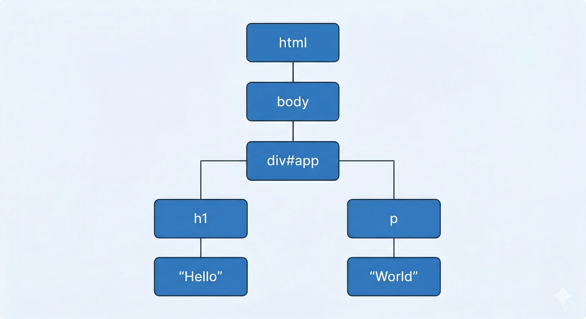
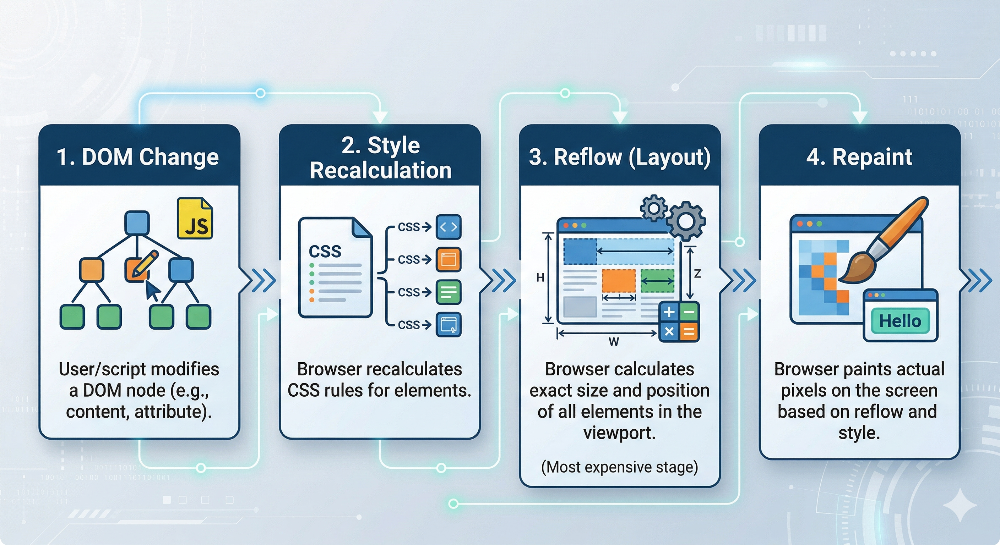

# What is React, Virtual DOM & Reconciliation

*17 min read · Updated 26 Mar 2026 Topic 1 of 62 Bookmark Completed 1 · Topic 1 of 62*

**Source:** [https://www.geekyfrontend.in/learn/react-interview-kit/virtual-dom](https://www.geekyfrontend.in/learn/react-interview-kit/virtual-dom)

---

# 1.1 — What is React, Virtual DOM & Reconciliation

> **Module 2: React Core Concepts** | Difficulty: 🟢 Fresher 🟡 Intermediate

---

## 🎯 What Interviewers Actually Ask

These are real questions from interviews — not textbook phrasing. You'll face at least one of these:

| Question | Level | Frequency |
| --- | --- | --- |
| "What is React? Why do we use it?" | 🟢 | ★★★★★ |
| "What are the main features of React?" | 🟢 | ★★★★★ |
| "What is the DOM? What is the Virtual DOM?" | 🟢 | ★★★★★ |
| "How does the Virtual DOM actually work?" | 🟢🟡 | ★★★★☆ |
| "What is reconciliation?" | 🟡 | ★★★★☆ |
| "What is the diffing algorithm?" | 🟡 | ★★★☆☆ |
| "What is React Fiber? How is it different from the old approach?" | 🟡🔴 | ★★★☆☆ |
| "What is the difference between the render phase and the commit phase?" | 🔴 | ★★☆☆☆ |

---

## 📝 Part 1: What is React?

React is an **open-source JavaScript library** for building user interfaces. It was developed by Facebook (now Meta) and open-sourced in 2013.

Notice the word **library** — not framework. This is a common interview trap.

| Aspect | Library (React) | Framework (Angular) |
| --- | --- | --- |
| Control flow | You call React when you need it | The framework calls your code |
| Flexibility | Choose your own router, state manager, etc. | Most tools come built-in |
| Learning curve | Gradual — learn as you need | Steeper — must learn the whole system |
| Opinionated? | No — multiple ways to do things | Yes — "the Angular way" |

### Why Do We Use React?

Instead of memorizing a list, understand the **problems React solves**:

**Problem 1: Manually updating the DOM is painful and error-prone.**

javascript

```
// Without React — vanilla JavaScript DOM manipulation
document.getElementById('username').textContent = user.name;
document.getElementById('email').textContent = user.email;
document.getElementById('avatar').src = user.avatar;
// Imagine doing this for 50 dynamic elements...
```

jsx

```
// With React — just describe what the UI should look like
function UserCard({ user }) {
  return (
    <div>
      <h2>{user.name}</h2>
      <p>{user.email}</p>
      
    </div>
  );
}
// React handles all the DOM updates for you
```

**Problem 2: UI code becomes unmanageable at scale.**

React's **component-based architecture** lets you break a complex UI into small, reusable, isolated pieces. Each component manages its own state and rendering logic.

**Problem 3: Updating the DOM directly is slow.**

React's **Virtual DOM** computes the minimum set of changes needed and applies them in a batch — far more efficient than touching the real DOM for every small change.

### Core Features of React (The Interview-Ready List)

javascript

```
1. Component-Based Architecture — Build encapsulated, reusable UI pieces
2. Declarative Syntax (JSX)       — Describe what the UI should look like, not how to build it
3. Virtual DOM                    — Efficient UI updates without manual DOM manipulation
4. One-Way Data Flow              — Data flows parent → child via props (predictable)
5. Rich Ecosystem                 — Huge community, libraries for everything
6. Cross-Platform (React Native)  — Use the same concepts for mobile apps
```

---

## 📝 Part 2: Understanding the DOM

Before understanding the **Virtual DOM**, you must understand the **real DOM**.

**DOM (Document Object Model)** is a tree-like representation of your webpage created by the browser. Every HTML element becomes a **node** in this tree.

html

```
<html>
  <body>
    <div id="app">
      <h1>Hello</h1>
      <p>World</p>
    </div>
  </body>
</html>
```

javascript

```
The browser builds this tree:
```



**Why Is Direct DOM Manipulation Slow?**

The DOM itself isn't inherently slow. What's slow is what happens **after** you change it:



When you make **10 separate DOM changes**, the browser may go through this expensive cycle up to **10 times**. React batches these changes and applies them all at once — triggering the cycle just **once**.

---

## 📝 Part 3: The Virtual DOM

The Virtual DOM is a **lightweight JavaScript object** — a copy of the real DOM that React keeps in memory. It's not a browser feature or a special API. It's just a plain JS object tree that React creates and manages.

### How It Actually Works (Step by Step)

How one state change flows through ReactState orprops changeBuild a newVirtual DOMDiff againstthe old treeCompute theminimal patchPatch thereal DOMReconciliation

*Watch the update travel left→right: React only touches the real DOM at the final step — everything before it is cheap work on plain JS objects.*

javascript

```
Step 1: Initial Render
━━━━━━━━━━━━━━━━━━━
Your JSX → React.createElement() → Virtual DOM tree → Real DOM

Step 2: State/Props Change
━━━━━━━━━━━━━━━━━━━━━━━━
State changes → React creates a NEW Virtual DOM tree

Step 3: Diffing
━━━━━━━━━━━━━━
React COMPARES the new Virtual DOM with the previous one
(This is the "diffing algorithm")

Step 4: Reconciliation
━━━━━━━━━━━━━━━━━━━━━━
React calculates the MINIMUM set of changes needed

Step 5: Commit
━━━━━━━━━━━━━
React applies ONLY those changes to the real DOM
(Batch update — efficient!)
```

### Let's See It in Code

jsx

```
function Counter() {
  const [count, setCount] = useState(0);
  
  return (
    <div>
      <h1>Count: {count}</h1>
      <button onClick={() => setCount(count + 1)}>
        Increment
      </button>
    </div>
  );
}
```

When `setCount(1)` is called, here's what happens internally:

Previous treeNew tree (after setCount)<div><h1>Count: 0<button>Increment<div><h1>Count: 1<button>Increment✱ changedunchangedSame shape → only the <h1> text node is patched. The button is untouched.

*React walks both trees in a single pass and flags just the node that actually differs — here, only the counter text.*

javascript

```
Previous Virtual DOM:             New Virtual DOM:
{                                 {
  type: 'div',                      type: 'div',
  props: {                          props: {
    children: [                       children: [
      {                                 {
        type: 'h1',                       type: 'h1',
        props: {                          props: {
          children: 'Count: 0'  ←→          children: 'Count: 1'  ← CHANGED!
        }                                }
      },                                },
      {                                 {
        type: 'button',                   type: 'button',     ← Same, skip
        ...                               ...
      }                                 }
    ]                                 ]
  }                                 }
}                                 }

Result: React only updates the text node inside <h1> — nothing else.
```

### Virtual DOM vs Real DOM — Quick Comparison

| Feature | Real DOM | Virtual DOM |
| --- | --- | --- |
| What is it? | Browser's actual HTML tree | JavaScript object in memory |
| Speed of manipulation | Slow (triggers reflow/repaint) | Fast (just JS object manipulation) |
| Update approach | Updates the whole node + children | Computes minimal changeset |
| Creates directly? | Yes — rendered on screen | No — not rendered until committed |
| Memory | Heavy (full browser node) | Lightweight (plain JS object) |

---

## 📝 Part 4: Reconciliation & The Diffing Algorithm

**Reconciliation** is the entire process React uses to update the DOM efficiently — from detecting changes to applying the minimum number of updates.

The **diffing algorithm** is the specific comparison logic React uses during reconciliation.

### The Two Key Assumptions (Heuristics)

Comparing two trees node-by-node would have O(n³) complexity — way too slow for UI rendering. React makes **two smart assumptions** to bring this down to **O(n)**:

javascript

```
Assumption 1: Different element types produce different trees.
━━━━━━━━━━━━━━━━━━━━━━━━━━━━━━━━━━━━━━━━━━━━━━━━━━━━━━━━━
If a <div> changes to a <span>, React doesn't try to diff the children.
It tears down the entire old tree and builds a new one.

Assumption 2: Keys tell React which children are the "same" across renders.
━━━━━━━━━━━━━━━━━━━━━━━━━━━━━━━━━━━━━━━━━━━━━━━━━━━━━━━━━━━━━━━━━━━━━━━━
When rendering lists, the `key` prop helps React identify which items
moved, were added, or were removed — without re-rendering everything.
```

### Diffing Rules in Action

**Rule 1: Different element types → full rebuild**

BeforeAfter<div><Counter />state kepttype changed<span><Counter />state LOSTDifferent tag → React destroys the whole subtree and rebuilds it from scratch.

*This is why swapping a wrapper element (div → span) silently resets any state living inside it.*

jsx

```
// Before
<div>
  <Counter />
</div>

// After
<span>
  <Counter />
</span>

// React's decision: <div> changed to <span>
// → Destroy the entire <div> tree (including Counter's state!)
// → Build a brand new <span> tree from scratch
```

**Rule 2: Same element type → update only changed attributes**

jsx

```
// Before
<div className="old" title="stuff" />

// After  
<div className="new" title="stuff" />

// React's decision: Same <div>, only className changed
// → Update className from "old" to "new"
// → title is the same, skip it
```

**Rule 3: Same component type → keep instance, update props**

jsx

```
// Before
<UserCard name="Alice" role="admin" />

// After
<UserCard name="Bob" role="admin" />

// React's decision: Same UserCard component
// → Keep the same component instance (state is preserved!)
// → Pass new props (name: "Bob"), trigger re-render
```

**Rule 4: Keys matter in lists**

jsx

```
// Without keys (or using index as key)
// React can't tell which items moved — re-renders everything

// With stable, unique keys
<ul>
  {users.map(user => (
    <li key={user.id}>{user.name}</li>
  ))}
</ul>
// React knows exactly which items changed, added, or removed
```

### Why You Should Never Use Index as Key (The Classic Trap)

Why index-as-key breakskey = indexafter deleting "Buy milk"0Buy milk1Walk dog2Read book0Walk dog1Read bookReact thinks key 0 just changed text — not that an item was removed. State attaches to the wrong row.

*With index keys, deleting the first item shifts every key down by one. Stable ids (key={item.id}) keep each row bound to its own state.*

jsx

```
// BAD — using index as key
{items.map((item, index) => (
  <TodoItem key={index} text={item.text} />
))}
```

What happens when you **delete the first item**:

javascript

```
Before (index as key):          After deleting "Buy milk":
key=0 → "Buy milk"             key=0 → "Walk dog"      ← React thinks this is an UPDATE, not a removal
key=1 → "Walk dog"             key=1 → "Read book"     ← React re-renders unnecessarily
key=2 → "Read book"            
                                
// React sees: key=0 changed text, key=1 changed text, key=2 removed
// Reality: Only key=0 should have been removed!
// This causes bugs with component state and is inefficient.
```

jsx

```
// ✅ GOOD — using unique id as key
{items.map(item => (
  <TodoItem key={item.id} text={item.text} />
))}

// Now React knows: id=1 was removed. Keep everything else as-is.
```

---

## 📝 Part 5: React Fiber Architecture

> This section is for 🟡 Intermediate and 🔴 Senior interviews. Freshers can skip to the interview answers below.

### The Problem Fiber Solved

Before React 16, the reconciliation algorithm (called the **Stack Reconciler**) was **synchronous and recursive**. Once React started comparing trees, it couldn't stop until it finished the entire tree.

javascript

```
The Old Problem:
━━━━━━━━━━━━━━━
User types in a search box
        ↓
React starts re-rendering a huge filtered list (takes 300ms)
        ↓
The entire main thread is BLOCKED for 300ms
        ↓
User's keystrokes are delayed — UI feels janky and frozen
```

### What is Fiber?

React Fiber is a **complete rewrite of React's core reconciliation engine**, introduced in React 16. It reimplements the call stack so that React can:

javascript

```
✅ Pause rendering work and resume it later
✅ Assign priority to different types of updates
✅ Reuse previously completed work
✅ Abort work that's no longer needed
```

### How Fiber Works (Simplified)

A **Fiber Node** is a JavaScript object that represents a single unit of work. Every component in your app has a corresponding Fiber.

javascript

```
Key fields in a Fiber Node:
━━━━━━━━━━━━━━━━━━━━━━━━━
type          → Component function/class or DOM tag ('div', 'span')
key           → Reconciliation key (same as your JSX key prop)
child         → Points to the first child fiber
sibling       → Points to the next sibling fiber
return        → Points to the parent fiber
stateNode     → Reference to the real DOM element or component instance
alternate     → Points to the "other version" of this fiber (for diffing)
flags         → What needs to change (Update, Placement, Deletion)
```

### The Two Phases of Fiber Rendering

Two phases of a Fiber renderRENDER — build & diffcan pause / resume / discardCOMMIT — apply to DOMsynchronous, runs to completion

*The render phase is interruptible, so typing stays responsive. Only the short commit phase touches the DOM.*

javascript

```
Phase 1: RENDER PHASE (can be interrupted)
━━━━━━━━━━━━━━━━━━━━━━━━━━━━━━━━━━━━━━━━━━
- React walks the fiber tree
- Calls your component functions
- Builds a new "work-in-progress" fiber tree
- Compares with the "current" fiber tree (diffing)
- Marks which nodes need changes
- NO real DOM updates happen here
- Can be paused, resumed, or aborted

Phase 2: COMMIT PHASE (synchronous, cannot be interrupted)
━━━━━━━━━━━━━━━━━━━━━━━━━━━━━━━━━━━━━━━━━━━━━━━━━━━━━━━
- React walks the list of changes (effect list)
- Applies all DOM mutations in one go
- Runs lifecycle methods / useEffect cleanups
- Must complete without interruption (for UI consistency)
```

### Double Buffering (How React Swaps Trees)

React maintains **two fiber trees** at all times:

current (on screen)work-in-progressFiber AFiber BFiber CFiber A′Fiber B′Fiber C′alternatealternatealternatewhen done → swap the pointers

*React keeps two fiber trees. It builds the new one in the background, then flips a single pointer to make it live — the same double-buffering trick games use to avoid screen tearing.*

javascript

```
"current" tree          "work-in-progress" tree
(what's on screen)      (being built in background)
       │                        │
       ▼                        ▼
   [Fiber A] ── alternate ── [Fiber A']
   [Fiber B] ── alternate ── [Fiber B']
   [Fiber C] ── alternate ── [Fiber C']

When the work-in-progress tree is complete:
→ React swaps the pointers
→ work-in-progress becomes the new "current"
→ The old "current" becomes available for the next update
```

This technique is called **double buffering** — the same concept used in video game rendering to prevent screen tearing.

### Priority-Based Scheduling (React 18+)

With Fiber, React can prioritize updates:

javascript

```
import { startTransition } from 'react';

// HIGH PRIORITY — user typing (should feel instant)
function handleInput(e) {
  setSearchText(e.target.value);  // Urgent update
}

// LOW PRIORITY — filtering a huge list (can wait)
function handleInput(e) {
  setSearchText(e.target.value);  // Urgent — update input immediately
  
  startTransition(() => {
    setFilteredResults(filterList(e.target.value));  // Non-urgent — can be interrupted
  });
}
```

---

## ⚡ Common Mistakes & Gotchas

### Mistake 1: Saying "React is a framework"

React is a **library**, not a framework. Libraries provide tools you can call; frameworks control the flow and call your code. React handles only the view layer — you choose your own routing, state management, and HTTP client.

### Mistake 2: Thinking the Virtual DOM makes React "fast"

The Virtual DOM doesn't magically make things fast. In fact, maintaining a Virtual DOM has overhead. What it does is make **updates predictable and efficient** by batching DOM mutations and applying the minimum changes. A well-written vanilla JS app with manual DOM updates can actually be faster for simple cases.

### Mistake 3: Confusing reconciliation with rendering

Reconciliation is the process of **figuring out what changed** (the diffing). Rendering is the process of **applying those changes** to the actual DOM. React separates these two phases intentionally — this separation is what allows React to support multiple targets (DOM, Native, Canvas, etc.) with the same reconciliation logic.

### Mistake 4: Not understanding when state gets destroyed

jsx

```
// State is PRESERVED when component type stays the same
<UserCard name="Alice" />  →  <UserCard name="Bob" />
// Same component type → state is kept, only props update

// State is DESTROYED when component type changes
<UserCard />  →  <ProfileCard />
// Different component type → old tree torn down, state lost!

// State is DESTROYED when position in tree changes (without key)
{isAdmin ? <AdminPanel /> : <UserPanel />}
// Switching between these destroys and recreates state
```

---

## 🔥 Output-Based Questions

### Question 1: What gets re-rendered?

jsx

```
function Parent() {
  const [count, setCount] = useState(0);
  
  return (
    <div>
      <h1>Count: {count}</h1>
      <Child name="Alice" />
      <button onClick={() => setCount(count + 1)}>+</button>
    </div>
  );
}

function Child({ name }) {
  console.log('Child rendered');
  return <p>Hello, {name}</p>;
}

// Question: When the button is clicked, does "Child rendered" appear in the console?
```

**Answer: Yes.**

When `Parent` re-renders (due to state change), **all its children re-render too** — even if their props haven't changed. This is React's default behavior. To prevent this, you'd use `React.memo`:

jsx

```
const Child = React.memo(function Child({ name }) {
  console.log('Child rendered');
  return <p>Hello, {name}</p>;
});
// Now Child only re-renders when `name` prop actually changes
```

### Question 2: Is state preserved or lost?

jsx

```
function App() {
  const [isAdmin, setIsAdmin] = useState(false);
  
  return (
    <div>
      {isAdmin ? <Counter label="Admin" /> : <Counter label="User" />}
      <button onClick={() => setIsAdmin(!isAdmin)}>Toggle</button>
    </div>
  );
}

// Question: When you toggle, does the Counter's count reset to 0?
```

**Answer: No — state is PRESERVED.**

Both branches render `<Counter />` at the **same position** in the tree, with the **same component type**. React sees it as the same component and only updates the `label` prop. The internal state (count) stays intact.

If you **want** to reset state, add a `key`:

jsx

```
{isAdmin ? <Counter key="admin" label="Admin" /> : <Counter key="user" label="User" />}
// Now React treats them as different components → state resets on toggle
```

---

## 🗣️ How to Answer in an Interview

### "What is React?" — Sample Answer (30 seconds)

> "React is an open-source JavaScript **library** — not a framework — for building user interfaces. It was created by Facebook. The core idea is that you describe **what** the UI should look like for a given state, and React efficiently handles **how** to update the DOM when that state changes. It does this through a component-based architecture, one-way data flow, and the Virtual DOM."

### "What is the Virtual DOM?" — Sample Answer (45 seconds)

> "The Virtual DOM is a lightweight JavaScript object tree that mirrors the structure of the real DOM. When state changes, React creates a **new** Virtual DOM tree, **compares** it with the previous one using a diffing algorithm, and calculates the **minimum** set of DOM operations needed. This process is called reconciliation. The key benefit is that React can batch multiple changes and update the real DOM in one go, avoiding the expensive reflow-repaint cycle for every individual change."

### "What is Fiber?" — Sample Answer for Senior Interviews (60 seconds)

> "Fiber is React's internal reconciliation engine, introduced in React 16 as a complete rewrite of the old synchronous stack reconciler. The core innovation is that rendering work is broken into small units called 'fibers' — each fiber is a JS object representing one component. This lets React **pause**, **prioritize**, and **resume** rendering work, which was impossible before.
>
> The rendering process is split into two phases: the **render phase**, where React builds a work-in-progress fiber tree and diffs it against the current tree — this phase can be interrupted. Then the **commit phase**, where all DOM mutations are applied synchronously. This architecture is what enables concurrent features like `startTransition`, `Suspense`, and automatic batching in React 18 and 19."

---

## 🏗️ Scenario Question: "How would you explain React to a non-technical person?"

This is asked to test your communication skills. Here's a solid answer:

> "Imagine you have a whiteboard (the browser screen). Every time something changes, instead of erasing the entire board and redrawing everything from scratch, React takes a **photo** of the current board, makes a **new photo** with the changes, and **compares** the two. Then it only erases and redraws the parts that actually changed. That's much faster and cleaner."

---

## 🏗️ Scenario Question: "When would you NOT use React?"

This tests whether you understand React's tradeoffs:

javascript

```
Use React when:
├── Building complex, interactive UIs with lots of state
├── Need reusable components across a large team
├── Single Page Applications (SPAs) with dynamic content
└── Apps that will grow in complexity over time

Consider NOT using React when:
├── Simple static websites (use plain HTML/CSS)
├── Content-heavy sites with minimal interactivity (use a static site generator)
├── You need the fastest possible initial load (React adds ~40KB gzipped to bundle)
└── SEO-critical pages without SSR setup (though Next.js solves this)
```

---

## ✅ Key Takeaways (Revision Cheat Sheet)

javascript

```
□ React is a LIBRARY (not framework) for building UIs
□ Virtual DOM = lightweight JS copy of the real DOM
□ Reconciliation = the entire update process (diff + apply changes)
□ Diffing algorithm = how React compares two Virtual DOM trees
□ Two heuristics: different types → full rebuild; keys identify list items
□ NEVER use array index as key in dynamic lists
□ Fiber = React's rendering engine since v16 (interruptible, prioritizable)
□ Render phase = build work-in-progress tree (can pause)
□ Commit phase = apply DOM changes (must complete)
□ React 18/19: Concurrent features built on Fiber (startTransition, Suspense)
□ State is preserved when component type + position stays the same
□ State is destroyed when component type changes or key changes
```

---

## Learn More

- [Render and Commit react.dev](https://react.dev/learn/render-and-commit)
- [Preserving and Resetting State react.dev](https://react.dev/learn/preserving-and-resetting-state)
- [Reconciliation (how the diffing works) reactjs.org](https://legacy.reactjs.org/docs/reconciliation.html)
- [React Fiber Architecture — deep dive github.com](https://github.com/acdlite/react-fiber-architecture)
- [Virtual DOM, Reconciliation & Diffing in React YouTube](https://www.youtube.com/watch?v=jiziEC8dPSE)
- [React Fiber — confusing, made simple YouTube](https://www.youtube.com/watch?v=6JOm5rGvogc)
- [React Fiber Reconciliation: how it works YouTube](https://www.youtube.com/watch?v=rKk4XJYzSQA)
