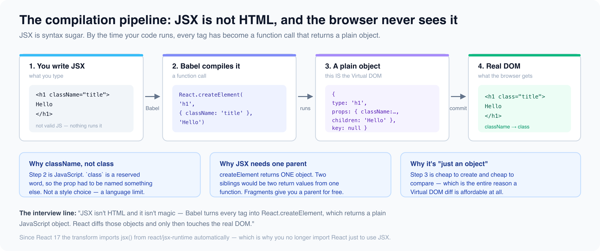

# JSX — It's Not HTML

*17 min read · Updated 16 Jul 2026 Topic 2 of 62 Bookmark Mark done 1 · Topic 2 of 62*

**Source:** [https://www.geekyfrontend.in/learn/react-interview-kit/jsx-it-s-not-html](https://www.geekyfrontend.in/learn/react-interview-kit/jsx-it-s-not-html)

---

# 1.2 — JSX: It's Not HTML

> **Module 2: React Core Concepts** | Difficulty: 🟢 Fresher 🟡 Intermediate

---

## 🎯 What Interviewers Actually Ask

| Question | Level | Frequency |
| --- | --- | --- |
| "What is JSX?" | 🟢 | ★★★★★ |
| "Is JSX mandatory in React?" | 🟢 | ★★★★☆ |
| "What does JSX compile to?" | 🟢🟡 | ★★★★☆ |
| "What are the differences between HTML and JSX?" | 🟢 | ★★★★☆ |
| "Why can't you use `class` in JSX?" | 🟢 | ★★★☆☆ |
| "How does conditional rendering work in JSX?" | 🟢🟡 | ★★★★★ |
| "What is the role of Babel in React?" | 🟡 | ★★★☆☆ |
| "Why must JSX return a single parent element?" | 🟢 | ★★★☆☆ |
| "What are Fragments and why do we use them?" | 🟢🟡 | ★★★★☆ |
| "What is the difference between `createElement` and `cloneElement`?" | 🟡 | ★★☆☆☆ |

---

## 📝 Part 1: What is JSX?

JSX stands for **JavaScript XML**. It's a **syntax extension** for JavaScript that lets you write HTML-like markup directly inside your JavaScript files.

Here's the key insight most beginners miss: **JSX is not HTML. It's not a template language. It's syntactic sugar for JavaScript function calls.**

jsx

```
// What you write (JSX):
const element = <h1 className="title">Hello, World!</h1>;

// What the browser actually receives (JavaScript):
const element = React.createElement('h1', { className: 'title' }, 'Hello, World!');
```

Your browser cannot understand JSX. A tool called **Babel** transforms your JSX into `React.createElement()` calls during the build process. This is why you need a build step (like Vite, Webpack, or Next.js) to run a React project.

### Is JSX Mandatory?

No. You can write React entirely without JSX using `React.createElement()`. But nobody does this in practice because it becomes unreadable very quickly:

jsx

```
// ✅ With JSX — clean and intuitive
function UserCard({ name, role }) {
  return (
    <div className="card">
      <h2>{name}</h2>
      <p>{role}</p>
    </div>
  );
}

// ❌ Without JSX — same component, pure JavaScript
function UserCard({ name, role }) {
  return React.createElement(
    'div',
    { className: 'card' },
    React.createElement('h2', null, name),
    React.createElement('p', null, role)
  );
}
```

Both produce the exact same output. JSX is just easier to read, write, and maintain.

---

## 📝 Part 2: What JSX Compiles To

Understanding the compilation step is critical — interviewers love asking this because it separates candidates who truly understand React from those who just use it.

### The Compilation Pipeline

What really happens to your JSXYou writeJSXBabeltransformcreateElement()callsReact element(plain object)RealDOMbuild time (Babel)

*JSX is syntax sugar. Babel rewrites it into createElement() calls before the browser ever runs your code.*

javascript

```
Your Code (.jsx)
      ↓
   Babel (transpiler)
      ↓
React.createElement() calls
      ↓
Plain JavaScript objects (React Elements)
      ↓
Virtual DOM tree
      ↓
Real DOM (rendered on screen)
```



### React.createElement() — The Function Behind JSX

JSX ⇄ createElementYou write (JSX)<h1 className="x">Hi</h1>Reads like markupNeeds a compilerReact runs (JS)createElement('h1', {className:'x'}, 'Hi')Returns a plain objectPure JavaScript

*Every JSX tag is one createElement() call — nesting produces nested calls.*

Every JSX tag becomes a `React.createElement()` call with three arguments:

javascript

```
React.createElement(
  type,       // String ('div', 'h1') or Component (UserCard)
  props,      // Object of attributes/props (or null)
  ...children // Child elements, strings, or numbers
);
```

Let's trace a real example:

jsx

```
// JSX
<div id="container">
  <h1>Welcome</h1>
  <p>To React</p>
</div>

// Compiles to:
React.createElement(
  'div',
  { id: 'container' },
  React.createElement('h1', null, 'Welcome'),
  React.createElement('p', null, 'To React')
);

// Which produces this plain JavaScript object (a "React Element"):
{
  type: 'div',
  props: {
    id: 'container',
    children: [
      { type: 'h1', props: { children: 'Welcome' } },
      { type: 'p',  props: { children: 'To React' } }
    ]
  }
}
```

This object is what React uses to build the Virtual DOM. It's lightweight, fast to create, and cheap to compare.

### React 17+ — The New JSX Transform

Since React 17, Babel uses a new transform that doesn't require you to import React in every file:

jsx

```
// Before React 17 — you HAD to import React
import React from 'react';  // ← Required even if you didn't use it directly
function App() {
  return <h1>Hello</h1>;
}

// React 17+ — import is no longer needed for JSX
function App() {
  return <h1>Hello</h1>;
}

// Babel now compiles to a different function:
import { jsx as _jsx } from 'react/jsx-runtime';  // ← Babel adds this automatically
function App() {
  return _jsx('h1', { children: 'Hello' });
}
```

> **Interview Tip:** If asked "Why don't we need to import React anymore?", explain the new JSX transform from React 17. This shows you understand the tooling, not just the syntax.

---

## 📝 Part 3: JSX vs HTML — The Complete Difference Table

HTML vs JSX — what changesHTMLclass="btn"style="color:red"onclick="..." (no close)JSXclassName="btn"style={{color:"red"}}onClick={fn} (must close)vs

*JSX attributes are JavaScript, so they follow camelCase and reserved-word rules.*

This is one of the most frequently asked questions. Here's every difference you need to know:

| Feature | HTML | JSX |
| --- | --- | --- |
| **CSS classes** | `class="box"` | `className="box"` |
| **Label association** | `for="name"` | `htmlFor="name"` |
| **Inline styles** | `style="color: red; font-size: 16px"` | `style={{ color: 'red', fontSize: '16px' }}` |
| **Event handlers** | `onclick="handleClick()"` | `onClick={handleClick}` |
| **Attribute casing** | Lowercase (`tabindex`) | camelCase (`tabIndex`) |
| **Self-closing tags** | `<br>`, ``, `<input>` | `<br />`, ``, `<input />` (must self-close) |
| **Boolean attributes** | `<input disabled>` | `<input disabled={true} />` |
| **Custom attributes** | `data-id="5"` | `data-id="5"` (same — `data-*` and `aria-*` work normally) |
| **Comments** | `<!-- comment -->` | `{/* comment */}` |
| **Embedding JS** | Not possible inline | `{expression}` anywhere |
| **Returns** | Multiple root elements OK | Must return single root element |

### Why `className` Instead of `class`?

Because `class` is a **reserved keyword** in JavaScript (used for ES6 classes). Since JSX is JavaScript under the hood, using `class` would create a conflict. The same logic applies to `htmlFor` (because `for` is a loop keyword in JS).

jsx

```
// ❌ This causes issues
<div class="container">  // 'class' is a JS reserved word

// ✅ Correct
<div className="container">
```

### Inline Styles — Objects, Not Strings

In HTML, styles are strings. In JSX, styles are **JavaScript objects** with camelCase property names:

jsx

```
// ❌ HTML way — doesn't work in JSX
<div style="background-color: red; font-size: 16px;">

// ✅ JSX way — object with camelCase
<div style={{ backgroundColor: 'red', fontSize: '16px' }}>

// Why double curly braces {{ }}?
// Outer {} → "I'm embedding a JavaScript expression"
// Inner {} → "This is a JavaScript object literal"
```

### Self-Closing Tags Are Required

In HTML, some tags don't need closing. In JSX, **every tag must be closed**:

jsx

```
// ✅ HTML — both are valid
<br>

<input type="text">

// ✅ JSX — must self-close
<br />

<input type="text" />

// ❌ JSX — this causes an error
<br>    // SyntaxError: unterminated JSX

```

---

## 📝 Part 4: Embedding JavaScript in JSX

The `{}` curly braces in JSX are your gateway to JavaScript. Anything inside `{}` is evaluated as a **JavaScript expression**.

### What Can Go Inside `{}`?

jsx

```
function Profile({ user }) {
  const greeting = 'Hello';

  return (
    <div>
      {/* ✅ Variables */}
      <h1>{greeting}, {user.name}</h1>

      {/* ✅ Expressions & calculations */}
      <p>Age: {user.birthYear ? new Date().getFullYear() - user.birthYear : 'N/A'}</p>

      {/* ✅ Function calls */}
      <p>{user.name.toUpperCase()}</p>

      {/* ✅ Ternary expressions */}
      <span>{user.isAdmin ? 'Admin' : 'User'}</span>

      {/* ✅ Template literals */}
      <p>{`${user.firstName} ${user.lastName}`}</p>

      {/* ✅ Array methods that return values */}
      <ul>{user.hobbies.map(h => <li key={h}>{h}</li>)}</ul>
    </div>
  );
}
```

### What CANNOT Go Inside `{}`?

jsx

```
function Bad() {
  return (
    <div>
      {/* ❌ Statements — if/else, for, while, switch */}
      {if (true) { return 'yes' }}   // SyntaxError!
      {for (let i=0; i<5; i++) {}}   // SyntaxError!

      {/* ❌ Variable declarations */}
      {const x = 5}                  // SyntaxError!

      {/* ❌ Objects directly (React can't render objects) */}
      {{ name: 'Alice' }}            // Error: Objects are not valid as a React child
    </div>
  );
}
```

**The rule is simple:** `{}` accepts **expressions** (things that produce a value), not **statements** (things that perform an action).

javascript

```
Expression (has a value):        Statement (performs an action):
━━━━━━━━━━━━━━━━━━━━━━          ━━━━━━━━━━━━━━━━━━━━━━━━━━━
2 + 2                            if (x > 5) { ... }
user.name                        for (let i=0; ...)
isAdmin ? 'Yes' : 'No'          const x = 5;
items.map(...)                   switch (val) { ... }
someFunction()                   while (true) { ... }
```

---

## 📝 Part 5: The Single Parent Rule & Fragments

The single-parent ruleInvalid — two rootsreturn ( <h1/> <p/> ← second root)Valid — one wrapperreturn ( <> ← Fragment <h1/><p/> </>

*A component must return a single node. Fragments (<>…</>) group siblings without adding a DOM element.*

JSX must return **one single parent element**. This is because `React.createElement()` can only return one element — the function takes one `type` as its first argument.

jsx

```
// ❌ Error: Adjacent JSX elements must be wrapped in an enclosing tag
function App() {
  return (
    <h1>Title</h1>
    <p>Description</p>
  );
}

// ✅ Solution 1: Wrap in a <div>
function App() {
  return (
    <div>
      <h1>Title</h1>
      <p>Description</p>
    </div>
  );
}

// ✅ Solution 2: Use a Fragment (no extra DOM node!)
function App() {
  return (
    <>
      <h1>Title</h1>
      <p>Description</p>
    </>
  );
}
```

### What Are Fragments?

Fragments (`<>...</>` or `<React.Fragment>...</React.Fragment>`) let you group elements without adding an extra node to the DOM.

jsx

```
// With <div> wrapper → adds an unnecessary node to the DOM
<div>         ← This div has no purpose, it's just a wrapper
  <td>Name</td>
  <td>Age</td>
</div>

// With Fragment → no extra DOM node
<>
  <td>Name</td>
  <td>Age</td>
</>
```

**When do you need the full** `<React.Fragment>` **syntax?** Only when you need a `key` prop (like in lists):

jsx

```
{items.map(item => (
  <React.Fragment key={item.id}>
    <dt>{item.term}</dt>
    <dd>{item.definition}</dd>
  </React.Fragment>
))}
// Short syntax <> doesn't support key prop
```

---

## 📝 Part 6: Conditional Rendering Patterns

Interviewers will ask you to render different UI based on conditions. Here are all the patterns, from simplest to most advanced:

### Pattern 1: Ternary Operator (Most Common)

Use when you have **two outcomes** — show one thing or another.

jsx

```
function Greeting({ isLoggedIn }) {
  return (
    <div>
      {isLoggedIn ? <h1>Welcome back!</h1> : <h1>Please sign in.</h1>}
    </div>
  );
}
```

### Pattern 2: Logical AND `&&` (Show or Hide)

Use when you want to **show something or nothing**.

jsx

```
function Mailbox({ unreadCount }) {
  return (
    <div>
      <h1>Mailbox</h1>
      {unreadCount > 0 && <p>You have {unreadCount} unread messages.</p>}
    </div>
  );
}
```

> **Gotcha:** Be careful with `0` and `&&`. React renders `0` on screen!

jsx

```
// ❌ Bug — renders "0" on screen when count is 0
{count && <p>Messages: {count}</p>}
// When count = 0, this renders: 0 (because 0 is falsy but renderable)

// ✅ Fix — explicitly check for boolean
{count > 0 && <p>Messages: {count}</p>}
```

### Pattern 3: Early Return (Clean Code)

Use when a condition should **block the entire render**.

jsx

```
function Dashboard({ user }) {
  if (!user) {
    return <p>Please log in to view dashboard.</p>;
  }

  return (
    <div>
      <h1>Welcome, {user.name}</h1>
      <DashboardContent />
    </div>
  );
}
```

### Pattern 4: Variable Assignment (Complex Conditions)

Use when you have **multiple conditions** that would make inline JSX unreadable.

jsx

```
function StatusBadge({ status }) {
  let badge;

  if (status === 'active') {
    badge = <span className="green">Active</span>;
  } else if (status === 'pending') {
    badge = <span className="yellow">Pending</span>;
  } else if (status === 'banned') {
    badge = <span className="red">Banned</span>;
  } else {
    badge = <span className="gray">Unknown</span>;
  }

  return <div>{badge}</div>;
}
```

### Pattern 5: Object Lookup (Replaces Switch)

Use when you're mapping **a value to a component** — cleaner than a switch statement.

jsx

```
const STATUS_COMPONENTS = {
  active:  <span className="green">Active</span>,
  pending: <span className="yellow">Pending</span>,
  banned:  <span className="red">Banned</span>,
};

function StatusBadge({ status }) {
  return <div>{STATUS_COMPONENTS[status] ?? <span>Unknown</span>}</div>;
}
```

### Pattern 6: IIFE (Immediately Invoked Function Expression)

Use when you absolutely need a `switch` or complex logic **inline inside JSX** (rare but asked in interviews):

jsx

```
function Notification({ type }) {
  return (
    <div>
      {(() => {
        switch (type) {
          case 'success': return <p style={{ color: 'green' }}>Success!</p>;
          case 'error':   return <p style={{ color: 'red' }}>Error!</p>;
          case 'warning': return <p style={{ color: 'orange' }}>Warning!</p>;
          default:        return null;
        }
      })()}
    </div>
  );
}
```

---

## 📝 Part 7: createElement vs cloneElement

createElement vs cloneElementcreateElementBuilds a NEW elementYou supply type + propsWhat JSX compiles tocloneElementCopies an EXISTING elementMerges/overrides propsUsed to inject props into childrenvs

*cloneElement is how libraries add props to children they did not create.*

This is an intermediate question that tests deeper understanding.

javascript

```
React.createElement()                    React.cloneElement()
━━━━━━━━━━━━━━━━━━━━━                   ━━━━━━━━━━━━━━━━━━━━
Creates a brand new React element        Clones an EXISTING element and
from scratch.                            adds/overrides its props.

Used by: JSX compilation (Babel)         Used by: HOCs, component wrappers

You use it every time you write JSX      You use it when you receive an element
(even though you don't see it).          and want to enhance it.
```

jsx

```
// createElement — creates a new element
const element = React.createElement('div', { className: 'box' }, 'Hello');
// Equivalent to: <div className="box">Hello</div>

// cloneElement — copies an existing element and adds/overrides props
const original = <button>Click</button>;
const enhanced = React.cloneElement(original, { className: 'primary', disabled: true });
// Result: <button className="primary" disabled>Click</button>
```

**Real-world use case for cloneElement** — injecting props into children:

jsx

```
function FormGroup({ children, error }) {
  return (
    <div className="form-group">
      {React.Children.map(children, child =>
        React.cloneElement(child, { 
          className: error ? 'input-error' : '',
          'aria-invalid': !!error 
        })
      )}
      {error && <span className="error-text">{error}</span>}
    </div>
  );
}

// Usage
<FormGroup error="Required field">
  <input type="text" placeholder="Name" />
</FormGroup>
// The input automatically gets className="input-error" and aria-invalid="true"
```

---

## ⚡ Common Mistakes & Gotchas

### Mistake 1: Using `class` instead of `className`

jsx

```
// ❌ Common beginner mistake
<div class="container">Hello</div>
// React will warn: "Invalid DOM property `class`. Did you mean `className`?"

// ✅ Correct
<div className="container">Hello</div>
```

### Mistake 2: Forgetting that JSX is case-sensitive for components

jsx

```
// ❌ Lowercase = treated as HTML element
<myComponent />  // React thinks this is a custom HTML tag, not your component

// ✅ Components must start with uppercase
<MyComponent />
```

This rule exists because React uses the **casing** to distinguish between HTML tags (lowercase) and custom components (PascalCase) during compilation.

### Mistake 3: Rendering objects directly

jsx

```
const user = { name: 'Alice', age: 25 };

// ❌ Error: Objects are not valid as a React child
<p>{user}</p>

// ✅ Access specific properties
<p>{user.name}</p>

// ✅ Or convert to string
<p>{JSON.stringify(user)}</p>
```

### Mistake 4: Forgetting `()` around multi-line JSX

jsx

```
// ❌ Bug — returns undefined (semicolon is auto-inserted after return)
function App() {
  return
    <div>Hello</div>;
}

// ✅ Wrap in parentheses
function App() {
  return (
    <div>Hello</div>
  );
}
```

JavaScript's **Automatic Semicolon Insertion (ASI)** adds a `;` after `return` on its own line, so the function returns `undefined`. Parentheses prevent this.

### Mistake 5: The `&&` operator with `0`

jsx

```
// ❌ Renders "0" on screen when items is an empty array
{items.length && <ItemList items={items} />}

// ✅ Always convert to boolean first
{items.length > 0 && <ItemList items={items} />}
// or
{!!items.length && <ItemList items={items} />}
```

---

## 🔥 Output-Based Questions

### Question 1: What renders on screen?

jsx

```
function App() {
  const show = false;
  return (
    <div>
      {show && <h1>Hello</h1>}
      {null}
      {undefined}
      {false}
      {true}
      {''}
      {0}
    </div>
  );
}
```

**Answer:** Only `0` renders on screen. Everything else renders nothing.

javascript

```
null        → renders nothing
undefined   → renders nothing
false       → renders nothing
true        → renders nothing
''          → renders nothing (empty string)
0           → renders "0" on screen! ← This is the trap
```

This is why `{count && <Component />}` is dangerous when `count` can be `0`.

### Question 2: Will this code work?

jsx

```
function App() {
  return (
    <h1>Hello</h1>
    <h2>World</h2>
  );
}
```

**Answer: No.** It throws a syntax error: *"Adjacent JSX elements must be wrapped in an enclosing tag."* You need a single parent — use a `<div>` or a Fragment `<>`.

### Question 3: What does this render?

jsx

```
function App() {
  const items = [];
  return (
    <div>
      {items.length && <p>Items exist</p>}
    </div>
  );
}
```

**Answer:** It renders `0` on the screen. Because `items.length` is `0`, and `0 && <p>...</p>` evaluates to `0`, which React renders as text. The fix is `items.length > 0 && ...`.

### Question 4: What's the difference?

jsx

```
// Version A
<input disabled />

// Version B
<input disabled={true} />

// Version C
<input disabled={false} />
```

**Answer:** Version A and B are identical — in JSX, writing a prop without a value defaults to `true`. Version C passes `false`, so the input will NOT be disabled. This is different from HTML where `<input disabled="false">` would still disable the input (because any attribute value counts as present in HTML).

---

## 🏗️ Scenario Question: "Build a component that renders different UI based on user role"

This tests conditional rendering knowledge:

jsx

```
function Dashboard({ user }) {
  // Early return for unauthenticated users
  if (!user) {
    return <LoginPrompt />;
  }

  // Object lookup for role-based content
  const roleContent = {
    admin: (
      <>
        <AdminStats />
        <UserManagement />
        <SystemSettings />
      </>
    ),
    editor: (
      <>
        <ContentEditor />
        <MediaLibrary />
      </>
    ),
    viewer: (
      <>
        <ReadOnlyContent />
      </>
    ),
  };

  return (
    <div className="dashboard">
      <Header user={user} />
      
      {/* Role-based content with fallback */}
      {roleContent[user.role] ?? <p>Unknown role: {user.role}</p>}
      
      {/* Feature flags */}
      {user.hasNotifications && <NotificationBell count={user.unreadCount} />}
      
      <Footer />
    </div>
  );
}
```

**Why this is a good answer:** It demonstrates early return, object lookup pattern (instead of messy if/else chains), fragment usage, nullish coalescing for fallback, and the `&&` pattern — all in one clean component.

---

## 🗣️ How to Answer in an Interview

### "What is JSX?" — Sample Answer (30 seconds)

> "JSX stands for JavaScript XML. It's a syntax extension that lets us write HTML-like markup inside JavaScript files. It's not HTML — it gets compiled by Babel into `React.createElement()` function calls, which produce plain JavaScript objects called React Elements. These objects form the Virtual DOM. JSX is not mandatory, but it makes the code far more readable than writing `createElement` calls manually."

### "What are the differences between HTML and JSX?" — Sample Answer (30 seconds)

> "The main differences are: JSX uses `className` instead of `class` and `htmlFor` instead of `for` because those are reserved words in JavaScript. Inline styles in JSX are objects with camelCase properties, not strings. All tags must be explicitly closed in JSX — so `<br>` becomes `<br />`. Event handlers use camelCase like `onClick` instead of `onclick`. And you can embed JavaScript expressions using curly braces `{}`."

### "What are Fragments?" — Sample Answer (20 seconds)

> "Fragments let you group multiple elements without adding an extra node to the DOM. You write them as `<>...</>` or `<React.Fragment>...</React.Fragment>`. The long syntax is needed when you want to pass a `key` prop, like when rendering lists. They solve the 'single parent element' rule without polluting the DOM with unnecessary wrapper divs."

---

## ✅ Key Takeaways (Revision Cheat Sheet)

javascript

```
□ JSX = JavaScript XML — syntax sugar, not HTML, not a template
□ Babel compiles JSX → React.createElement() → plain JS objects
□ React 17+ uses a new JSX transform (no more import React needed)
□ Use className, htmlFor, camelCase events (onClick, onChange)
□ Inline styles are JS objects: style={{ fontSize: '16px' }}
□ All tags must be self-closed: <br />, , <input />
□ {} embeds JS EXPRESSIONS (not statements) in JSX
□ Must return a single parent — use Fragments <> to avoid extra DOM nodes
□ <React.Fragment key={id}> when you need keys on fragments
□ Component names must start with UPPERCASE (PascalCase)
□ Conditional rendering: ternary, &&, early return, variable, object lookup
□ Watch out: {0 && <Component />} renders "0" on screen
□ createElement creates new elements; cloneElement copies and enhances existing ones
□ Multi-line JSX needs () after return to avoid ASI bugs
```

---

## Learn More

- [Writing Markup with JSX react.dev](https://react.dev/learn/writing-markup-with-jsx)
- [JavaScript in JSX with Curly Braces react.dev](https://react.dev/learn/javascript-in-jsx-with-curly-braces)
- [Introducing JSX (deep dive) reactjs.org](https://legacy.reactjs.org/docs/introducing-jsx.html)
- [What is JSX? Syntax explained with examples YouTube](https://www.youtube.com/watch?v=C3OvWKv_a6w)
- [Learn JSX in React — the essential guide YouTube](https://www.youtube.com/watch?v=pIpzObwzJqo)
- [JSX explained for beginners YouTube](https://www.youtube.com/watch?v=C-TCQl4VvCs)
