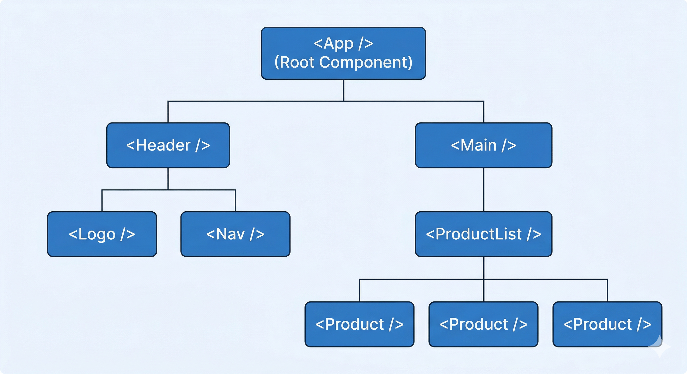
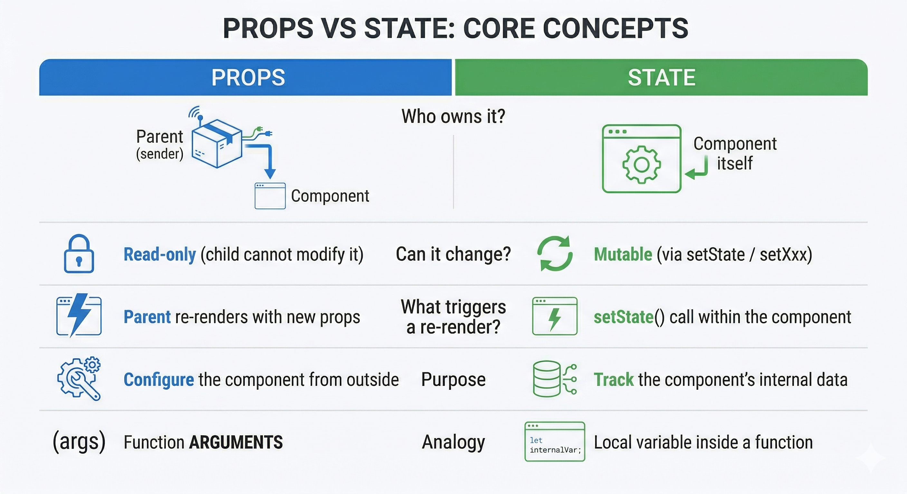

# Components, Props & Composition

*18 min read · Updated 26 Mar 2026 Topic 3 of 62 Bookmark Mark done 1 · Topic 3 of 62*

**Source:** [https://www.geekyfrontend.in/learn/react-interview-kit/components-props-composition](https://www.geekyfrontend.in/learn/react-interview-kit/components-props-composition)

---

# 1.3 — Components, Props & the Art of Composition

> **Module 2: React Core Concepts** | Difficulty: 🟢 Fresher 🟡 Intermediate

---

## 🎯 What Interviewers Actually Ask

| Question | Level | Frequency |
| --- | --- | --- |
| "What are components in React?" | 🟢 | ★★★★★ |
| "What is the difference between functional and class components?" | 🟢 | ★★★★★ |
| "What are props?" | 🟢 | ★★★★★ |
| "What is the difference between props and state?" | 🟢 | ★★★★★ |
| "How do you pass data from parent to child?" | 🟢 | ★★★★★ |
| "How do you send data from child to parent?" | 🟢🟡 | ★★★★★ |
| "What is prop drilling? How do you avoid it?" | 🟡 | ★★★★☆ |
| "What is component composition?" | 🟡 | ★★★☆☆ |
| "What are Pure Components?" | 🟡 | ★★★☆☆ |
| "What is PropTypes? How do you do type checking?" | 🟡 | ★★☆☆☆ |
| "Composition vs inheritance — which does React prefer?" | 🟡🔴 | ★★★☆☆ |
| "What is the `children` prop?" | 🟢🟡 | ★★★☆☆ |

---

## 📝 Part 1: What Are Components?

A component is a **reusable, self-contained piece of UI**. Think of it like a LEGO block — small on its own, but combine many and you build something complex.

Every React application is a tree of components:



There are two ways to create components: **functional** and **class-based**.

### Functional Components (The Modern Standard)

A functional component is a plain JavaScript function that takes `props` as input and returns JSX.

jsx

```
function Greeting({ name }) {
  return <h1>Hello, {name}!</h1>;
}

// Arrow function version (equally valid)
const Greeting = ({ name }) => <h1>Hello, {name}!</h1>;
```

### Class Components (Legacy but Still Asked in Interviews)

A class component extends `React.Component` and must have a `render()` method.

jsx

```
class Greeting extends React.Component {
  render() {
    return <h1>Hello, {this.props.name}!</h1>;
  }
}
```

### Functional vs Class — The Complete Comparison

Functional vs Class componentsFunctionalJust a function returning JSXHooks for state & effectsLess boilerplateThe modern defaultClassExtends React.Componentthis.state / lifecycle methodsMore verboseLegacy, still asked aboutvs

*Everything a class did, hooks now do in a function — with less ceremony.*

| Feature | Functional Component | Class Component |
| --- | --- | --- |
| Syntax | Plain function | ES6 class extending `React.Component` |
| State | `useState` hook | `this.state` + `this.setState()` |
| Lifecycle | `useEffect` hook | `componentDidMount`, `componentDidUpdate`, etc. |
| `this` keyword | Not needed | Required (`this.props`, `this.state`) |
| Performance | Slightly better (no class overhead) | Slightly heavier |
| Readability | Simpler, less boilerplate | More verbose |
| Modern React | Preferred standard since React 16.8 | Legacy — still needed for Error Boundaries |
| Hooks support | Yes | No |

### Why Class Components Still Matter in Interviews

Even though functional components are the standard today, you should know class components because:

javascript

```
1. Error Boundaries can ONLY be class components (as of React 19)
2. Many production codebases still have class components
3. Interviewers test if you understand lifecycle methods
4. Migration questions: "How would you convert this class to functional?"
```

**Quick class-to-functional conversion** — a common interview exercise:

jsx

```
// CLASS
class UserProfile extends React.Component {
  constructor(props) {
    super(props);
    this.state = { isOnline: false };
  }
  
  componentDidMount() {
    this.setState({ isOnline: true });
  }
  
  componentWillUnmount() {
    console.log('Cleanup');
  }
  
  render() {
    return <p>{this.props.name} is {this.state.isOnline ? 'Online' : 'Offline'}</p>;
  }
}

// FUNCTIONAL (converted)
function UserProfile({ name }) {
  const [isOnline, setIsOnline] = useState(false);
  
  useEffect(() => {
    setIsOnline(true);
    return () => console.log('Cleanup');  // componentWillUnmount
  }, []);  // empty deps = componentDidMount
  
  return <p>{name} is {isOnline ? 'Online' : 'Offline'}</p>;
}
```

---

## 📝 Part 2: Props — The Communication Channel

**Props** (short for "properties") are how components talk to each other. They're the mechanism for passing data **from parent to child**.

### The Core Rules of Props

javascript

```
Rule 1: Props flow ONE WAY — parent → child (unidirectional)
Rule 2: Props are READ-ONLY — a child can never modify its own props
Rule 3: You can pass ANYTHING as a prop — strings, numbers, objects, arrays, functions, even other components
```

### Passing & Receiving Props

jsx

```
// PARENT — passes data as props
function App() {
  const user = { name: 'Alice', age: 30 };

  return (
    <UserCard
      name={user.name}            {/* string */}
      age={user.age}              {/* number */}
      isAdmin={true}              {/* boolean */}
      hobbies={['reading', 'coding']}  {/* array */}
      address={{ city: 'NYC' }}   {/* object */}
      onLogout={() => console.log('Bye')} {/* function */}
    />
  );
}

// CHILD — receives props (two ways to access)

// Way 1: props object
function UserCard(props) {
  return <h1>{props.name}, Age: {props.age}</h1>;
}

// Way 2: destructuring (preferred — cleaner, self-documenting)
function UserCard({ name, age, isAdmin, hobbies, onLogout }) {
  return (
    <div>
      <h1>{name}, Age: {age}</h1>
      {isAdmin && <span>Admin</span>}
      <button onClick={onLogout}>Logout</button>
    </div>
  );
}
```

### Default Props

When a prop isn't provided, you can set fallback values:

jsx

```
// Modern way — default parameters (recommended)
function Button({ label = 'Click me', variant = 'primary', size = 'md' }) {
  return <button className={`btn btn-${variant} btn-${size}`}>{label}</button>;
}

// Usage
<Button />                        // Uses all defaults
<Button label="Submit" />         // Overrides label, keeps other defaults
<Button variant="danger" />       // Only changes variant
```

### The Spread Operator for Props

When you have an object that matches a component's props, you can spread it:

jsx

```
const buttonProps = {
  label: 'Save',
  variant: 'primary',
  disabled: false,
  onClick: handleSave,
};

// ❌ Tedious
<Button label={buttonProps.label} variant={buttonProps.variant} 
        disabled={buttonProps.disabled} onClick={buttonProps.onClick} />

// ✅ Clean — spread the object
<Button {...buttonProps} />

// ✅ Spread + override specific props
<Button {...buttonProps} variant="danger" label="Delete" />
```

---

## 📝 Part 3: Props vs State

Props vs StatePropsPassed IN from the parentRead-only inside the childParent controls themStateOwned BY the componentChanged with a setterTriggers a re-rendervs

*Props flow down and are immutable; state is local and mutable via its setter.*

This is arguably the most asked React question. Here's the definitive comparison:



jsx

```
function Child({ message }) {                // ← message is a PROP (from parent)
  const [count, setCount] = useState(0);     // ← count is STATE (owned locally)

  return (
    <div>
      <p>Parent says: {message}</p>
      <p>My count: {count}</p>
      <button onClick={() => setCount(count + 1)}>+</button>
    </div>
  );
}

function Parent() {
  return <Child message="Hello from parent!" />;
}
```

---

## 📝 Part 4: Data Flow Patterns

Props flow down (Parent → Child)ParentChild AChild Bprops ↓

*React's data flow is one-way: a parent hands data to its children through props.*

### Pattern 1: Parent → Child (Props)

The simplest and most common pattern — already covered above.

### Pattern 2: Child → Parent (Callback Functions)

Events flow up (Child → Parent)Parent (owns state)Child AChild BonChange(value) ↑

*To talk back, a child calls a function the parent passed down — it never mutates the parent directly.*

This is **the most asked data flow question in interviews**. The parent passes a **function** as a prop. The child **calls that function** with data.

jsx

```
// PARENT — defines the function, receives data
function Parent() {
  const [messageFromChild, setMessageFromChild] = useState('');

  const handleChildData = (data) => {
    setMessageFromChild(data);   // Now parent has the child's data
  };

  return (
    <div>
      <p>Child said: {messageFromChild}</p>
      <Child onSendData={handleChildData} />
    </div>
  );
}

// CHILD — calls the parent's function with data
function Child({ onSendData }) {
  return (
    <button onClick={() => onSendData('Hello from child!')}>
      Send to Parent
    </button>
  );
}
```

**How this works step by step:**

javascript

```
1. Parent creates handleChildData function
2. Parent passes it to Child via the onSendData prop
3. Child calls onSendData('Hello from child!') on button click
4. This actually executes handleChildData('Hello from child!') in the parent
5. Parent's state updates → triggers re-render → shows the message
```

### Pattern 3: Sibling → Sibling (Lifting State Up)

Two siblings can't talk directly. The solution is **lifting the shared state up** to their common parent.

jsx

```
function App() {
  // Shared state lives in the parent
  const [searchText, setSearchText] = useState('');

  return (
    <div>
      <SearchInput value={searchText} onChange={setSearchText} />
      <ResultsList searchText={searchText} />
    </div>
  );
}

function SearchInput({ value, onChange }) {
  return (
    <input
      value={value}
      onChange={(e) => onChange(e.target.value)}
      placeholder="Search..."
    />
  );
}

function ResultsList({ searchText }) {
  const filtered = allItems.filter(item =>
    item.name.toLowerCase().includes(searchText.toLowerCase())
  );

  return (
    <ul>
      {filtered.map(item => <li key={item.id}>{item.name}</li>)}
    </ul>
  );
}
```

---

## 📝 Part 5: Prop Drilling & How to Solve It

Prop drillingApp (has user)Page (just forwards user)Sidebar (just forwards user)Avatar (finally uses user)

*user is threaded through components that do not need it. Context (or composition) lets the deep child read it directly.*

**Prop drilling** is when you pass props through multiple intermediate components that don't use the data — they just pass it along.

jsx

```
// ❌ THE PROBLEM — App → Parent → Child → GrandChild
function App() {
  const [user, setUser] = useState({ name: 'Alice' });
  return <Parent user={user} />;           // Step 1: pass down
}

function Parent({ user }) {
  return <Child user={user} />;             // Step 2: pass through (doesn't use it!)
}

function Child({ user }) {
  return <GrandChild user={user} />;        // Step 3: pass through (doesn't use it!)
}

function GrandChild({ user }) {
  return <h1>Hello, {user.name}</h1>;       // Step 4: finally used
}
```

### Why Prop Drilling Is a Problem

javascript

```
1. Code complexity     — Hard to trace where data comes from
2. Fragile             — Adding/removing a prop means touching every component in the chain
3. Unnecessary renders — Intermediate components re-render when props change (even though they don't use them)
4. Poor maintainability — Changing the data shape requires updates in multiple files
```

### Solutions to Prop Drilling

**Solution 1: Component Composition (restructure your tree)**

jsx

```
// ✅ Instead of drilling, compose components so the data stays close
function App() {
  const [user, setUser] = useState({ name: 'Alice' });

  return (
    <Layout>
      <Header>
        <UserGreeting name={user.name} />   {/* Direct access — no drilling */}
      </Header>
      <Main>
        <Dashboard user={user} />
      </Main>
    </Layout>
  );
}

function Layout({ children }) {
  return <div className="layout">{children}</div>;
}

function Header({ children }) {
  return <header>{children}</header>;
}
```

**Solution 2: Context API (for truly global data)**

jsx

```
const UserContext = React.createContext();

function App() {
  const [user, setUser] = useState({ name: 'Alice' });
  
  return (
    <UserContext.Provider value={user}>
      <Parent />
    </UserContext.Provider>
  );
}

// Parent and Child don't need to know about user at all!
function Parent() {
  return <Child />;
}

function Child() {
  return <GrandChild />;
}

// GrandChild grabs user directly from Context
function GrandChild() {
  const user = useContext(UserContext);
  return <h1>Hello, {user.name}</h1>;
}
```

**Solution 3: State management libraries** (Redux, Zustand) — covered in Module 5.

---

## 📝 Part 6: Component Composition — The `children` Prop

Composition is React's answer to inheritance. The React docs explicitly recommend **composition over inheritance** for code reuse.

### The `children` Prop

Every component automatically receives a special prop called `children` — whatever you put **between** the component's opening and closing tags.

jsx

```
function Card({ children }) {
  return <div className="card">{children}</div>;
}

// Usage — anything between <Card> and </Card> becomes `children`
<Card>
  <h2>Title</h2>
  <p>Some content here</p>
</Card>

// Renders:
// <div class="card">
//   <h2>Title</h2>
//   <p>Some content here</p>
// </div>
```

### Building a Reusable Card System with Composition

jsx

```
// Base building blocks
function Card({ children, className = '' }) {
  return <div className={`card ${className}`}>{children}</div>;
}

function CardHeader({ children }) {
  return <div className="card-header">{children}</div>;
}

function CardBody({ children }) {
  return <div className="card-body">{children}</div>;
}

function CardFooter({ children }) {
  return <div className="card-footer">{children}</div>;
}

// COMPOSED — building complex UI from simple parts
function UserCard({ user }) {
  return (
    <Card className="user-card">
      <CardHeader>
        
        <h2>{user.name}</h2>
      </CardHeader>
      <CardBody>
        <p>{user.bio}</p>
        <p>Joined: {user.joinDate}</p>
      </CardBody>
      <CardFooter>
        <button>Follow</button>
        <button>Message</button>
      </CardFooter>
    </Card>
  );
}

function ProductCard({ product }) {
  return (
    <Card className="product-card">
      <CardHeader>
        
      </CardHeader>
      <CardBody>
        <h3>{product.name}</h3>
        <p>${product.price}</p>
      </CardBody>
      <CardFooter>
        <button>Add to Cart</button>
      </CardFooter>
    </Card>
  );
}
```

### Named Slots Pattern (Multiple `children`-like Props)

Sometimes `children` isn't enough — you need multiple "slots" for content:

jsx

```
function PageLayout({ header, sidebar, content, footer }) {
  return (
    <div className="page">
      <header className="page-header">{header}</header>
      <div className="page-body">
        <aside className="page-sidebar">{sidebar}</aside>
        <main className="page-content">{content}</main>
      </div>
      <footer className="page-footer">{footer}</footer>
    </div>
  );
}

// Usage — pass JSX to named props
<PageLayout
  header={<NavBar user={user} />}
  sidebar={<FilterPanel filters={filters} />}
  content={<ProductGrid products={products} />}
  footer={<Footer />}
/>
```

### Composition vs Inheritance

Composition over inheritanceInheritanceextends a base componentRigid parent-child couplingReact does NOT recommend itCompositionPass UI via props / childrenFlexible, reusableThe React wayvs

*Build complex UI by nesting components and passing children — not by subclassing.*

javascript

```
Inheritance (Object-Oriented):          Composition (React's Way):
━━━━━━━━━━━━━━━━━━━━━━━━━              ━━━━━━━━━━━━━━━━━━━━━━━
class SpecialButton                     function SpecialButton(props) {
  extends Button { ... }                  return (
                                            <Button
"SpecialButton IS A Button"                   className="special"
                                              {...props}
Tight coupling.                             />
Hard to change later.                    );
Fragile hierarchies.                    }
                                        
                                        "SpecialButton USES a Button"
                                        
                                        Loose coupling.
                                        Flexible. Easy to change.
```

React's official recommendation: **"At Facebook, we use React in thousands of components, and we haven't found any use cases where we would recommend creating component inheritance hierarchies."**

---

## 📝 Part 7: Pure Components & React.memo

A **Pure Component** only re-renders when its props or state actually change (via shallow comparison).

jsx

```
// CLASS — PureComponent (shallow comparison built-in)
class Greeting extends React.PureComponent {
  render() {
    console.log('Greeting rendered');
    return <h3>Hello, {this.props.name}!</h3>;
  }
}

// FUNCTIONAL — React.memo (the equivalent for function components)
const Greeting = React.memo(function Greeting({ name }) {
  console.log('Greeting rendered');
  return <h3>Hello, {name}!</h3>;
});
```

**Shallow comparison** means React checks if each prop value is the same reference (for objects/arrays) or the same value (for primitives). It does NOT do a deep comparison.

jsx

```
// This parent re-renders every time address is typed
function App() {
  const [name, setName] = useState('');
  const [address, setAddress] = useState('');

  return (
    <>
      <input value={name} onChange={e => setName(e.target.value)} />
      <input value={address} onChange={e => setAddress(e.target.value)} />
      <Greeting name={name} />
      {/* Without React.memo: Greeting re-renders when address changes too! */}
      {/* With React.memo: Greeting only re-renders when name changes */}
    </>
  );
}
```

---

## ⚡ Common Mistakes & Gotchas

### Mistake 1: Mutating props

jsx

```
// ❌ NEVER do this — props are read-only
function Child(props) {
  props.name = 'Changed';   // This WILL cause bugs and React warnings
  return <p>{props.name}</p>;
}

// ✅ If you need to change data, use local state
function Child({ name }) {
  const [localName, setLocalName] = useState(name);
  return <input value={localName} onChange={e => setLocalName(e.target.value)} />;
}
```

### Mistake 2: Passing new object/array references on every render

jsx

```
// ❌ Creates a NEW object every render → React.memo won't help
function Parent() {
  return <Child style={{ color: 'red' }} items={[1, 2, 3]} />;
  //             ↑ new object every time    ↑ new array every time
}

// ✅ Move constants outside or memoize
const cardStyle = { color: 'red' };
const defaultItems = [1, 2, 3];

function Parent() {
  return <Child style={cardStyle} items={defaultItems} />;
}
```

### Mistake 3: Not destructuring props (readability issue)

jsx

```
// ❌ Hard to tell what this component needs
function UserCard(props) {
  return (
    <div>
      <h1>{props.user.name}</h1>
      <p>{props.user.email}</p>
      <button onClick={props.onEdit}>{props.editLabel}</button>
    </div>
  );
}

// ✅ Self-documenting — immediately clear what the component needs
function UserCard({ user, onEdit, editLabel = 'Edit' }) {
  return (
    <div>
      <h1>{user.name}</h1>
      <p>{user.email}</p>
      <button onClick={onEdit}>{editLabel}</button>
    </div>
  );
}
```

### Mistake 4: Deeply nested component definitions

jsx

```
// ❌ Defining a component INSIDE another component
function Parent() {
  // This gets re-created every render! State gets lost!
  function Child() {
    const [count, setCount] = useState(0);
    return <button onClick={() => setCount(count + 1)}>{count}</button>;
  }

  return <Child />;
}

// ✅ Define components at the TOP LEVEL
function Child() {
  const [count, setCount] = useState(0);
  return <button onClick={() => setCount(count + 1)}>{count}</button>;
}

function Parent() {
  return <Child />;
}
```

---

## 🔥 Output-Based Questions

### Question 1: What happens when the parent re-renders?

jsx

```
const Child = React.memo(({ data }) => {
  console.log('Child rendered');
  return <p>{data.name}</p>;
});

function Parent() {
  const [count, setCount] = useState(0);

  return (
    <div>
      <button onClick={() => setCount(count + 1)}>Count: {count}</button>
      <Child data={{ name: 'Alice' }} />
    </div>
  );
}
```

**Answer:** `"Child rendered"` logs **every time** the button is clicked, despite `React.memo`.

Why? Because `{ name: 'Alice' }` creates a **new object reference** on every render. `React.memo` does a shallow comparison, sees a different reference, and re-renders. Fix: move the object outside or use `useMemo`.

### Question 2: Does the child re-render?

jsx

```
function Parent() {
  const [count, setCount] = useState(0);

  return (
    <div>
      <button onClick={() => setCount(c => c + 1)}>+</button>
      <Child />
    </div>
  );
}

function Child() {
  console.log('Child rendered');
  return <p>I am a child</p>;
}
```

**Answer:** Yes, `"Child rendered"` logs on every click. Even though `Child` receives no props and nothing about it changes, React re-renders all children of a component that re-renders. This is React's default behavior. Use `React.memo(Child)` to prevent it.

### Question 3: Will this component work?

jsx

```
function greeting({ name }) {
  return <h1>Hello, {name}</h1>;
}

function App() {
  return <greeting name="Alice" />;
}
```

**Answer:** No — it renders a plain HTML `<greeting>` element (which doesn't exist), not the component. Component names **must start with an uppercase letter** so React can distinguish them from HTML tags. Rename to `Greeting`.

---

## 🏗️ Scenario: "Build a reusable Alert component that supports different types"

This tests composition, props, default values, and conditional styling:

jsx

```
function Alert({ type = 'info', title, children, onClose, closable = true }) {
  const styles = {
    info:    { bg: '#e7f3fe', border: '#2196F3', icon: 'ℹ️' },
    success: { bg: '#e8f5e9', border: '#4CAF50', icon: '✅' },
    warning: { bg: '#fff3e0', border: '#FF9800', icon: '⚠️' },
    error:   { bg: '#ffebee', border: '#f44336', icon: '❌' },
  };

  const style = styles[type] || styles.info;

  return (
    <div style={{
      backgroundColor: style.bg,
      borderLeft: `4px solid ${style.border}`,
      padding: '16px',
      borderRadius: '4px',
      position: 'relative',
    }}>
      <strong>{style.icon} {title}</strong>
      <div>{children}</div>
      {closable && (
        <button
          onClick={onClose}
          style={{ position: 'absolute', top: 8, right: 8, border: 'none', background: 'none', cursor: 'pointer' }}
        >
          ✕
        </button>
      )}
    </div>
  );
}

// Usage — flexible through props
<Alert type="success" title="Saved!" onClose={() => setShow(false)}>
  <p>Your changes have been saved successfully.</p>
</Alert>

<Alert type="error" title="Error" closable={false}>
  <p>Something went wrong. Please try again.</p>
</Alert>

<Alert title="Note">
  <p>This defaults to "info" type.</p>
</Alert>
```

**Why this is a strong interview answer:** It uses default props, the `children` prop for flexible content, object lookup for styling (no if/else chains), conditional rendering for the close button, and clean destructuring.

---

## 🗣️ How to Answer in an Interview

### "What is the difference between functional and class components?" (30 sec)

> "Functional components are plain JavaScript functions that return JSX. Class components extend `React.Component` and require a `render()` method. Since React 16.8, hooks gave functional components the ability to manage state and lifecycle — so they're now the standard. Class components are still needed for Error Boundaries, and you'll see them in older codebases, but for new code we use functional components."

### "How do you pass data from child to parent?" (30 sec)

> "React's data flow is one-way — parent to child via props. To send data the other direction, the parent passes a **callback function** as a prop. When the child needs to send data, it calls that function with the data as an argument. The function executes in the parent's scope, so the parent receives the data and can update its state accordingly."

### "What is prop drilling and how do you avoid it?" (30 sec)

> "Prop drilling is passing props through multiple intermediate components that don't actually use the data — they just forward it. It makes code fragile and hard to maintain. The three solutions are: **component composition** — restructuring the tree so data stays close to where it's used; **Context API** — for data that many components need at different nesting levels; or **state management libraries** like Redux or Zustand for complex apps."

### "Composition vs Inheritance — which does React prefer?" (20 sec)

> "React strongly prefers composition over inheritance. Instead of extending a base component with a subclass, you compose behavior by nesting components and using the `children` prop. The React team at Facebook said they haven't found any use case where inheritance is recommended. Composition is more flexible, easier to understand, and avoids the tight coupling that inheritance creates."

---

## ✅ Key Takeaways (Revision Cheat Sheet)

javascript

```
□ Components = reusable, self-contained UI pieces
□ Functional components = functions that return JSX (modern standard)
□ Class components = ES6 classes with render() (legacy, still needed for Error Boundaries)
□ Props = read-only data passed parent → child (one-way flow)
□ State = mutable data owned by the component itself
□ Child → Parent communication = callback functions passed as props
□ Sibling communication = lift state up to common parent
□ Prop drilling = passing props through components that don't use them
□ Solutions: composition, Context API, or state management libraries
□ children prop = whatever is placed between component's opening/closing tags
□ Composition over inheritance — React's official recommendation
□ Named slots = passing JSX to multiple named props (header, sidebar, etc.)
□ React.memo = functional component equivalent of PureComponent
□ React.memo uses SHALLOW comparison — new object refs bypass it
□ Component names MUST start with uppercase (PascalCase)
□ Never define a component inside another component (state gets lost)
□ Destructure props for readability and self-documentation
□ Use default parameters for optional props
```

---

## Learn More

- [Your First Component react.dev](https://react.dev/learn/your-first-component)
- [Passing Props to a Component react.dev](https://react.dev/learn/passing-props-to-a-component)
- [Passing Data Deeply with Context react.dev](https://react.dev/learn/passing-data-deeply-with-context)
- [React props — a detailed, simplified explanation YouTube](https://www.youtube.com/watch?v=KGDi6818H4w)
- [Prop drilling & component composition YouTube](https://www.youtube.com/watch?v=7bmrhfOIGFY)
- [Composition with props.children YouTube](https://www.youtube.com/watch?v=UyxjZZLPTSY)
