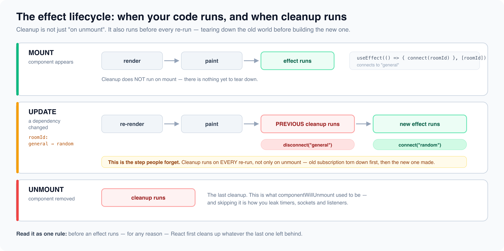

# Component Lifecycle & useEffect Mastery

*15 min read · Updated 16 Jul 2026 Topic 5 of 62 Bookmark Mark done 1 · Topic 5 of 62*

**Source:** [https://www.geekyfrontend.in/learn/react-interview-kit/component-lifecycle-useeffect-mastery](https://www.geekyfrontend.in/learn/react-interview-kit/component-lifecycle-useeffect-mastery)

---

# 1.5 — Component Lifecycle & useEffect Mastery

---

## 🎯 What Interviewers Actually Ask

| Question | Level | Frequency |
| --- | --- | --- |
| "What is useEffect and why do we need it?" | 🟢 | ★★★★★ |
| "What is the dependency array? What happens with no deps vs empty deps?" | 🟢🟡 | ★★★★★ |
| "What is the cleanup function in useEffect?" | 🟡 | ★★★★★ |
| "What are React lifecycle methods?" | 🟢 | ★★★★☆ |
| "How does useEffect replace class lifecycle methods?" | 🟡 | ★★★★☆ |
| "What is the difference between useEffect and useLayoutEffect?" | 🟡🔴 | ★★★☆☆ |
| "Can you make useEffect async?" | 🟡 | ★★★★☆ |
| "What are common useEffect mistakes?" | 🟡 | ★★★★★ |
| "How do you fetch data with useEffect?" | 🟢🟡 | ★★★★★ |
| "How do you handle race conditions in useEffect?" | 🔴 | ★★☆☆☆ |

---

## What Are Side Effects?

A React component's primary job is to take data (props, state) and return JSX. Everything *else* — everything that reaches outside of that pure rendering cycle — is a **side effect**.

Common side effects include:

- Fetching data from an API
- Setting up event listeners (window resize, scroll, keyboard)
- Manually changing the DOM (document.title, focus)
- Starting timers (setTimeout, setInterval)
- Subscribing to external data sources (WebSockets, Firebase)
- Writing to localStorage

React gives you `useEffect` to handle all of these. The name literally tells you what it does: it lets you run **effects** that happen *after* your component renders.

---

## The Three Flavors of useEffect

The dependency array controls everythinguseEffect(fn)runs after EVERY renderuseEffect(fn, [])runs ONCE on mountuseEffect(fn, [a, b])runs when a or b changes

*The second argument decides how often your effect runs — the single most important thing to get right.*

The dependency array is the entire control system. Everything about *when* your effect runs comes down to what you put in that second argument.

### Flavor 1: Runs after every render (no dependency array)

jsx

```
useEffect(() => {
  console.log('I run after EVERY render');
});
```

This fires on mount and after every single re-render. You'll rarely want this — it's the equivalent of saying "do this work every time anything happens." Use it for things like logging or debugging, but almost never in production code.

### Flavor 2: Runs once on mount (empty dependency array)

jsx

```
useEffect(() => {
  console.log('I run ONCE — when the component first appears');
}, []);  // ← empty array = no dependencies = only run on mount
```

This is the functional equivalent of `componentDidMount`. Perfect for one-time setup: initial API calls, setting up subscriptions, reading from localStorage.

### Flavor 3: Runs when specific values change (with dependencies)

jsx

```
useEffect(() => {
  console.log(`userId changed to ${userId}, fetching new data...`);
  fetchUser(userId);
}, [userId]);  // ← only re-runs when userId changes
```

This covers `componentDidMount` AND `componentDidUpdate` in one shot. The effect runs on mount, then again whenever any value in the dependency array changes.

### The full picture in one place:

| Dependency Array | When It Runs | Class Equivalent |
| --- | --- | --- |
| Not provided | After every render | `componentDidMount` + `componentDidUpdate` (all updates) |
| `[]` | Once, after first render | `componentDidMount` |
| `[a, b]` | On mount + when `a` or `b` change | `componentDidMount` + `componentDidUpdate` with condition |

---

## The Cleanup Function

When cleanup runsMounteffect runsRe-render (deps change)cleanup → effectUnmountcleanup runs

*Cleanup runs before the next effect AND on unmount — that is how you cancel timers, listeners, and subscriptions.*

Effects often create things that need to be torn down — event listeners, timers, subscriptions. If you don't clean these up, you get memory leaks, stale callbacks, and bugs that are incredibly hard to track down.

Return a function from your effect, and React will call it before running the effect again and when the component unmounts.

jsx

```
useEffect(() => {
  // SETUP: subscribe to something
  const handleResize = () => console.log(window.innerWidth);
  window.addEventListener('resize', handleResize);

  // CLEANUP: unsubscribe when component unmounts or before effect re-runs
  return () => {
    window.removeEventListener('resize', handleResize);
  };
}, []);
```

### When does cleanup actually run?

There are two scenarios:

1. **Component unmounts** — React calls your cleanup function. This is the equivalent of `componentWillUnmount`.
2. **Effect re-runs** (because a dependency changed) — React calls the *previous* cleanup first, then runs the new effect. Think of it as tearing down the old world before building the new one.

jsx

```
useEffect(() => {
  const connection = createConnection(roomId);
  connection.connect();

  return () => connection.disconnect();  // Disconnects from OLD room before connecting to new one
}, [roomId]);
```

If `roomId` changes from `"general"` to `"random"`, the sequence is:

1. Cleanup runs → disconnects from `"general"`
2. Effect runs → connects to `"random"`

---



## Class Lifecycle → useEffect (The Migration Map)

Class lifecycle → useEffectClass methodcomponentDidMountcomponentDidUpdatecomponentWillUnmountuseEffect equivalentuseEffect(fn, [])useEffect(fn, [deps])return () => {...}

*One hook replaces three lifecycle methods — and keeps related setup/cleanup together.*

Interviewers often ask you to convert class lifecycle methods to hooks, or explain the mapping. Here's the complete reference:

### componentDidMount → useEffect with `[]`

jsx

```
// Class
class MyComponent extends React.Component {
  componentDidMount() {
    fetchData();
    document.title = 'My Page';
  }
  render() { return <div>Hello</div>; }
}

// Functional
function MyComponent() {
  useEffect(() => {
    fetchData();
    document.title = 'My Page';
  }, []);

  return <div>Hello</div>;
}
```

### componentDidUpdate → useEffect with dependencies

jsx

```
// Class
componentDidUpdate(prevProps) {
  if (prevProps.userId !== this.props.userId) {
    fetchUser(this.props.userId);
  }
}

// Functional
useEffect(() => {
  fetchUser(userId);
}, [userId]);
```

Notice how the functional version is cleaner — you don't need the manual `prevProps` comparison. React handles that for you through the dependency array.

### componentWillUnmount → cleanup function

jsx

```
// Class
componentWillUnmount() {
  clearInterval(this.timerId);
  this.subscription.unsubscribe();
}

// Functional
useEffect(() => {
  const timerId = setInterval(tick, 1000);
  const subscription = dataSource.subscribe();

  return () => {
    clearInterval(timerId);
    subscription.unsubscribe();
  };
}, []);
```

### All three in one useEffect

This is what makes hooks powerful — one `useEffect` can handle mount, update, AND unmount:

jsx

```
useEffect(() => {
  // Runs on mount AND when userId changes (mount + update)
  const subscription = subscribeToUser(userId);

  return () => {
    // Runs on unmount AND before re-running (unmount + cleanup)
    subscription.unsubscribe();
  };
}, [userId]);
```

---

## Fetching Data with useEffect

The data-fetching cycleComponentrenderseffectfiresfetch()datasetStateresultre-renderwith data

*Render first, fetch in the effect, then setState — which re-renders with the data. Never fetch during render.*

This comes up in almost every interview. Here's the pattern, evolving from basic to production-ready.

### Basic fetch

jsx

```
function UserProfile({ userId }) {
  const [user, setUser] = useState(null);
  const [loading, setLoading] = useState(true);
  const [error, setError] = useState(null);

  useEffect(() => {
    setLoading(true);
    fetch(`/api/users/${userId}`)
      .then(res => {
        if (!res.ok) throw new Error('Failed to fetch');
        return res.json();
      })
      .then(data => {
        setUser(data);
        setLoading(false);
      })
      .catch(err => {
        setError(err.message);
        setLoading(false);
      });
  }, [userId]);

  if (loading) return <p>Loading...</p>;
  if (error) return <p>Error: {error}</p>;
  return <h1>{user.name}</h1>;
}
```

### Using async/await (the right way)

You **cannot** make the useEffect callback itself async. React expects the callback to return either nothing or a cleanup function — not a Promise.

jsx

```
// ❌ WRONG — useEffect callback cannot be async
useEffect(async () => {
  const data = await fetchUser(userId);  // Returns a Promise, not a cleanup function
  setUser(data);
}, [userId]);

// ✅ CORRECT — define an async function inside, then call it
useEffect(() => {
  const loadUser = async () => {
    try {
      setLoading(true);
      const res = await fetch(`/api/users/${userId}`);
      const data = await res.json();
      setUser(data);
    } catch (err) {
      setError(err.message);
    } finally {
      setLoading(false);
    }
  };

  loadUser();
}, [userId]);
```

### Handling race conditions (senior-level)

Race conditions on fast changesNo guardRequest A (slow) firesRequest B (fast) returnsA returns late → overwrites BCleanup flaglet ignore = falsecleanup sets ignore = trueStale response is droppedvs

*A boolean flag flipped in cleanup ensures only the latest request updates state.*

When `userId` changes rapidly (e.g., user clicks through a list), you can end up with stale data — an older request might resolve after a newer one.

jsx

```
useEffect(() => {
  let cancelled = false;  // Flag to track if this effect is still relevant

  const loadUser = async () => {
    setLoading(true);
    try {
      const res = await fetch(`/api/users/${userId}`);
      const data = await res.json();

      if (!cancelled) {  // Only update state if this effect hasn't been cleaned up
        setUser(data);
        setLoading(false);
      }
    } catch (err) {
      if (!cancelled) setError(err.message);
    }
  };

  loadUser();

  return () => {
    cancelled = true;  // Cleanup: mark this effect's results as stale
  };
}, [userId]);
```

The modern alternative is `AbortController`, which actually cancels the network request:

jsx

```
useEffect(() => {
  const controller = new AbortController();

  fetch(`/api/users/${userId}`, { signal: controller.signal })
    .then(res => res.json())
    .then(data => setUser(data))
    .catch(err => {
      if (err.name !== 'AbortError') setError(err.message);
    });

  return () => controller.abort();  // Cancel the request on cleanup
}, [userId]);
```

---

## useEffect vs useLayoutEffect

useEffect vs useLayoutEffectuseEffectRuns AFTER paintNon-blockingDefault choiceuseLayoutEffectRuns BEFORE paintBlocks the browserUse to measure/avoid flickervs

*Reach for useLayoutEffect only when you must read layout or mutate the DOM before the user sees it.*

This is an intermediate-to-senior question. The short answer: they have the same API, but different timing.

|  | useEffect | useLayoutEffect |
| --- | --- | --- |
| **When it runs** | Asynchronously, *after* the browser paints | Synchronously, *before* the browser paints |
| **Blocks painting?** | No | Yes |
| **Use for** | API calls, subscriptions, logging — most things | DOM measurements, preventing visual flicker |
| **Performance risk** | None | Can block UI if the logic is slow |

**When do you actually need useLayoutEffect?** When you need to read from the DOM and immediately write back to it *before* the user sees anything. The classic example is measuring an element's size and positioning a tooltip:

jsx

```
function Tooltip({ targetRef, text }) {
  const [coords, setCoords] = useState({ x: 0, y: 0 });
  const tooltipRef = useRef();

  useLayoutEffect(() => {
    // This runs BEFORE the browser paints
    // So the tooltip appears in the right position immediately — no flicker
    const rect = targetRef.current.getBoundingClientRect();
    setCoords({ x: rect.left, y: rect.bottom + 8 });
  }, [targetRef]);

  return (
    <div ref={tooltipRef} style={{ position: 'fixed', left: coords.x, top: coords.y }}>
      {text}
    </div>
  );
}
```

If you used `useEffect` here, the tooltip would briefly appear at `(0, 0)` and then jump to the correct position — a visible flicker.

**Rule of thumb:** Start with `useEffect`. Switch to `useLayoutEffect` only if you see a flicker caused by DOM measurement-then-update.

---

## ⚡ Common Mistakes

### Mistake 1: Missing dependencies

The dependency array should include **every** value from your component scope that the effect uses. Missing one means your effect works with stale data.

jsx

```
// ❌ BAD — uses userId but doesn't list it as a dependency
useEffect(() => {
  fetchData(userId);
}, []);  // Runs once with the initial userId, never updates

// ✅ GOOD
useEffect(() => {
  fetchData(userId);
}, [userId]);
```

The `react-hooks/exhaustive-deps` ESLint rule catches this automatically. Don't disable it — fix the underlying issue instead.

### Mistake 2: Not cleaning up timers and subscriptions

jsx

```
// ❌ BAD — creates a new interval on every render, never clears old ones
useEffect(() => {
  setInterval(() => {
    setCount(c => c + 1);
  }, 1000);
});

// ✅ GOOD — cleans up the interval
useEffect(() => {
  const id = setInterval(() => {
    setCount(c => c + 1);
  }, 1000);

  return () => clearInterval(id);
}, []);
```

### Mistake 3: Making the useEffect callback async

jsx

```
// ❌ BAD — returns a Promise, React expects void or cleanup function
useEffect(async () => {
  const data = await fetchData();
  setData(data);
}, []);

// ✅ GOOD — async function defined and called inside
useEffect(() => {
  async function load() {
    const data = await fetchData();
    setData(data);
  }
  load();
}, []);
```

### Mistake 4: Infinite loops from objects/arrays in dependencies

jsx

```
// ❌ INFINITE LOOP — options is a new object every render
function SearchResults({ query }) {
  const options = { sortBy: 'date', limit: 10 };  // New object each render!

  useEffect(() => {
    search(query, options);
  }, [query, options]);  // options changes every render → effect runs forever
}

// ✅ FIX — move the object inside the effect, or memoize it
function SearchResults({ query }) {
  useEffect(() => {
    const options = { sortBy: 'date', limit: 10 };  // Created inside — not a dependency
    search(query, options);
  }, [query]);
}

// ✅ OR use useMemo if the object needs to be shared
function SearchResults({ query, sortBy }) {
  const options = useMemo(() => ({ sortBy, limit: 10 }), [sortBy]);

  useEffect(() => {
    search(query, options);
  }, [query, options]);  // Now options only changes when sortBy changes
}
```

### Mistake 5: Setting state on unmounted component

This used to cause a React warning. It's less dangerous in React 18, but still a code smell:

jsx

```
// ❌ Potential issue — component might unmount before fetch finishes
useEffect(() => {
  fetchData().then(data => setData(data));
}, []);

// ✅ Better — guard with a flag
useEffect(() => {
  let active = true;
  fetchData().then(data => {
    if (active) setData(data);
  });
  return () => { active = false; };
}, []);
```

---

## 🔥 Output-Based Questions

### Question 1: In what order do these log?

jsx

```
function App() {
  console.log('1. Render');

  useEffect(() => {
    console.log('2. Effect');
    return () => console.log('3. Cleanup');
  });

  return <div>Hello</div>;
}
```

**On first render:** `1. Render` → `2. Effect`

**On re-render:** `1. Render` → `3. Cleanup` (of previous effect) → `2. Effect` (new effect)

**On unmount:** `3. Cleanup`

The key insight: React renders first (synchronously), paints to the screen, *then* runs effects asynchronously. Cleanup always runs before the next effect.

### Question 2: How many times does the effect run?

jsx

```
function App() {
  const [count, setCount] = useState(0);

  useEffect(() => {
    console.log('Effect ran');
  }, []);

  return <button onClick={() => setCount(c => c + 1)}>Count: {count}</button>;
}
```

**Answer:** The effect runs **once** — on mount. The empty dependency array means "I have no dependencies, so I never need to re-run." Clicking the button re-renders the component, but the effect doesn't fire again.

### Question 3: What's wrong with this code?

jsx

```
function Timer() {
  const [seconds, setSeconds] = useState(0);

  useEffect(() => {
    setInterval(() => {
      setSeconds(seconds + 1);
    }, 1000);
  }, []);

  return <p>{seconds}</p>;
}
```

**Two problems:**

1. **Stale closure:** `seconds` is captured as `0` when the effect runs. The interval always computes `0 + 1 = 1`. The counter gets stuck at 1. Fix: use the updater function `setSeconds(s => s + 1)`.
2. **No cleanup:** The interval is never cleared. If the component unmounts and remounts, you'll have multiple intervals running. Fix: return `() => clearInterval(id)`.

jsx

```
// Fixed version
useEffect(() => {
  const id = setInterval(() => {
    setSeconds(s => s + 1);  // Updater function — always has latest value
  }, 1000);

  return () => clearInterval(id);  // Cleanup
}, []);
```

### Question 4: Spot the infinite loop

jsx

```
function UserList() {
  const [users, setUsers] = useState([]);

  useEffect(() => {
    fetch('/api/users')
      .then(res => res.json())
      .then(data => setUsers(data));
  });

  return <ul>{users.map(u => <li key={u.id}>{u.name}</li>)}</ul>;
}
```

**Answer:** No dependency array means the effect runs after *every* render. `setUsers` causes a re-render, which triggers the effect again, which fetches data, which calls `setUsers`, which re-renders... infinite loop. Fix: add `[]` as the dependency array.

---

## 🏗️ Scenario: "Build a component that tracks window size in real-time"

This tests useEffect, cleanup, and custom hook extraction:

jsx

```
// Step 1: Build it as a plain component
function WindowSize() {
  const [size, setSize] = useState({
    width: window.innerWidth,
    height: window.innerHeight,
  });

  useEffect(() => {
    const handleResize = () => {
      setSize({ width: window.innerWidth, height: window.innerHeight });
    };

    window.addEventListener('resize', handleResize);
    return () => window.removeEventListener('resize', handleResize);
  }, []);

  return <p>Window: {size.width} × {size.height}</p>;
}

// Step 2: Extract into a reusable custom hook (bonus points in interviews)
function useWindowSize() {
  const [size, setSize] = useState({
    width: window.innerWidth,
    height: window.innerHeight,
  });

  useEffect(() => {
    const handleResize = () => {
      setSize({ width: window.innerWidth, height: window.innerHeight });
    };

    window.addEventListener('resize', handleResize);
    return () => window.removeEventListener('resize', handleResize);
  }, []);

  return size;
}

// Step 3: Use it anywhere
function Header() {
  const { width } = useWindowSize();
  return <nav>{width > 768 ? <DesktopNav /> : <MobileNav />}</nav>;
}
```

**Why this is a strong interview answer:** It demonstrates the effect → cleanup cycle with event listeners, then naturally escalates to a custom hook — showing you think about reusability without being asked.

---

## 🗣️ How to Answer in an Interview

### "What is useEffect?"

> "useEffect is React's way of handling side effects — anything that reaches outside the component's pure rendering, like API calls, subscriptions, or DOM mutations. It runs after the component renders, and the dependency array controls when it re-runs. You can return a cleanup function for things like removing event listeners or cancelling requests."

### "What is the cleanup function and when does it run?"

> "The cleanup function runs in two situations: when the component unmounts, and right before the effect re-runs due to a dependency change. It's how you prevent memory leaks — you use it to clear timers, unsubscribe from events, or cancel network requests. React runs the cleanup from the *previous* effect before executing the new one."

### "What's the difference between useEffect and useLayoutEffect?"

> "Same API, different timing. `useEffect` runs asynchronously after the browser paints — it doesn't block what the user sees. `useLayoutEffect` runs synchronously before the paint — it blocks rendering. You'd only use `useLayoutEffect` when you need to measure the DOM and immediately update it to prevent a visual flicker, like positioning a tooltip. For everything else — data fetching, subscriptions, logging — stick with `useEffect`."

---

## ✅ Key Takeaways

- **useEffect** handles side effects: API calls, subscriptions, timers, DOM manipulation.
- **No deps** → runs after every render. `[]` → runs once on mount. `[a, b]` → runs when `a` or `b` change.
- **Cleanup function** (returned from the effect) runs before re-execution and on unmount. Use it to prevent memory leaks.
- **useEffect replaces** `componentDidMount`, `componentDidUpdate`, and `componentWillUnmount` — all in one API.
- **Never make the useEffect callback async.** Define an async function inside and call it.
- **Always include all used values** in the dependency array. Trust the ESLint rule.
- **Objects and arrays** in deps cause infinite loops because they're new references each render. Move them inside the effect or memoize them.
- **Stale closures** are the #1 useEffect bug. Use updater functions (`setCount(c => c + 1)`) in intervals/timeouts.
- **Race conditions** in data fetching: use a `cancelled` flag or `AbortController` in the cleanup.
- **useLayoutEffect** — same as useEffect but runs before paint. Only needed for DOM measurement + immediate update to prevent flicker.

---

## Learn More

- [Synchronizing with Effects react.dev](https://react.dev/learn/synchronizing-with-effects)
- [useEffect — API reference react.dev](https://react.dev/reference/react/useEffect)
- [You Might Not Need an Effect react.dev](https://react.dev/learn/you-might-not-need-an-effect)
- [useEffect hook — the basics YouTube](https://www.youtube.com/watch?v=gv9ugDJ1ynU)
- [useEffect: what you need to know YouTube](https://www.youtube.com/watch?v=vpPkUr86IG8)
- [useEffect explained in 4 minutes YouTube](https://www.youtube.com/watch?v=jO1lPbllUz4)
