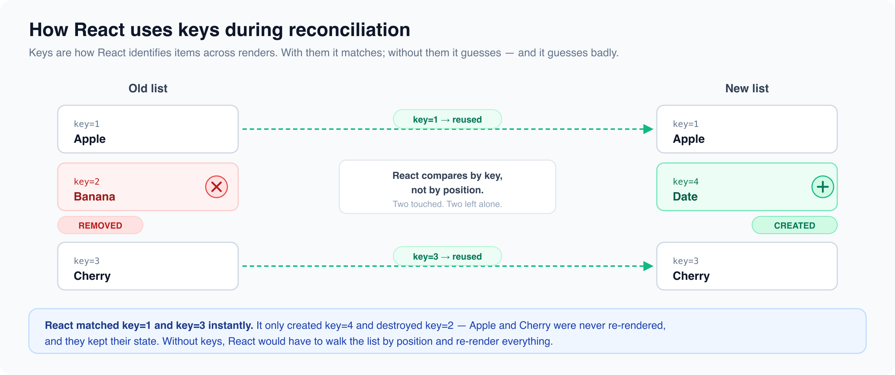
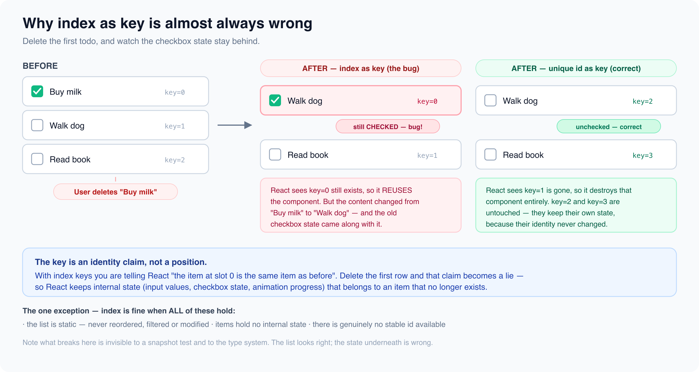

# Conditional Rendering & List Rendering

*16 min read · Updated 16 Jul 2026 Topic 6 of 62 Bookmark Mark done 1 · Topic 6 of 62*

**Source:** [https://www.geekyfrontend.in/learn/react-interview-kit/conditional-rendering-list-rendering](https://www.geekyfrontend.in/learn/react-interview-kit/conditional-rendering-list-rendering)

---

# 1.6 — Conditional Rendering & List Rendering

---

## 🎯 What Interviewers Actually Ask

| Question | Level | Frequency |
| --- | --- | --- |
| "What are the different ways to conditionally render in React?" | 🟢 | ★★★★★ |
| "Why do we need keys in lists?" | 🟢 | ★★★★★ |
| "Why shouldn't we use array index as key?" | 🟢🟡 | ★★★★★ |
| "What happens if you don't provide a key?" | 🟢 | ★★★★☆ |
| "What is the difference between map and forEach for rendering?" | 🟢 | ★★★☆☆ |
| "How do you render nothing / hide a component?" | 🟢 | ★★★☆☆ |
| "What is the gotcha with `&&` and falsy values?" | 🟡 | ★★★★☆ |
| "How does React's reconciliation use keys?" | 🟡🔴 | ★★★☆☆ |

---

## Conditional Rendering

In plain HTML, you can't say "show this only if the user is logged in." You need JavaScript for that. React embraces this fully. Since JSX is just JavaScript, you can use any JS technique to decide what gets rendered.

There are six patterns. You don't need all six in every project, but interviewers expect you to know them and explain when to pick one over another.

### Pattern 1: if/else with Early Return

Best for: blocking the entire component from rendering when a condition isn't met.

jsx

```
function Dashboard({ user }) {
  if (!user) {
    return <p>Please log in to continue.</p>;
  }

  return (
    <div>
      <h1>Welcome, {user.name}</h1>
      <DashboardContent />
    </div>
  );
}
```

This pattern keeps the happy path at the bottom without nesting. Senior developers reach for this first because it's simple, explicit, and easy to read.

### Pattern 2: Ternary Operator

Best for: choosing between two things to show inline.

jsx

```
function Greeting({ isLoggedIn }) {
  return (
    <div>
      {isLoggedIn ? <h1>Welcome back!</h1> : <h1>Please sign in.</h1>}
    </div>
  );
}
```

The ternary works great for simple A or B choices. Avoid nesting ternaries inside each other. If you need more than two branches, use a different pattern.

jsx

```
// ❌ Nested ternary. Nobody wants to read this.
{role === 'admin'
  ? <AdminPanel />
  : role === 'editor'
    ? <EditorPanel />
    : role === 'viewer'
      ? <ViewerPanel />
      : <GuestPanel />}

// ✅ Use an object lookup or if/else instead (see patterns 5 and 6)
```

### Pattern 3: Logical AND (`&&`)

Best for: show something or show nothing. No "else" branch.

jsx

```
function Mailbox({ unreadCount }) {
  return (
    <div>
      <h1>Inbox</h1>
      {unreadCount > 0 && <p>You have {unreadCount} new messages.</p>}
    </div>
  );
}
```

**The** `0` **trap:** This is the single most common bug with `&&`. If the left side evaluates to `0`, React renders the number `0` on screen instead of rendering nothing.

jsx

```
// ❌ Bug: renders "0" when items is empty
{items.length && <ItemList items={items} />}

// ✅ Fix: convert to boolean explicitly
{items.length > 0 && <ItemList items={items} />}
```

Why does this happen? The `&&` operator returns the first falsy value it encounters. `0` is falsy, so it returns `0`. React renders numbers, so `0` shows up on screen. `false`, `null`, and `undefined` all render as nothing, but `0` does not.

### Pattern 4: Variable Assignment

Best for: multiple conditions where inline JSX would be unreadable.

jsx

```
function NotificationIcon({ type }) {
  let icon;

  if (type === 'success') {
    icon = <span className="green">✓</span>;
  } else if (type === 'warning') {
    icon = <span className="yellow">⚠</span>;
  } else if (type === 'error') {
    icon = <span className="red">✕</span>;
  } else {
    icon = <span className="gray">ℹ</span>;
  }

  return <div className="notification">{icon}</div>;
}
```

### Pattern 5: Object Lookup

Best for: mapping a value to a component. Cleaner than chained if/else or switch.

jsx

```
const STATUS_BADGES = {
  active:  <span className="badge green">Active</span>,
  pending: <span className="badge yellow">Pending</span>,
  banned:  <span className="badge red">Banned</span>,
  deleted: <span className="badge gray">Deleted</span>,
};

function UserStatus({ status }) {
  return (
    <div>
      {STATUS_BADGES[status] ?? <span className="badge">Unknown</span>}
    </div>
  );
}
```

The `??` (nullish coalescing) operator provides a fallback when the key doesn't exist. This is the cleanest approach when you have a fixed set of possible values.

### Pattern 6: Render Nothing

Sometimes you want a component to exist in the tree but produce no visible output. Return `null`.

jsx

```
function WarningBanner({ warn }) {
  if (!warn) {
    return null;  // Component exists but renders nothing
  }

  return <div className="warning">Warning!</div>;
}
```

Returning `null` still mounts the component (lifecycle hooks and effects run), but it outputs nothing to the DOM. This is different from not rendering the component at all.

### When to Use Which: A Quick Reference

Which conditional to reach forInline (in JSX)cond ? <A/> : <B/>cond && <A/>Short, two outcomesOutside JSXearly returnvariable / object lookupMany branches, cleanervs

*Ternary/&& for small inline choices; early return or a lookup map when there are several cases.*

| Situation | Best Pattern |
| --- | --- |
| Block entire render based on auth/loading | Early return |
| Show A or B inline | Ternary |
| Show something or nothing | `&&` |
| Multiple branches (3+) | Variable assignment or object lookup |
| Fixed value to component mapping | Object lookup |
| Component exists but shows nothing | Return `null` |

---

## List Rendering

How lists renderarray ofdata.map()each itemarray ofelementsReactrenders list

*.map() turns your data array into an array of elements. React renders each — and uses keys to track them.*

Rendering a list of items is something you'll do in virtually every React component. The core tool is `.map()`.

### The Basics

jsx

```
function FruitList() {
  const fruits = ['Apple', 'Banana', 'Cherry'];

  return (
    <ul>
      {fruits.map(fruit => (
        <li key={fruit}>{fruit}</li>
      ))}
    </ul>
  );
}
```

`.map()` takes each item in the array, transforms it into JSX, and React renders all of them. Simple enough. But the `key` prop is where things get interesting.

### Why Not forEach?

Beginners sometimes try `forEach` instead of `map`. It won't work because `forEach` returns `undefined`, not a new array. React needs an array of elements to render.

jsx

```
// ❌ forEach returns undefined. Nothing renders.
{fruits.forEach(fruit => <li>{fruit}</li>)}

// ✅ map returns a new array of JSX elements. React renders them.
{fruits.map(fruit => <li key={fruit}>{fruit}</li>)}
```

### Rendering Arrays of Objects

In real apps, your data is almost always objects, not plain strings.

jsx

```
function UserList({ users }) {
  return (
    <ul>
      {users.map(user => (
        <li key={user.id}>
          <strong>{user.name}</strong> — {user.email}
        </li>
      ))}
    </ul>
  );
}
```

### Filtering Before Rendering

You can chain `.filter()` before `.map()` to only show items that match a condition.

jsx

```
function ActiveUsers({ users }) {
  return (
    <ul>
      {users
        .filter(user => user.isActive)
        .map(user => (
          <li key={user.id}>{user.name}</li>
        ))}
    </ul>
  );
}
```

### Rendering Multiple Elements Per Item

When each item needs to render more than one element (like a `<dt>` and `<dd>` pair), use `React.Fragment` with a key.

jsx

```
function Glossary({ terms }) {
  return (
    <dl>
      {terms.map(term => (
        <React.Fragment key={term.id}>
          <dt>{term.word}</dt>
          <dd>{term.definition}</dd>
        </React.Fragment>
      ))}
    </dl>
  );
}
// Note: the short syntax <> doesn't accept a key prop. Use <React.Fragment> here.
```

---

## Keys: Why They Exist and How They Work

Keys are how React identifies individual items in a list. Without them, React has no way to tell which element changed, which was added, and which was removed. It has to guess, and it guesses badly.

### What React Does With Keys

When your list re-renders, React compares the old list of keys with the new list and decides:

- **Same key in both?** Keep the component, update its props if needed.
- **New key that didn't exist before?** Create a new component.
- **Old key missing from the new list?** Destroy that component.

This is directly tied to the reconciliation algorithm we covered in Article 1.1.



### What Makes a Good Key?

What makes a good keyBad keyindex (order changes)Math.random()Non-unique valuesGood keyA stable, unique iditem.id from your dataSame item → same key alwaysvs

*A key must be stable across renders and unique among siblings.*

A key needs to be:

- **Unique** among siblings (not globally, just within the same list)
- **Stable** across re-renders (the same item always gets the same key)
- **Predictable** (not random, not generated during render)

jsx

```
// ✅ Database IDs are ideal
{users.map(user => <UserCard key={user.id} user={user} />)}

// ✅ Unique string identifiers work too
{countries.map(c => <Option key={c.code} value={c.code}>{c.name}</Option>)}

// ✅ Composite keys when no single unique field exists
{events.map(e => <Event key={`${e.date}-${e.title}`} event={e} />)}
```

### Why Index as Key Is Almost Always Wrong

key = indexafter deleting first0Buy milk1Walk dog2Read book0Walk dog1Read bookKeys shift down — React re-labels rows and misplaces their state.

*Deleting the first item shifts every index. Use item.id so each row keeps its identity.*

This is one of the most asked React questions, period. And most candidates get it wrong because they memorize "don't use index" without understanding *why*.

Lets walk through what actually breaks. Say you have a todo list and the user deletes the first item:



When you use index as key and remove item 0, everything shifts up. key=0 used to be "Buy milk" and now it's "Walk dog". React sees the same key, assumes it's the same component, and keeps all internal state (input values, checkbox states, animation progress). The UI becomes corrupt.

jsx

```
// ❌ Index as key. Breaks when items are added, removed, or reordered.
{todos.map((todo, index) => (
  <TodoItem key={index} todo={todo} />
))}

// ✅ Unique ID. Always correct.
{todos.map(todo => (
  <TodoItem key={todo.id} todo={todo} />
))}
```

**The one exception:** index is acceptable when ALL of these are true:

1. The list is static (never reordered, filtered, or modified)
2. Items have no internal state (no inputs, checkboxes, or animations)
3. Items have no stable unique ID available

In practice, this is rare. Default to using unique IDs.

### What Happens With No Key At All?

React will use the index as the key by default and show a warning in the console. So having no key is the same as using index, plus you get a yellow warning telling you to fix it.

### Keys Must Be On the Outermost Returned Element

A common mistake is putting the key in the wrong place.

jsx

```
// ❌ Key is on the inner element, not the map's direct child
{users.map(user => (
  <div>
    <span key={user.id}>{user.name}</span>
  </div>
))}

// ✅ Key goes on the outermost element returned by map
{users.map(user => (
  <div key={user.id}>
    <span>{user.name}</span>
  </div>
))}
```

---

## Combining Conditional Rendering With Lists

Real components almost always combine both concepts. Here are patterns that come up constantly.

### Empty State Handling

jsx

```
function ProductList({ products }) {
  if (products.length === 0) {
    return (
      <div className="empty-state">
        <p>No products found.</p>
        <button>Add your first product</button>
      </div>
    );
  }

  return (
    <div className="product-grid">
      {products.map(product => (
        <ProductCard key={product.id} product={product} />
      ))}
    </div>
  );
}
```

### Loading + Error + Data Pattern

One fetch, three UI statesfetch stateLoadingspinnerErrorretryDatathe list

*Always render for loading, error, AND success — not just the happy path.*

This is the most common real-world pattern. Every data-fetching component needs it.

jsx

```
function UserList() {
  const [users, setUsers] = useState([]);
  const [loading, setLoading] = useState(true);
  const [error, setError] = useState(null);

  useEffect(() => {
    fetch('/api/users')
      .then(res => res.json())
      .then(data => { setUsers(data); setLoading(false); })
      .catch(err => { setError(err.message); setLoading(false); });
  }, []);

  if (loading) return <Spinner />;
  if (error) return <ErrorMessage message={error} />;
  if (users.length === 0) return <EmptyState />;

  return (
    <ul>
      {users.map(user => (
        <li key={user.id}>{user.name}</li>
      ))}
    </ul>
  );
}
```

Notice the order: loading first, then error, then empty state, then the actual data. This cascade of early returns keeps the code flat and readable.

### Conditional Rendering Inside a List

Sometimes you need to render different components based on each item's data.

jsx

```
function NotificationFeed({ notifications }) {
  return (
    <div>
      {notifications.map(notif => {
        switch (notif.type) {
          case 'message':
            return <MessageNotif key={notif.id} data={notif} />;
          case 'follow':
            return <FollowNotif key={notif.id} data={notif} />;
          case 'like':
            return <LikeNotif key={notif.id} data={notif} />;
          default:
            return <GenericNotif key={notif.id} data={notif} />;
        }
      })}
    </div>
  );
}
```

---

## ⚡ Common Mistakes

### Mistake 1: Generating keys during render

jsx

```
// ❌ Math.random() generates a new key every render.
// React destroys and recreates the component each time. Terrible performance.
{items.map(item => (
  <Item key={Math.random()} data={item} />
))}

// ❌ Same problem with Date.now()
{items.map(item => (
  <Item key={Date.now()} data={item} />
))}

// ✅ Use a stable identifier from your data
{items.map(item => (
  <Item key={item.id} data={item} />
))}
```

### Mistake 2: Using `&&` with numbers

Already covered above, but worth repeating because it's that common:

jsx

```
// ❌ Shows "0" on screen
{count && <Badge count={count} />}

// ✅ Explicit boolean conversion
{count > 0 && <Badge count={count} />}
```

### Mistake 3: Forgetting that map needs a return

When you use curly braces `{}` in an arrow function, you need an explicit `return`. Parentheses `()` give you an implicit return.

jsx

```
// ❌ No return statement. Renders nothing.
{items.map(item => {
  <li>{item.name}</li>
})}

// ✅ Option A: Parentheses for implicit return
{items.map(item => (
  <li key={item.id}>{item.name}</li>
))}

// ✅ Option B: Explicit return with curly braces
{items.map(item => {
  return <li key={item.id}>{item.name}</li>;
})}
```

### Mistake 4: Keys on the wrong element

jsx

```
// ❌ Key is on <li>, but the direct child of map is the <div> wrapper
{items.map(item => (
  <div>
    <li key={item.id}>{item.name}</li>
  </div>
))}

// ✅ Key goes on the outermost element
{items.map(item => (
  <div key={item.id}>
    <li>{item.name}</li>
  </div>
))}
```

---

## 🔥 Output-Based Questions

### Question 1: What renders?

jsx

```
function App() {
  const items = [];

  return (
    <div>
      <h1>Items</h1>
      {items.length && <p>Found {items.length} items</p>}
    </div>
  );
}
```

**Answer:** The screen shows "Items" followed by `0`. Because `items.length` is `0`, and `0 && anything` evaluates to `0`. React renders `0` as text. Fix: `items.length > 0 && ...`

### Question 2: Is this a valid use of key?

jsx

```
function App() {
  const [items, setItems] = useState(['a', 'b', 'c']);

  const addToStart = () => setItems(['new', ...items]);

  return (
    <div>
      <button onClick={addToStart}>Add</button>
      <ul>
        {items.map((item, index) => (
          <li key={index}>
            <input defaultValue={item} />
          </li>
        ))}
      </ul>
    </div>
  );
}
```

**Answer:** No. After clicking "Add", the inputs will be wrong. The new item "new" gets key=0, but the old key=0 component (with the input containing "a") already exists. React reuses it, so the input still shows "a" even though the item text is now "new". All inputs get shifted to the wrong items. Use a unique ID instead of index.

### Question 3: How many times does the list render?

jsx

```
function App() {
  const [filter, setFilter] = useState('');
  const items = ['React', 'Redux', 'Router', 'Relay'];

  const filtered = items.filter(i =>
    i.toLowerCase().includes(filter.toLowerCase())
  );

  console.log('Render count:', filtered.length);

  return (
    <div>
      <input value={filter} onChange={e => setFilter(e.target.value)} />
      {filtered.map(item => <p key={item}>{item}</p>)}
    </div>
  );
}
```

**Answer:** The component re-renders every time the user types a character (because `setFilter` triggers a re-render). The `console.log` fires on every keystroke. The `filtered` array is recalculated each time. This is fine for small lists but would benefit from `useMemo` for large datasets.

---

## 🏗️ Scenario: "Build a filterable, sortable user table"

This combines conditional rendering, list rendering, keys, and state.

jsx

```
function UserTable({ users }) {
  const [search, setSearch] = useState('');
  const [sortField, setSortField] = useState('name');
  const [sortAsc, setSortAsc] = useState(true);

  const handleSort = (field) => {
    if (sortField === field) {
      setSortAsc(prev => !prev);
    } else {
      setSortField(field);
      setSortAsc(true);
    }
  };

  const filtered = users
    .filter(user =>
      user.name.toLowerCase().includes(search.toLowerCase()) ||
      user.email.toLowerCase().includes(search.toLowerCase())
    )
    .sort((a, b) => {
      const valA = a[sortField].toLowerCase();
      const valB = b[sortField].toLowerCase();
      const direction = sortAsc ? 1 : -1;
      return valA < valB ? -direction : valA > valB ? direction : 0;
    });

  return (
    <div>
      <input
        placeholder="Search by name or email..."
        value={search}
        onChange={e => setSearch(e.target.value)}
      />

      {filtered.length === 0 ? (
        <p>No users match your search.</p>
      ) : (
        <table>
          <thead>
            <tr>
              <th onClick={() => handleSort('name')}>
                Name {sortField === 'name' && (sortAsc ? '↑' : '↓')}
              </th>
              <th onClick={() => handleSort('email')}>
                Email {sortField === 'email' && (sortAsc ? '↑' : '↓')}
              </th>
              <th onClick={() => handleSort('role')}>
                Role {sortField === 'role' && (sortAsc ? '↑' : '↓')}
              </th>
            </tr>
          </thead>
          <tbody>
            {filtered.map(user => (
              <tr key={user.id}>
                <td>{user.name}</td>
                <td>{user.email}</td>
                <td>{user.role}</td>
              </tr>
            ))}
          </tbody>
        </table>
      )}

      <p>{filtered.length} of {users.length} users shown</p>
    </div>
  );
}
```

**Why this is a strong interview answer:** It uses search filtering with `.filter()`, sorting with `.sort()` on a copied array, conditional empty state, stable `user.id` as key, sort direction toggling, and clean separation of concerns. This is the kind of component that shows up in actual machine coding rounds.

---

## 🗣️ How to Answer in an Interview

### "What are the different ways to conditionally render in React?"

> "There are several approaches depending on the situation. For gating an entire component, I use early returns with if/else. For inline A or B decisions, the ternary operator. For show-or-hide with no else branch, the logical AND operator, though you need to be careful with falsy values like `0`. For multiple branches, I prefer object lookups over switch statements because they're cleaner. And returning `null` when a component should exist but render nothing."

### "Why do we need keys in lists?"

> "Keys help React's reconciliation algorithm identify which items changed between renders. When React compares the old and new lists, it matches items by key. Same key means same component, so React just updates props. New key means create a new component. Missing key means destroy it. Without stable keys, React falls back to index-based comparison which breaks whenever items are reordered, added, or removed, especially if the list items have their own internal state."

### "Why is index as key bad?"

> "Because index is positional, not identity-based. If you remove the first item, everything shifts up. The item that was at index 1 is now at index 0. React sees key=0 still exists and reuses the component, but the data changed. Any internal state like input values, checkboxes, or animation states from the old key=0 component leak into the new one. The only time index is safe is for completely static lists with no state."

---

## ✅ Key Takeaways

- **Six conditional rendering patterns:** early return, ternary, logical AND, variable assignment, object lookup, return null.
- `&&` **with** `0` renders `0` on screen. Always use `> 0` or `!!` to convert to boolean first.
- `.map()` is the only array method for rendering lists (not `.forEach()`, which returns undefined).
- **Keys** must be unique among siblings, stable across renders, and placed on the outermost element returned by `.map()`.
- **Index as key** breaks when items are added, removed, or reordered. State leaks between components.
- **No key at all** = React uses index by default, plus shows a console warning.
- **Never generate keys during render** (`Math.random()`, `Date.now()`). This forces React to destroy and recreate components every render.
- **Filter before map**, not inside map. Chain `.filter().map()` for clean, readable list filtering.
- **Loading, error, empty, data** is the standard cascade for data-fetching components. Use early returns in that order.
- `React.Fragment` **with** `key` when rendering multiple elements per list item.

---

## Learn More

- [Conditional Rendering react.dev](https://react.dev/learn/conditional-rendering)
- [Rendering Lists (and keys) react.dev](https://react.dev/learn/rendering-lists)
- [Lists and Keys (deep dive) reactjs.org](https://legacy.reactjs.org/docs/lists-and-keys.html)
- [Lists and keys in React YouTube](https://www.youtube.com/watch?v=0sasRxl35_8)
- [Conditional rendering & rendering lists YouTube](https://www.youtube.com/watch?v=96DGjqlAIxs)
- [React conditional-rendering mistakes YouTube](https://www.youtube.com/watch?v=T3yQZ3LNHmc)
