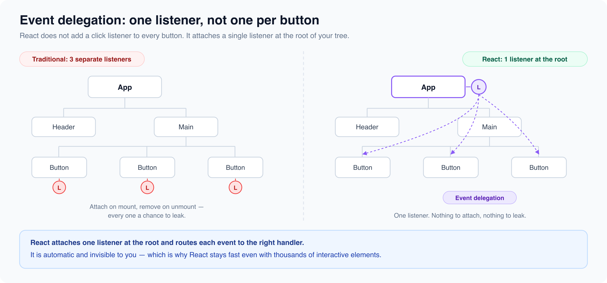

# Event Handling in React

*6 min read · Updated 16 Jul 2026 Topic 8 of 62 Bookmark Mark done 1 · Topic 8 of 62*

**Source:** [https://www.geekyfrontend.in/learn/react-interview-kit/event-handling-in-react](https://www.geekyfrontend.in/learn/react-interview-kit/event-handling-in-react)

---

# 1.8 — Event Handling in React

---

## 🎯 What Interviewers Actually Ask

| Question | Level | Frequency |
| --- | --- | --- |
| "How does event handling work in React?" | 🟢 | ★★★★★ |
| "What are Synthetic Events?" | 🟡 | ★★★★☆ |
| "How do you pass arguments to an event handler?" | 🟢 | ★★★★☆ |
| "What is event delegation? Does React use it?" | 🟡 | ★★★☆☆ |
| "What is the difference between `onClick={fn}` and `onClick={fn()}`?" | 🟢 | ★★★★★ |
| "How do you prevent default behavior?" | 🟢 | ★★★☆☆ |
| "What is event propagation (bubbling/capturing) in React?" | 🟡 | ★★☆☆☆ |

---

## How Events Work in React

Event delegation in ReactYour onClick handlerReact SyntheticEventone cross-browser wrapperOne listener on the React rootNative DOM event

*React attaches ONE listener at the root and routes native events to your handlers as SyntheticEvents.*

React's event system looks like regular HTML events but works differently under the hood. You write `onClick` instead of `onclick`, and you pass a function reference instead of a string.

jsx

```
// HTML (plain)
<button onclick="handleClick()">Click</button>

// React (JSX)
<button onClick={handleClick}>Click</button>
```

Three differences to remember:

1. **CamelCase naming:** `onClick`, `onChange`, `onSubmit`, `onKeyDown` (not `onclick`, `onchange`)
2. **Function reference, not a string:** You pass the function itself, not a string containing code
3. **Prevent default explicitly:** You call `e.preventDefault()` inside the handler. Returning `false` does nothing in React (unlike vanilla HTML).

---

## Passing Arguments to Event Handlers

This is a very common interview question because there's a trap here.

jsx

```
// ❌ WRONG: calls the function immediately on render, not on click
<button onClick={handleDelete(item.id)}>Delete</button>

// ✅ CORRECT: wraps in an arrow function, calls on click
<button onClick={() => handleDelete(item.id)}>Delete</button>

// ✅ ALSO CORRECT: bind the argument
<button onClick={handleDelete.bind(null, item.id)}>Delete</button>
```

When you write `handleDelete(item.id)` without wrapping it, JavaScript executes it right away during render and passes the *return value* to onClick. Unless your handler returns another function, this is a bug.

### The Event Object

Every handler automatically receives the event object as its first argument.

jsx

```
function SearchInput() {
  const handleKeyDown = (e) => {
    if (e.key === 'Enter') {
      console.log('User pressed Enter');
    }
  };

  const handleChange = (e) => {
    console.log('Current value:', e.target.value);
  };

  return (
    <input
      onChange={handleChange}
      onKeyDown={handleKeyDown}
      placeholder="Search..."
    />
  );
}
```

When you need to pass both custom arguments AND the event object:

jsx

```
const handleClick = (id, e) => {
  e.stopPropagation();
  console.log('Clicked item:', id);
};

return <button onClick={(e) => handleClick(item.id, e)}>Click</button>;
```

---

## Synthetic Events

SyntheticEvent vs native eventSyntheticEventReact wrapper, same API everywheree.preventDefault() works cross-browserWhat your handler receivesNative eventBrowser-specific quirksReach it via e.nativeEventRarely needed directlyvs

*SyntheticEvent normalizes browser differences so your handler code stays the same.*

React doesn't attach event listeners directly to DOM nodes. Instead, it uses its own event system called **Synthetic Events**.

A SyntheticEvent is a cross-browser wrapper around the browser's native event. It has the same interface as native events (`stopPropagation()`, `preventDefault()`, `target`, `currentTarget`) but works identically across all browsers.

| Feature | Native Events | React Synthetic Events |
| --- | --- | --- |
| Browser consistency | Varies by browser | Identical across all browsers |
| Where listeners attach | Directly on elements | Single listener on the root (delegation) |
| Event object | Browser-specific | Normalized wrapper |
| Performance | One listener per element | One listener total (pooled) |

### Event Delegation in React

React doesn't add a click listener to every button in your app. It attaches a single event listener at the root of your React tree and uses event delegation to figure out which component should handle each event.



This means you never need to worry about attaching or removing listeners manually. React handles it all. This is also why React performs well even with thousands of interactive elements.

---

## Preventing Default Behavior

preventDefault vs stopPropagationpreventDefault()Cancels the browser defaulte.g. stop form submit / link navEvent still bubblesstopPropagation()Stops bubbling to parentsDefault action still happensUse to isolate a clickvs

*They solve different problems — one cancels the default action, the other stops the event travelling up.*

In vanilla HTML, you can return `false` from an event handler to prevent defaults. In React, that doesn't work. You must call `e.preventDefault()` explicitly.

jsx

```
function LoginForm() {
  const handleSubmit = (e) => {
    e.preventDefault();  // Prevents page reload
    // Handle form submission
  };

  return (
    <form onSubmit={handleSubmit}>
      <input name="email" />
      <button type="submit">Login</button>
    </form>
  );
}
```

### Stopping Propagation

To prevent an event from bubbling up to parent handlers:

jsx

```
function Card() {
  const handleCardClick = () => console.log('Card clicked');

  const handleButtonClick = (e) => {
    e.stopPropagation();  // Prevents handleCardClick from firing
    console.log('Button clicked');
  };

  return (
    <div onClick={handleCardClick}>
      <h2>Card Title</h2>
      <button onClick={handleButtonClick}>Action</button>
    </div>
  );
}
```

Without `stopPropagation`, clicking the button would fire both `handleButtonClick` AND `handleCardClick` because events bubble up from child to parent.

---

## Common Event Types Quick Reference

| Event | Handler | Common Use |
| --- | --- | --- |
| Click | `onClick` | Buttons, links, toggles |
| Input change | `onChange` | Text inputs, selects, checkboxes |
| Form submit | `onSubmit` | Form submission |
| Key press | `onKeyDown` / `onKeyUp` | Keyboard shortcuts, Enter to submit |
| Focus/Blur | `onFocus` / `onBlur` | Input validation, UI highlights |
| Mouse hover | `onMouseEnter` / `onMouseLeave` | Tooltips, dropdowns |
| Scroll | `onScroll` | Infinite scroll, scroll-based animations |

---

## ⚡ Common Mistakes

**Mistake 1: Calling the function instead of passing it.**

jsx

```
// ❌ Executes immediately. Infinite loop if it sets state.
<button onClick={setCount(count + 1)}>+</button>

// ✅ Pass a function that React will call on click
<button onClick={() => setCount(count + 1)}>+</button>
```

**Mistake 2: Forgetting that** `onChange` **fires on every keystroke in React.** In vanilla HTML, `onchange` fires on blur. React's `onChange` fires on every character typed. This is intentional and different from HTML.

**Mistake 3: Using** `onKeyPress` **instead of** `onKeyDown`**.** `onKeyPress` is deprecated. Use `onKeyDown` for keyboard events.

---

## 🔥 Output Question

jsx

```
function App() {
  const handleClick = () => console.log('Button');
  const handleDivClick = () => console.log('Div');

  return (
    <div onClick={handleDivClick}>
      <button onClick={handleClick}>Click me</button>
    </div>
  );
}
```

**What logs when you click the button?**

Answer: Both `"Button"` and `"Div"` log, in that order. Events bubble up from the button to the div. To prevent the div handler from firing, add `e.stopPropagation()` inside `handleClick`.

---

## 🗣️ Interview Answer

> "React uses a Synthetic Event system that wraps native browser events to ensure consistent behavior across browsers. Events use camelCase naming like onClick and onChange, and you pass function references rather than strings. Under the hood, React uses event delegation by attaching a single listener at the root rather than one per element, which is more performant. You prevent default behavior with `e.preventDefault()` and stop bubbling with `e.stopPropagation()`."

---

## ✅ Key Takeaways

- React uses **camelCase** for events: `onClick`, `onChange`, `onSubmit`.
- Pass a **function reference**, not a function call: `onClick={fn}` not `onClick={fn()}`.
- **Synthetic Events** are cross-browser wrappers around native events.
- React uses **event delegation** at the root, not individual listeners per element.
- Use `e.preventDefault()` to prevent defaults. Returning `false` does nothing.
- Use `e.stopPropagation()` to stop event bubbling.
- `onChange` in React fires on **every keystroke**, unlike HTML's `onchange` which fires on blur.
- `onKeyPress` is **deprecated**. Use `onKeyDown`.

---

## Learn More

- [Responding to Events react.dev](https://react.dev/learn/responding-to-events)
- [Handling Events (deep dive) reactjs.org](https://legacy.reactjs.org/docs/handling-events.html)
- [React event object (SyntheticEvent) react.dev](https://react.dev/reference/react-dom/components/common#react-event-object)
- [Synthetic events & event handling YouTube](https://www.youtube.com/watch?v=0RuGOyDvPyc)
- [Event handling, synthetic events & bubbling YouTube](https://www.youtube.com/watch?v=H7LeEvw9hLw)
- [Synthetic events in React YouTube](https://www.youtube.com/watch?v=_vU4vP3m4e0)
