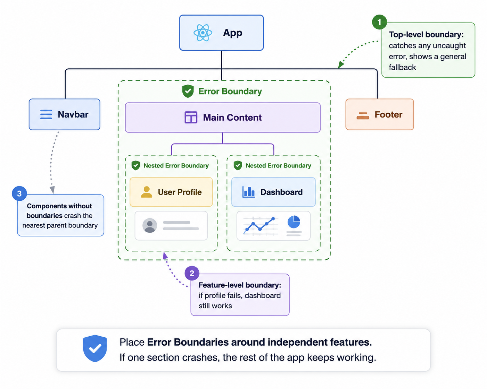

# Error Boundaries & Handling Errors Gracefully

*12 min read · Updated 29 Jun 2026 Topic 10 of 62 Bookmark Mark done 1 · Topic 10 of 62*

**Source:** [https://www.geekyfrontend.in/learn/react-interview-kit/error-boundaries-handling-errors-gracefully](https://www.geekyfrontend.in/learn/react-interview-kit/error-boundaries-handling-errors-gracefully)

---

# 1.10 — Error Boundaries & Handling Errors Gracefully

---

## 🎯 What Interviewers Actually Ask

| Question | Level | Frequency |
| --- | --- | --- |
| "What are Error Boundaries in React?" | 🟡 | ★★★★☆ |
| "Can you create an Error Boundary?" | 🟡 | ★★★★☆ |
| "Why must Error Boundaries be class components?" | 🟡 | ★★★☆☆ |
| "What kind of errors do Error Boundaries NOT catch?" | 🟡🔴 | ★★★★☆ |
| "How do you handle errors in event handlers?" | 🟢🟡 | ★★★☆☆ |
| "How would you implement error handling in a production React app?" | 🔴 | ★★★☆☆ |

---

## The Problem: React Apps Crash Entirely

One error takes down everythingAppDashboardWidget throws ✱Without a boundary → whole app unmounts

*An uncaught render error unmounts the entire React tree — the user sees a blank screen. An Error Boundary stops the fall.*

Before Error Boundaries existed (pre React 16), a single JavaScript error inside a component would corrupt React's internal state and cause the entire app to show a blank white screen on the next render. No fallback UI, no error message. Just nothing.

React 16 introduced Error Boundaries to solve this. An Error Boundary is a component that catches JavaScript errors anywhere in its child component tree, logs those errors, and displays a fallback UI instead of crashing the whole app.

Think of it like a try/catch, but for your component tree instead of your JavaScript logic.

---

## Building an Error Boundary

Error Boundaries must be **class components**. There is no hook equivalent for `componentDidCatch` or `getDerivedStateFromError` as of React 19. This is the one major reason class components still matter.

### The Minimal Version

jsx

```
class ErrorBoundary extends React.Component {
  constructor(props) {
    super(props);
    this.state = { hasError: false };
  }

  static getDerivedStateFromError(error) {
    // Update state so the next render shows fallback UI
    return { hasError: true };
  }

  componentDidCatch(error, errorInfo) {
    // Log the error to a reporting service
    console.error('Error caught by boundary:', error);
    console.error('Component stack:', errorInfo.componentStack);
  }

  render() {
    if (this.state.hasError) {
      return <h2>Something went wrong.</h2>;
    }
    return this.props.children;
  }
}
```

### Usage

Wrap any part of your component tree with it:

jsx

```
function App() {
  return (
    <div>
      <Header />
      <ErrorBoundary>
        <MainContent />
      </ErrorBoundary>
      <Footer />
    </div>
  );
}
```

If `MainContent` (or any of its children) throws during rendering, the Error Boundary catches it. The user sees "Something went wrong" instead of a blank screen. The `Header` and `Footer` remain untouched because they're outside the boundary.

---

## The Two Lifecycle Methods

The two Error Boundary methodsgetDerivedStateFromErrorRuns during renderReturns new state → show fallback UINo side effects herecomponentDidCatchRuns after the errorReceives error + stack infoLog to your service here

*One flips to the fallback UI; the other is where you log the error for debugging.*

Error Boundaries rely on two special lifecycle methods. Understanding the difference is important for interviews.

`static getDerivedStateFromError(error)`

Called during the render phase. Its job is to update state so the next render can show the fallback UI. This method should be pure (no side effects). It receives the error and returns an object that gets merged into the component's state.

`componentDidCatch(error, errorInfo)`

Called during the commit phase (after the DOM has been updated). This is where you perform side effects: send the error to a logging service, trigger analytics, or show a notification. The `errorInfo` argument contains `componentStack`, a string showing which components were in the tree when the error occurred.

A component becomes an Error Boundary when it implements **at least one** of these two methods. In practice, you almost always want both.

---

## A Production-Ready Error Boundary

The minimal version above is fine for learning, but real apps need more:

jsx

```
class ErrorBoundary extends React.Component {
  constructor(props) {
    super(props);
    this.state = { hasError: false, error: null };
  }

  static getDerivedStateFromError(error) {
    return { hasError: true, error };
  }

  componentDidCatch(error, errorInfo) {
    // Send to your error tracking service (Sentry, LogRocket, etc.)
    if (this.props.onError) {
      this.props.onError(error, errorInfo);
    }
  }

  handleReset = () => {
    this.setState({ hasError: false, error: null });
  };

  render() {
    if (this.state.hasError) {
      // Use custom fallback if provided, otherwise show default
      if (this.props.fallback) {
        return this.props.fallback;
      }

      return (
        <div style={{ padding: 20, textAlign: 'center' }}>
          <h2>Something went wrong</h2>
          <p style={{ color: '#666' }}>
            {this.state.error?.message || 'An unexpected error occurred.'}
          </p>
          <button onClick={this.handleReset}>Try Again</button>
        </div>
      );
    }

    return this.props.children;
  }
}
```

jsx

```
// Usage with custom fallback and error logging
function App() {
  return (
    <ErrorBoundary
      fallback={<p>The dashboard is temporarily unavailable.</p>}
      onError={(error, info) => {
        // Send to Sentry, LogRocket, or your own service
        logErrorToService(error, info.componentStack);
      }}
    >
      <Dashboard />
    </ErrorBoundary>
  );
}
```

The `handleReset` method lets users retry after an error. This is useful when the error is transient (like a network hiccup). Clicking "Try Again" clears the error state, which causes React to re-render the children instead of the fallback.

---

## What Error Boundaries Catch (and Don't Catch)

What Error Boundaries catchCaught ✓Errors during renderIn lifecycle methodsIn child constructorsNOT caught ✗Event handlers (use try/catch)Async code / setTimeoutServer-side renderingErrors in the boundary itselfvs

*Boundaries cover the render path only — handle events and async errors with plain try/catch and .catch().*

This is a very common interview question. Error Boundaries only catch errors in specific situations:

| Caught ✅ | Not Caught ❌ |
| --- | --- |
| Errors during rendering | Event handler errors |
| Errors in lifecycle methods | Errors inside `setTimeout` / `setInterval` |
| Errors in constructors of child components | Async code (promises, `async/await`) |
|  | Errors in the Error Boundary itself |
|  | Server-side rendering errors |

### Why Not Event Handlers?

Event handlers don't happen during rendering. They fire after the component has already rendered successfully. React doesn't need Error Boundaries for these because you can use regular `try/catch`.

jsx

```
function DeleteButton({ onDelete, itemId }) {
  const handleClick = async () => {
    try {
      await onDelete(itemId);
    } catch (error) {
      // Handle the error yourself. Error Boundary won't catch this.
      console.error('Delete failed:', error);
      alert('Failed to delete. Please try again.');
    }
  };

  return <button onClick={handleClick}>Delete</button>;
}
```

### Why Not Async Code?

Same reasoning. By the time a promise rejects or an async function throws, the render phase is long over. Use `try/catch` inside `useEffect` or event handlers for async errors.

jsx

```
useEffect(() => {
  const loadData = async () => {
    try {
      const res = await fetch('/api/data');
      const json = await res.json();
      setData(json);
    } catch (error) {
      setError(error.message);  // Handle it in component state
    }
  };
  loadData();
}, []);
```

---

## Placement Strategy: Where to Put Error Boundaries

Layer your boundariesApp-level boundarylast-resort full-page fallbackRoute / section boundaryisolate a page areaWidget boundaryone broken widget, rest survives

*Nest boundaries: a granular one keeps a single widget failure from blanking the whole route.*

You don't wrap your entire app in one giant Error Boundary. You place them strategically around parts of the UI that can fail independently.



### Practical placement:

jsx

```
function App() {
  return (
    <div>
      <Navbar />

      {/* Top-level catch-all */}
      <ErrorBoundary fallback={<p>Something went wrong. Please refresh.</p>}>

        {/* Feature-level boundaries for independent sections */}
        <ErrorBoundary fallback={<p>Could not load your profile.</p>}>
          <UserProfile />
        </ErrorBoundary>

        <ErrorBoundary fallback={<p>Dashboard temporarily unavailable.</p>}>
          <Dashboard />
        </ErrorBoundary>

        <ErrorBoundary fallback={<p>Could not load the feed.</p>}>
          <ActivityFeed />
        </ErrorBoundary>

      </ErrorBoundary>

      <Footer />
    </div>
  );
}
```

If `Dashboard` throws an error, only its section shows the fallback. `UserProfile` and `ActivityFeed` keep working normally.

---

## The Full Error Handling Strategy for a React App

Full error-handling strategyRender errorsError BoundariesShow fallback UIEverything elseEvents → try/catchAsync → .catch()Report to logging servicevs

*Three layers of defense together: boundaries for render, try/catch for events, .catch() for async.*

Error Boundaries are one piece of the puzzle. A production app needs a complete strategy:

| Error Type | How to Handle |
| --- | --- |
| Render errors (component throws during render) | Error Boundary |
| Event handler errors (button click fails) | `try/catch` inside the handler |
| API/async errors (fetch fails, promise rejects) | `try/catch` in async functions, set error state |
| Global unhandled errors | `window.onerror` or `window.addEventListener('unhandledrejection', ...)` |
| Form validation errors | State-based validation (covered in 1.7) |

jsx

```
// Global error listener (catches anything Error Boundaries miss)
useEffect(() => {
  const handleGlobalError = (event) => {
    console.error('Unhandled error:', event.error);
    // Send to error tracking service
  };

  const handleRejection = (event) => {
    console.error('Unhandled promise rejection:', event.reason);
  };

  window.addEventListener('error', handleGlobalError);
  window.addEventListener('unhandledrejection', handleRejection);

  return () => {
    window.removeEventListener('error', handleGlobalError);
    window.removeEventListener('unhandledrejection', handleRejection);
  };
}, []);
```

---

## ⚡ Common Mistakes

**Mistake 1: Trying to build an Error Boundary as a functional component.** There is no hook equivalent for `getDerivedStateFromError` or `componentDidCatch`. This is the one case where you must use a class component.

**Mistake 2: Wrapping everything in a single boundary.** If your entire app is inside one Error Boundary, any error takes down the entire UI. Use multiple boundaries around independent features so failures are isolated.

**Mistake 3: Not providing a reset mechanism.** Users hit a dead end if the fallback has no way to recover. Always include a "Try Again" button that clears the error state and re-renders the children.

**Mistake 4: Expecting Error Boundaries to catch event handler errors.** They don't. Use `try/catch` inside event handlers and async code.

**Mistake 5: Forgetting to log errors.** `componentDidCatch` is your chance to send errors to a tracking service like Sentry. If you only show a fallback UI without logging, you'll never know what's breaking in production.

---

## 🔥 Output-Based Questions

### Question 1: Will the Error Boundary catch this?

jsx

```
function BuggyButton() {
  const handleClick = () => {
    throw new Error('Crash!');
  };

  return <button onClick={handleClick}>Click me</button>;
}

function App() {
  return (
    <ErrorBoundary>
      <BuggyButton />
    </ErrorBoundary>
  );
}
```

**Answer:** No. The error happens inside an event handler, not during rendering. The Error Boundary won't catch it. The error will propagate to the browser's default error handling. You need `try/catch` inside `handleClick`.

### Question 2: Will THIS one catch it?

jsx

```
function BuggyComponent() {
  throw new Error('Crash during render!');
  return <div>Hello</div>;
}

function App() {
  return (
    <ErrorBoundary>
      <BuggyComponent />
    </ErrorBoundary>
  );
}
```

**Answer:** Yes. The error happens during rendering (inside the component function body). The Error Boundary catches it and shows the fallback UI.

### Question 3: What happens here?

jsx

```
function App() {
  return (
    <ErrorBoundary>
      <Header />
      <BuggyComponent />
      <Footer />
    </ErrorBoundary>
  );
}
```

**Answer:** When `BuggyComponent` throws, the *entire* Error Boundary's children are replaced by the fallback. Both `Header` and `Footer` disappear too. If you want `Header` and `Footer` to survive, move them outside the boundary or wrap `BuggyComponent` in its own separate boundary.

---

## 🏗️ Scenario: "Build a reusable Error Boundary with retry and error logging"

jsx

```
class AppErrorBoundary extends React.Component {
  constructor(props) {
    super(props);
    this.state = { hasError: false, error: null, errorInfo: null };
  }

  static getDerivedStateFromError(error) {
    return { hasError: true, error };
  }

  componentDidCatch(error, errorInfo) {
    this.setState({ errorInfo });

    // Log to external service
    if (typeof this.props.onError === 'function') {
      this.props.onError(error, errorInfo);
    }
  }

  handleRetry = () => {
    this.setState({ hasError: false, error: null, errorInfo: null });
  };

  render() {
    if (this.state.hasError) {
      // Custom fallback takes priority
      if (typeof this.props.fallback === 'function') {
        return this.props.fallback({
          error: this.state.error,
          retry: this.handleRetry,
        });
      }

      return (
        <div style={{
          padding: 24,
          margin: 16,
          border: '1px solid #e0e0e0',
          borderRadius: 8,
          textAlign: 'center',
          backgroundColor: '#fafafa',
        }}>
          <h3>Oops! Something broke.</h3>
          <p style={{ color: '#888' }}>
            {this.state.error?.message || 'An unexpected error occurred.'}
          </p>
          <button
            onClick={this.handleRetry}
            style={{
              padding: '8px 16px',
              backgroundColor: '#4CAF50',
              color: 'white',
              border: 'none',
              borderRadius: 4,
              cursor: 'pointer',
            }}
          >
            Try Again
          </button>
        </div>
      );
    }

    return this.props.children;
  }
}
```

Usage with a render-prop style fallback for maximum flexibility:

jsx

```
<AppErrorBoundary
  onError={(error, info) => sendToSentry(error, info)}
  fallback={({ error, retry }) => (
    <div>
      <p>Failed to load: {error.message}</p>
      <button onClick={retry}>Retry</button>
    </div>
  )}
>
  <Dashboard />
</AppErrorBoundary>
```

**Why this is a strong interview answer:** The fallback prop accepts both JSX and a render function, giving consumers a choice between simple and advanced usage. The render function receives both the error and a retry callback, so consumers can build custom recovery UIs. The `onError` prop decouples logging from the boundary component itself.

---

## 🗣️ How to Answer in an Interview

### "What are Error Boundaries?"

> "Error Boundaries are React components that catch JavaScript errors during rendering, in lifecycle methods, and in constructors of their child component tree. They display a fallback UI instead of crashing the entire app. You build one by creating a class component that implements `getDerivedStateFromError` to update state for the fallback, and `componentDidCatch` to log the error. They must be class components because there are no hook equivalents for these lifecycle methods."

### "What errors do Error Boundaries NOT catch?"

> "They don't catch errors in event handlers, async code like promises or setTimeout, server-side rendering, or errors thrown in the Error Boundary component itself. For event handlers and async code, you use regular try/catch. For global unhandled errors, you can listen to the window error and unhandledrejection events."

### "Where do you place Error Boundaries in an app?"

> "I place them at multiple levels. A top-level boundary around the main content area as a catch-all, then feature-level boundaries around independent sections like the dashboard, profile, or feed. This way if one feature crashes, the rest of the app stays functional. I keep navigation and footer outside boundaries so users can always navigate away from a broken page."

---

## ✅ Key Takeaways

- **Error Boundaries** catch rendering errors and display fallback UI instead of a white screen.
- They must be **class components** because `getDerivedStateFromError` and `componentDidCatch` have no hook equivalents.
- `getDerivedStateFromError` runs during render (pure, for updating state). `componentDidCatch` runs during commit (for side effects like logging).
- Error Boundaries do **not** catch: event handler errors, async errors, setTimeout errors, SSR errors, or errors in the boundary itself.
- Use **try/catch** for event handlers and async code. Error Boundaries are only for the render phase.
- Place boundaries **strategically** around independent features, not just one at the top.
- Always include a **reset/retry mechanism** so users can recover without refreshing.
- Always **log errors** via `componentDidCatch` to a service like Sentry in production.
- The fallback prop can accept **JSX or a render function** for maximum flexibility.

---

## Learn More

- [Error Boundaries (Component reference) react.dev](https://react.dev/reference/react/Component#catching-rendering-errors-with-an-error-boundary)
- [Error Boundaries (deep dive) reactjs.org](https://legacy.reactjs.org/docs/error-boundaries.html)
- [react-error-boundary (popular library) github.com](https://github.com/bvaughn/react-error-boundary)
- [Error boundaries in 7 minutes YouTube](https://www.youtube.com/watch?v=_FuDMEgIy7I)
- [Handle errors correctly with Error Boundary YouTube](https://www.youtube.com/watch?v=gVj84413hVg)
- [Mastering error boundaries in React YouTube](https://www.youtube.com/watch?v=BZ6NBdSbKKI)
