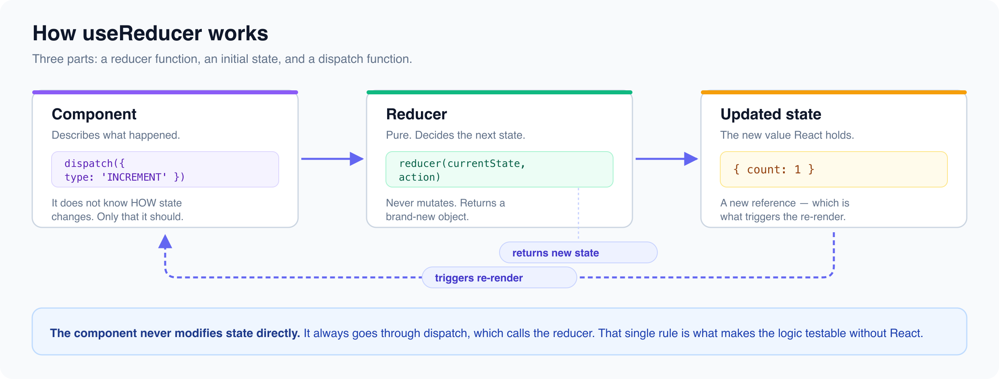

# useReducer: When useState Isn't Enough

*6 min read · Updated 16 Jul 2026 Topic 11 of 62 Bookmark Mark done 2 · Topic 11 of 62*

**Source:** [https://www.geekyfrontend.in/learn/react-interview-kit/usereducer-when-usestate-isn-t-enough](https://www.geekyfrontend.in/learn/react-interview-kit/usereducer-when-usestate-isn-t-enough)

---

# 2.1 - useReducer: When useState Isn't Enough

---

## 🎯 What Interviewers Actually Ask

| Question | Level | Frequency |
| --- | --- | --- |
| "What is useReducer?" | 🟡 | ★★★★☆ |
| "When would you use useReducer over useState?" | 🟡 | ★★★★★ |
| "Explain the reducer pattern" | 🟡 | ★★★★☆ |
| "What are actions and dispatch?" | 🟡 | ★★★☆☆ |
| "Build a todo app using useReducer" | 🟡 | ★★★★☆ |

---

## The Problem useState Can't Solve Cleanly

useState works beautifully for simple, independent pieces of state. But some state is more complex. Consider a data fetching component that needs to track `data`, `loading`, `error`, and `status` together. These four values are tightly related, and updating one usually means updating others at the same time.

When you find yourself with multiple related `useState` calls, state transitions that depend on other state values, or update logic scattered across many event handlers, it's a sign that useReducer would give you better structure.

---

## How useReducer Works

The pattern has three parts: a **reducer function**, an **initial state**, and a **dispatch function**.

jsx

```
const [state, dispatch] = useReducer(reducer, initialState);
```

The reducer is a pure function that takes the current state and an action, then returns the new state. It never modifies the existing state directly.

jsx

```
function reducer(state, action) {
  switch (action.type) {
    case 'INCREMENT':
      return { count: state.count + 1 };
    case 'DECREMENT':
      return { count: state.count - 1 };
    case 'RESET':
      return { count: 0 };
    default:
      return state;
  }
}

function Counter() {
  const [state, dispatch] = useReducer(reducer, { count: 0 });

  return (
    <div>
      <p>Count: {state.count}</p>
      <button onClick={() => dispatch({ type: 'INCREMENT' })}>+</button>
      <button onClick={() => dispatch({ type: 'DECREMENT' })}>-</button>
      <button onClick={() => dispatch({ type: 'RESET' })}>Reset</button>
    </div>
  );
}
```



---

## useState vs useReducer: The Decision

| Use useState when... | Use useReducer when... |
| --- | --- |
| State is a single primitive value | State is an object with multiple sub-values |
| Updates are independent and simple | Updates depend on previous state or other state values |
| Few state transitions | Many possible state transitions |
| Logic is small enough to inline | Logic is complex enough to deserve its own function |
| You're building a simple component | You're building something that resembles a mini state machine |

A good rule of thumb: if you have more than 3 related `useState` calls, or if your event handlers contain a lot of state-update logic, try useReducer.

---

## Real-World Example: Data Fetching

This is the pattern interviewers want to see. It handles loading, success, and error states in one clean reducer.

jsx

```
const initialState = {
  data: null,
  loading: false,
  error: null,
};

function fetchReducer(state, action) {
  switch (action.type) {
    case 'FETCH_START':
      return { ...state, loading: true, error: null };
    case 'FETCH_SUCCESS':
      return { data: action.payload, loading: false, error: null };
    case 'FETCH_ERROR':
      return { data: null, loading: false, error: action.payload };
    default:
      return state;
  }
}

function UserProfile({ userId }) {
  const [state, dispatch] = useReducer(fetchReducer, initialState);

  useEffect(() => {
    dispatch({ type: 'FETCH_START' });

    fetch(`/api/users/${userId}`)
      .then(res => res.json())
      .then(data => dispatch({ type: 'FETCH_SUCCESS', payload: data }))
      .catch(err => dispatch({ type: 'FETCH_ERROR', payload: err.message }));
  }, [userId]);

  if (state.loading) return <p>Loading...</p>;
  if (state.error) return <p>Error: {state.error}</p>;
  if (!state.data) return null;

  return <h1>{state.data.name}</h1>;
}
```

Compare this to the same thing with useState: you'd need three separate `set` calls inside each `.then()` and `.catch()`. The reducer centralizes all state transitions in one place, making the logic easier to test and reason about.

---

## Real-World Example: Todo App

This is the most common useReducer interview coding question.

jsx

```
function todoReducer(state, action) {
  switch (action.type) {
    case 'ADD':
      return [...state, { id: Date.now(), text: action.text, done: false }];
    case 'TOGGLE':
      return state.map(todo =>
        todo.id === action.id ? { ...todo, done: !todo.done } : todo
      );
    case 'DELETE':
      return state.filter(todo => todo.id !== action.id);
    case 'EDIT':
      return state.map(todo =>
        todo.id === action.id ? { ...todo, text: action.text } : todo
      );
    default:
      return state;
  }
}

function TodoApp() {
  const [todos, dispatch] = useReducer(todoReducer, []);
  const [input, setInput] = useState('');

  const handleAdd = () => {
    if (!input.trim()) return;
    dispatch({ type: 'ADD', text: input });
    setInput('');
  };

  return (
    <div>
      <input value={input} onChange={e => setInput(e.target.value)} />
      <button onClick={handleAdd}>Add</button>

      <ul>
        {todos.map(todo => (
          <li key={todo.id}>
            <span
              style={{ textDecoration: todo.done ? 'line-through' : 'none', cursor: 'pointer' }}
              onClick={() => dispatch({ type: 'TOGGLE', id: todo.id })}
            >
              {todo.text}
            </span>
            <button onClick={() => dispatch({ type: 'DELETE', id: todo.id })}>Delete</button>
          </li>
        ))}
      </ul>
    </div>
  );
}
```

Notice how the component stays clean. All the "what happens when" logic lives in the reducer, and the component only dispatches intentions.

---

## ⚡ Common Mistakes

**Mistake 1: Mutating state inside the reducer.** Reducers must be pure. Always return a new object/array, never modify the existing state.

**Mistake 2: Forgetting the default case.** Always include `default: return state;` in your switch. Without it, unrecognized actions silently return `undefined` and break your app.

**Mistake 3: Using useReducer for everything.** A simple boolean toggle doesn't need a reducer. `useState` is fine for simple, independent values.

---

## 🔥 Output Question

jsx

```
function reducer(state, action) {
  switch (action.type) {
    case 'INCREMENT':
      return { count: state.count + 1 };
    case 'RESET':
      return { count: 0 };
  }
}

function App() {
  const [state, dispatch] = useReducer(reducer, { count: 0 });
  dispatch({ type: 'UNKNOWN' });
  return <p>{state.count}</p>;
}
```

**Answer:** The reducer returns `undefined` for the 'UNKNOWN' action because there's no `default` case. `state.count` on the next render will throw because you can't read `.count` on `undefined`. Always include `default: return state;`.

---

## 🗣️ Interview Answer

> "useReducer is an alternative to useState for managing complex state. It takes a reducer function and initial state, and returns the current state plus a dispatch function. The reducer receives the current state and an action object, then returns the new state based on the action type. I reach for useReducer when I have multiple related state values that update together, like loading/data/error for API calls, or when state transitions are complex, like in a todo app with add/edit/delete/toggle operations. It centralizes all state logic in one testable function."

---

## ✅ Key Takeaways

- useReducer is for **complex, related state** where multiple values change together.
- The reducer is a **pure function**: `(state, action) => newState`. Never mutate.
- `dispatch({ type: 'ACTION_NAME', payload: data })` is how you trigger updates.
- Always include `default: return state` in your switch.
- Great for data fetching (loading/data/error), CRUD operations, and form state.
- useState is still better for simple, independent values. Don't over-engineer.

---

## 📚 What to Read Next

| Article | Why |
| --- | --- |
| **2.2 - useContext & the Context API** | Combine useReducer with Context for app-wide state management |
| **2.3 - useMemo & useCallback** | Performance hooks that complement useReducer |

---

## Learn More

- [useReducer — API reference react.dev](https://react.dev/reference/react/useReducer)
- [Extracting State Logic into a Reducer react.dev](https://react.dev/learn/extracting-state-logic-into-a-reducer)
- [useReducer — simply explained YouTube](https://www.youtube.com/watch?v=rgp_iCVS8ys)
- [Learn useReducer in 15 minutes YouTube](https://www.youtube.com/watch?v=R5G2acJ6_vQ)
- [useReducer vs useState — when to use YouTube](https://www.youtube.com/watch?v=PMyPyT8N4m8)
