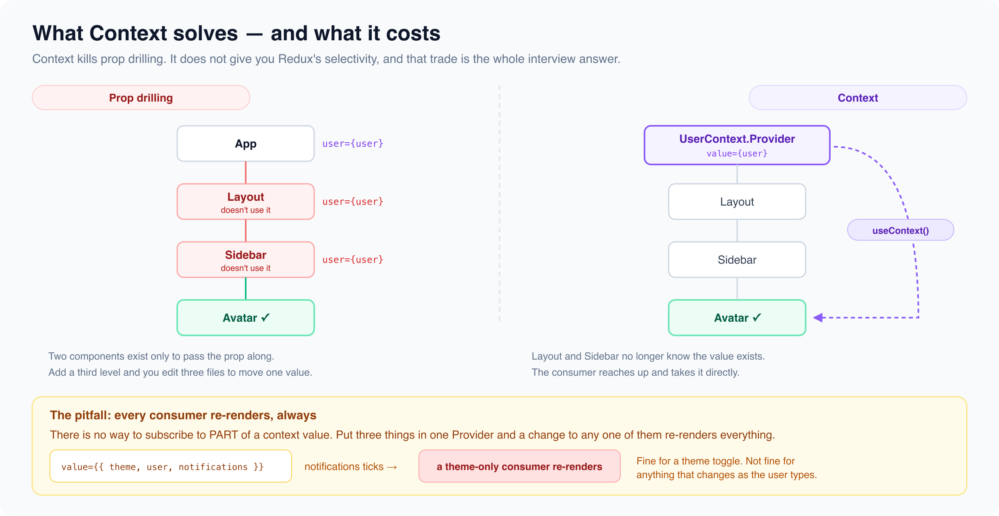

# useContext & the Context API

*5 min read · Updated 16 Jul 2026 Topic 12 of 62 Bookmark Mark done 2 · Topic 12 of 62*

**Source:** [https://www.geekyfrontend.in/learn/react-interview-kit/usecontext-the-context-api](https://www.geekyfrontend.in/learn/react-interview-kit/usecontext-the-context-api)

---

# 2.2 - useContext & the Context API

---

## 🎯 What Interviewers Actually Ask

| Question | Level | Frequency |
| --- | --- | --- |
| "What is the Context API?" | 🟡 | ★★★★★ |
| "How do you avoid prop drilling?" | 🟡 | ★★★★★ |
| "How do you create and consume a context?" | 🟡 | ★★★★☆ |
| "When should you use Context vs Redux?" | 🟡🔴 | ★★★★☆ |
| "What are the performance pitfalls of Context?" | 🔴 | ★★★☆☆ |

---

## What Problem Does Context Solve?

Context solves **prop drilling**: the problem of passing data through intermediate components that don't use it, just to get it to a deeply nested child.

Without Context, you'd pass `theme` through every level:

jsx

```
// Every component in the chain receives and forwards the prop
<App theme="dark">
  <Layout theme="dark">
    <Sidebar theme="dark">
      <Button theme="dark" />  {/* Finally used here */}
    </Sidebar>
  </Layout>
</App>
```

With Context, the Button grabs the value directly:

jsx

```
const ThemeContext = createContext('light');

function App() {
  return (
    <ThemeContext.Provider value="dark">
      <Layout />
    </ThemeContext.Provider>
  );
}

// Layout and Sidebar don't need to know about theme at all

function Button() {
  const theme = useContext(ThemeContext);  // Direct access
  return <button className={theme}>Click me</button>;
}
```

---

## The Three Steps

**Step 1: Create** the context.

jsx

```
import { createContext } from 'react';
export const UserContext = createContext(null);
```

**Step 2: Provide** the context value by wrapping a part of your tree.

jsx

```
function App() {
  const [user, setUser] = useState({ name: 'Alice', role: 'admin' });

  return (
    <UserContext.Provider value={{ user, setUser }}>
      <Dashboard />
    </UserContext.Provider>
  );
}
```

**Step 3: Consume** the context in any nested component.

jsx

```
function UserGreeting() {
  const { user } = useContext(UserContext);
  return <p>Hello, {user.name}!</p>;
}
```

Any component inside the Provider can access the value, no matter how deep.

---

## Context + useReducer = Mini Redux

This is a very common interview pattern. It gives you app-wide state management without installing any library.

jsx

```
const AppContext = createContext();

function appReducer(state, action) {
  switch (action.type) {
    case 'SET_USER':
      return { ...state, user: action.payload };
    case 'SET_THEME':
      return { ...state, theme: action.payload };
    case 'LOGOUT':
      return { ...state, user: null };
    default:
      return state;
  }
}

function AppProvider({ children }) {
  const [state, dispatch] = useReducer(appReducer, {
    user: null,
    theme: 'light',
  });

  return (
    <AppContext.Provider value={{ state, dispatch }}>
      {children}
    </AppContext.Provider>
  );
}

// Any component can read state and dispatch actions
function Header() {
  const { state, dispatch } = useContext(AppContext);

  return (
    <header>
      <p>Welcome, {state.user?.name || 'Guest'}</p>
      <button onClick={() => dispatch({ type: 'SET_THEME', payload: 'dark' })}>
        Dark Mode
      </button>
    </header>
  );
}
```

---

## Performance Pitfall: Re-rendering All Consumers

Every component that calls `useContext(SomeContext)` re-renders whenever the Provider's `value` changes. If you put too much into one context, every consumer re-renders on every change, even if they only use a small part of the value.

jsx

```
// ❌ Problem: changing theme re-renders everything that uses user too
<AppContext.Provider value={{ user, theme, notifications, settings }}>
```

**Solutions:**

1. **Split contexts** by domain (ThemeContext, UserContext, NotificationContext).
2. **Memoize the value** to prevent unnecessary reference changes.
3. Use **React.memo** on consumer components.

jsx

```
// ✅ Split into separate contexts
<ThemeContext.Provider value={theme}>
  <UserContext.Provider value={user}>
    {children}
  </UserContext.Provider>
</ThemeContext.Provider>
```

---



## When to Use Context vs Redux vs Props

|  | Props | Context | Redux/Zustand |
| --- | --- | --- | --- |
| **Best for** | Parent to child, 1-2 levels deep | App-wide values (theme, auth, locale) | Complex state with many actions and middleware |
| **Complexity** | Zero setup | Low setup | Higher setup (store, slices, provider) |
| **Performance** | Great | Can cause over-rendering if not split | Optimized selectors prevent unnecessary renders |
| **Debugging** | Simple | No devtools (without extra libraries) | Redux DevTools, time travel |

**Rule of thumb:** Start with props. If you're drilling through 3+ levels, try Context. If you need complex state logic, middleware, or devtools, consider Redux Toolkit or Zustand.

---

## ⚡ Common Mistakes

**Mistake 1: Using Context for frequently changing state.** Context doesn't have selectors. If a counter updates 60 times per second and 20 components consume the context, all 20 re-render on every tick. Use a state library for high-frequency updates.

**Mistake 2: Creating a new object on every render as the Provider value.**

jsx

```
// ❌ Creates a new object each render, all consumers re-render
<UserContext.Provider value={{ user, setUser }}>

// ✅ Memoize the value
const value = useMemo(() => ({ user, setUser }), [user]);
<UserContext.Provider value={value}>
```

**Mistake 3: Putting everything in one giant context.** Split by domain to minimize unnecessary re-renders.

---

## 🗣️ Interview Answer

> "Context API lets you share data across the component tree without passing props through every level. You create a context with `createContext`, wrap a portion of the tree with a Provider that supplies the value, and any nested component can access it with `useContext`. I use it for app-wide concerns like auth, theme, and locale. For more complex state, I combine it with useReducer to get a Redux-like pattern without the extra library. The main performance caveat is that all consumers re-render when the context value changes, so I split contexts by domain and memoize provider values."

---

## ✅ Key Takeaways

- Context solves **prop drilling** by letting any nested component access shared data directly.
- Three steps: `createContext`, wrap with `Provider`, consume with `useContext`.
- Context + useReducer gives you a lightweight, library-free state management pattern.
- **Split contexts** by domain to avoid unnecessary re-renders.
- **Memoize** the Provider value to prevent reference changes on every render.
- Use Context for **low-frequency, app-wide** data (theme, auth, locale). Use a state library for **high-frequency** or complex state.

---

## 📚 What to Read Next

| Article | Why |
| --- | --- |
| **2.3 - useMemo & useCallback** | Memoizing context values is critical for performance |
| **2.4 - Custom Hooks** | Extract context consumption into reusable `useAuth()`, `useTheme()` hooks |

---

## Learn More

- [useContext — API reference react.dev](https://react.dev/reference/react/useContext)
- [Passing Data Deeply with Context react.dev](https://react.dev/learn/passing-data-deeply-with-context)
- [Scaling Up with Reducer and Context react.dev](https://react.dev/learn/scaling-up-with-reducer-and-context)
- [useContext — simply explained YouTube](https://www.youtube.com/watch?v=HYKDUF8X3qI)
- [Learn useContext in 13 minutes YouTube](https://www.youtube.com/watch?v=5LrDIWkK_Bc)
- [React Context API tutorial YouTube](https://www.youtube.com/watch?v=bJMwH1FWSmU)
