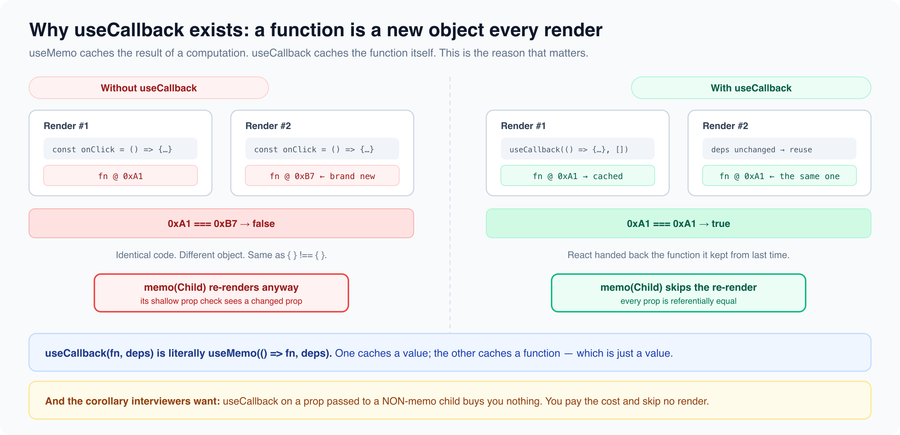

# useMemo & useCallback: Performance Hooks

*6 min read · Updated 16 Jul 2026 Topic 13 of 62 Bookmark Mark done 2 · Topic 13 of 62*

**Source:** [https://www.geekyfrontend.in/learn/react-interview-kit/usememo-usecallback-performance-hooks](https://www.geekyfrontend.in/learn/react-interview-kit/usememo-usecallback-performance-hooks)

---

# 2.3 - useMemo & useCallback: Performance Hooks

---

## 🎯 What Interviewers Actually Ask

| Question | Level | Frequency |
| --- | --- | --- |
| "What is useMemo?" | 🟡 | ★★★★☆ |
| "What is useCallback?" | 🟡 | ★★★★☆ |
| "What is the difference between useMemo and useCallback?" | 🟡🔴 | ★★★★★ |
| "When should you NOT use useMemo/useCallback?" | 🟡🔴 | ★★★★☆ |
| "How does React.memo relate to useCallback?" | 🟡🔴 | ★★★☆☆ |

---

## The Core Difference (One Sentence)

**useMemo** caches the **result** of a computation. **useCallback** caches the **function itself**.

That's it. Everything else is details.

jsx

```
// useMemo: caches the RETURN VALUE
const sortedList = useMemo(() => {
  return items.sort((a, b) => a.name.localeCompare(b.name));
}, [items]);
// sortedList is the sorted array. Recalculated only when items changes.

// useCallback: caches the FUNCTION
const handleClick = useCallback(() => {
  console.log('clicked');
}, []);
// handleClick is the same function reference across renders.
```

In fact, `useCallback(fn, deps)` is exactly the same as `useMemo(() => fn, deps)`.

---

## useMemo: Caching Expensive Calculations

Use useMemo when you have a computation that's slow and its inputs don't change on every render.

jsx

```
function ProductList({ products, searchTerm }) {
  // Without useMemo: filters and sorts on EVERY render, even if products/searchTerm didn't change
  // With useMemo: only recalculates when products or searchTerm change
  const filteredProducts = useMemo(() => {
    console.log('Filtering and sorting...');
    return products
      .filter(p => p.name.toLowerCase().includes(searchTerm.toLowerCase()))
      .sort((a, b) => a.price - b.price);
  }, [products, searchTerm]);

  return (
    <ul>
      {filteredProducts.map(p => <li key={p.id}>{p.name} - ${p.price}</li>)}
    </ul>
  );
}
```

### When useMemo actually helps

It helps when the computation is genuinely expensive (sorting thousands of items, complex math, deep data transformations). For simple operations like adding two numbers or concatenating strings, the overhead of useMemo itself is greater than the computation you're trying to avoid. Don't memoize everything.

---

## useCallback: Stabilizing Function References

Every time a component renders, all functions defined inside it are recreated as new references. This is normally fine. But it becomes a problem when you pass functions as props to memoized child components.

jsx

```
// Without useCallback: increment is a NEW function on every render
// This defeats React.memo on the Child component
function Parent() {
  const [count, setCount] = useState(0);
  const [other, setOther] = useState(false);

  const increment = () => setCount(c => c + 1);

  return (
    <div>
      <MemoizedChild onClick={increment} />
      <button onClick={() => setOther(!other)}>Toggle</button>
    </div>
  );
}

const MemoizedChild = React.memo(({ onClick }) => {
  console.log('Child rendered');
  return <button onClick={onClick}>Increment</button>;
});
// Child re-renders on every toggle because increment is a new reference each time
```

jsx

```
// With useCallback: increment keeps the same reference across renders
function Parent() {
  const [count, setCount] = useState(0);
  const [other, setOther] = useState(false);

  const increment = useCallback(() => setCount(c => c + 1), []);

  return (
    <div>
      <MemoizedChild onClick={increment} />
      <button onClick={() => setOther(!other)}>Toggle</button>
    </div>
  );
}
// Now toggling "other" does NOT re-render the Child
```

**The key insight:** useCallback is only useful when the function is passed to a component wrapped in `React.memo`, or when the function is a dependency of another hook (useEffect, useMemo). If neither is true, useCallback adds overhead without any benefit.

---

## React.memo + useCallback: The Full Picture

These three tools work together as a system:

| Tool | What it does | Used on |
| --- | --- | --- |
| `React.memo` | Skips re-render if props haven't changed (shallow comparison) | Child components |
| `useCallback` | Keeps function reference stable across renders | Functions passed as props |
| `useMemo` | Keeps computed value stable across renders | Objects/arrays passed as props |

If you use `React.memo` on a child but pass it an inline function or a new object every render, `React.memo` does nothing because the props are always "different."

---



## When NOT to Optimize

This is the question that separates senior developers from those who just memorize hooks.

**Don't use useMemo/useCallback when:**

1. The computation is trivial (basic math, string operations, accessing object properties).
2. The value isn't passed as a prop to a memoized component and isn't a hook dependency.
3. The component is simple and renders fast anyway.
4. You're guessing that something might be slow without measuring first.

Premature optimization makes code harder to read for zero performance benefit. Profile first with React DevTools, identify actual bottlenecks, then optimize.

jsx

```
// ❌ Pointless memoization. Adding two numbers costs nothing.
const total = useMemo(() => price + tax, [price, tax]);

// ✅ Just compute it directly
const total = price + tax;

// ❌ Pointless useCallback. No memoized child, no hook dependency.
const handleClick = useCallback(() => {
  setCount(c => c + 1);
}, []);
// If nothing consumes the reference stability, this is wasted code.

// ✅ Just write the function
const handleClick = () => setCount(c => c + 1);
```

---

## ⚡ Common Mistakes

**Mistake 1: Using useMemo/useCallback everywhere "just in case."** They have their own cost (storing the cached value, comparing deps). Only use them when there's a measurable benefit.

**Mistake 2: Forgetting to wrap the child in React.memo.** useCallback alone doesn't prevent child re-renders. The child must also be wrapped in React.memo for the stable reference to matter.

**Mistake 3: Wrong dependencies.** If you omit a dependency, the cached value becomes stale. If you include too many, it recalculates too often. Trust the exhaustive-deps lint rule.

---

## 🔥 Output Question

jsx

```
const MemoChild = React.memo(({ data, onClick }) => {
  console.log('Child rendered');
  return <button onClick={onClick}>{data.label}</button>;
});

function Parent() {
  const [count, setCount] = useState(0);

  const data = { label: 'Click me' };
  const handleClick = useCallback(() => setCount(c => c + 1), []);

  return (
    <div>
      <p>{count}</p>
      <MemoChild data={data} onClick={handleClick} />
    </div>
  );
}
```

**Does the child re-render when count changes?**

Yes. Even though `handleClick` is stable (thanks to useCallback), `data` is a new object on every render. React.memo sees a different `data` reference and re-renders. Fix: wrap `data` in useMemo too, or move it outside the component if it's static.

---

## 🗣️ Interview Answer

> "useMemo caches the result of a computation, useCallback caches the function reference itself. They're both about preventing unnecessary work across re-renders, but they only matter in specific situations: useMemo when a computation is genuinely expensive, useCallback when a function is passed to a React.memo child or used as a hook dependency. Without React.memo on the child, useCallback alone doesn't prevent re-renders. I avoid using them everywhere because they add complexity, and I always profile with React DevTools before optimizing."

---

## ✅ Key Takeaways

- **useMemo** = cache the computed value. **useCallback** = cache the function.
- `useCallback(fn, deps)` is identical to `useMemo(() => fn, deps)`.
- useCallback only matters when paired with **React.memo** on the child, or as a **hook dependency**.
- useMemo only matters when the computation is **genuinely expensive**.
- Don't memoize everything. Measure first, optimize second.
- Stale dependencies are the most common bug. Trust the lint rule.

---

## Learn More

- [useMemo — API reference react.dev](https://react.dev/reference/react/useMemo)
- [useCallback — API reference react.dev](https://react.dev/reference/react/useCallback)
- [useCallback, useMemo & React.memo explained YouTube](https://www.youtube.com/watch?v=x10C19dWCKo)
- [useMemo and useCallback YouTube](https://www.youtube.com/watch?v=JGtVj_P9XEE)
- [useMemo vs React.memo vs useCallback YouTube](https://www.youtube.com/watch?v=GYT2TetMLbE)
