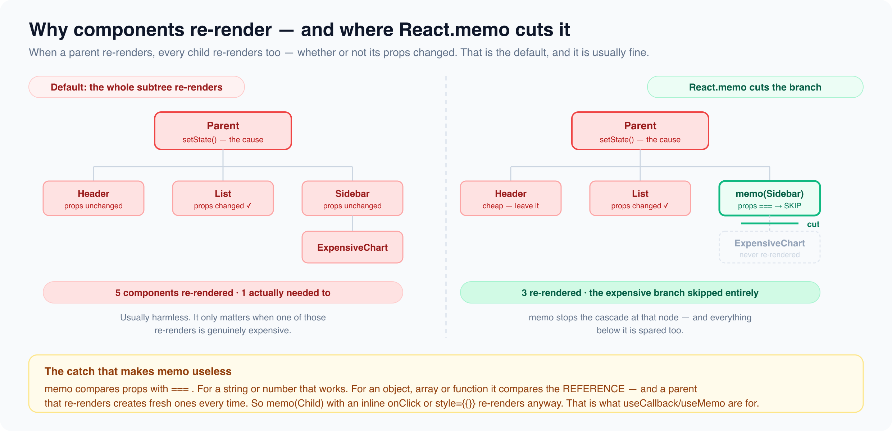

# React.memo, PureComponent & Re-render Prevention

*5 min read · Updated 16 Jul 2026 Topic 15 of 62 Bookmark Mark done 2 · Topic 15 of 62*

**Source:** [https://www.geekyfrontend.in/learn/react-interview-kit/react-memo-purecomponent-re-render-prevention](https://www.geekyfrontend.in/learn/react-interview-kit/react-memo-purecomponent-re-render-prevention)

---

# 2.5 - React.memo, PureComponent & Re-render Prevention

---

## 🎯 What Interviewers Actually Ask

| Question | Level | Frequency |
| --- | --- | --- |
| "What is React.memo?" | 🟡 | ★★★★☆ |
| "What is PureComponent?" | 🟡 | ★★★☆☆ |
| "How do you prevent unnecessary re-renders?" | 🟡🔴 | ★★★★★ |
| "What is shallow comparison?" | 🟡 | ★★★☆☆ |
| "When does React.memo NOT work?" | 🟡🔴 | ★★★★☆ |

---

## Why Components Re-render

By default, when a parent component re-renders, **all of its children re-render too**, regardless of whether their props changed. This is React's default behavior and it's usually fine. But for expensive components, it's wasteful.

jsx

```
function Parent() {
  const [count, setCount] = useState(0);

  return (
    <div>
      <button onClick={() => setCount(c => c + 1)}>Count: {count}</button>
      <ExpensiveChild name="Alice" />
      {/* ExpensiveChild re-renders on every click even though "Alice" never changes */}
    </div>
  );
}
```

---



## React.memo: Memoizing Functional Components

`React.memo` wraps a functional component and tells React: "Only re-render this component if its props actually changed."

jsx

```
const ExpensiveChild = React.memo(function ExpensiveChild({ name }) {
  console.log('ExpensiveChild rendered');
  return <p>Hello, {name}</p>;
});

// Now ExpensiveChild only re-renders when `name` changes, not when Parent re-renders
```

### How it decides: shallow comparison

React.memo compares each prop using `===` (strict equality). For primitives (strings, numbers, booleans), this works perfectly. For objects and arrays, it only checks if the reference is the same, not whether the contents are identical.

jsx

```
// ✅ Primitive props: shallow comparison works
<MemoChild name="Alice" count={5} />

// ❌ New object every render: defeats React.memo
<MemoChild style={{ color: 'red' }} />

// ❌ New array every render: defeats React.memo
<MemoChild items={[1, 2, 3]} />

// ❌ Inline function: new reference every render
<MemoChild onClick={() => doSomething()} />
```

To fix these, use `useMemo` for objects/arrays and `useCallback` for functions (covered in 2.3).

### Custom comparison function

You can provide your own comparison function as the second argument to React.memo:

jsx

```
const UserCard = React.memo(
  function UserCard({ user }) {
    return <div>{user.name} ({user.age})</div>;
  },
  (prevProps, nextProps) => {
    // Return true to SKIP re-render, false to allow it
    return prevProps.user.id === nextProps.user.id
        && prevProps.user.name === nextProps.user.name;
  }
);
```

Use this sparingly. If your custom comparison is wrong, you'll have stale UI bugs that are very hard to track down.

---

## PureComponent: The Class Equivalent

`PureComponent` is the class component version of React.memo. It implements `shouldComponentUpdate` with a shallow props and state comparison automatically.

jsx

```
// Class: PureComponent
class Greeting extends React.PureComponent {
  render() {
    console.log('Greeting rendered');
    return <h3>Hello, {this.props.name}</h3>;
  }
}

// Functional: React.memo (equivalent)
const Greeting = React.memo(function Greeting({ name }) {
  console.log('Greeting rendered');
  return <h3>Hello, {name}</h3>;
});
```

In new code, use React.memo. PureComponent is for legacy class components you haven't migrated yet.

---

## The Complete Re-render Prevention Toolkit

| Tool | What it prevents | How to use |
| --- | --- | --- |
| `React.memo` | Component re-render when props didn't change | Wrap the component |
| `useMemo` | Recalculation of expensive values | Wrap the computation |
| `useCallback` | Recreation of function references | Wrap the function |
| Move state down | Unrelated components re-rendering | Keep state close to where it's used |
| Split components | Large re-renders | Break big components into smaller ones |

The last two are free and don't add any code complexity. Try them first before reaching for memoization hooks.

---

## ⚡ Common Mistakes

**Mistake 1: Using React.memo on every component.** Most components are fast enough that the overhead of memoization (comparing all props) is more expensive than just re-rendering. Profile first.

**Mistake 2: Memoizing the child but passing new object/function references.** React.memo becomes useless if any prop changes on every render.

**Mistake 3: Thinking React.memo makes the component "pure."** It only prevents re-renders from parent changes. If the component's own state changes, it still re-renders (which is correct behavior).

---

## 🔥 Output Question

jsx

```
const Child = React.memo(({ user }) => {
  console.log('Child rendered');
  return <p>{user.name}</p>;
});

function Parent() {
  const [count, setCount] = useState(0);
  const user = { name: 'Alice' };

  return (
    <div>
      <button onClick={() => setCount(c => c + 1)}>Count: {count}</button>
      <Child user={user} />
    </div>
  );
}
```

**Does Child re-render when count changes?**

Yes. Every render creates a new `user` object. Even though its contents are identical, React.memo's shallow comparison sees a different reference. Fix: move `user` outside the component or wrap it in `useMemo`.

---

## 🗣️ Interview Answer

> "React.memo is a higher-order component that memoizes a functional component, preventing re-renders when props haven't changed. It uses shallow comparison by default, which means it compares primitive values by value and objects by reference. This is why you need useMemo for objects and useCallback for functions passed as props. PureComponent is the class equivalent. The important thing is to not use these everywhere. Most components don't need memoization. I always profile with React DevTools first to identify actual bottlenecks, then apply memoization selectively."

---

## ✅ Key Takeaways

- **React.memo** prevents re-renders when props haven't changed (shallow comparison).
- **PureComponent** is the class equivalent. Use React.memo for new code.
- Shallow comparison: primitives by value, objects/arrays/functions by reference.
- New object or function on every render **defeats** React.memo. Use useMemo and useCallback to stabilize references.
- Don't memoize everything. Profile first, optimize only what's slow.
- Moving state down and splitting components are free optimizations that don't add complexity.

---

## Learn More

- [memo — API reference react.dev](https://react.dev/reference/react/memo)
- [PureComponent — API reference react.dev](https://react.dev/reference/react/PureComponent)
- [Preventing re-renders with React.memo YouTube](https://www.youtube.com/watch?v=feEY3Qajrwg)
- [useMemo & useCallback do NOT prevent re-renders YouTube](https://www.youtube.com/watch?v=HA96JzJ_G1A)
- [Optimising with React.memo YouTube](https://www.youtube.com/watch?v=2woSmgfUjC8)
