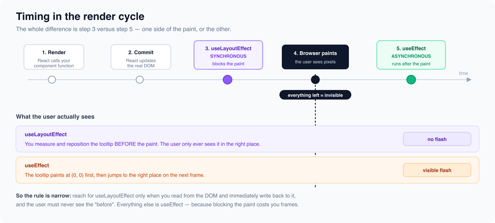

# useLayoutEffect vs useEffect

*4 min read · Updated 16 Jul 2026 Topic 16 of 62 Bookmark Mark done 2 · Topic 16 of 62*

**Source:** [https://www.geekyfrontend.in/learn/react-interview-kit/uselayouteffect-vs-useeffect](https://www.geekyfrontend.in/learn/react-interview-kit/uselayouteffect-vs-useeffect)

---

# 2.6 - useLayoutEffect vs useEffect

---

## 🎯 What Interviewers Actually Ask

| Question | Level | Frequency |
| --- | --- | --- |
| "What is the difference between useEffect and useLayoutEffect?" | 🟡🔴 | ★★★☆☆ |
| "When would you use useLayoutEffect?" | 🟡🔴 | ★★★☆☆ |
| "Does useLayoutEffect block the browser?" | 🔴 | ★★☆☆☆ |

---

## The One-Line Difference

**useEffect** runs asynchronously *after* the browser has painted the screen. **useLayoutEffect** runs synchronously *before* the browser paints. Same API, different timing.

---

## Timing in the Render Cycle

Here's the exact sequence when a component renders:

1. React calls your component function (the "render")
2. React updates the DOM (commit phase)
3. **useLayoutEffect runs** (synchronous, blocks paint)
4. Browser paints the screen (user sees the update)
5. **useEffect runs** (asynchronous, after paint)

The critical difference is step 3 vs step 5. useLayoutEffect fires between DOM update and paint, so the user never sees the intermediate state. useEffect fires after paint, so there can be a brief flash of the old state.

---



## When to Use useLayoutEffect

You need it in one specific scenario: when you read from the DOM and immediately write back to it, and you need the user to never see the "before" state.

### The Classic Example: Tooltip Positioning

jsx

```
function Tooltip({ targetRef, text }) {
  const tooltipRef = useRef(null);
  const [position, setPosition] = useState({ top: 0, left: 0 });

  useLayoutEffect(() => {
    if (!targetRef.current || !tooltipRef.current) return;
    const rect = targetRef.current.getBoundingClientRect();
    setPosition({
      top: rect.bottom + 8,
      left: rect.left,
    });
  }, [targetRef]);

  return (
    <div
      ref={tooltipRef}
      style={{ position: 'fixed', top: position.top, left: position.left }}
    >
      {text}
    </div>
  );
}
```

If you used `useEffect` here, the tooltip would first appear at position (0, 0), then jump to the correct position after the browser paints. The user would see a flicker. With `useLayoutEffect`, the position is calculated before paint, so the tooltip appears in the right place from the start.

### Other Real Use Cases

- Measuring an element's height to set a container size
- Adjusting scroll position after a DOM update
- Animations that need to read initial DOM values before the first frame

---

## The Decision

Start with `useEffect` for everything. Switch to `useLayoutEffect` only if you see a visual flicker caused by reading the DOM and then updating state based on that reading. In practice, this is rare.

jsx

```
// 99% of the time: useEffect
useEffect(() => {
  fetchData();
  document.title = 'My Page';
  analytics.track('pageview');
}, []);

// The rare 1%: useLayoutEffect
useLayoutEffect(() => {
  const height = ref.current.getBoundingClientRect().height;
  setContainerHeight(height);
}, []);
```

**Warning:** useLayoutEffect blocks rendering. If your logic is slow (heavy computation, network calls), it will freeze the UI. Never put async operations or expensive calculations inside useLayoutEffect.

---

## ⚡ Common Mistakes

**Mistake 1: Using useLayoutEffect for API calls.** It blocks the browser from painting. Use useEffect for anything async.

**Mistake 2: Using useLayoutEffect "just to be safe."** It has a performance cost. Only use it when you've identified a visual flicker.

**Mistake 3: SSR warning.** useLayoutEffect fires a warning during server-side rendering because there's no DOM to measure. Use useEffect for SSR-compatible code, or conditionally apply useLayoutEffect only on the client.

---

## 🗣️ Interview Answer

> "useEffect and useLayoutEffect have the same API but different timing. useEffect runs asynchronously after the browser paints. useLayoutEffect runs synchronously before the paint. I use useLayoutEffect only when I need to measure the DOM and update the UI based on that measurement before the user sees anything, like positioning a tooltip or measuring an element's dimensions. For everything else, including API calls, subscriptions, and logging, I use useEffect because it doesn't block rendering."

---

## ✅ Key Takeaways

- Same API, different timing: **useEffect** = after paint, **useLayoutEffect** = before paint.
- useLayoutEffect **blocks the browser** from painting until it finishes.
- Use it for DOM measurement + immediate update to prevent visual flicker.
- Use useEffect for **everything else** (API calls, subscriptions, logging, timers).
- Never put async operations or heavy logic in useLayoutEffect.
- Start with useEffect. Switch to useLayoutEffect only if you see a flicker.

---

## 📚 Module 2 Complete!

You've finished all the Advanced Hooks & Patterns. Here's a recap:

| # | Article | Core Concept |
| --- | --- | --- |
| 2.1 | useReducer | Complex state with action-based transitions |
| 2.2 | useContext | Sharing state without prop drilling |
| 2.3 | useMemo & useCallback | Caching values and function references |
| 2.4 | Custom Hooks | Extracting reusable stateful logic |
| 2.5 | React.memo & Re-render Prevention | Controlling when components re-render |
| 2.6 | useLayoutEffect vs useEffect | Synchronous vs async effect timing |

**Next up: Module 3 (Routing & Navigation) or Module 4 (State Management with Redux)**

---

## Learn More

- [useLayoutEffect — API reference react.dev](https://react.dev/reference/react/useLayoutEffect)
- [useEffect — API reference react.dev](https://react.dev/reference/react/useEffect)
- [useLayoutEffect vs useEffect YouTube](https://www.youtube.com/watch?v=pHxQtHwcT-s)
- [useLayoutEffect vs useEffect — which is better? YouTube](https://www.youtube.com/watch?v=sRDUOd1IkS8)
- [The difference, in depth YouTube](https://www.youtube.com/watch?v=6jd7d1FfEW0)
