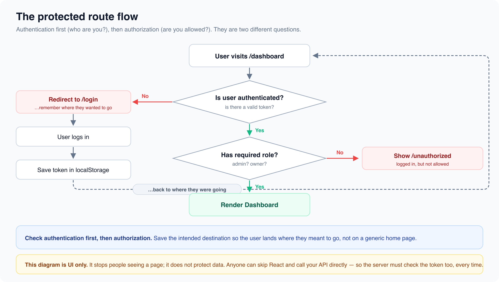

# Protected Routes & Authentication Flow

*5 min read · Updated 16 Jul 2026 Topic 18 of 62 Bookmark Mark done 3 · Topic 18 of 62*

**Source:** [https://www.geekyfrontend.in/learn/react-interview-kit/protected-routes-authentication-flow](https://www.geekyfrontend.in/learn/react-interview-kit/protected-routes-authentication-flow)

---

# 3.2 - Protected Routes & Authentication Flow

---

## 🎯 What Interviewers Actually Ask

| Question | Level | Frequency |
| --- | --- | --- |
| "What are protected/private routes?" | 🟡 | ★★★★☆ |
| "How do you implement route guards in React?" | 🟡🔴 | ★★★★☆ |
| "How do you handle authentication in a React app?" | 🟡🔴 | ★★★★★ |
| "What is the difference between authentication and authorization?" | 🟡 | ★★★★☆ |
| "How do you implement role-based access control?" | 🔴 | ★★★☆☆ |

---

## Authentication vs Authorization

**Authentication** answers: "Who are you?" (verifying identity through login).

**Authorization** answers: "What are you allowed to do?" (checking permissions and roles).

A protected route deals with both. It first checks if the user is authenticated (logged in), then optionally checks if they're authorized (have the right role/permissions).

---

## Building a Protected Route Component

The pattern is straightforward: wrap your route in a component that checks authentication status. If the user is logged in, render the child. If not, redirect to login.

jsx

```
import { Navigate, useLocation } from 'react-router-dom';

function ProtectedRoute({ children }) {
  const { user } = useAuth();  // Your auth hook/context
  const location = useLocation();

  if (!user) {
    // Redirect to login, but save where the user was trying to go
    return <Navigate to="/login" state={{ from: location }} replace />;
  }

  return children;
}
```

### Using it in your routes

jsx

```
function App() {
  return (
    <BrowserRouter>
      <Routes>
        {/* Public routes */}
        <Route path="/login" element={<LoginPage />} />
        <Route path="/signup" element={<SignupPage />} />
        <Route path="/" element={<HomePage />} />

        {/* Protected routes */}
        <Route
          path="/dashboard"
          element={
            <ProtectedRoute>
              <Dashboard />
            </ProtectedRoute>
          }
        />
        <Route
          path="/profile"
          element={
            <ProtectedRoute>
              <Profile />
            </ProtectedRoute>
          }
        />
      </Routes>
    </BrowserRouter>
  );
}
```

---

## Redirecting Back After Login

The `state={{ from: location }}` in the Navigate component saves where the user was trying to go. After login, you can redirect them back:

jsx

```
function LoginPage() {
  const navigate = useNavigate();
  const location = useLocation();
  const { login } = useAuth();

  const from = location.state?.from?.pathname || '/dashboard';

  const handleSubmit = async (e) => {
    e.preventDefault();
    const success = await login(credentials);
    if (success) {
      navigate(from, { replace: true });  // Go back to where they came from
    }
  };

  return <form onSubmit={handleSubmit}>...</form>;
}
```

---

## Role-Based Access Control

For apps with different user roles (admin, editor, viewer), extend the protected route to check roles.

jsx

```
function RoleRoute({ children, allowedRoles }) {
  const { user } = useAuth();
  const location = useLocation();

  if (!user) {
    return <Navigate to="/login" state={{ from: location }} replace />;
  }

  if (!allowedRoles.includes(user.role)) {
    return <Navigate to="/unauthorized" replace />;
  }

  return children;
}
```

jsx

```
// Usage
<Route
  path="/admin"
  element={
    <RoleRoute allowedRoles={['admin']}>
      <AdminPanel />
    </RoleRoute>
  }
/>
<Route
  path="/editor"
  element={
    <RoleRoute allowedRoles={['admin', 'editor']}>
      <ContentEditor />
    </RoleRoute>
  }
/>
```

---

## The Auth Context Pattern

Most apps use a Context to provide authentication state throughout the app.

jsx

```
const AuthContext = createContext(null);

function AuthProvider({ children }) {
  const [user, setUser] = useState(null);
  const [loading, setLoading] = useState(true);

  useEffect(() => {
    // Check if user is already logged in (e.g., from a stored token)
    const token = localStorage.getItem('token');
    if (token) {
      validateToken(token)
        .then(userData => setUser(userData))
        .catch(() => localStorage.removeItem('token'))
        .finally(() => setLoading(false));
    } else {
      setLoading(false);
    }
  }, []);

  const login = async (credentials) => {
    const response = await api.post('/auth/login', credentials);
    localStorage.setItem('token', response.token);
    setUser(response.user);
  };

  const logout = () => {
    localStorage.removeItem('token');
    setUser(null);
  };

  if (loading) return <FullPageSpinner />;

  return (
    <AuthContext.Provider value={{ user, login, logout }}>
      {children}
    </AuthContext.Provider>
  );
}

function useAuth() {
  const context = useContext(AuthContext);
  if (!context) throw new Error('useAuth must be used inside AuthProvider');
  return context;
}
```



---

## ⚡ Common Mistakes

**Mistake 1: Storing tokens in state only.** If the user refreshes the page, they get logged out. Persist tokens in localStorage or httpOnly cookies.

**Mistake 2: Not showing a loading state.** While checking if the user is authenticated (e.g., validating a token on mount), show a spinner. Otherwise the user briefly sees the login page before being redirected to the dashboard.

**Mistake 3: Client-side auth as the only security layer.** Protected routes prevent UI access, but they don't protect your data. Your API must always validate tokens independently. Someone can bypass React and hit your API directly.

---

## 🗣️ Interview Answer

> "Protected routes are components that check if a user is authenticated before rendering their children. If the user isn't logged in, they redirect to the login page. I implement this with a ProtectedRoute wrapper that uses an auth context to check the user's status. For role-based access, I extend it to check the user's role against allowed roles. The key is saving the intended destination so the user gets redirected back after login. And I always emphasize that client-side route protection is for UX only. The real security must be on the API side."

---

## ✅ Key Takeaways

- **Protected routes** check auth status before rendering. Redirect to login if unauthenticated.
- Save the **intended destination** with `location.state` so users return after login.
- **Role-based routes** extend the pattern by checking `user.role` against allowed roles.
- Use **AuthContext** to provide auth state app-wide.
- Show a **loading spinner** while validating the token on initial load.
- Client-side protection is **UX only**. API must validate tokens independently.

---

## Learn More

- [React Router — Routing basics reactrouter.com](https://reactrouter.com/start/library/routing)
- [React Router — home & docs reactrouter.com](https://reactrouter.com)
- [Protected routes & auth with React Router v6 YouTube](https://www.youtube.com/watch?v=q94v5AhgrW4)
- [Authentication and protected routes YouTube](https://www.youtube.com/watch?v=X8eAbu1RWZ4)
- [Private & protected routes (v6) YouTube](https://www.youtube.com/watch?v=9RfaG0IzccE)
