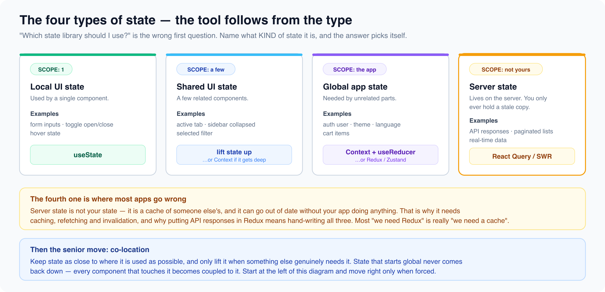

# State Management: When & Why You Need It

*5 min read · Updated 16 Jul 2026 Topic 20 of 62 Bookmark Mark done 4 · Topic 20 of 62*

**Source:** [https://www.geekyfrontend.in/learn/react-interview-kit/state-management-when-why-you-need-it](https://www.geekyfrontend.in/learn/react-interview-kit/state-management-when-why-you-need-it)

---

# 4.1 - State Management: When & Why You Need It

---

## 🎯 What Interviewers Actually Ask

| Question | Level | Frequency |
| --- | --- | --- |
| "When do you need a state management library?" | 🟡 | ★★★★★ |
| "What is the difference between local state and global state?" | 🟡 | ★★★★☆ |
| "How do you decide between Context API and Redux?" | 🟡🔴 | ★★★★★ |
| "What is state co-location?" | 🔴 | ★★★☆☆ |
| "What is server state vs client state?" | 🔴 | ★★★☆☆ |

---

## Not Every App Needs Redux

This is the most important thing to understand before learning any state management library. Many developers reach for Redux on day one of a project. That's almost always premature.

React's built-in tools handle state perfectly well for most applications:

- **useState** for component-local state
- **useReducer** for complex local state
- **useContext** for sharing state across a subtree
- **Lifting state up** for sibling communication

You only need an external library when these become painful.

---

## The Four Types of State

Understanding what kind of state you're dealing with is the real skill. The tool choice follows naturally.

| Type | What it is | Examples | Best tool |
| --- | --- | --- | --- |
| **Local UI state** | Data used by a single component | Form inputs, toggle open/close, hover state | `useState` |
| **Shared UI state** | Data used by a few related components | Active tab, sidebar collapsed, selected filter | Lift state up or Context |
| **Global app state** | Data needed across many unrelated parts of the app | Auth user, theme, language, cart items | Context + useReducer, Redux, or Zustand |
| **Server/async state** | Data that lives on the server and is fetched, cached, synced | API responses, paginated lists, real-time data | React Query (TanStack Query), SWR, RTK Query |

Most apps are a mix of all four. The mistake is treating everything as global state. Keep state as local as possible and only "promote" it when you have a concrete reason.

---



## State Co-location: The Senior Principle

State co-location means **putting state as close as possible to where it's used**. If only one component needs a piece of data, it should live in that component. If two siblings need it, lift it to their parent. Only reach for global state when the data is truly needed across distant parts of the tree.

jsx

```
// ❌ Over-centralized: search text is global even though only SearchBar and ResultsList need it
// This forces the entire app to re-render on every keystroke
<GlobalStore>  // Redux or Context with everything
  <App />
</GlobalStore>

// ✅ Co-located: search state lives in the nearest common parent
function SearchPage() {
  const [searchText, setSearchText] = useState('');
  return (
    <>
      <SearchBar value={searchText} onChange={setSearchText} />
      <ResultsList searchText={searchText} />
    </>
  );
}
```

---

## The Decision Framework

When someone asks "Should I use Redux?", walk through this:

1. Can this state live in a single component? Use `useState`.
2. Do a few nearby components need it? Lift state up.
3. Are deeply nested components accessing it, causing prop drilling? Use Context.
4. Is the state logic complex with many transitions? Use `useReducer` (with or without Context).
5. Is the state needed app-wide, updated frequently, and requires devtools/middleware? Use Redux or Zustand.
6. Is the data coming from an API and needs caching, refetching, and sync? Use React Query or RTK Query.

Most apps never get past step 4. And that's perfectly fine.

---

## ⚡ Common Mistakes

**Mistake 1: Putting everything in Redux.** Form inputs, modal open/close, hover states, none of these belong in a global store. They're local UI concerns.

**Mistake 2: Using Context for high-frequency updates.** Context re-renders all consumers on every change. A search input updating Context on every keystroke will cause performance problems. Use a state library with selectors for high-frequency updates.

**Mistake 3: Confusing server state with client state.** API data has its own lifecycle (loading, caching, stale, refetching, error). Managing it with Redux requires tons of boilerplate. React Query/SWR/RTK Query handle this lifecycle automatically.

---

## 🗣️ Interview Answer

> "I follow the principle of state co-location: keep state as close as possible to where it's used. For single-component state, useState is enough. For shared state between nearby components, I lift it up. For avoiding prop drilling, Context works well. For complex state transitions, useReducer. I only reach for Redux or Zustand when I have truly global, frequently updated state that needs middleware or devtools. And for server data, I prefer React Query because it handles caching, refetching, and loading states out of the box, which would require a lot of boilerplate in Redux."

---

## ✅ Key Takeaways

- React's built-in tools (useState, useReducer, useContext) handle most state needs.
- **Four types of state:** local UI, shared UI, global app, server/async. Each has a best tool.
- **State co-location:** keep state as close to where it's used as possible.
- Don't put form inputs or UI toggles in a global store.
- **Context** is great for low-frequency global data (theme, auth). Not for high-frequency updates.
- **Server state** (API data) is a separate category. Use React Query, SWR, or RTK Query instead of manually managing it in Redux.
- Redux is for truly global, complex state that needs middleware, devtools, and predictable transitions.

---

## Learn More

- [Managing State react.dev](https://react.dev/learn/managing-state)
- [Choosing the State Structure react.dev](https://react.dev/learn/choosing-the-state-structure)
- [React state management YouTube](https://www.youtube.com/watch?v=-bEzt5ISACA)
- [State management: the beginner’s guide YouTube](https://www.youtube.com/watch?v=U-uD-DNsKgU)
- [The state of state management in React YouTube](https://www.youtube.com/watch?v=BhQYZmaxTCM)
