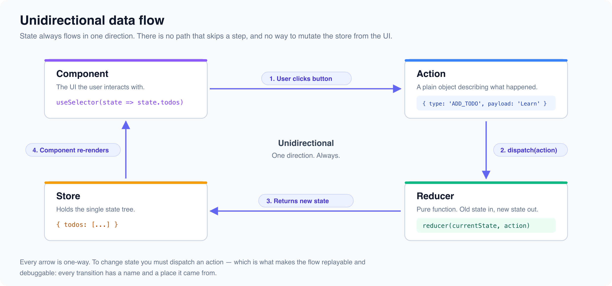

# Redux from Scratch: Core Principles

*6 min read · Updated 16 Jul 2026 Topic 21 of 62 Bookmark Mark done 4 · Topic 21 of 62*

**Source:** [https://www.geekyfrontend.in/learn/react-interview-kit/redux-from-scratch-core-principles](https://www.geekyfrontend.in/learn/react-interview-kit/redux-from-scratch-core-principles)

---

# 4.2 - Redux from Scratch: Core Principles

---

## 🎯 What Interviewers Actually Ask

| Question | Level | Frequency |
| --- | --- | --- |
| "What is Redux and how does it work?" | 🟡 | ★★★★★ |
| "What are the three core principles of Redux?" | 🟡 | ★★★★★ |
| "Explain the Redux data flow" | 🟡🔴 | ★★★★☆ |
| "What is the difference between local state and Redux state?" | 🟡 | ★★★★☆ |
| "What are actions, reducers, and the store?" | 🟡 | ★★★★★ |
| "What are the disadvantages of Redux?" | 🟡 | ★★★★☆ |

---

## What is Redux?

Redux is a predictable state container for JavaScript applications. It stores the entire application state in a single centralized object (the "store") and enforces strict rules about how that state can be updated.

The key word is **predictable**. In Redux, every state change follows the same pattern: an action is dispatched, the reducer processes it, and a new state is returned. There's no ambiguity about what happened, when, or why.

---

## The Three Principles

**1. Single source of truth.** The entire state of your application lives in one JavaScript object inside one store. This makes it easy to inspect, serialize, and debug.

**2. State is read-only.** The only way to change state is to dispatch an action (a plain object describing what happened). You never modify the state directly.

**3. Changes are made with pure functions.** Reducers are pure functions that take the previous state and an action, and return a new state. No side effects, no mutations.

---

## The Building Blocks

### Actions

An action is a plain JavaScript object with a `type` property that describes what happened. It can carry additional data in a `payload`.

jsx

```
// Action object
{ type: 'ADD_TODO', payload: { text: 'Learn Redux', id: 1 } }

// Action creator (a function that returns an action)
const addTodo = (text) => ({
  type: 'ADD_TODO',
  payload: { text, id: Date.now() },
});
```

### Reducers

A reducer takes the current state and an action, and returns the new state. It must be a pure function: same inputs always produce same outputs, no side effects.

jsx

```
const initialState = { todos: [], filter: 'all' };

function todoReducer(state = initialState, action) {
  switch (action.type) {
    case 'ADD_TODO':
      return {
        ...state,
        todos: [...state.todos, { ...action.payload, done: false }],
      };
    case 'TOGGLE_TODO':
      return {
        ...state,
        todos: state.todos.map(todo =>
          todo.id === action.payload ? { ...todo, done: !todo.done } : todo
        ),
      };
    case 'SET_FILTER':
      return { ...state, filter: action.payload };
    default:
      return state;
  }
}
```

### Store

The store holds the state tree and provides methods to interact with it. There's only one store per application.

jsx

```
import { createStore } from 'redux';

const store = createStore(todoReducer);

// Read current state
store.getState();

// Dispatch an action
store.dispatch(addTodo('Learn Redux'));

// Subscribe to state changes
const unsubscribe = store.subscribe(() => {
  console.log('State changed:', store.getState());
});
```

---

## The Redux Data Flow



The flow is always one-directional:

1. Something happens in the UI (user clicks a button)
2. The component dispatches an action
3. The reducer receives the current state and the action, returns a new state
4. The store updates with the new state
5. Connected components re-render with the new data

---

## Connecting Redux to React

Redux itself is framework-agnostic. The `react-redux` library connects it to React.

jsx

```
import { Provider, useSelector, useDispatch } from 'react-redux';
import { configureStore } from '@reduxjs/toolkit';

// Wrap your app with Provider
function Root() {
  return (
    <Provider store={store}>
      <App />
    </Provider>
  );
}

// Read state with useSelector
function TodoCount() {
  const count = useSelector(state => state.todos.length);
  return <p>{count} todos</p>;
}

// Dispatch actions with useDispatch
function AddTodoButton() {
  const dispatch = useDispatch();

  return (
    <button onClick={() => dispatch(addTodo('New task'))}>
      Add Todo
    </button>
  );
}
```

`useSelector` takes a selector function that picks out the piece of state you need. The component only re-renders when that specific piece changes, not on every store update. This is a major performance advantage over Context.

---

## Local State vs Redux State

|  | Local State (useState) | Redux State |
| --- | --- | --- |
| **Scope** | One component | Global, any component |
| **Managed by** | The component itself | Redux store externally |
| **Performance** | Fast for small apps | Optimized for large apps with selectors |
| **Complexity** | Minimal | More setup (actions, reducers, store) |
| **Debugging** | React DevTools | Redux DevTools with time travel |
| **Testing** | Simple unit tests | Reducers are pure functions, easy to test in isolation |

---

## Disadvantages of Redux

This is a common interview question. Knowing the drawbacks shows maturity.

1. **Boilerplate.** Even simple state requires defining actions, action types, reducers, and wiring them up. Redux Toolkit reduces this significantly (next article).
2. **Learning curve.** Actions, reducers, dispatch, selectors, middleware: there's a lot to learn before you can be productive.
3. **Overkill for small apps.** If your app has 5 components and 2 pieces of shared state, Redux adds complexity without benefit.
4. **Verbosity grows with the app.** Without discipline, the store can become a dumping ground for every piece of state, even things that should be local.

---

## ⚡ Common Mistakes

**Mistake 1: Mutating state in the reducer.** Reducers must return new objects. `state.todos.push(item)` mutates the existing array. Use spread syntax or array methods that return new arrays.

**Mistake 2: Putting everything in Redux.** Form field values, modal open/close, hover states: keep these in local component state.

**Mistake 3: Large monolithic reducers.** Split your reducer into multiple smaller reducers by feature and combine them with `combineReducers`.

---

## 🗣️ Interview Answer

> "Redux is a predictable state management library built on three principles: single source of truth (one store), read-only state (changes only through actions), and pure functions (reducers return new state without mutations). The flow is always unidirectional: the component dispatches an action, the reducer processes it and returns new state, the store updates, and connected components re-render. I connect Redux to React using react-redux's Provider, useSelector, and useDispatch. The main advantage is predictability and debugging with time-travel. The main disadvantage is boilerplate, which Redux Toolkit largely solves."

---

## ✅ Key Takeaways

- Redux is a **predictable** state container with three principles: single store, read-only state, pure reducer functions.
- **Actions** describe what happened. **Reducers** compute the new state. The **store** holds everything.
- Data flow is **unidirectional**: UI dispatches action, reducer returns new state, store updates, UI re-renders.
- `react-redux` connects Redux to React: `Provider` for the store, `useSelector` to read, `useDispatch` to write.
- `useSelector` only re-renders the component when the selected value changes (better than Context).
- **Disadvantages:** boilerplate, learning curve, overkill for small apps.
- **Never mutate** state inside a reducer. Always return new objects/arrays.

---

## Learn More

- [Redux Fundamentals — Overview redux.js.org](https://redux.js.org/tutorials/fundamentals/part-1-overview)
- [Redux — Getting Started redux.js.org](https://redux.js.org/introduction/getting-started)
- [Redux tutorial for beginners YouTube](https://www.youtube.com/watch?v=wl_t7b7u0d4)
- [Introduction to Redux — what is Redux? YouTube](https://www.youtube.com/watch?v=hMIGj1690QA)
- [Redux — beginner to advanced YouTube](https://www.youtube.com/watch?v=zrs7u6bdbUw)
