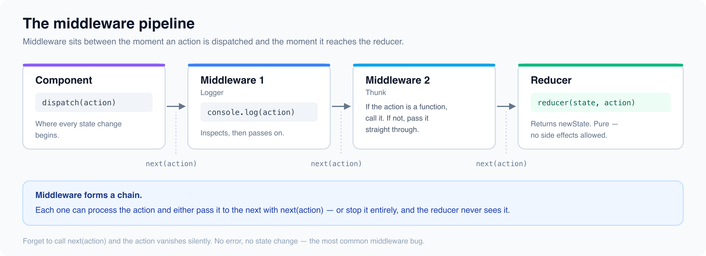

# Redux Middleware & Side Effects

*4 min read · Updated 16 Jul 2026 Topic 23 of 62 Bookmark Mark done 4 · Topic 23 of 62*

**Source:** [https://www.geekyfrontend.in/learn/react-interview-kit/redux-middleware-side-effects](https://www.geekyfrontend.in/learn/react-interview-kit/redux-middleware-side-effects)

---

# 4.4 - Redux Middleware & Side Effects

---

## 🎯 What Interviewers Actually Ask

| Question | Level | Frequency |
| --- | --- | --- |
| "What is middleware in Redux?" | 🟡🔴 | ★★★★☆ |
| "What is redux-thunk?" | 🟡🔴 | ★★★★☆ |
| "How would you write a custom middleware?" | 🔴 | ★★★☆☆ |
| "What is the difference between thunk and saga?" | 🔴 | ★★★☆☆ |

---

## What is Middleware?

Middleware sits between the moment an action is dispatched and the moment it reaches the reducer. It can inspect actions, modify them, delay them, replace them, or trigger side effects like API calls and logging.



Think of middleware as a pipeline of functions. Each one gets a chance to do something with the action before it reaches the reducer.

---

## redux-thunk (Included in RTK by Default)

A thunk is a function that returns another function. In Redux, it lets you dispatch a function instead of a plain action object. That function can contain async logic.

Redux Toolkit includes `redux-thunk` automatically. You don't need to install or configure it.

jsx

```
// Without thunk: you can only dispatch plain objects
dispatch({ type: 'ADD_TODO', payload: 'Learn Redux' });

// With thunk: you can dispatch a function that does async work
dispatch(async (dispatch, getState) => {
  dispatch({ type: 'FETCH_START' });
  try {
    const data = await fetch('/api/data').then(r => r.json());
    dispatch({ type: 'FETCH_SUCCESS', payload: data });
  } catch (err) {
    dispatch({ type: 'FETCH_ERROR', payload: err.message });
  }
});
```

In practice, you use `createAsyncThunk` from RTK instead of writing thunks manually (covered in 4.3).

---

## Writing a Custom Middleware

Every middleware has the same signature: `store => next => action => {}`.

### Logger middleware

jsx

```
const loggerMiddleware = (store) => (next) => (action) => {
  console.log('Dispatching:', action.type);
  console.log('Current state:', store.getState());

  const result = next(action);  // Pass the action to the next middleware or reducer

  console.log('Next state:', store.getState());
  return result;
};
```

### Crash reporter middleware

jsx

```
const crashReporter = (store) => (next) => (action) => {
  try {
    return next(action);
  } catch (err) {
    console.error('Redux error:', err);
    reportToService(err, { action, state: store.getState() });
    throw err;
  }
};
```

### Adding custom middleware to the store

jsx

```
import { configureStore } from '@reduxjs/toolkit';

const store = configureStore({
  reducer: rootReducer,
  middleware: (getDefaultMiddleware) =>
    getDefaultMiddleware().concat(loggerMiddleware, crashReporter),
});
```

`getDefaultMiddleware()` returns the default middleware array (which includes thunk). `.concat()` adds yours after the defaults.

---

## Thunk vs Saga (Brief Comparison)

This is a senior interview question. You don't need to know Saga in depth, but you should understand the tradeoff.

|  | Redux Thunk | Redux Saga |
| --- | --- | --- |
| **Learning curve** | Low (just functions) | High (generators, effects) |
| **Syntax** | Regular async/await | Generator functions with `yield` |
| **Complexity** | Simple async flows | Complex flows with cancellation, racing, retries |
| **Testing** | Requires mocking API calls | Effects are declarative descriptions, easier to test |
| **When to use** | Most apps. Simple to moderate async logic. | Apps with complex async workflows (e.g., real-time data, multi-step processes) |
| **Included in RTK?** | Yes | No (separate install) |

For the vast majority of projects, thunks (especially `createAsyncThunk`) are sufficient. Sagas are only worth the complexity if your async flows involve things like cancellation, debouncing at the Redux level, or coordinating multiple parallel requests.

---

## ⚡ Common Mistakes

**Mistake 1: Calling** `next(action)` **more than once.** Each middleware should call `next(action)` exactly once. Calling it multiple times processes the action through the remaining pipeline multiple times.

**Mistake 2: Forgetting to return** `next(action)`**.** If you don't return the result, the dispatch call in your component returns `undefined` instead of the action (or thunk result).

**Mistake 3: Doing async work directly in a reducer.** Reducers must be pure and synchronous. All async logic belongs in middleware (thunks) or in the component (useEffect).

---

## 🗣️ Interview Answer

> "Middleware in Redux sits between dispatch and the reducer. It can intercept, modify, delay, or augment actions. The most common middleware is redux-thunk, which lets you dispatch functions instead of plain objects, enabling async logic like API calls. Redux Toolkit includes thunk by default. For custom middleware, the signature is `store => next => action => {}`, where `next` passes the action to the next middleware in the chain. I've written custom middleware for logging and error reporting. For most async needs, createAsyncThunk from RTK is enough. I'd only consider redux-saga if the app has complex async workflows with cancellation or parallel coordination."

---

## ✅ Key Takeaways

- **Middleware** sits between dispatch and reducer, forming a processing pipeline for actions.
- **redux-thunk** lets you dispatch functions (not just objects) for async operations. Included in RTK by default.
- Custom middleware signature: `store => next => action => {}`. Call `next(action)` to pass it along.
- Use `getDefaultMiddleware().concat(myMiddleware)` in `configureStore` to add custom middleware.
- **Thunks** are sufficient for most apps. **Sagas** are for complex async coordination (rare).
- Reducers must be **pure and synchronous**. All async work happens in middleware or components.

---

## Learn More

- [Redux Middleware — concepts redux.js.org](https://redux.js.org/understanding/history-and-design/middleware)
- [Redux Toolkit — Quick Start (thunks) redux.js.org](https://redux.js.org/tutorials/quick-start)
- [Redux middleware: thunk, saga & custom YouTube](https://www.youtube.com/watch?v=hVANZEQJFI4)
- [What is Redux Thunk middleware? YouTube](https://www.youtube.com/watch?v=1MoArYk7BA4)
- [Redux Thunk crash course YouTube](https://www.youtube.com/watch?v=lSSQ1r8zgtY)
