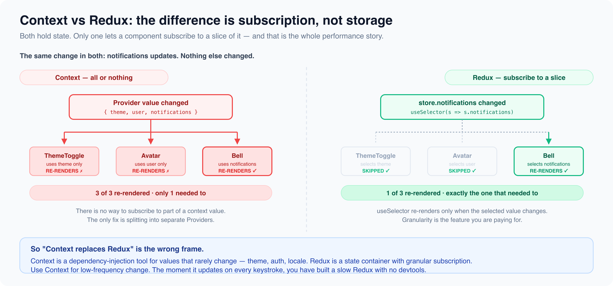

# Context API vs Redux: The Real Answer

*6 min read · Updated 16 Jul 2026 Topic 24 of 62 Bookmark Mark done 4 · Topic 24 of 62*

**Source:** [https://www.geekyfrontend.in/learn/react-interview-kit/context-api-vs-redux-the-real-answer](https://www.geekyfrontend.in/learn/react-interview-kit/context-api-vs-redux-the-real-answer)

---

# 4.5 - Context API vs Redux: The Real Answer

---

## 🎯 What Interviewers Actually Ask

| Question | Level | Frequency |
| --- | --- | --- |
| "When would you use Context API vs Redux?" | 🟡🔴 | ★★★★★ |
| "Can Context replace Redux?" | 🟡🔴 | ★★★★☆ |
| "What are the performance differences?" | 🔴 | ★★★★☆ |
| "What is your state management approach for large apps?" | 🔴 | ★★★★☆ |

---

## They Solve Different Problems

This is the most important thing to understand, and most candidates miss it. Context is a **dependency injection mechanism** (a way to pass values down the tree). Redux is a **state management library** (a way to manage, update, and debug complex state).

Comparing them is like comparing a pipe to a water treatment plant. One transports data, the other processes it.

That said, Context + useReducer can be combined to create a state management solution. And that's where the real comparison begins.

---

## The Complete Comparison

| Feature | Context + useReducer | Redux (with RTK) |
| --- | --- | --- |
| **Setup complexity** | Minimal. Create context, write reducer, wrap provider. | More setup. Install packages, configure store, create slices. |
| **Boilerplate** | Low | Low with RTK (high with classic Redux) |
| **Performance** | All consumers re-render when value changes. No selectors. | Components only re-render when their selected state changes. |
| **DevTools** | None built-in | Redux DevTools with time travel, action log, state diff |
| **Middleware** | None. Side effects go in useEffect. | Built-in middleware pipeline (thunk, saga, custom) |
| **Async handling** | Manual (useEffect + dispatch) | createAsyncThunk with pending/fulfilled/rejected lifecycle |
| **Scalability** | Works for small to medium apps | Designed for large, complex apps |
| **Testing** | Test reducers independently (same as Redux) | Test reducers, thunks, and selectors independently |
| **Community/ecosystem** | Built into React, no extras | Huge ecosystem: RTK Query, middleware, devtools extensions |

---

## Performance: The Critical Difference

This is where most people get it wrong when they say "Context replaces Redux."

**Context:** When the Provider value changes, *every* component that calls `useContext(ThatContext)` re-renders. There's no way to subscribe to just a part of the context value.

jsx

```
// Every component calling useContext(AppContext) re-renders
// when ANY part of this value changes
<AppContext.Provider value={{ user, theme, cart, notifications }}>
```

If `notifications` updates but a component only uses `theme`, it still re-renders. For low-frequency changes (theme toggle, auth login/logout), this is fine. For frequent changes (typing in a search box, real-time data), it causes performance problems.

**Redux:** `useSelector` only triggers a re-render when the specific piece of state you selected changes. This is granular and efficient.

jsx

```
// Only re-renders when state.theme changes, ignores everything else
const theme = useSelector(state => state.theme);
```

---



## The Decision Tree

When to use **Context**:

- Theme (light/dark mode)
- Authenticated user info
- Locale/language setting
- Any value that changes infrequently and is needed by many components

When to use **Redux**:

- Shopping cart in an e-commerce app
- Complex form state across multiple pages
- Real-time data (notifications, chat, live feeds)
- State that needs middleware (logging, analytics, offline sync)
- Debugging needs (time travel, action replay)
- Large team where predictable state management prevents bugs

When to use **neither** (just React):

- Small apps with a few components
- State that's only needed by one component or its immediate children
- Prototypes and MVPs

---

## The Interview-Winning Answer

Most candidates say "Context for small apps, Redux for big apps." That's true but shallow. Here's the answer that shows depth:

> "Context and Redux solve different problems. Context is a dependency injection mechanism. Redux is a full state management system. Context + useReducer gives you Redux-like patterns for free, which works great for low-frequency, app-wide state like auth and theme. But Context has no selectors, so every consumer re-renders on any change, which makes it unsuitable for high-frequency updates. Redux with useSelector gives you granular re-rendering, plus middleware for side effects and DevTools for debugging.
>
> My approach: I keep most state local with useState. I use Context for a few global values (auth, theme). If the app grows to need complex state transitions, middleware, or I find myself debugging state issues that time-travel would solve, I reach for Redux Toolkit. For server data, I use React Query instead of putting API responses in Redux."

---

## The Modern Stack (What Senior Developers Actually Use)

In practice, most production apps in 2025 use a combination:

| Layer | Tool | Handles |
| --- | --- | --- |
| Local UI state | `useState`, `useReducer` | Form fields, toggles, UI-only state |
| Global UI state | Context or Zustand | Theme, auth, sidebar collapsed |
| Server/async state | React Query (TanStack Query) or RTK Query | API data, caching, refetching |
| Complex global state | Redux Toolkit (if needed) | Cart, complex workflows, state machines |

The trend is moving **away** from putting everything in Redux and toward specialized tools for each type of state. Server state management libraries like React Query handle caching, background refetching, and stale-while-revalidate patterns that would require hundreds of lines of Redux code.

---

## ⚡ Common Mistakes

**Mistake 1: Saying "Context replaces Redux."** Context is a transport mechanism, not a state management solution. You can build one with Context + useReducer, but it lacks selectors, devtools, and middleware.

**Mistake 2: Using Redux for server state.** Managing loading/data/error for every API endpoint in Redux creates massive boilerplate. Use React Query, SWR, or RTK Query instead.

**Mistake 3: Starting with Redux before you need it.** Build with React's built-in tools first. Add Redux only when you hit a real pain point that React alone can't solve cleanly.

---

## ✅ Key Takeaways

- Context is for **dependency injection** (passing values down the tree). Redux is for **state management** (managing complex, global state with middleware and devtools).
- Context re-renders **all consumers** on any change. Redux `useSelector` re-renders **only when selected state changes**. This is the critical performance difference.
- Use Context for **low-frequency global values** (theme, auth, locale).
- Use Redux for **complex, high-frequency global state** that needs middleware, devtools, or predictable transitions.
- Use **React Query/RTK Query** for server state (API data). Don't put everything in Redux.
- The modern approach is **specialized tools for each state type**, not one tool for everything.

---

## 📚 Module 4 Complete!

| # | Article | Core Concept |
| --- | --- | --- |
| 4.1 | When & Why You Need State Management | Four types of state, co-location, decision framework |
| 4.2 | Redux Core Principles | Actions, reducers, store, unidirectional flow |
| 4.3 | Redux Toolkit | createSlice, configureStore, createAsyncThunk, Immer |
| 4.4 | Middleware & Side Effects | Middleware pipeline, thunk, custom middleware, thunk vs saga |
| 4.5 | Context API vs Redux | Performance differences, decision tree, modern stack |

---

## Learn More

- [Passing Data Deeply with Context react.dev](https://react.dev/learn/passing-data-deeply-with-context)
- [Redux FAQ — When should I use Redux? redux.js.org](https://redux.js.org/faq/general)
- [Redux vs Context API — which one? YouTube](https://www.youtube.com/watch?v=n0Cvo2MrJbk)
- [Redux vs Context API — interview take YouTube](https://www.youtube.com/watch?v=hh4Jxd9ZZ5M)
- [React Context vs Redux — who wins? YouTube](https://www.youtube.com/watch?v=OvM4hIxrqAw)
