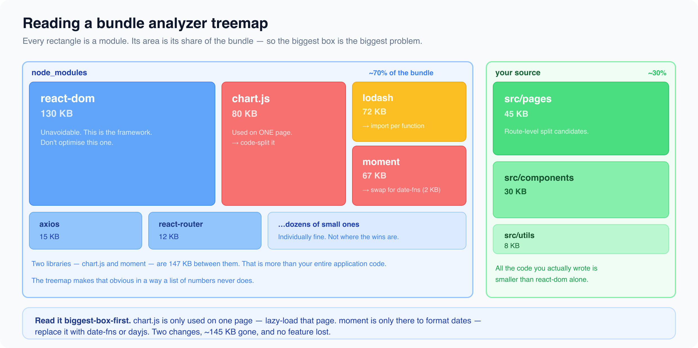

# Code Splitting, Lazy Loading & Suspense Deep Dive

*5 min read · Updated 16 Jul 2026 Topic 26 of 62 Bookmark Mark done 5 · Topic 26 of 62*

**Source:** [https://www.geekyfrontend.in/learn/react-interview-kit/code-splitting-lazy-loading-suspense-deep-dive](https://www.geekyfrontend.in/learn/react-interview-kit/code-splitting-lazy-loading-suspense-deep-dive)

---

# 5.2 - Code Splitting, Lazy Loading & Suspense Deep Dive

---

## 🎯 What Interviewers Actually Ask

| Question | Level | Frequency |
| --- | --- | --- |
| "How does code splitting improve performance?" | 🟡🔴 | ★★★★☆ |
| "What is dynamic import?" | 🟡 | ★★★☆☆ |
| "How do you analyze your bundle size?" | 🔴 | ★★★☆☆ |
| "What is tree shaking?" | 🟡 | ★★★☆☆ |

---

## How Bundling Works

When you build a React app, the bundler (Webpack, Vite, esbuild) takes all your JavaScript files, their dependencies, and third-party libraries, and combines them into one or a few output files. For a small app, this single bundle might be 100KB. For a large app with heavy libraries, it can balloon to several megabytes.

The user has to download this entire bundle before anything appears on screen. Code splitting breaks that single bundle into multiple smaller chunks that load on demand.

---

## Dynamic Import: The Foundation

The standard `import` statement is static. It loads the module at build time and includes it in the main bundle.

jsx

```
// Static import: always included in the main bundle
import { Chart } from 'chart.js';
```

A dynamic `import()` is a function call that returns a Promise. The bundler sees it and creates a separate chunk that only loads when the import is actually executed.

jsx

```
// Dynamic import: creates a separate chunk, loaded on demand
const module = await import('chart.js');
const Chart = module.Chart;
```

React.lazy uses dynamic import under the hood. But you can also use dynamic import directly in event handlers or useEffect to load heavy libraries only when needed.

jsx

```
function ChartPage() {
  const [ChartComponent, setChartComponent] = useState(null);

  const loadChart = async () => {
    const { Chart } = await import('chart.js');
    // Now use Chart only when the user actually needs it
  };

  return <button onClick={loadChart}>Show Chart</button>;
}
```

---

## Bundle Analysis

You can't optimize what you can't see. Bundle analyzers visualize what's inside your bundle and how much space each dependency takes.

For **Webpack**: use `webpack-bundle-analyzer`. It generates an interactive treemap showing every module and its size.

For **Vite**: use `rollup-plugin-visualizer`.

bash

```
# Webpack
npm install --save-dev webpack-bundle-analyzer

# Vite
npm install --save-dev rollup-plugin-visualizer
```



Common findings and fixes:

| Finding | Fix |
| --- | --- |
| Large library used on one page | Lazy load that page |
| Entire lodash imported | Use `lodash/specific-function` instead of full import |
| moment.js (67KB+) | Replace with date-fns or dayjs (2KB) |
| Duplicate dependencies | Check for version conflicts in package-lock.json |
| Unused exports | Enable tree shaking (use ES modules, not CommonJS) |

---

## Tree Shaking

Tree shaking is a technique where the bundler removes code that is imported but never actually used. It works automatically with ES module syntax (`import`/`export`).

jsx

```
// ✅ Tree-shakeable: bundler can remove unused exports
import { debounce } from 'lodash-es';
// Only debounce is included in the bundle

// ❌ Not tree-shakeable: pulls in the entire library
const _ = require('lodash');
_.debounce(fn, 300);
// Entire lodash (72KB) goes into the bundle
```

For tree shaking to work:

1. Use **ES module syntax** (import/export), not CommonJS (require/module.exports)
2. Use libraries that ship ES modules (lodash-es instead of lodash)
3. Avoid side effects in modules (or mark them in package.json)

---

## Suspense Boundaries: Strategic Placement

From Article 3.3, you know Suspense provides a fallback while lazy components load. The strategy is about *where* to put the boundaries.

jsx

```
// Strategy 1: One boundary at the top (simple, but jarring transitions)
<Suspense fallback={<FullPageSpinner />}>
  <Routes>
    <Route path="/dashboard" element={<Dashboard />} />
    <Route path="/settings" element={<Settings />} />
  </Routes>
</Suspense>

// Strategy 2: Per-route boundaries with skeleton screens (better UX)
<Routes>
  <Route path="/dashboard" element={
    <Suspense fallback={<DashboardSkeleton />}>
      <Dashboard />
    </Suspense>
  } />
  <Route path="/settings" element={
    <Suspense fallback={<SettingsSkeleton />}>
      <Settings />
    </Suspense>
  } />
</Routes>

// Strategy 3: Per-section within a page (best UX for complex pages)
function Dashboard() {
  return (
    <div>
      <Header />  {/* Loads immediately */}
      <Suspense fallback={<ChartSkeleton />}>
        <LazyChartWidget />  {/* Loads on demand */}
      </Suspense>
      <Suspense fallback={<TableSkeleton />}>
        <LazyDataTable />  {/* Loads independently */}
      </Suspense>
    </div>
  );
}
```

Strategy 3 is what production apps use. Different sections of a page load independently, with their own skeleton loaders. The page feels fast because the lightweight parts appear instantly.

---

## ⚡ Common Mistakes

**Mistake 1: Not analyzing your bundle.** Most developers have no idea that 60% of their bundle is unused lodash or an enormous date library. Run an analyzer before optimizing anything else.

**Mistake 2: Lazy loading small components.** The overhead of creating a separate chunk and loading it over the network is worse than just including a 5KB component in the main bundle. Only lazy load page-level components or heavy libraries.

**Mistake 3: Using CommonJS in a modern project.** `require()` prevents tree shaking. Use `import`/`export` for everything, and choose dependencies that ship ES modules.

---

## 🗣️ Interview Answer

> "Code splitting breaks the JavaScript bundle into smaller chunks that load on demand. I use React.lazy with dynamic import for route-level splitting, so users only download the code for pages they actually visit. For heavy third-party libraries like chart.js, I dynamically import them in event handlers or useEffect so they don't bloat the initial bundle. I always run a bundle analyzer to identify what's actually large. Tree shaking removes unused exports automatically when you use ES module syntax. For the loading experience, I place Suspense boundaries strategically with skeleton screens so different sections of a page load independently."

---

## ✅ Key Takeaways

- **Static import** bundles everything upfront. **Dynamic import()** creates separate chunks loaded on demand.
- **Bundle analysis** reveals what's actually large. Always analyze before optimizing.
- **Tree shaking** removes unused code. Requires ES module syntax (import/export, not require).
- Replace heavy libraries: moment.js with dayjs, lodash with lodash-es or specific imports.
- **Lazy load at the page/route level**, not small components.
- Place **Suspense boundaries** per-section for the best loading experience with skeleton screens.

---

## Learn More

- [lazy — API reference react.dev](https://react.dev/reference/react/lazy)
- [Suspense — API reference react.dev](https://react.dev/reference/react/Suspense)
- [React lazy loading explained (lazy + Suspense) YouTube](https://www.youtube.com/watch?v=wtW06D5MYbg)
- [Lazy loading & Suspense for performance YouTube](https://www.youtube.com/watch?v=MS2kbyWOXI8)
- [Code splitting & Suspense YouTube](https://www.youtube.com/watch?v=m1XU0AkPoPU)
