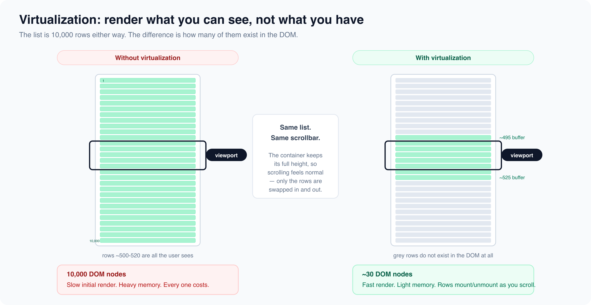

# Virtualization: Rendering 10,000 Rows

*4 min read · Updated 16 Jul 2026 Topic 27 of 62 Bookmark Mark done 5 · Topic 27 of 62*

**Source:** [https://www.geekyfrontend.in/learn/react-interview-kit/virtualization-rendering-10-000-rows](https://www.geekyfrontend.in/learn/react-interview-kit/virtualization-rendering-10-000-rows)

---

# 5.3 - Virtualization: Rendering 10,000 Rows

---

## 🎯 What Interviewers Actually Ask

| Question | Level | Frequency |
| --- | --- | --- |
| "How do you render a very large list efficiently?" | 🟡🔴 | ★★★★☆ |
| "What is virtualization / windowing?" | 🔴 | ★★★☆☆ |
| "Have you used react-window or react-virtualized?" | 🔴 | ★★★☆☆ |
| "How would you implement infinite scroll?" | 🟡🔴 | ★★★★☆ |

---

## The Problem

Rendering 10,000 DOM nodes is slow. Even if each row takes 0.5ms to render, 10,000 rows take 5 seconds. The browser then has to manage all those nodes for layout, paint, scrolling, and event handling.

But the user can only see maybe 20-30 rows at a time. Why render the other 9,970?

**Virtualization** (also called windowing) renders only the items that are currently visible in the viewport, plus a small buffer above and below for smooth scrolling. As the user scrolls, React mounts new items entering the viewport and unmounts items leaving it.



---

## react-window (Recommended)

`react-window` is the lightweight successor to `react-virtualized`. It covers the most common use cases with a much smaller bundle.

bash

```
npm install react-window
```

### Fixed-size list

jsx

```
import { FixedSizeList } from 'react-window';

function VirtualizedList({ items }) {
  const Row = ({ index, style }) => (
    <div style={style} className="row">
      {items[index].name}
    </div>
  );

  return (
    <FixedSizeList
      height={500}        // Height of the scrollable container
      width="100%"
      itemCount={items.length}
      itemSize={50}        // Height of each row in pixels
    >
      {Row}
    </FixedSizeList>
  );
}
```

Even with 100,000 items, only ~10-15 DOM nodes exist at any time. The list scrolls smoothly because React only mounts/unmounts a few items as you scroll.

### Variable-size list

When rows have different heights:

jsx

```
import { VariableSizeList } from 'react-window';

function ChatMessages({ messages }) {
  const getItemSize = (index) => {
    // Short messages get 50px, long ones get 100px
    return messages[index].text.length > 100 ? 100 : 50;
  };

  const Row = ({ index, style }) => (
    <div style={style} className="message">
      <strong>{messages[index].sender}:</strong> {messages[index].text}
    </div>
  );

  return (
    <VariableSizeList
      height={600}
      width="100%"
      itemCount={messages.length}
      itemSize={getItemSize}
    >
      {Row}
    </VariableSizeList>
  );
}
```

---

## Infinite Scroll

Infinite scroll loads more data as the user scrolls near the bottom. You combine virtualization with the Intersection Observer API or a library like `react-window-infinite-loader`.

jsx

```
import { FixedSizeList } from 'react-window';
import InfiniteLoader from 'react-window-infinite-loader';

function InfiniteList({ hasMore, loadMore, items }) {
  const isItemLoaded = (index) => index < items.length;

  return (
    <InfiniteLoader
      isItemLoaded={isItemLoaded}
      itemCount={hasMore ? items.length + 1 : items.length}
      loadMoreItems={loadMore}
    >
      {({ onItemsRendered, ref }) => (
        <FixedSizeList
          ref={ref}
          onItemsRendered={onItemsRendered}
          height={600}
          width="100%"
          itemCount={items.length}
          itemSize={50}
        >
          {({ index, style }) => (
            <div style={style}>
              {items[index]?.name || 'Loading...'}
            </div>
          )}
        </FixedSizeList>
      )}
    </InfiniteLoader>
  );
}
```

### Manual Intersection Observer approach

If you don't want a library, use the browser's Intersection Observer:

jsx

```
function InfiniteScrollList({ fetchMore }) {
  const observerRef = useRef();
  const lastItemRef = useRef();

  useEffect(() => {
    observerRef.current = new IntersectionObserver(([entry]) => {
      if (entry.isIntersecting) {
        fetchMore();
      }
    });

    if (lastItemRef.current) {
      observerRef.current.observe(lastItemRef.current);
    }

    return () => observerRef.current?.disconnect();
  }, [fetchMore]);

  return (
    <ul>
      {items.map((item, i) => (
        <li key={item.id} ref={i === items.length - 1 ? lastItemRef : null}>
          {item.name}
        </li>
      ))}
    </ul>
  );
}
```

---

## When to Virtualize

Not every list needs virtualization. Here's the threshold:

| Item count | Recommendation |
| --- | --- |
| Under 100 | No optimization needed. Render normally. |
| 100 to 500 | Probably fine, but profile if you notice lag |
| 500 to 5,000 | Consider virtualization |
| Over 5,000 | Definitely virtualize |

---

## ⚡ Common Mistakes

**Mistake 1: Virtualizing short lists.** If your list has 50 items, virtualization adds complexity without benefit. The overhead of the windowing library might actually make it slower.

**Mistake 2: Forgetting the** `style` **prop.** react-window passes a `style` prop to each row for positioning. If you don't apply it, all rows stack on top of each other.

**Mistake 3: Not handling dynamic content.** If row height depends on content (text length, images), use `VariableSizeList` instead of `FixedSizeList`. Otherwise items will overlap.

---

## 🗣️ Interview Answer

> "When I need to render thousands of items, I use virtualization. Instead of rendering all 10,000 rows to the DOM, I render only the 20-30 that are visible in the viewport. As the user scrolls, new items mount and old ones unmount. I use react-window for this because it's lightweight and covers both fixed and variable-size lists. For infinite scroll, I combine it with Intersection Observer to trigger data fetching when the user approaches the bottom. I only virtualize when the list exceeds a few hundred items. For short lists, it's unnecessary overhead."

---

## ✅ Key Takeaways

- **Virtualization** renders only visible items, keeping the DOM small and fast.
- Use `react-window` for most cases. `FixedSizeList` for uniform rows, `VariableSizeList` for dynamic heights.
- **Always apply the** `style` **prop** from react-window to each row for correct positioning.
- **Infinite scroll** combines virtualization with Intersection Observer to load data on demand.
- Only virtualize lists with **hundreds or thousands** of items. Short lists don't need it.

---

## Learn More

- [react-window (windowing library) github.com](https://github.com/bvaughn/react-window)
- [TanStack Virtual github.com](https://github.com/TanStack/virtual)
- [Render large lists with react-window YouTube](https://www.youtube.com/watch?v=8glwCms18rQ)
- [Efficiently render 100,000 rows YouTube](https://www.youtube.com/watch?v=MFtvsEe2rUA)
- [Build a virtualized list from scratch YouTube](https://www.youtube.com/watch?v=Yz4eK-4LKXg)
