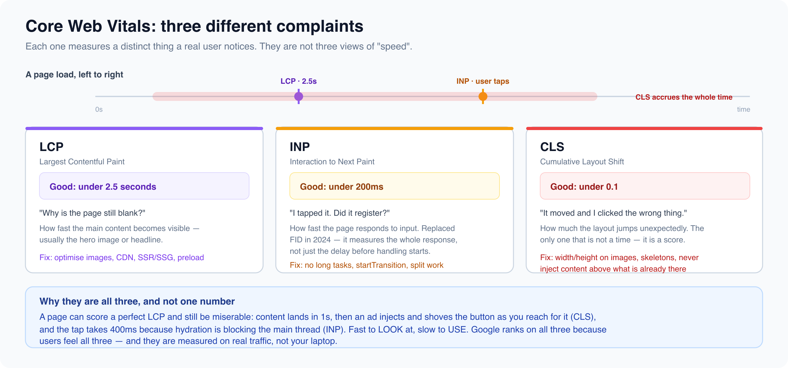

# Web Vitals, Tree Shaking & Bundle Optimization

*5 min read · Updated 16 Jul 2026 Topic 29 of 62 Bookmark Mark done 5 · Topic 29 of 62*

**Source:** [https://www.geekyfrontend.in/learn/react-interview-kit/web-vitals-tree-shaking-bundle-optimization](https://www.geekyfrontend.in/learn/react-interview-kit/web-vitals-tree-shaking-bundle-optimization)

---

# 5.5 - Web Vitals, Tree Shaking & Bundle Optimization

---

## 🎯 What Interviewers Actually Ask

| Question | Level | Frequency |
| --- | --- | --- |
| "What are Core Web Vitals?" | 🟡🔴 | ★★★☆☆ |
| "What is LCP, FID, CLS?" | 🔴 | ★★★☆☆ |
| "What is tree shaking?" | 🟡 | ★★★☆☆ |
| "What is the difference between CSR and SSR?" | 🟡🔴 | ★★★★☆ |
| "How do you reduce bundle size?" | 🟡🔴 | ★★★★☆ |

---

## Core Web Vitals

Google uses Core Web Vitals as ranking factors for search. They measure real user experience, not just server response time.

| Metric | What it measures | Good threshold | How to improve |
| --- | --- | --- | --- |
| **LCP** (Largest Contentful Paint) | How fast the main content becomes visible | Under 2.5 seconds | Optimize images, use CDN, SSR/SSG, preload critical assets |
| **INP** (Interaction to Next Paint) | How fast the page responds to user input | Under 200ms | Avoid long tasks on main thread, use `startTransition`, split heavy computations |
| **CLS** (Cumulative Layout Shift) | How much the page layout shifts unexpectedly | Under 0.1 | Set explicit width/height on images, use skeleton screens, avoid injecting content above existing content |

INP replaced FID (First Input Delay) in March 2024 as a Core Web Vital. Some interviewers still ask about FID, but INP is the current standard.

---



## Client-Side Rendering vs Server-Side Rendering

This is one of the most common senior interview questions.

|  | CSR (Client-Side Rendering) | SSR (Server-Side Rendering) | SSG (Static Site Generation) |
| --- | --- | --- | --- |
| **How it works** | Browser downloads JS bundle, executes it, then renders the page | Server renders HTML, sends it to browser, then JS hydrates it | HTML is generated at build time, served as static files |
| **Initial load** | Slower (blank page until JS loads and executes) | Faster (HTML appears immediately) | Fastest (pre-built HTML, no server processing) |
| **SEO** | Poor (search crawlers may not execute JS) | Good (fully rendered HTML for crawlers) | Best (static HTML, instantly indexable) |
| **Subsequent navigation** | Fast (no server round trips, client-side routing) | Depends on implementation | Fast with client-side hydration |
| **Server cost** | Low (static hosting works) | Higher (server renders on every request) | Lowest (CDN serves static files) |
| **Best for** | Dashboards, internal tools, apps behind login | Content sites, e-commerce, SEO-critical pages | Blogs, docs, marketing sites, landing pages |
| **Framework** | Create React App, Vite | Next.js, Remix | Next.js (getStaticProps), Astro, Gatsby |

**Hydration** is the process where React attaches event listeners and state to the server-rendered HTML, making it interactive. The HTML is visible immediately, but the page becomes fully interactive only after hydration completes.

---

## Bundle Size Optimization Strategies

### 1. Analyze what's in your bundle

Run a bundle analyzer (covered in 5.2) to see what's actually large.

### 2. Replace heavy dependencies

| Heavy library | Lightweight alternative | Size savings |
| --- | --- | --- |
| moment.js (72KB) | dayjs (2KB) or date-fns (tree-shakeable) | ~70KB |
| lodash (72KB) | lodash-es (tree-shakeable) or native JS | Up to 72KB |
| axios (14KB) | Native fetch API | 14KB |
| classnames (2KB) | Template literals or clsx (0.5KB) | Small but adds up |

### 3. Use tree shaking properly

Import only what you use, using named imports from ES module packages.

jsx

```
// ❌ Imports the entire library
import _ from 'lodash';
_.debounce(fn, 300);

// ✅ Imports only debounce (tree-shakeable with lodash-es)
import { debounce } from 'lodash-es';
debounce(fn, 300);

// ✅ Or import the specific module directly
import debounce from 'lodash/debounce';
debounce(fn, 300);
```

### 4. Compress and minify

Modern bundlers (Vite, Webpack 5) handle minification automatically in production builds. Ensure your server sends assets with gzip or brotli compression.

### 5. Use a CDN for static assets

Serve JavaScript, CSS, images, and fonts from a CDN (Cloudflare, AWS CloudFront, Vercel Edge) to reduce latency for users around the world.

### 6. Optimize images

Images are often the largest assets on a page. Use modern formats (WebP, AVIF), responsive sizes (srcset), and lazy loading (`loading="lazy"` attribute).

jsx

```

```

---

## Measuring Web Vitals in React

jsx

```
import { onLCP, onINP, onCLS } from 'web-vitals';

onLCP(metric => console.log('LCP:', metric.value));
onINP(metric => console.log('INP:', metric.value));
onCLS(metric => console.log('CLS:', metric.value));
```

Or use Lighthouse in Chrome DevTools (Ctrl+Shift+I, then Lighthouse tab) for a full audit with actionable recommendations.

---

## ⚡ Common Mistakes

**Mistake 1: Ignoring images.** Developers spend hours optimizing JavaScript bundle size while serving uncompressed 5MB hero images. Images are usually the biggest payload.

**Mistake 2: Using CSR for SEO-critical pages.** Search engines may not execute JavaScript, so CSR pages can appear empty to crawlers. Use SSR or SSG for pages that need to rank in search results.

**Mistake 3: Not setting image dimensions.** Without explicit width and height, images cause layout shifts (CLS) when they load. Always set dimensions or use aspect-ratio CSS.

---

## 🗣️ Interview Answer

> "Core Web Vitals measure real user experience: LCP for loading speed, INP for interactivity, and CLS for visual stability. For loading performance, I optimize the bundle with tree shaking, code splitting, and replacing heavy libraries like moment.js with lighter alternatives. I analyze the bundle to find what's actually large. For SEO-critical pages, I use SSR or SSG with Next.js instead of pure client-side rendering. For images, I use modern formats like WebP, lazy loading, and explicit dimensions to prevent layout shifts. I serve static assets from a CDN with compression. And I always measure with Lighthouse before and after changes to validate the improvements."

---

## ✅ Key Takeaways

- **Core Web Vitals:** LCP (loading), INP (interactivity), CLS (visual stability). Google uses them for SEO ranking.
- **CSR** for dashboards/internal tools. **SSR** for SEO-critical pages. **SSG** for static content.
- **Tree shaking** removes unused code. Requires ES module imports (not require).
- **Replace heavy dependencies:** moment.js with dayjs, full lodash with lodash-es or native JS.
- **Images are usually the biggest payload.** Use WebP/AVIF, lazy loading, explicit dimensions.
- **Bundle analysis** first, optimization second.
- **CDN + compression** for all static assets.
- **Measure with Lighthouse and web-vitals library** before and after changes.

---

## 📚 Module 5 Complete!

| # | Article | Core Concept |
| --- | --- | --- |
| 5.1 | Performance Toolkit | Profiling tools, the seven optimization strategies, the checklist |
| 5.2 | Code Splitting Deep Dive | Dynamic import, bundle analysis, tree shaking, Suspense strategies |
| 5.3 | Virtualization | react-window, infinite scroll, when to virtualize |
| 5.4 | Memoization Strategies | When memoization helps, when it hurts, the decision flowchart |
| 5.5 | Web Vitals & Bundle Optimization | LCP/INP/CLS, CSR vs SSR vs SSG, image optimization, CDN |

---

## Learn More

- [Web Vitals web.dev](https://web.dev/articles/vitals)
- [Tree shaking (MDN glossary) MDN](https://developer.mozilla.org/en-US/docs/Glossary/Tree_shaking)
- [Tree shaking — optimize bundle size YouTube](https://www.youtube.com/watch?v=MUSoj2JcD4A)
- [Perfect web vitals (Next.js) YouTube](https://www.youtube.com/watch?v=Sk2XRK3tO-A)
- [Make your JS bundle smaller YouTube](https://www.youtube.com/watch?v=kwUfeWe7DCw)
