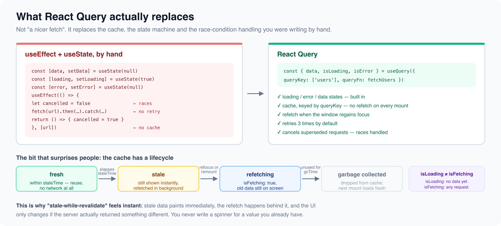

# Fetching Data: fetch vs axios vs React Query

*6 min read · Updated 16 Jul 2026 Topic 36 of 62 Bookmark Mark done 8 · Topic 36 of 62*

**Source:** [https://www.geekyfrontend.in/learn/react-interview-kit/fetching-data-fetch-vs-axios-vs-react-query](https://www.geekyfrontend.in/learn/react-interview-kit/fetching-data-fetch-vs-axios-vs-react-query)

---

# 8.1 - Fetching Data: fetch vs axios vs React Query

---

## 🎯 What Interviewers Actually Ask

| Question | Level | Frequency |
| --- | --- | --- |
| "How do you make API calls in React?" | 🟢🟡 | ★★★★★ |
| "What is the difference between fetch and axios?" | 🟡 | ★★★★☆ |
| "What is React Query / TanStack Query?" | 🟡🔴 | ★★★★☆ |
| "Where should API calls go in a React component?" | 🟢 | ★★★★★ |

---

## Where to Make API Calls

API calls are side effects. They go inside `useEffect` (or in event handlers for user-triggered actions like form submission). Never put API calls directly in the component function body, because that runs on every render.

jsx

```
// ✅ Inside useEffect for data that loads on mount
useEffect(() => {
  fetch('/api/users').then(r => r.json()).then(setUsers);
}, []);

// ✅ Inside an event handler for user-triggered actions
const handleSubmit = async () => {
  await fetch('/api/orders', { method: 'POST', body: JSON.stringify(order) });
};

// ❌ Never in the component body directly
function UserList() {
  const data = fetch('/api/users');  // Runs on every render, causes infinite loop with setState
}
```

---

## fetch vs axios

| Feature | fetch (native) | axios |
| --- | --- | --- |
| Built-in? | Yes, zero install | No, `npm install axios` (~14KB) |
| JSON parsing | Manual: `response.json()` | Automatic: `response.data` is already parsed |
| Error handling | Only rejects on network failure. 404/500 resolve normally. | Rejects on any non-2xx status |
| Request cancellation | AbortController | AbortController or CancelToken |
| Interceptors | None | Yes, for auth headers, logging, error transforms |
| Timeout | Not built-in (use AbortController + setTimeout) | Built-in `timeout` option |
| CSRF protection | Manual | Built-in |

### fetch requires more boilerplate

jsx

```
// fetch: must check .ok, must call .json(), must handle errors manually
async function fetchUsers() {
  const response = await fetch('/api/users');
  if (!response.ok) throw new Error(`HTTP ${response.status}`);
  return response.json();
}

// axios: automatic parsing, automatic error on non-2xx
async function fetchUsers() {
  const { data } = await axios.get('/api/users');
  return data;
}
```

### axios interceptors (frequently asked)

Interceptors let you modify every request or response globally. The most common use case is attaching auth tokens.

jsx

```
// Attach JWT token to every outgoing request
axios.interceptors.request.use(config => {
  const token = localStorage.getItem('token');
  if (token) {
    config.headers.Authorization = `Bearer ${token}`;
  }
  return config;
});

// Handle 401 (unauthorized) globally
axios.interceptors.response.use(
  response => response,
  error => {
    if (error.response?.status === 401) {
      localStorage.removeItem('token');
      window.location.href = '/login';
    }
    return Promise.reject(error);
  }
);
```

---

## AbortController: Cancelling Requests

When a component unmounts before the API call finishes, you should cancel the request to prevent setting state on an unmounted component.

jsx

```
useEffect(() => {
  const controller = new AbortController();

  fetch('/api/users', { signal: controller.signal })
    .then(res => res.json())
    .then(data => setUsers(data))
    .catch(err => {
      if (err.name !== 'AbortError') {
        setError(err.message);
      }
    });

  return () => controller.abort();  // Cancel on unmount
}, []);
```

For timeout-based cancellation, combine AbortController with setTimeout:

jsx

```
useEffect(() => {
  const controller = new AbortController();
  const timeoutId = setTimeout(() => controller.abort(), 5000);  // 5s timeout

  fetch('/api/slow-endpoint', { signal: controller.signal })
    .then(res => res.json())
    .then(data => setData(data))
    .catch(err => {
      if (err.name === 'AbortError') setError('Request timed out');
      else setError(err.message);
    })
    .finally(() => clearTimeout(timeoutId));

  return () => { clearTimeout(timeoutId); controller.abort(); };
}, []);
```

---

## React Query (TanStack Query): The Modern Approach

React Query is not a replacement for fetch or axios. It's a layer on top of them that manages the entire lifecycle of server data: loading, caching, background refetching, stale detection, error retry, pagination, and optimistic updates.

jsx

```
import { useQuery } from '@tanstack/react-query';

function UserList() {
  const { data: users, isLoading, error, refetch } = useQuery({
    queryKey: ['users'],
    queryFn: () => fetch('/api/users').then(r => r.json()),
    staleTime: 5 * 60 * 1000,  // Consider data fresh for 5 minutes
    retry: 3,                   // Retry failed requests 3 times
  });

  if (isLoading) return <Spinner />;
  if (error) return <ErrorMessage message={error.message} onRetry={refetch} />;

  return <ul>{users.map(u => <li key={u.id}>{u.name}</li>)}</ul>;
}
```

### Why React Query over manual useEffect + useState

| Manual approach | React Query |
| --- | --- |
| Write loading/error/data state yourself | Built-in `isLoading`, `isError`, `data` |
| No caching, refetches every mount | Automatic cache with configurable stale time |
| No background refetch | Refetches when window regains focus |
| No retry on failure | Auto-retry 3 times by default |
| Race conditions need manual `cancelled` flag | Handled automatically |
| 40-60 lines per API call | 5-10 lines per API call |
| Must manage AbortController cleanup yourself | Automatic query cancellation |



### Mutations (POST, PUT, DELETE)

jsx

```
function CreateUser() {
  const queryClient = useQueryClient();

  const mutation = useMutation({
    mutationFn: (newUser) => axios.post('/api/users', newUser),
    onSuccess: () => {
      queryClient.invalidateQueries({ queryKey: ['users'] });  // Refetch user list
    },
  });

  const handleSubmit = (formData) => {
    mutation.mutate(formData);
  };

  return (
    <form onSubmit={handleSubmit}>
      {mutation.isLoading && <p>Creating...</p>}
      {mutation.isError && <p>Error: {mutation.error.message}</p>}
      {/* form fields */}
    </form>
  );
}
```

---

## The Decision

| Situation | Recommendation |
| --- | --- |
| Small project, few API calls | fetch is enough |
| Need interceptors, timeout, cleaner syntax | axios |
| Multiple components consume the same data | React Query |
| Complex caching, pagination, real-time sync | React Query |
| Don't want to install anything | fetch |

---

## ⚡ Common Mistakes

**Mistake 1: Not checking** `response.ok` **with fetch.** fetch doesn't throw on 404 or 500. You must check `response.ok` manually or your "error" will silently look like success.

**Mistake 2: Not cleaning up API calls.** Without AbortController cleanup, setting state on an unmounted component causes React warnings and potential memory leaks.

**Mistake 3: Putting API responses in Redux.** Server data has its own lifecycle (loading, stale, refetch, retry). React Query or SWR handle this automatically. Putting API data in Redux requires hundreds of lines of boilerplate for the same functionality.

---

## 🗣️ Interview Answer

> "I choose my HTTP client based on the project. For simple needs, native fetch works fine since it's zero-dependency. For apps that need interceptors, automatic JSON parsing, and cleaner error handling, I use axios. For any app with significant data fetching, I use React Query on top of fetch or axios because it manages caching, background refetching, retry logic, and loading states automatically. It eliminates the repetitive useEffect + useState + AbortController boilerplate that every manual API call requires."

---

## ✅ Key Takeaways

- API calls go in **useEffect** (load on mount) or **event handlers** (user-triggered). Never in the component body.
- **fetch** is native and free. Must check `response.ok`, must call `.json()`, no interceptors.
- **axios** adds automatic JSON parsing, non-2xx error throwing, interceptors, timeout, and CSRF protection.
- **AbortController** cancels requests on unmount. Always clean up API calls.
- **React Query** manages the full server-data lifecycle: loading, caching, refetching, retry. Replaces manual useEffect boilerplate.
- Use **interceptors** (axios) for attaching auth tokens and handling 401s globally.
- Don't put server data in Redux. Use React Query or SWR instead.

---

## 📚 What to Read Next

| Article | Why |
| --- | --- |
| **8.2 - Loading, Error & Empty States** | Handle every state a data component goes through |
| **8.3 - Authentication & JWT Flow** | The most common interceptor use case |

---

> **Part of the React Interview Preparation Kit** — [Back to Course Roadmap →](https://claude.ai/00-course-roadmap.md)

---

## Learn More

- [TanStack Query (React Query) github.com](https://github.com/TanStack/query)
- [Axios (HTTP client) github.com](https://github.com/axios/axios)
- [Data fetching in React — every way YouTube](https://www.youtube.com/watch?v=RoYUlfbSChY)
- [Axios vs fetch — full comparison YouTube](https://www.youtube.com/watch?v=y2XhLTz7Mio)
- [Axios, fetch & React Query in practice YouTube](https://www.youtube.com/watch?v=GOpkIVbeQAg)
