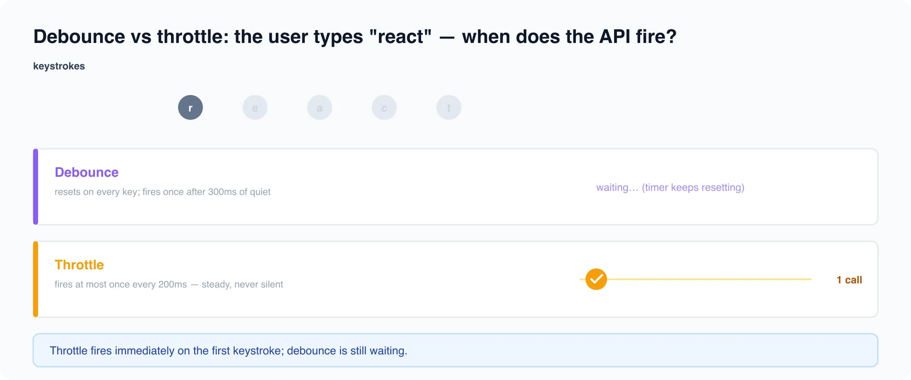

# Debouncing & Throttling

*3 min read · Updated 16 Jul 2026 Topic 39 of 62 Bookmark Mark done 8 · Topic 39 of 62*

**Source:** [https://www.geekyfrontend.in/learn/react-interview-kit/debouncing-throttling](https://www.geekyfrontend.in/learn/react-interview-kit/debouncing-throttling)

---

# 8.4 - Debouncing & Throttling

---

## 🎯 What Interviewers Actually Ask

| Question | Level | Frequency |
| --- | --- | --- |
| "What is debouncing?" | 🟡 | ★★★★★ |
| "What is the difference between debounce and throttle?" | 🟡 | ★★★★☆ |
| "Implement a debounced search input" | 🟡 | ★★★★☆ |

---

## The Difference

**Debounce:** Waits until the user *stops* doing something for a set delay, then fires once. Like a search input that waits until the user stops typing before calling the API.

**Throttle:** Fires at most once every X milliseconds, regardless of how many events happen. Like a scroll handler that updates a progress bar at most 10 times per second.

|  | Debounce | Throttle |
| --- | --- | --- |
| Fires when | User stops for X ms | At most once every X ms |
| Best for | Search input, form validation, resize | Scroll events, mouse tracking, rate-limited APIs |
| User types "react" | API fires once, 300ms after "t" | API fires multiple times during typing |

---



## useDebounce hook

jsx

jsx

```
function useDebounce(value, delay = 300) {
  const [debouncedValue, setDebouncedValue] = useState(value);

  useEffect(() => {
    const timer = setTimeout(() => setDebouncedValue(value), delay);
    return () => clearTimeout(timer);
  }, [value, delay]);

  return debouncedValue;
}
```

### Using it for search

jsx

jsx

```
function SearchBar() {
  const [query, setQuery] = useState('');
  const [results, setResults] = useState([]);
  const [loading, setLoading] = useState(false);
  const debouncedQuery = useDebounce(query, 300);

  useEffect(() => {
    if (!debouncedQuery.trim()) { setResults([]); return; }

    let cancelled = false;
    setLoading(true);

    fetch(`/api/search?q=${encodeURIComponent(debouncedQuery)}`)
      .then(r => r.json())
      .then(data => { if (!cancelled) { setResults(data); setLoading(false); } })
      .catch(() => { if (!cancelled) setLoading(false); });

    return () => { cancelled = true; };
  }, [debouncedQuery]);

  return (
    <div>
      <input value={query} onChange={e => setQuery(e.target.value)} placeholder="Search..." />
      {loading && <p>Searching...</p>}
      {!loading && results.length > 0 && (
        <ul>{results.map(r => <li key={r.id}>{r.name}</li>)}</ul>
      )}
      {!loading && debouncedQuery && results.length === 0 && <p>No results found.</p>}
    </div>
  );
}
```

---

## useThrottle hook

jsx

jsx

```
function useThrottle(value, interval = 500) {
  const [throttledValue, setThrottledValue] = useState(value);
  const lastRun = useRef(Date.now());

  useEffect(() => {
    const now = Date.now();

    if (now - lastRun.current >= interval) {
      lastRun.current = now;
      setThrottledValue(value);
    } else {
      const timer = setTimeout(() => {
        lastRun.current = Date.now();
        setThrottledValue(value);
      }, interval - (now - lastRun.current));

      return () => clearTimeout(timer);
    }
  }, [value, interval]);

  return throttledValue;
}
```

---

## ⚡ Common Mistakes

**Mistake 1: Debouncing the setter instead of the value.** Debounce the *value* and use it as a useEffect dependency. Don't try to debounce `setQuery` directly.

**Mistake 2: Not cancelling the previous request.** Without a `cancelled` flag or AbortController, old API results can overwrite newer ones (race condition).

**Mistake 3: Using throttle where debounce is needed.** Throttle for scroll/resize (continuous events that need periodic updates). Debounce for search input (want the final value only).

---

## 🗣️ Interview Answer

> "Debouncing delays execution until the user stops performing an action for a set time, like waiting for the user to finish typing before calling a search API. Throttling limits execution to once per interval, useful for scroll or resize events. I implement both as custom hooks: useDebounce returns a debounced value that I use as a useEffect dependency, and useThrottle does the same but fires at a maximum rate. The key is always to cancel in-flight requests when a new one starts, using a cancelled flag or AbortController."

---

## 📚 Module 8 Complete!

| # | Article | Core Concept |
| --- | --- | --- |
| 8.1 | fetch vs axios vs React Query | HTTP clients, AbortController, caching, interceptors |
| 8.2 | Loading, Error & Empty States | State cascade, skeleton screens, retry, empty UX |
| 8.3 | Authentication & JWT | Login flow, token storage, AuthContext, 401 handling |
| 8.4 | Debouncing & Throttling | Custom hooks, search optimization, race conditions |

---

## Learn More

- [Debouncing & Throttling explained css-tricks.com](https://css-tricks.com/debouncing-throttling-explained-examples/)
- [Lodash — debounce & throttle lodash.com](https://lodash.com/docs)
- [Debounce & throttle in 16 minutes YouTube](https://www.youtube.com/watch?v=cjIswDCKgu0)
- [Throttling & debouncing with examples YouTube](https://www.youtube.com/watch?v=E9XcoEMu1lk)
- [Fastest debounce & throttle explanation YouTube](https://www.youtube.com/watch?v=mPYDvHxInOU)
