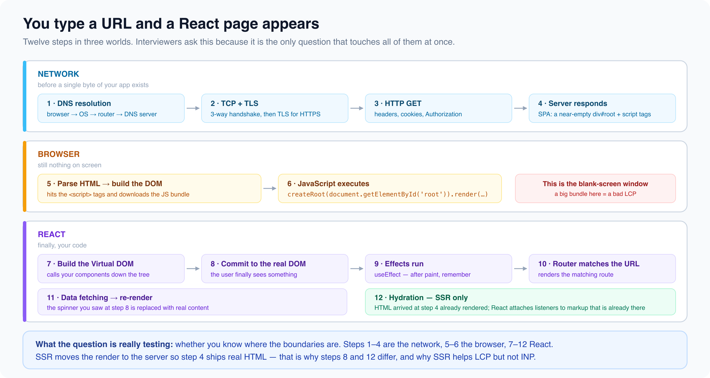

# Scenario: "Walk Me Through What Happens When You Type a URL and See a React Page"

*3 min read · Updated 16 Jul 2026 Topic 46 of 62 Bookmark Mark done 10 · Topic 46 of 62*

**Source:** [https://www.geekyfrontend.in/learn/react-interview-kit/scenario-walk-me-through-what-happens-when-you-type-a-url-and-see-a-react-page](https://www.geekyfrontend.in/learn/react-interview-kit/scenario-walk-me-through-what-happens-when-you-type-a-url-and-see-a-react-page)

---

# 10.4 - Scenario: "Walk Me Through What Happens When You Type a URL and See a React Page"

---

## 🎯 Why This Question Exists

This tests your understanding of the full stack: networking, server, browser, bundling, React initialization, and rendering.

---

## The Complete Sequence

### 1. DNS Resolution

The browser looks up the domain name and resolves it to an IP address (checking browser cache, OS cache, router cache, then DNS server).

### 2. TCP/TLS Connection

The browser establishes a TCP connection (3-way handshake). For HTTPS, a TLS handshake follows for encryption.

### 3. HTTP Request

The browser sends an HTTP GET request with headers (Accept, User-Agent, cookies, Authorization).

### 4. Server Response

For a React SPA (client-side rendered), the server responds with a minimal HTML file containing a `<div id="root"></div>` and `<script>` tags pointing to the JS bundle. For SSR (Next.js), the server runs React on the server and sends pre-rendered HTML.

### 5. Browser Parses HTML

The browser constructs the DOM. When it encounters `<script>` tags, it downloads the JavaScript bundles.

### 6. JavaScript Executes

React's entry point runs:

jsx

```
const root = createRoot(document.getElementById('root'));
root.render(<App />);
```

### 7. React Builds the Virtual DOM

React calls your component functions recursively down the tree, creating a Virtual DOM (a JavaScript object tree describing the UI).

### 8. React Commits to the Real DOM

React creates real DOM nodes from the Virtual DOM and inserts them into `<div id="root">`.

### 9. Effects Run

After painting, `useEffect` callbacks execute. Data fetching, event listener setup, and side effects happen here.

### 10. React Router Matches the URL

React Router checks the current URL against defined routes and renders the matching component. For `/products/42`, it matches `<Route path="/products/:id">` and provides `{ id: '42' }` via `useParams()`.

### 11. Data Fetching and Re-render

The matched component fires API calls. Loading states show while data is fetched. Once data arrives, state updates trigger a re-render with the actual content.

### 12. Hydration (SSR only)

If the page was server-rendered, React "hydrates" the existing HTML by attaching event listeners and state. The page was already visible but becomes fully interactive after hydration.

---



## 🗣️ Sample Answer

> "When you type a URL, the browser resolves the domain via DNS, establishes a TCP/TLS connection, and sends an HTTP GET request. For a React SPA, the server returns a minimal HTML shell with script tags. The browser parses the HTML, downloads the JS bundle, and React's `createRoot` mounts the App component. React builds a Virtual DOM, diffs it against the empty DOM, and commits real DOM nodes. After painting, useEffect callbacks run for data fetching. React Router matches the URL to the correct route component. If it's SSR with Next.js, the server pre-renders full HTML so users see content immediately, and React hydrates the page on the client to make it interactive."

---

## Learn More

- [How browsers work (MDN) MDN](https://developer.mozilla.org/en-US/docs/Web/Performance/How_browsers_work)
- [What happens when you type a URL? YouTube](https://www.youtube.com/watch?v=AlkDbnbv7dk)
- [Typing a URL — the full journey YouTube](https://www.youtube.com/watch?v=3109b5ZyvcU)
- [What happens when a user types a URL YouTube](https://www.youtube.com/watch?v=zp45ysqZTzU)
